# 班级工作台 2.0

> 给班主任和任课老师用的一套**班级工作台**：教师端与学生端共用一个网页入口，
> 数据全部存在自己的服务器上，不依赖任何第三方云服务。

当前版本：**2.0.37**（版本号唯一代码源：`app/server.py` 的 `VERSION`）

```
http://<服务器局域网 IP>:8080/        ← Docker 部署的入口；直接运行时是 :20020
├── /teacher/   教师端  —— 老师用电脑打开
├── /s/         学生端  —— 学生用电脑/手机打开
├── /typing/    打字冒险岛（学生练习 / 教师管理面板）
└── /api/act/   课堂活动接口（工作台内置；界面在教师端「大屏」页）
```

> 本文件是项目的**唯一说明文档**，整合了原先分散在 `docs/` 与 `app/` 下的全部说明。

---

## 一、它能帮你做什么

### 教师端 `/teacher/`

| 分类 | 模块 | 主要用途 |
|---|---|---|
| 常用 | **首页** | 班级概览、今日课程、本周德育加减分、待办提醒、学生入口二维码 |
| 常用 | **座位** | 拖拽排座、框选分组、课堂签到实时显示、按状态筛人、手动强制设定考勤状态、结算本节考勤 |
| 常用 | **课表** | 节次设置（含时间重叠校验）、按周排课、课程库、排课冲突提醒、星期栏吸顶 |
| 教学 | **大屏** | 选课程 → 选学习单 → 按班下发；课上实时看提交与数据大屏 |
| 教学 | **资料** | 资料库（资源管理器式）：树形目录 + 课程内子文件夹、上传 / 重命名 / 删除、网页可「设为学习单」、按班下发在线副本 |
| 教学 | **作业** | 布置作业、收交状态与提交率趋势、批量催交 |
| 教学 | **成绩** | 考试管理、成绩录入（支持批量粘贴）、平均分 / 及格率 / 优秀率、分数段分布、分析报告与导出 |
| 教学 | **打字** | 打字练习开关、中文词库年级、班级参与统计与排行榜 |
| 班务 | **班级** | 班级信息 · 进度 · 值日 · 分组 · 德育 五个页签；导入名单、导出 Excel / CSV / 图片 / PDF |
| 班务 | **学生** | 学生与家长卡片、账号状态、批量管理与重置密码、成长报告、通讯录导出 |
| 其他 | **待办** | 分类待办、截止日、完成率、逾期提醒 |
| 其他 | **工具** | 随机点名、计时器、番茄工作法、自定义快捷链接与二维码 |
| 其他 | **设置** | 学期与周次、主题与字号、待办提醒、密保、模块开关、软件更新、数据与备份 |

> 考勤已并入**座位**页；进度 / 值日 / 分组 / 德育已并入**班级**页；
> 旧的「活动管理」「课件库」「考勤」独立入口均已下线，旧书签会自动跳到对应页面。

### 学生端 `/s/`

电脑 / 手机浏览器打开即用，不用装任何 App。左侧（宽屏）或底部（手机）导航：
**今日 / 作业 / 科目 / 座位**（老师开放打字练习后再多一个「打字」）：

- **今日**：一键签到 + 今日课程（每节课的学习单入口）+ 待交作业 + 值日；座位卡点一下直接进座位表
- **作业**：本班全部作业与我的提交状态（已提交 · 待批改 / 已批改 / 逾期）
- **科目**：老师推送的课程与资料文件，点开即可在线预览
- **座位**：整间教室的座位表，自己的位置高亮标出，讲台永远画在上方（学生端整表镜像翻转，序号从最靠讲台那排、从右往左数，与老师口径一致）

学生只会看到**本班、本人**的数据；手机号、家长信息、其他同学的成绩在服务端就被裁掉了。
座位表是唯一会下发「同班同学姓名」的接口，给姓名、学号、座位号、小组与班干部职务
（与教师端座位卡同一套信息），**不含电话、成绩、内部 id，也不带考勤状态**。

学生端登录：选班级 → 选学号（下拉**只显示学号**，选中后姓名自动带出）→ 输密码。

### 课堂活动（工作台内置）

课堂活动内嵌在工作台自己的库里：活动、提交、附件都在 `workbench.db` 与
`data/activity/` 里，不需要任何额外的容器或第二套账号密码。活动接口在
`/api/act/*`（学生提交页、数据大屏、资料归档都按这个格式走），
附件在 `/static/uploads/<活动号>/<文件>`。

---

## 二、界面一览

下面每张图对应一个功能模块。截图取自一套**演示数据**（所有姓名、电话均为虚构）。

### 1. 教师登录

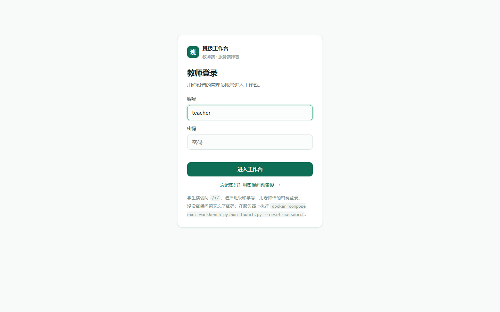

第一次打开会让你设置管理员账号与密保问题；之后用账号密码进入。
忘记密码可以点「忘记密码？」用密保自助重设。

### 2. 首页 `#home`

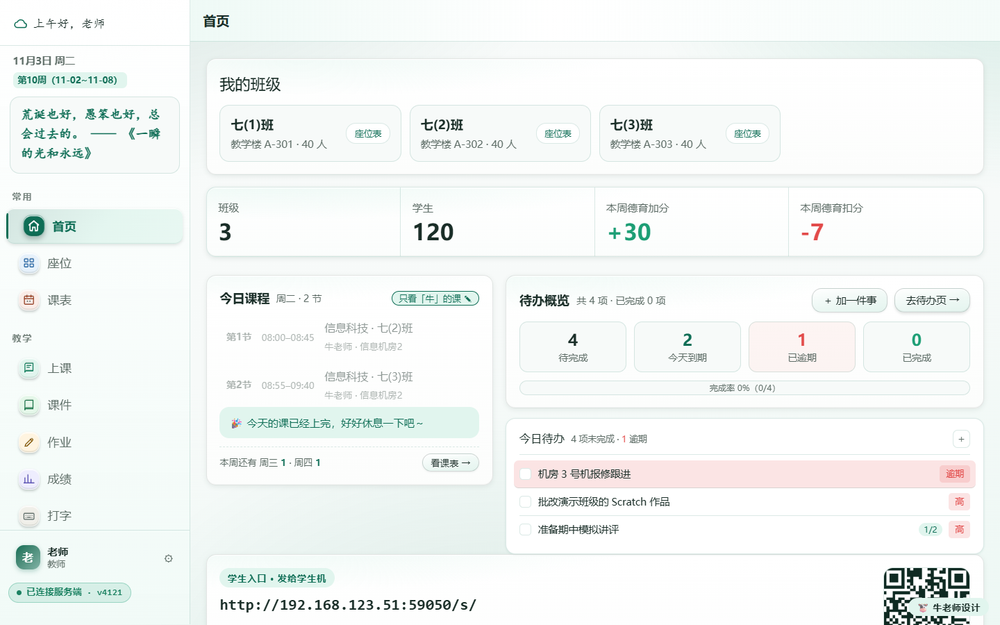

进门第一屏：我的班级、学生总数、本周德育加减分、今日课程、待办概览（含逾期提醒），
右下角是发给学生的入口二维码与地址。

### 3. 座位 `#seats`

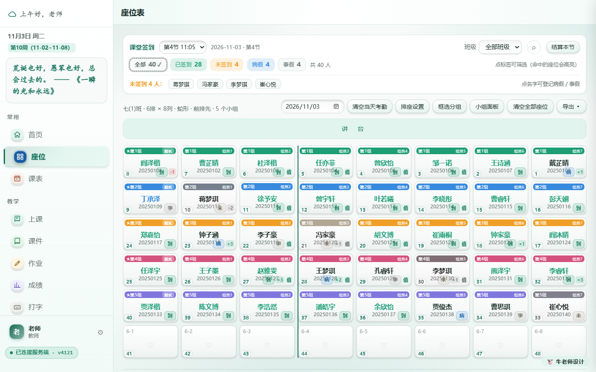

按教室座位排布，支持拖拽调位、框选分组。上课时「课堂签到」会实时把已签到的学生标绿，
顶部标签点一下就能筛出**未签到 / 迟到 / 病假 / 事假**的人。点击学生在面板里：

- 标**病假 / 事假**（再点一次取消）；
- **强制设置本节考勤**（任意状态，🔒 标记；强制后学生再签到也不会改写，直到解除）；
- 最后「结算本节」。

标题下会写明 **共 X 排 Y 列**。排座配置（行列数 / 蛇形或横竖排 / 起点 / 讲台方位）
自动同步到服务端，学生端座位表读的就是这一份，两端永远是同一张图。

### 4. 课表 `#timetable`

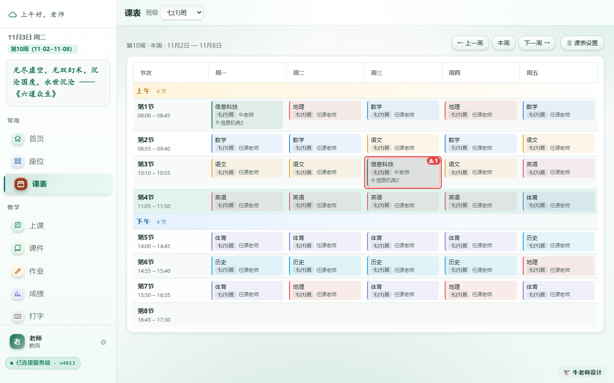

先设节次，再按天排课；切到单个班看本班课表，切到「全部班级」看全周。
同一时段给同一个老师排了两个班，格子会标红提示冲突。**星期栏吸顶常驻**：
上下滚动时星期标题固定在顶栏下方，桌面端与移动端都生效。

### 5. 大屏（课堂活动）`#guide`

选课程（文件夹名即课程名）→ 选学习单（三选一：设计器刚生成的页面 > 资料里「设为学习单」的网页 > 默认模板）→ 按班「下发」。学生端「今日」对应课程立刻出现「进学习单」入口；
下发时自动把本班学生数据（花名册）挂到学习单上，学生打开即带身份。课上在这里看提交与数据大屏。
**选课程即归属**：学生作品与提交数据会自动归档到「资料」里同名课程文件夹（新提交到达后增量归档）；
课程与文件的管理统一在「资料」页操作。「自定义学习单」设计区默认收起，点「＋ 新增自定义学习单」展开；
设计稿「💾 保存到资料」时弹窗选课程 / 子文件夹并支持重命名。

### 6. 资料 `#courseware`

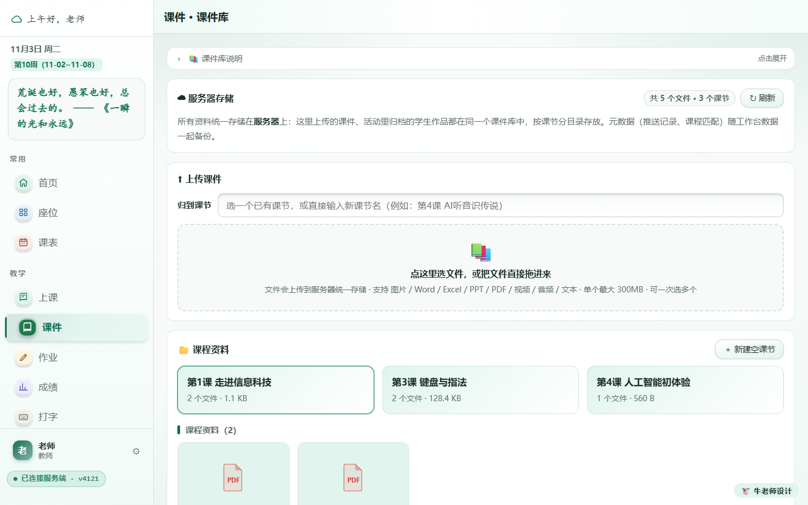

资料按「课程文件夹」归档在服务器上，资源管理器式界面：左侧树形目录（课程 → 子文件夹，
可拖动分隔条调宽），右侧列表给出**名称 / 类型 / 大小 / 修改时间**。
支持 Word / Excel / PPT / PDF / 视频 / 音频 / 图片，单个最大 300 MB，可批量上传；
勾选多个文件可批量删除 / 移动 / 一键下发；**活动归档**（学生作品）只读，不参与下发。
三种浏览视图（缩略图 / 列表 / 紧凑）记在本机。网页文件可「🗒 设为学习单」，下发时自动部署。

**类型识别与缩略图规则**：文件类型按**扩展名**判定——
`png/jpg/gif/webp/svg…` → 图片；`mp4/mov/mkv…` → 视频；`mp3/wav/flac…` → 音频；
`pdf` → PDF；`ppt/pptx/doc/docx/xls/xlsx/wps…` → 文档；`txt/md/csv/html/py/js…` → 文本；
认不出的扩展名 → 文件。缩略图视图（大卡片）里：图片 / 视频直接显示内容；
网页（.html）与 PDF 内嵌文件本体当封面；PPT / Word / Excel 由服务端
（`app/core/ooxml_preview.py`，纯 Python 解析 OOXML）渲染成页面当封面，
结果按「文件名+大小+修改时间」缓存，首次渲染后秒开；列表 / 紧凑视图仍用轻量图标。

### 7. 作业 `#homework`

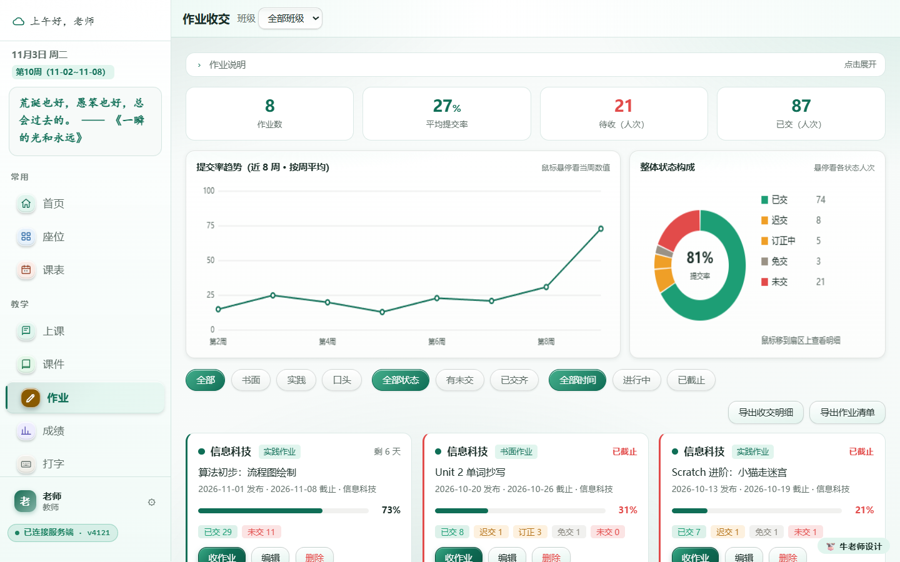

顶部是提交率趋势与状态构成，下方按作业列出每个人的状态，可批量催交、导出收交明细。

### 8. 成绩 `#scores`

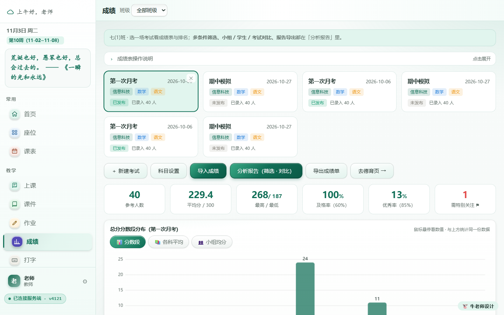

一场考试一张卡片：参考人数、平均分、最高 / 最低、及格率、优秀率、分数段分布；
「分析报告」支持多维筛选与班级 / 小组对比。

### 9. 打字 `#typing`

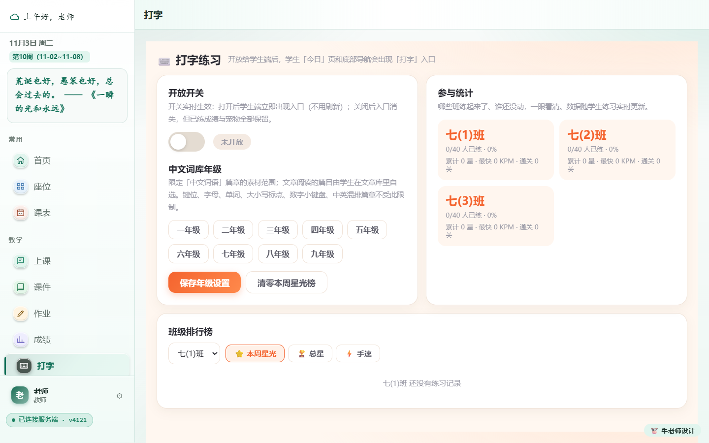

一键开放给学生，学生端立即出现「打字」入口；这里看各班参与率、最快速度与本周星光榜。

### 10. 班级 / 学生 / 待办 / 工具 / 设置

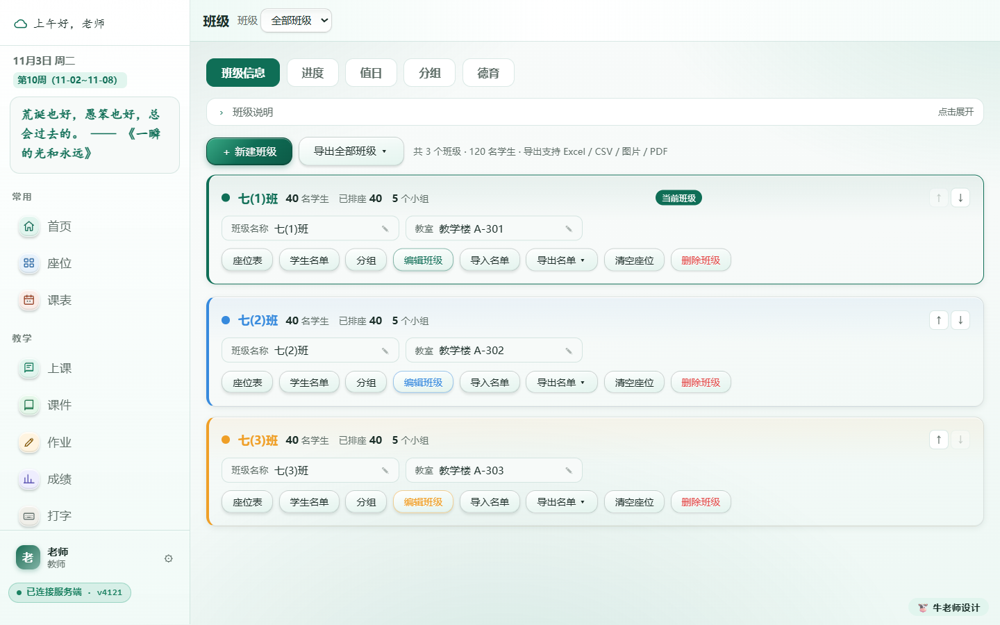

班级页五个页签管 **班级信息 / 进度 / 值日 / 分组 / 德育**；学生页管账号初始化、重置密码
（弹窗预填 6 位易读密码，默认勾「首次登录后要求学生自行修改」）、成长报告、通讯录导出；
待办分「今天 / 本周 / 全部」；工具含随机点名、计时器、番茄钟、自定义链接二维码；
设置里有主题字号、密保、模块开关、**软件更新**与**数据与备份**。

### 11. 学生端

学生打开 `/s/`：选班级 → 选学号 → 输密码。

| 今日 | 作业 | 科目 | 座位 |
|---|---|---|---|
| 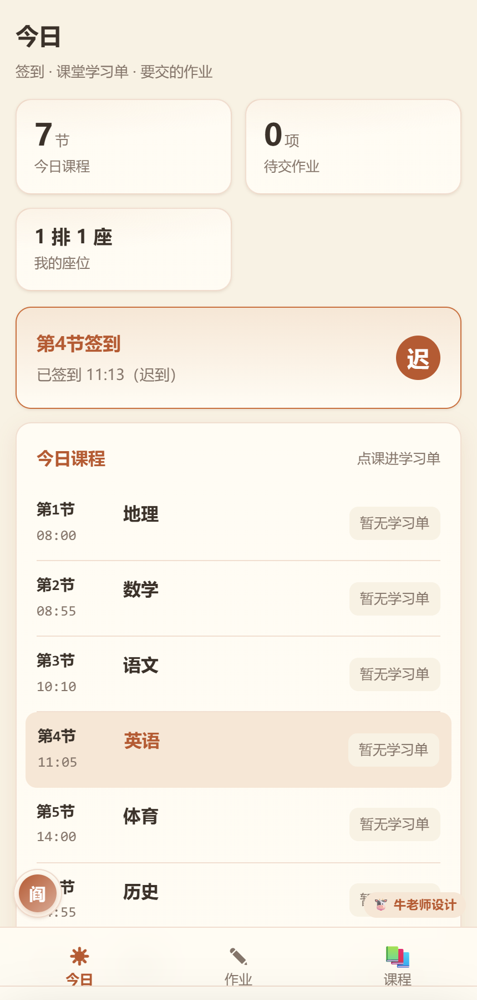 | 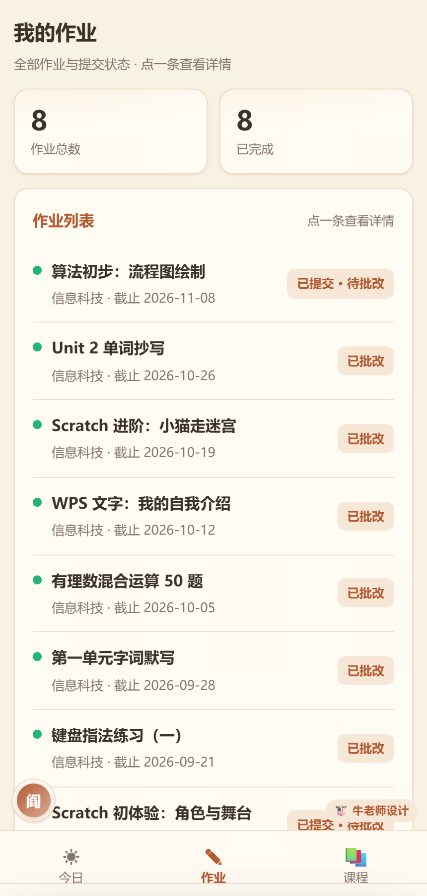 | 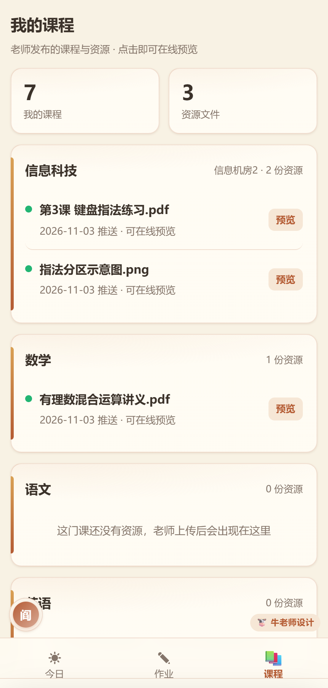 | 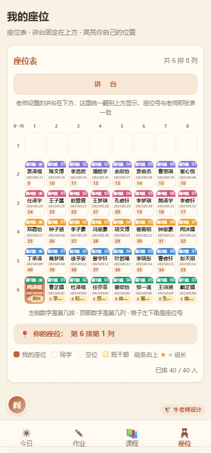 |
| 一键签到、今日课程与学习单入口、待交作业 | 全部作业与我的提交状态 | 老师推送的课程资源，点开在线预览 | 全教室座位表，自己那格高亮 |

> 学生端网页图标是橙底「学」字，与教师端绿色「牛师」图标区分。
> 想放到桌面：手机浏览器「添加到主屏幕」，或电脑右键 → 新建 → 快捷方式，填 `http://服务器IP:端口/s/`。

---

## 三、三端架构与运行形态

```
学生机 / 教师机浏览器 ──局域网 HTTP──▶ 统一入口（gateway nginx :8080）
                                        └── workbench 容器（:20020，容器网络内）
                                             ├── /teacher/   教师端
                                             ├── /s/         学生端（直连服务端）
                                             ├── /api/v2/*   同步 / 鉴权 / 业务
                                             └── /api/act/*  课堂活动
```

| 角色 | 职责 |
|---|---|
| **服务端（NAS Docker）** | 唯一主库（29 张表）+ 账号权威 + **唯一时间源** + 实时事件推送（SSE）+ 页面渲染。三个容器：`init`（初始化/迁移）→ `workbench`（主服务）→ `gateway`（统一入口） |
| **教师端** | 浏览器里的操作界面，不常驻任何进程。任何改动 → 服务端记变更（全局版本号 rev）→ 学生端 SSE 收到信号拉增量（浏览器端 `netsync.js` 每 1.5 秒兜底轮询） |
| **学生端** | 登录签到、打开学习单、作答提交、查看反馈。**直连服务端**，学生机可联网；所有静态资源本地化，零外链依赖 |

**关键口径：**

- **服务端时间是唯一时间源**：签到节次、考勤判定、缺勤扫描一律服务端计算（`/api/v2/student/now`、`/api/v2/teacher/now`），各端只做显示；
- **数据投影**：学生端只拿得到「本班 + 本人」的字段投影；手机号、家长信息、他人成绩在服务端就裁掉。关闭某模块时，学生端入口消失、接口直接 403；
- **容器内不按 IP 判身份**，按会话角色判定教师 / 学生；
- **服务端启动横幅会按网卡打印多条学生端地址**：一张网卡一条。物理网卡（如 `192.168.x.x`）是给学生用的；`172.x.x.x` 多为 Hyper-V / WSL / Docker 虚拟网卡，只有本机打得开，属正常现象。

---

## 四、部署

同一套程序、同一份数据格式，两种装法，随时可以互相搬家：

| | 方式一：直接运行 | 方式二：Docker（推荐） |
|---|---|---|
| 适合 | 教师机、笔记本、机房临时使用、无外网环境 | NAS、常开小主机、正式长期部署 |
| 前置 | Windows 10+ / macOS，Python 3.9+（或带运行时的离线包） | 装好 Docker 与 Compose |
| 启动 | 双击 `启动教师端` | `docker compose up -d --build` |
| 对外端口 | `20020` | `8080` 一个端口全包 |
| 开机自启 | 需自行加计划任务 | 随 Docker 自启 |

**共同部署前准备：** 学生设备与服务器同一局域网（机房关闭 AP 隔离）；服务器设固定 IP
或 DHCP 保留；预留 20 GB 以上磁盘；防火墙放行对外端口；服务器不休眠。

### 方式一：直接运行

1. 解压 / 克隆到本地（路径尽量不含空格）；Windows 双击 `app\启动教师端.bat`，macOS 双击 `app/启动教师端.command`；
2. 浏览器打开 `http://127.0.0.1:20020/`；学生访问 `http://<这台电脑的局域网 IP>:20020/s/`。

常用启动参数：`--port 20021`（换端口）、`--no-browser`、`--reset-password`（忘记教师密码）、`--no-dialog`。
首次运行 Windows 防火墙弹窗必须允许「专用网络」。

### 方式二：Docker

```bash
git clone https://gitee.com/shyxiaoniu/teacher-workbench.git
cd teacher-workbench
cp .env.example .env          # 正式使用至少改 WEB_PORT
docker compose up -d --build
```

`docker compose ps` 里 `workbench`、`gateway` 都是 `healthy` 即就绪（`init` 跑完即退，正常）。

`.env` 关键项：`WEB_PORT`（唯一对外端口）、`TZ=Asia/Shanghai`（不要动，考勤按本地日期归档）、
`WB_PUBLIC_URL`（前面再套反向代理时才填）、`WORKBENCH_VOLUME`（命名卷名，不要动）。

常用运维：

| 目的 | 命令 |
|---|---|
| 看状态 / 日志 | `docker compose ps` / `docker compose logs -f workbench` |
| 升级 | `docker compose up -d --build`（数据不丢） |
| 停止（保留数据） | `docker compose down`（**别加 `-v`**，会删数据卷） |
| 忘记教师密码 | `docker compose exec workbench python launch.py --reset-password` |

---

## 五、第一次使用与课堂流程

**建班流程：** ①「班级」页建班级 → ②「学生」页导入名单（支持表格粘贴）→
③「课表」页设节次、按周排课 → ④「学生端控制台」设密码策略（统一初始密码 / 独立密码 /
首次登录必改 / 一键重置）→ ⑤「资料」页建课程文件夹、上传文件 → ⑥「大屏」页选课程下发。

**一堂课的典型用法：**

| 环节 | 老师做什么 | 学生做什么 |
|---|---|---|
| 课前 | 「大屏」选好课程与学习单，点「下发」 | —— |
| 上课 | 打开「座位」，投屏学生入口 | 打开 `/s/`，进入「今日」 |
| 签到 | 座位表实时看到谁已签到，可点标签筛人 | 点「一键签到」 |
| 课中 | 学生点开学习单作答，大屏实时看提交；资料可随时补发 | 在学习单里答题 / 传文件 |
| 课后 | 座位页「结算本节」；强制/请假登记收尾 | 在「科目」里回看资料 |

**考勤规则（服务端判定）：**

| 状态 | 判定 |
|---|---|
| 出勤（已签到） | 本节时间窗内登录（课表开始 5 分钟内） |
| 迟到 | 超过开始 5 分钟才登录 |
| 缺勤 | 开始 15 分钟仍未登录且未请假，自动记录；之后到堂登录改判「迟到」并留痕 |
| 病假 / 事假 | 教师手动登记，优先级最高，不被签到覆盖 |
| 🔒 强制 | 教师在座位面板「强制设置本节考勤」任意指定；**学生再签到也不改写**，直到教师解除 |

- 签到时间窗 = 上一节下课 +1 分钟 ~ 本节下课（当天第一节保留课前 15 分钟）；已下课不补签；
- 课间时段按「下一节有排课」归属，提前到机房不算迟到；
- 本班该节没排课不产生考勤（防假全勤）；课表 0 条时不拦；
- 未排课时段 / 作息表没填时间从宽处理。

---

## 六、课堂活动与学习单（闸门 + 票据机制）

一句话：**数据服务地址、任务号、学生身份，一个都不出现在学生页面上。**
教师端配一次，学生点开即用，答完自动进大屏。

### 数据落在哪

| 内容 | 位置 |
|---|---|
| 活动 / 提交 / 附件记录 | `<数据目录>/workbench.db`（act_task / act_submission / act_file 表，提交的 `sid/name/cls` 单独成列，按班统计直接查库） |
| 附件文件 | `<数据目录>/activity/<活动号>/<随机名>.<ext>`，对外 `/static/uploads/<活动号>/<文件>` |
| 附件上限 | 单文件 / 整份提交各 40MB；备份打包时 >10MB 或合计 >40MB 会跳过并点名，不静默丢 |

### 一次完整链路

```
① 教师端「大屏」：选课程 → 选学习单 → 按班下发
   （每班各推一份花名册 + 部署学习单页面 + 写 activity_pushes）
② 学生端「今日」：SSE 实时收到，对应课程行出现「进学习单」
③ 浏览器打开 /g/act/<push_id>   ← 同源闸门，带登录 Cookie
④ 服务端：验会话 → 验本班 & 已发放 → 验签到 → 签票
   302 到学习单页，票与身份拼在 URL 上（wbT/wbSid/wbName/wbCls/wbTask/wbBase）
⑤ 每次提交 → POST /api/v2/student/submit?t=<票>
⑥ 服务端：验票 → 用票里的身份覆盖页面填的学号（防冒名）→ 落库 → 大屏实时出现
```

- 票据只存内存（重启即失效，学生重开一次学习单即可），默认 12 小时有效；
- 学习单页面统一部署在 `/submit/custom.html?task=<任务号>`，页面存提交服务 `custom_templates`，改版随「下发」强制部署，该页 `Cache-Control: no-store`；
- 「下发」用的页面优先级：设计器刚生成 > 课程资料里被「设为学习单」的那份网页（自动识别，无需下拉）> 默认模板；
- 学生两个入口都通到这里：`/g/act/<发放id>`（今日·课堂活动）与 `/g/mat/<资料id>`（资料里点那份学习单）。资料入口在「该班已发放」时走完整闸门；已收回 / 从未发放时直通本节链路（带身份票、真提交按钮），不会再退回 `/cw` 原始网页（那会落进页面自带的「预览模式」兜底）；
- 签到闸门：今天一笔有效签到都没有（或缺勤）→ 学习单打不开，先回学生端签到；两个入口标准一致；
- 活动管理接口（教师端专用，走 `/api/v2/teacher/activity/*`）支持列表 / 导出 CSV·JSON / 删除 / 清空。

---

## 七、资料库（教师端「资料」页）

- **目录即数据**：文件按 `<课件根目录>/<课程文件夹>/<子文件夹>/<文件>` 存放，不维护索引；
  老师用资源管理器手动拷文件进去，刷新就能看到；拷走整个目录就是完整备份；
- 左侧树：课程文件夹（新建 / 重命名 / 删除）→ 课程内**子文件夹**（新建 / 点进 / 删除空文件夹），
  文件可在课程内「移入」子文件夹；分隔条可拖动调宽（双击复位，宽度记本机）；
- 上传：单文件最大 300MB，**流式直传**（浏览器 fetch body=File，服务端 256KB 分块落盘，
  前后端内存占用恒定，大文件不崩页）；同名自动加「（2）」；
- **设为学习单**：.html 文件可标记为本课程的学习单（存服务端配置，重启不丢；
  课程改名标记跟着走、文件删除自动失效）——「大屏」选这门课时自动预选；
- **下发**：勾选文件 → 选班级 → 学生端拿到**在线查看副本**（只读，动不了原文件）；
  推送记录可一键撤回；下发的学习单自动带上本班学生信息；
- 访问控制：只对教师账号开放管理；学生端只能看被下发的副本。

---

## 八、打字冒险岛

定位：信息科技机房课的打字训练系统，教师一键开关，学生端零安装。

- **六大篇章渐进主线**：键位熟悉 → 字母位置 → 英文单词 → 大小写标点 → 中文词语 → 课文句子（另有数字小键盘、中英混排篇章）；每章每卷 10 关，第 10 关 BOSS，卷号无限递增、难度按卷爬坡；
- **关卡内容随机化**：除「读文章」篇章按句序推进外，每个关卡在重玩 / 重置 / 刷新时都随机生成新内容（伪随机种子含每次进关的 nonce），防止背顺序；
- **反馈感**：逐字变色、实时速度 / 准确率、三星结算（通关 ≥90%；⭐⭐ 速度线；⭐⭐⭐ 速度线 ×1.3 且 ≥97%）、指法高亮随按键走（头顶 ⇧ 角标、错字红标、课文行永远显示原文）；
- **收集欲**：8 只原创宠物（SVG 零外部资源），BOSS 首通掉宠物蛋，装扮按累计星数解锁；
- **排行榜**：星光榜（本周）/ 总星榜 / 手速榜，只展示名字与成绩；教师端可重置周榜；
- **教师主权**：开关 + 年级词库限定中文素材范围；成绩由服务端按公式重算（不信任客户端）；
- **技术落点**：`app/typing/typing-data.js`、`levels.js`（引擎）、`student.html` / `teacher.html`（两端页面，iframe 内嵌）、`app/core/typing_store.py`（独立 JSON 存储）。
  未登录可打开但为演示模式（禁止提交）。

---

## 九、数据、备份与换机

### 数据存在哪

| 部署方式 | 位置 |
|---|---|
| Docker | 命名卷 `teacher-workbench-data`（`/app/data`：29 张表 `workbench.db`、课件库 `courseware/`、活动附件 `activity/`、打字 `typing.json`、每日快照）；`down` 不删，`down -v` 才删（**危险**） |
| 直接运行 | 项目 `app/data/` 目录 |

### 备份与恢复

**设置 → 数据与备份 → 一键导出全量备份**：设一个备份密码（≥6 位），得到 `.cwbackup`
加密文件，内含整库 29 张表 + 全部配置 + 教师 / 学生口令哈希（只存哈希）+ 打字成绩 +
学生作品附件（单个 ≤10MB、合计 ≤40MB，超出点名跳过）+ 浏览器界面设置。
课件大文件用旁边的 **导出资料包** 单独打包（保留课程子目录）。

**换机两步**：新环境装好并登录 → 一键恢复（选文件 + 同一密码）→ 有课件再导入资料包。

导入前置校验：空表 / 本机有数据而备份 0 行 → 拒绝；本机 ≥5 行且备份 <40% → 需二次确认（force）。
失败一定不改动任何数据。每天首次启动自动快照，保留 14 份。
**不要手工拷数据库文件迁移。** 导入只替换数据、不替换解锁密码。

---

## 十、版本、发行包与在线更新

### 版本号维护

发版按顺序核对 5 处（缺一处就会出现「界面显示 2.0、镜像却是别的 tag」）：

| # | 文件 | 位置 |
|---|---|---|
| 1 | `app/server.py` | `VERSION = "2.0.37"` —— **唯一代码源** |
| 2 | `.env.example` | `IMAGE_TAG=2.0.37` |
| 3 | `docker-compose.yml` | `image: …:${IMAGE_TAG:-2.0.37}`（init 与 workbench **两处**） |
| 4 | `README.md` | 文首「当前版本」 |
| 5 | `version.json` | 由 `tools/make_release.py` 自动同步 |

不要跟着改的「版本」：`app/core/store.py` 的 `SCHEMA_VERSION`（表结构版本）、
`app/backup.js` 的 `VER`（备份格式版本）。

版本规则（2026-11-04 定版）：以 **2.0** 为基线，**每次改动更新都在后面追加序号**
（2.0.1 → 2.0.2 → 2.0.3 …），便于逐次追踪；主版本 / 次版本号只在数据表破坏性
变更或大改版时才动。`app/updater.py::vtuple` 按段比较数字，2.0.1 > 2.0 判定天然成立。

### 发行包

```bash
python tools/make_release.py                 # 版本取 VERSION，日期取当天
python tools/make_release.py --out D:\dist   # 指定输出目录（默认 dist/）
```

命名 `班级工作台<版本>-<yyMMdd>.zip`。脚本自动跳过运行期数据（`app/data/`、课件库、
附件、日志、`.git`、`__pycache__`），产物在 `dist/`（已被 .gitignore 忽略）。
包里：启动脚本 + `app/` 全部程序 + docker 全套 + `docs/shots/` 截图 + README + LICENSE。
解压即用的空白工作台，不含任何真实数据。

> **Gitee「发行版」页面为空是正常的**：仓库里的 `dist/` 只是一个普通目录（构建产物），
> 和 Gitee 的「发行版（Releases）」功能是两回事——后者需要在 Gitee 网页上手动
> 「创建发行版」并上传 zip 才会有内容。在线更新走的是 `version.json`（manifest）+
> raw 直链，不依赖 Releases 功能；想把 zip 同时挂到 Releases 也可以，把
> `version.json` 的 `zip` 字段改成完整 URL 即可。

### 导入名单按钮吸底（2.0.31；截图工具已于 2.0.32 移除）

**① 导入名单弹窗：确认按钮吸底**

| 项 | 说明 |
|---|---|
| 结构 | `showFloat(title, body, {footer})` 新增 `footer` 插槽 → `.float-box` 变成「标题栏 + 滚动 body + 固定 footer」三段 |
| 样式 | `.float-foot{flex:none; border-top; padding:11px 15px; 极淡上投影}`，与其它弹窗同一套配色 |
| 效果 | 名单几十行时只有中间列表滚，`确认导入 / 取消` 永远贴在弹窗底部；底部还带一句「共 N 人，确认无误后点左边按钮」 |
| 兼容 | 不传 `footer` 的弹窗结构完全不变 |
| 顺手修 | `openImportClass` 用 `x.id === Number(id)` 严格比，id 是字符串时找不到班 → 点「导入名单」没反应；改成字符串比 |

**② ~~教师端工具页 · 截图工具~~（2.0.32 已按要求整体删除）**

> 下面这段只作为历史记录保留。2.0.32 起：教师端工具页没有「截图工具」卡片，
> 整套画布 / 标注 / 推送代码与 `/api/v2/tool/*` 接口全部移除，
> 学生端「课堂工具」页与今日页截图卡也一并下线。

- 工具页「内置工具」第一张卡：📷 截图工具，点开是全屏工作区（不是浮窗）。
- 参照微信截图：**拉框选区 → 标注 → 保存/复制/推送**。
  - 6 种标注：矩形 / 椭圆 / 箭头 / 画笔 / 文字 / 马赛克（马赛克从底图采样后降采样，再关插值放大）。
  - 5 种颜色 + 3 档线宽，撤销、重选区。
- 取图三条路：`getDisplayMedia` 截屏（**只在 127.0.0.1 / https 可用**）、`Ctrl+V` 粘贴、拖入/上传图片。
  局域网 `http://192.168.x.x` 下浏览器不给屏幕捕获，页面里直接写清楚，引导用粘贴。
- **一键推送**：`POST /api/v2/tool/push`（教师）→ 存 `<账号目录>/tools/<id>.png` + `index.json`，
  只保留最近 12 张。

**③ ~~学生端工具页~~（2.0.32 已删除）**

| 位置 | 当时的实现 |
|---|---|
| 底部/侧边导航 | 「🧰 工具」，排在「资料」后面（现已移除） |
| 工具页 | 显示最新一张推送（现已移除） |
| 今日页 | 「老师刚推送的截图」小卡（现已移除） |
| 接口 | `GET /api/v2/tool/latest`、`GET /api/v2/tool/img?id=`（现已 404） |

### 归档文件名还原 / 学号-姓名目录 / 学习单身份兜底（2.0.37）

**① 归档文件名乱码（`作业.txt` → `作业.txt`）**

- 新增 `app/core/textfix.py`：`fix_filename()` 负责把三种错码还原成正常中文
  （surrogateescape 残渣、UTF-8 被当 latin-1、`%XX` 百分号编码），
  正常中英文原样返回，不做多余转换。
- 三个入口统一过一道：`parse_multipart` 解析上传名 → `act_file.orig` 入库 →
  归档复制（旧记录里已经存成乱码的也在这一步还原）。
- 归档目录固定为 **`学号-姓名`**（`01-张三`）；2.0.36 已建过 `01张三` 的，
  同班沿用老目录，不会给同一学生开两个文件夹。
- 原始名认不出（只剩服务端落盘的 12 位 hex 名）→ 改名为 `学号-姓名.扩展名`。

**② 资料里删文件后跳回课程根目录**

- `cwPickCourse()` 以前**无条件** `cwState.sub = ''`，删除 / 上传后的刷新
  都会把视图推回课程根目录。现在只有「真的换了课程」才重置；
  子文件夹被删 / 改名时才回退。
- 点左侧课程名仍回根目录（`cwPickCourseRoot()`），行为不变。

**③ 重新登录后学习单提示「本页未从教师端打开」**

- 根因：学生拿到的是**原始 `/cw/…html`**（没有注入运行时、URL 也没有
  `wbSid`），模板 900ms 等不到 `.act-submit-btn` 就退化成预览模式，身份自然是空的。
- 三处补齐：
  1. `/submit/custom.html`：已登录学生打开、但票缺失 / 过期 / 不是本人 / 不是这份学习单
     → 按会话身份**重签一张票**再 302 回同一页（不会循环）；
  2. `/g/mat`：网页资料 + 本课程有部署好的学习单页 → 走注入页，
     **不再要求老师先点过「设为学习单」**；
  3. `/cw/<网页>`：学生打开的是某门课的学习单 → 转 `/g/mat` / 注入页。
     判据用「标题 / 正文指纹对得上部署页」或「本班这门课只有这一份网页」，
     同课程其他 html 照旧打开原件。

### 学生提交的文件自动归档到资料（2.0.36）

**① 目标文件夹对应规则**

```text
<课件根>/<课程>/<班级>/<学号-姓名>/<学生上传的原文件名>
例：courseware/信息科技/七1班/20250108-张三/作业.docx
```

| 路径段 | 取值来源 | 缺省兜底 |
|---|---|---|
| 课程 | `act_task.course`（大屏选课程时写进服务端） | 空则看活动标题是否正好是已有课程名；都不是就**不猜、不建目录** |
| 班级 | 学生登录票里的班级（每次提交自带） | 空 → `未分班` |
| 学号-姓名 | `act_file.orig` 同时记录的学生身份 | 缺一留一，都没有 → `未命名学生` |
| 文件名 | 学生上传时的原始文件名（不是 uuid） | 同名不同内容 → `名字 (2).docx`，**永不覆盖** |

**② 触发条件与流程（改成服务端在提交时做）**

```text
学生点提交
  → 服务端落盘 act_file（<账号>/activity/<活动>/<uuid>）
  → 立刻调用 CW.archive_items() 复制到 <课程>/<班级>/<学号-姓名>/
  → 写归档索引 archive-index.json（清空提交时按它删副本）
  → 返回提交结果（带 archived=N）
```

- **不再依赖老师打开大屏**：以前是前端 `cwArchiveTick()` 在大屏刷新时顺带归档，
  老师没开大屏 / 页面关掉就永远不归档，这是「交了文件资料里没有」的主要原因。
- 前端自动归档保留为**补偿**：只补历史提交、以及「提交时还没绑定课程、后来才选课」的情况；
  失败不记账，下次刷新会重试。

**③ 这次修掉的四个坑**

| 环节 | 问题 | 修法 |
|---|---|---|
| 路径匹配 | `static/uploads/<活动>/<文件>` 被多加了一层 `activity/`，拼成 `activity/activity/…`，本地直读永远失败 | `_rel_from_url()` 只保留 `<活动>/<文件>`，再逐个候选目录拼 |
| 目录范围 | 只认 `<数据目录>/activity`，多教师账号的附件在 `accounts/<id>/activity/` | `_activity_dirs()` 列出当前账号 + 数据根 + 各账号目录（仍做 commonpath 校验） |
| 下载兜底 | 前端把 `…/api/act` 当 base，拼出 `…/api/act/static/uploads/…` → 404 | `_norm_base()` 还原成站点根；前端也改传 `location.origin` |
| 课程归属 | 选课程只改内存字段，服务端读不到 `course` | 选课时 `POST /api/v2/teacher/activity/save` 持久化（加载时的程序性选中不覆盖已有归属） |

**④ 边界情况**

| 情况 | 行为 |
|---|---|
| 纯数据提交（没有文件） | 不建任何文件夹、不写 `act_file`，只留提交数据 |
| 同一文件重复提交 | 大小一致 → 视为已归档，`archived=0` |
| 同名不同内容 | 存成 `名字 (2).ext`，原文件不动 |
| 提交时课程还没绑定 | 本次不归档；老师选好课程后前端补偿归档（含历史提交） |
| 归档失败（目录不可写等） | **不影响提交**，`audit` 记一条 `auto-archive-fail`，大屏仍可手动「归档」 |
| 清空提交 | 按索引删除该活动**所有班级**下的副本，并收掉空的学生/班级文件夹 |
| 历史 `_sheet` 存档 | 2.0.35 起不再产生；旧文件仍在活动目录，不参与归档 |

### 学习单不再存整页 HTML 存档：只留学生交的文件（2.0.35）

**① 改了什么**

| 层 | 2.0.34 及以前 | 2.0.35 |
|---|---|---|
| 学生提交页 | 提交瞬间克隆整页、回填答案，作为 `__archive` 一起发 | **不再生成快照**（`actArchiveHtml` 已删），只发字段 + 当前任务块里的文件 |
| 服务端 | `_sheet_archive()` + `core/sheet_archive.py` 清洗后落 `.html` | 两个提交口都 `fields.pop("__archive", None)` 直接丢弃（防老页面缓存） |
| 存储 | `data._sheet` + `act_file` 里一行 `.html` | 只存 `data`（字段）与 `attachment` + `act_file` 里的真实文件 |
| 大屏「文件」列 | 📄 存档 + 📎 附件 | 只有 📎；没交文件显示「—」 |
| 归档 | 会把 `.html` 当作品一起搬进资料 | 只搬真实文件；没文件只写提交数据 CSV |

**② 适用范围**

只影响**课堂学习单（活动提交）**：`/api/v2/student/submit`（带票）与
`/api/act/<活动>`（匿名口）。作业收交、资料上传、课程文件、作品归档的目录结构
（`<课程>/<班级>/<学号+姓名>/`）都不变。

**③ 边界情况**

| 情况 | 行为 |
|---|---|
| 学生交文件 | 文件原样落 `act_file`，`data.attachment` 回填，大屏可在线预览、归档进学生文件夹 |
| 学生只填文字 | 只写 `act_submission.data`，不写盘、不产生 `act_file` 行、不生成归档文件夹 |
| 浏览器还拿着旧页面（缓存/未刷新） | 仍会发 `__archive`，服务端丢弃：不落库、不落盘、响应里没有 `sheet`，不报错 |
| 历史数据里的 `_sheet` | 不再展示、不再归档；`.html` 文件仍留在 `<数据目录>/activity/<活动>/`，需要清理可手删 |
| 同一个学生先交文件后只交数据 | `actKeepFiles()` 只继承附件，文件不丢；`_sheet` 不再参与合并 |
| 归档时一条文件都没有 | 只写 `-提交数据.csv`（附件数为 0），不建班级/学生文件夹 |

### 学习单提交按任务类型分流：文件任务 / 纯数据任务（2.0.34）

**① 适用范围**

只作用于**课堂学习单（活动提交）**这一条链路：学生端点学习单里的提交按钮 →
`/api/v2/student/submit`（带票）或 `/api/act/<活动>`（匿名口）。作业收交、资料上传、
作品归档这些功能不走这套判断，行为不变。

**② 判断条件（三级，先细后粗）**

| 顺序 | 依据 | 说明 |
|---|---|---|
| ① | 前端 `__kind` | 点提交时看**当前题目块**里有没有 `input[type=file]`（或块上写了 `data-need-file="1"`）：有 → `file`，没有 → `data` |
| ② | 下发扫描的 `layout.file_buttons` | 老页面没有 `__kind`（2.0.33 之前下发）时，按按钮名查扫描结果 |
| ③ | 都没有 | 保持旧行为「收到什么存什么」，不拦老模板 |

**③ 收集与存储**

| 类型 | 收集 | 存到哪 |
|---|---|---|
| 文件任务 | 字段 + 文件（`FormData` 带 file） | `act_submission.data.attachment` = 附件 URL（多个为数组）；`act_file` 一行一个文件（含原始文件名/大小/MIME）；读接口额外给 `_files` |
| 纯数据任务 | **只收字段**，`type=file` 一律跳过 | 只有 `act_submission.data`（各字段 + 学号/姓名/班级 + `_kind: "data"`）；**不写盘、不产生 `attachment`、不占 `act_file` 行** |
| 学习单整页存档（2.0.34 及以前） | 整页 HTML 快照 `__archive` | `data._sheet` —— **2.0.35 已整体删除**，见上一节 |

服务端还有一道兜底：`kind=data` 时即使请求里带了文件也直接丢弃（响应回
`ignored_files: N`），`ACT.add_submission` 里再兜一次 —— 纯数据任务永远不会落附件。

**④ 互不冲突**

- 同一学生「先交文件、后又交了一次纯数据」时，按人去重会保留最新一条；
  `actKeepFiles()` 把旧记录的 `attachment / _files` 继承过来，
  文件不会因为一次纯数据提交而消失；
- 反过来（先数据后文件）以新记录为准，附件自然是新的；
- 逐题提交时每个按钮独立记录（key 含按钮名），文件任务和数据任务互不覆盖。

### 作品在线预览与自动归档 / 清空彻底化（2.0.33）

**① 大屏「清空」现在会连归档副本一起删**

以前清空只删 `act_submission`，学生作品早已被自动归档到「资料」，副本一直留在课程文件夹里；
新提交一触发自动归档，老师又会在资料里看到旧作品，像「旧数据回来了」。

- 归档时写一份索引（数据目录 `archive-index.json`，不进课件库，老师看不到），记录
  「课程 / 班级 / 活动 → 归档了哪些文件」；
- 清空提交时调 `POST /api/cw/archive_clear`：按索引删掉这些副本、把空出来的学生/班级
  文件夹收掉；老版本平铺的 `<课程>/_活动作品/<活动名>/` 也一并删除；
- 删副本失败不影响清空本身（提交记录该删还是删），只是提示里不带「清理副本 N 个」。

**② 提交文件：原文件名 + 页面内直接预览**

| 项 | 说明 |
|---|---|
| 原始文件名 | `ACT.submissions()` 多返回 `_files: [{url,name,size,mime}]`（来自 `act_file.orig`）；URL 里是 uuid，界面全靠这份元信息 |
| 大屏文件列 | 📎 由「新标签打开原文件」改成**页面内预览**（`actOpenFileBtn` 从按钮 `data-*` 取地址，同一格多个文件可上一个/下一个） |
| 预览支持 | 图片 / 视频 / 音频 / PDF 用浏览器原生；docx / xlsx / pptx 走 `/api/cw/remote` 现场渲染；txt / md / csv / json 等文本同样渲染；doc/xls/ppt 老格式给下载兜底 |
| 作品墙 | `cwCollectWorks` 名称取 `_files.name`，不再显示 uuid 文件名 |

**③ 自动归档：课程 → 班级 → 学号+姓名**

```text
<课件根>/<课程>/
  └── 七1班/
        ├── 20250108张三/
        │     ├── 作业.txt
        │     └── 作业 (2).txt     ← 同名但内容不同
        └── 李四/                  ← 缺学号时用姓名
  未分班/                          ← 班级取不到时
        └── 未命名学生/            ← 学号姓名都没有
```

- 课程取当前大屏绑定课程，班级取大屏选中的班；都没有给兜底，**不会因为缺字段整批失败**；
- 同名文件：大小一致视为「已是最新」跳过；内容不同存成 `名字 (2).扩展名`，**绝不覆盖**；
- 归档结果会说明新增几个、几个因重名加了序号、几个已存在，以及最终相对路径。

**④ 好句字号与「来源」解耦（修「改了字号没生效」）**

- 根因：`currentQuote()` 只在 `mode==='custom'` 时带 `size`，在线 / 内置来源把 `size` 丢了，
  `paintQuoteEl` 见不到 size 就把内联 `font-size` 清空 → 保存了也看不出变化；
  另外弹窗预览只在调用 `qsSetBase` 时才设字号，打开时预览一直是默认 15.5px。
- 修法：`size` 变成模块级显示设置，三种来源都带；`showQuote()` 对字符串调用自动补当前字号
  （换句不会把字号打回默认）；`quoteCardHtml()` 首屏就写内联字号；`qsPreview()` 跟随编辑区字号。

### 大屏去掉问卷准确率 / 截屏工具下线 / 打字归「其他」/ 好句字号（2.0.32）

**① 数据大屏：只统计「谁交了」，不算正确率**

| 项 | 改动 |
|---|---|
| 逐题统计 | `actQuizStatsHtml` 整块删除（选项条、正确率、✓ 标记、整体分布全部不再渲染） |
| 结构扫描 | `actScanLayout` 只扫按钮（`{mode, buttons, source, updated_at}`），不再扫题目 / 选项 / 正确答案 |
| 归属汇总 | 任务窗口仍按「按钮」分组：同一学生在同一窗口只出现一次，换个任务就在另一个窗口各一条；按钮名先归一化（trim + 折叠空白）再去重 |
| 单按钮 | 只有一个提交按钮时不再单开窗口（与下方名单重复） |
| 自动补结构 | `actHealLayout`（老学习单补 questions）删除，老数据里留着的 `questions` 字段不影响显示 |

**② 截屏工具整体删除**

- 前端：`.shot-*` 样式、画布 / 标注 / 推送全部代码、工具页内置卡。
- 服务端：`_tool_dir / _tool_items / _tool_save_items / TOOL_KEEP` 与三个接口（push / latest / img）。
- 学生端：导航「工具」、`vTools`、今日页截图卡、相关样式与 `loadTool`。
- 已推送过的旧图片仍留在数据目录 `<账号>/tools/`，要清可直接删这个文件夹（不影响任何功能）。

**③ 打字页从「教学」移到「其他」**

`NAV_GROUPS`：`教学 = [guide, courseware, homework, scores]`，
`其他 = [todos, tools, typing]`。路由 `#typing` 没变，旧书签、`ROUTE_REDIRECT` 都不受影响。

**④ 好句编辑支持字号**

| 项 | 说明 |
|---|---|
| 编辑区 | `textarea` 换成 `contenteditable`（`.qs-rich`），字体/颜色按侧栏好句渲染，所见即所得 |
| 选中字号 | `#qsSelSize`（12–32px）+「应用到选中」→ 把选区包成 `<span style="font-size:Npx">`；内部旧字号先清掉，避免压不住 |
| 整体字号 | `#qsWholeSize`（13–24px，默认 15.5）→ 整句基准字号；不选文字直接点「应用到选中」也走整句 |
| 清除 | 「清除选中字号」清掉与选区相交的 span 的字号并拆掉空壳；不选文字则整句回默认 |
| 实时预览 | 编辑区下方 `.qs-prev` 用同一套规则渲染，输入 / 应用 / 改整句立即更新 |
| 存储 | `wb-quote-custom-html`（白名单富文本）+ `wb-quote-custom`（纯文本，兼容旧版与 title）+ `wb-quote-size` |
| 清洗 | `quoteCleanHtml`：只留 span/b/i/u/br，span 只留 11–40px 的 font-size；div/p 拆成 `<br>`，杜绝任意 HTML 进侧栏 |
| 首屏 | 侧栏改用 `quoteCardHtml()` 渲染，刷新页面不会退回纯文本（字号不丢） |

### 学生端网页一律新标签打开（2.0.30）

| 项 | 说明 |
|---|---|
| 行为 | 学习单、课件 html、`.url` 快捷方式、以及页面上任何网页链接，都在**新标签页**独立打开；学生端原页不跳转、不关闭，随时切回来看别的资料 |
| 复用 | 按绝对地址记住已开的标签：同一份资料再点一次 = **切到那个标签**（`focus`），不会越点越多；关掉后再点会重新打开 |
| 安全 | `window.open` 后立即 `opener = null`，新标签拿不到学生端的 window |
| 被拦 | 浏览器拦截弹窗时只提示，**绝不用 `location.href` 兜底**（那会把学生端顶掉，正是要避免的） |
| 不拦截 | `#锚点`、`javascript:`、`download` 下载、已显式写 `target` 的链接 |
| 涉及入口 | `app/student/app.js` 的 `openNewTab()`、`openMatSheet()`（资料「打开」）、全局 `a[href]` 兜底 |

### 大屏统计区不再吸顶 + 问卷逐题归位（2.0.29）

**① 统计区取消吸顶**

| 项 | 说明 |
|---|---|
| 改了什么 | `.act-dash-sticky`（`position:sticky` + `top:var(--wb-topbar-h)` + 负边距 + 阴影）→ `.act-dash-top`，纯文档流 |
| 为什么 | 1080p 教室屏上标题条 + 四张 KPI 常驻要吃掉 220px，往下看明细只剩一条缝 |
| 间距 | 标题条 padding 14→11、KPI padding 16→12、数值 42→34、`.act-sec` padding 16→13、间距 14→11 |
| 图表 | `actDrawBars` 以前写死 320×170：桌面右边一大片空白、390px 上还撑出横向滚动。现在按容器宽度画（位图 ×DPR，坐标仍用 CSS 像素） |
| 窄屏 | `.act-dash-hd` 允许换行，状态/按钮整行落到第二行（原来被挤成「刷/新」竖排）；KPI 两列 |
| 验证 | 1440：KPI 四列、高 126px、无重叠、占满宽度；390：两列、无横向溢出（336/336） |

**② 一条提交重复显示 / 题目认不出来**

| 根因 | 改法 |
|---|---|
| 提交记录里的「按钮」带尾空格 → `actSubId` 用原始字符串拼 key，同一人同一题被当成两条 | 拼 key 前归一化（`trim` + 折叠空白），4 条 → 3 条 |
| 同一道题在 layout 里登记了两次（模板复用 `name="q1"`、嵌套块重复扫描）→ 一张卡变两张、数字一样 | 扫描只取最外层块；按 `btn|name` 去重；渲染时同名字段只出一张卡 |
| 题目的 `q.btn` 带换行/连续空格 → `String(q.btn) === String(btn)` 永不成立，整个窗口不显示题目 | 两边都归一化后比较 |
| 老学习单没有 `custom_layout`（2.0.10 之前下发）→ 只能看到名单 | ① 打开大屏时后台自动扫一次并写回（`actHealLayout`，每个活动一次）；② 扫不到就按学生实际填写的字段自动识别（`actInferQuizQs`，只认 ≤8 个短取值） |
| 只有一个提交按钮的学习单不出窗口 → 单选题看不到分布 | 单按钮但确有题目字段时也出窗口（纯上传仍不出） |

### 打字岛只钉标题行 / 学习单存档独立网页 / Mac 更新重启（2.0.28）

**① 打字冒险岛：只让标题行吸顶**

| 项 | 说明 |
|---|---|
| 定位方式 | `.stick-top{position:sticky;top:-14px}`；`margin-top:-20px` 抵消 `padding-top:20px`，静止时位置与普通块完全一致（不跳动），滚动时卡片停在离顶端 6px |
| z-index | **30**：高于页面卡片（auto / 1~6），低于弹层（`.py-pop` 40 / `.mask` 50），滚下去的内容被实底背景挡住，文章库和提示窗仍盖在它上面 |
| 不再吸顶 | 演示条、教师练习条、三个页签都移出容器，随页面正常滚走 —— 1080p 上可视内容多出约 130px |
| 窄屏 | ≤760px 时顶栏折成「标题一行 + 数据 chip 一行」（原来 chip 折三四行，吸顶后占掉半屏） |
| 牧场 | `fitViewScroll()` 改成按 `#view` 到视口的实际距离算高度，不再用「视口 − sticky 高度」硬减（页签已不在 sticky 里，硬减会多出一条滚动条） |

**② 学习单提交存成独立网页（⚠️ 2.0.35 已删除，仅作历史记录）**

> 现在提交结果就是**学生上传的文件本身**；没有文件的任务只记录提交数据。
> 页面不再生成 `__archive`，服务端也不再落 `.html` 存档。详见文首「2.0.35」一节。

- 提交瞬间，页面把**整页 DOM 克隆**一份，把用户输入回写进属性（`value` / `checked` /
  `selected` / textarea 文本），摘掉脚本、登录浮层、身份条、提交按钮，作为
  `__archive` 字段随提交一起发上来。
- 服务端 `app/core/sheet_archive.py` 再洗一遍（脚本、`on*`、`javascript:`、
  iframe/object、meta refresh 全部移除，`<form>` 降级成 `<div>`），
  加上身份/时间存档条，落成 `<数据目录>/activity/<活动>/<随机>.html`。
- 地址记在提交的 `_sheet` 字段：数据大屏「文件」列会多一个 📄 链接，
  **以附件下发**（避免学生内容在教师端同源执行），老师下载后双击即可独立打开。
- 只有**部署过学习单模板**的活动才存；存档失败不影响提交本身。

**③ macOS 更新后起不来、弹「选择端口号」**

- **根因**：更新完点「重启」，服务端 `os.execv` 换进程映像。旧进程关掉监听后，
  浏览器那边的 SSE / keep-alive 连接让端口短暂处于 TIME_WAIT；新进程 `main()` 里
  `pick_port()` 用 `is_free()`（**故意不带 SO_REUSEADDR**）判断 → 一直「不可用」，
  于是弹出 Tk 端口设置窗；选了新端口后服务起在别处，而老师书签还指着老地址，
  看起来就是「怎么都起不来」。
- **修法**：
  1. `ports.can_bind()`：按「服务端真正绑端口的方式」（带 SO_REUSEADDR）判断能不能起，
     `_conn_refused()` 用 `select + SO_ERROR` 取代不可靠的 `connect_ex` 返回值；
  2. `pick_port(reuse_ok=True)`：`is_free` 为假但 `can_bind` 为真时，判定「旧连接在收尾」，
     **留在原端口**；
  3. `server.py` 重启路径：先等 20 秒让端口变成可绑，`no_dialog=args.no_dialog or restarting`
     —— **重启出来的进程绝不弹端口窗**，也不再换端口；
  4. `launch.py` 给子进程加 `--no-dialog`：端口只由启动器负责，子进程不参与选择。
- **边界**：`can_bind(trust=True)` 只给「刚放开自己端口」的重启用 —— Windows 上关掉监听后
  端口会挂起一段时间，和「别人 backlog 满」表现一样，探测区分不了；普通启动仍走严格判定，
  绝不抢别人的端口。

### 大屏问卷正确率 + 一条提交不再显示两次（2.0.27）

**① 逐题正确率与整体分布**

| 项 | 说明 |
|---|---|
| 数据来源 | 每条提交 = 一条作答记录，表单字段名就是题目 `input` 的 `name` |
| 正确答案 | **下发时扫描**模板：题目容器 `data-answer="B"`（多选 `"A,C"`）、或正确选项 `input[data-correct="1"]`、或 `input`/它的 `label` 带 `class="correct"`；扫到存进 `layout.questions[].answer` |
| 逐题 | 「正确 2/3 · 67%」，每个选项一条进度条（人数 · 占比），正确答案那条标绿打 ✓ |
| 整体 | 参与人数、平均正确率、答对题数分布（对 2 题 1 人 · 对 1 题 2 人…） |
| 没标答案 | 明确写「未标正确答案」，只出选项分布，**不谎报 0%** |
| 多选 | 按集合相等判定（选项完全相同才算对） |
| 刷新 | 大屏走 SSE（`/api/v2/events`）实时刷新，学生一交就重绘；断线时退回 12 秒轮询 |

**② 一个问卷题目的提交显示两条**

- **原因**：`actTaskWindowsHtml()` 直接用 `layout.buttons` 的原始字符串做 `indexOf` 去重。
  老 layout 里可能同时存着「提交任务一」和「提交任务一 」（尾空格 / 双空格），
  两个变体都被当成独立按钮 → **同一份提交在两个窗口各渲染一次**。
- **改法**：按钮名归一化（`trim` + 折叠连续空白）后再去重，过滤时也用归一化值比较。

### 换设备导入后学生端「没有创建班级」（2.0.26）

- **现象**：新版本导出、换设备导入，教师端登录后班级/学生都在，但学生端登录页
  显示「没有创建班级」，学生根本选不了班。
- **原因**：登录页的班级下拉 `/api/v2/public/classes` 只查**当前请求绑定的账号**
  （未登录 = `default`）。而全量恢复可能把数据写进**另一个教师账号的工作区**
  （比如原来的 `t2`），教师登录那个账号看得见、登录页查 default 是空的。
  2.0.19 的 `_ensure_default_teacher` 只补了「default 这个账号存在」，
  补出来的是**空工作区**，正好撞上这个盲点。
- **改法**：
  - `_public_classes()` 遍历**所有教师账号**合并班级，id 写成 `账号|班级id` 复合键
    （不同账号可能有同 id 的班）；
  - `_public_students()`、`/api/v2/auth/student` 都支持复合键（`_split_acc_id`），
    带前缀就只查那个账号，**不带前缀仍按老逻辑全账号遍历**（老页面/老缓存兼容）；
  - 单账号场景 id 也会带 `default|1` 前缀，不影响登录（服务端会拆）。
- **验证 b31**：default 留空、班级只在 t2 → 登录页能列出 `t2|2 七2班`、
  名单正常、复合 id 与纯 id 都能登录；两个账号都有班级时两个班都列出。

### 学习单身份不再重复显示（2.0.25）

- **现象**：学生打开学习单，左上角一条「已识别：七1班 · 肖泽楷（20250108）」，
  标题下方还有模板自带的「👤 七1班 · 肖泽楷（20250108）」，两条并排。
- **原因**：`actBuildCustomPage()` 注入的运行时里，`if (WB_SID)` 分支**无条件**把
  `#actHi` 插到 `<body>` 最前面。而不少学习单模板自己就画了身份胶囊
  （模板 JS 把班级/姓名/学号填进去），于是重复。
- **改法**：插入前先扫一遍页面 —— 已经有含**学号或姓名**的短文本（≤80 字的叶子节点，
  排除 `#actHi` 自己）就不再插，保留模板那条；模板确实没有身份显示时才补平台这条。
  原有 `#actHi` 存在时仍只更新文字，不重复创建。
- **验证 b30**（用真实 `actBuildCustomPage` 生成注入页）：
  - 模板自带胶囊 → 全页 1 处身份、无 `#actHi`、提交按钮正常、登录浮层已摘；
  - 模板没有身份 → 平台补 1 条「已识别：…」，全页仍只有 1 处。

### 学生端站内跳转回到当前标签（2.0.24）

- **现象**：学生端点资料「打开」、点站内链接，都会开一个新标签；在那边点返回，
  浏览器回到的仍是旧标签的学生端，看着像"点一次多一个页面"，也容易以为数据丢了。
- **原因**：2.0.23 之前定过一条"所有离开当前页的跳转一律开新标签"的规则
  （`app/student/app.js` 的 `openNewTab()`，外加一个全局 `a[href]` 兜底监听），
  当时是为了不把学生端顶掉，但对**站内页面**是过度反应。
- **改法**：`openNewTab()` 内部按目标分流 ——
  - **同源**（`/g/mat/...`、`/s/...`、`/cw/...` 这类）→ `location.href`，当前标签跳转；
  - **外部站点** → 仍 `window.open('_blank')`，避免把学生端顶掉后回不来；
  - 全局 `a[href]` 兜底监听不变，仍然统一走 `openNewTab()`，所以以后新增的链接自动正确。
- 「预览弹窗」里的「下载原文件 / 在新窗口打开」**保持不变**：那是指向 `/cw/<id>` 的
  文件，不是页面，「在新窗口」是明确的操作意图。
- 验收 b29：站内链接 `1 → 1` 标签页、外链 `1 → 2`、原标签不被顶掉。

### 导入进度不闪烁 + 附件剥离 + 文章按类别分配（2.0.23）

**① 导入/导出进度不再闪**

原来进度靠 `toast()` 报，而 toast 的实现是「删旧节点 + 建新节点」—— 解密回调每 64KB
调一次（8MB 备份 128 次），整窗跟着重建、闪烁。现在换成专用进度卡 `.bk-prog`：

- 节点**只建一次**，之后只改两个 Text 节点的 `nodeValue` 和进度条 `style.width`，
  **零 insert / 零 remove**（b27 用 MutationObserver 实测：插入 1 次、重建 0 次）；
- 进度条宽度带 `transition:width .18s linear`，只让进度条自己动；
- 容器 `pointer-events:none`，不挡任何点击；
- 宽度按当前 `zoom` 反算（同 `.upd-bar` 的处理），手机不溢出。

**② 学生作品附件从全量备份剥离**

- `/api/v2/teacher/export?full=1` **默认不再返回 `files`**（几十上百 MB 的 base64 是
  备份又大又慢的主因），只回 `files_meta`：`{omitted:true, count, bytes}`；
- 需要连附件一起带的老调用传 `nofiles=0`，行为与以前完全一致（可回退）；
- 导出后会明确提示「附件不在备份里，请用导出/导入资料包迁移」；导入含 `omitted`
  的备份时也会提醒一句；
- **边界**：老备份（带 files）照常恢复；新备份不含 files 时前端**不写 `files:{}`**
  —— 否则导入端会按 `'files' in sv` 误判成"清空附件"。

**③ 文章改成按「类别」分配**

- 选文章从"挑某一篇"改为"选哪一类"（故事 / 写景散文 / 科普 / 诗歌 / 古文 / 古诗 /
  课文 / 全部分类），下方 10 关从该类别里**按字数由短到长**依次取文章，一关一篇；
- 小类别（古诗 6 篇）打满后从头循环，不会 10 关全一样；
- 同一关任何时候进来都是同一篇（确定性），成绩与断点才对得上；
- 老 localStorage 里的单篇选择（`wb-typing-art`）在启动时迁移成它所属的类别后清掉。

### 打字冒险岛·文章切换同步（2.0.22）

- **现象**：文章条写着「《从百草园到三味书屋》· 已固定这一篇」（或点「换一篇」选了别的文章），
  下面 10 张关卡卡片还是自动轮换的那一套《观沧海》《答谢中书书》…，上下对不上，
  学生不知道点进去会打什么。
- **三个原因**：
  1. `boot()` 里 `S.art.id = readArtId() || TA.DEFAULT_ID` —— **默认就被兜底成固定某一篇**，
     与「默认自动轮换」的设计相反；而且学生点「自动轮换」保存的是空串，被这个兜底又变回
     固定篇，等于**退不回自动**；
  2. 地图渲染只按 `articleOf(ch, lv)` 算卡片标题，**从没读 `S.art.id`**；
  3. 断点续打的草稿只按 `sXcYlZ` 匹配，固定文章后会把**上一篇的正文**当成本关续打。
- **修法**：默认改为 `readArtId()`（空 = 自动轮换）；卡片标题优先用固定文章，没固定才走
  自动轮换；固定文章时不再续用旧草稿；文章条文案改为「已固定，本卷 10 关都读这一篇」。
- 验收 b26（演示模式真浏览器）：默认 10 卡 10 篇 → 固定《散步》后 10 卡全《散步》→
  换《背影（节选）》后全部更新且旧标题不残留 → 退回自动恢复 10 篇 → 刷新后状态保持。

### 导入不再卡死：解密分片化（2.0.21）

- **卡在哪**：全量备份的解密是纯 JS（局域网 `http://` 下 `crypto.subtle` 不可用），
  AES 只有 **0.54 MB/s**。实测：2MB 要 3.7 秒、8MB 要 14.9 秒、20MB 超过 35 秒，
  而且全程**同步占用主线程**，页面定格、按钮点不动 —— 用户看到的就是「导入卡死」。
  PBKDF2 15 万轮另算 1.1 秒；服务端导入反而很快（3700 行 0.38 秒）。
- **怎么改**：`cipher.js` 新增 `aesCbcDecryptAsync`，按 64KB 分片解密、每片让出主线程
  （每片约 120ms，低于"可感知卡顿"阈值），并提供进度回调；`backup.js` 的大块解密改走
  这条路，期间显示「正在解密备份 42%…」。同步版保留给小块数据（localStorage 里的密文）。
- **代价**：总耗时只多约 5%（实测 3994ms vs 3792ms），但界面全程可响应。
- 顺带确认：**服务端从来不是瓶颈**（`import_snapshot` 1000 行 0.13 秒），
  以后遇到"导入慢"先测前端解密，别去改数据库。

### 更新提醒改成底部提示条（2.0.20）

- 原来新版本提醒是「左下角头像挂红色数字角标 + 侧栏弹大卡片」。角标容易被当成
  未读消息，卡片又跟迷你计时条抢位置。现在换成**页面底部居中一条小提示**：
  - 文案「新版本 vX 可用，点此查看更新」，右侧「查看」胶囊 + ✕；
  - **整条可点** → 直接跳 系统设置 →「软件更新」并滚到那张卡片；
    键盘 Tab 聚焦后 Enter / 空格同样可跳；
  - ✕ 关闭后**本次会话不再弹**（`sessionStorage['wb-upd-bar-closed']` 记录版本号，
    下次发版会重新提示）；
  - 桌面宽 520px 居中，手机通栏（左右各 12px）、隐藏「查看」胶囊省宽度，
    文案自动折行不截断。
- **注意 zoom**：整站字号缩放用的是 `documentElement.style.zoom`（默认 1.16），
  `position:fixed` 的宽高会被再放大一次。提示条的宽度按 `520 / zoom` 反算，
  否则 520 会占 603 视觉像素、手机上直接横向溢出。
- 旧的 `body.has-update` 角标样式、`.upd-mini` 卡片与动画已全部移除。

### Mac 更新后无法启动 / 导入后学生登录不了 / 导入入口（2.0.19）

- **macOS 更新后重启不了**：更新器解压时用 `open(target,"wb")` 落地，文件的 Unix
  权限位被重置成 `0666 & ~umask`（通常 644），zip 里存的 755 全丢 —— 换装后
  `app/启动教师端.command`、`docker/*.sh` 不可执行，双击就是「没有权限」。
  现在解压后按 zip 里的 `external_attr` 补 `os.chmod`；服务启动时 `_heal_exec_bits()`
  再兜一次，**已经被旧版本更新坏的机器升级后会自动修好**。
- **导入数据后学生端「没有班级」、登录不了**：`ACCOUNTS.restore()` 会整体替换
  `teachers` 列表，而备份可能来自旧版本或另一台机器（没有 `default` 条目）。
  但业务数据一律落在 **default 工作区** —— 学生登录遍历 `teacher_ids()` 时扫不到
  default，就报「没找到这个学生」。现在 `AccountStore` 启动时自愈补回 `default`
  （builtin、密码留空，管理员可在 `/admin/` 重置），`restore()` 之后也补一次。
- **导入入口移到设置里**：登录页不再有「📥 数据导入」。换设备 / 重装后，先登录，
  再到 **系统设置 → 数据与备份 → 「一键恢复（导入备份）」**，选 `.cwbackup` 输入
  备份密码即可。登录页的「？」说明也同步改了文案。

### 登录页不再显示默认密码（2.0.18）

- **默认账号密码挪到启动终端**：登录页原来直接把 `teacher / t12345678` 印在副标题上，
  任何能打开这个页面的人都看得到。现在只在**首次启动**时打印到终端：

  ```
  [workbench] 管理员账号 teacher ／ 初始密码 t12345678
              只在首次启动打印这一次，登录后请尽快改掉。
  ```

  账号已存在时只提示账号名与重置办法（库里只剩哈希，没有密码可以打印）。
  直跑 `server.py` 与双击 `启动工作台.bat`（走 `launch.py`）两条路径都会打印。
- **登录页精简**：副标题从两行压成一句（管理员「管理教师账号。」/ 教师
  「教师账号由管理员创建。」）；「忘记密码？」「📥 数据导入」去掉括注；
  底部只留「学生入口 `/s/`」+ 说明气泡；账号框不再预填 `teacher`。
- 完整说明仍在右下角「？」里，需要的人点开就有。

### 管理弹窗类名与兜底（2.0.17）

- **现象**：管理员控制台点「重置密码」，弹窗只剩外壳、正文一片空白。
- **根因**：弹窗类名用了 `ad-*`（`.ad-ov / .ad-dlg / .ad-body / .ad-btn`）。uBlock、
  AdBlock 一类广告拦截插件的泛化规则会把 `[class^="ad-"]`、`.ad-body` 当成广告块
  `display:none` —— 卡片和按钮还在，中间的正文和输入框被隐藏，看起来就是一张空白弹窗。
  代码本身在无插件的浏览器里完全正常（桌面 / 手机视口都验过）。
- **修复**：类名统一改成 `wbd-*`（workbench dialog），函数名 `adDialog / adPrompt /
  adToast` 保持不变（JS 标识符不受拦截规则影响，改名会让所有调用点失效）。
- **兜底**：`adDialog` 外层包 `try/catch`，极端环境（无 Promise / DOM 异常）降级到
  原生弹窗，不再出现「点了没反应」；正文为空时显示「（无更多说明）」而不是空白卡片。
- **自查**：`/admin/` 底部显示当前版本号，若显示的是旧版本号说明浏览器拿的是缓存页，
  强刷（Ctrl+F5）即可。
- 详细台账见 `docs/问题排查记录.md` 的 P-019。

### 发行包权限（2.0.16）

- **现象**：macOS / Linux 解压发行包后双击 `启动工作台.command` 提示「没有权限打开」，
  终端执行报 `Permission denied`；解压出来的 `.command` / `.sh` 是 644。
- **根因**：`make_release.py` 只给 `ZipInfo.external_attr` 写了 755，**没写
  `create_system = 3`**。Windows 上 `ZipInfo` 默认 `create_system = 0`（FAT/MS-DOS），
  解压器看到「DOS 文件系统」就整段忽略高 16 位的 Unix 权限，按 umask 给 644。
  之前「修过一次」只补了 `external_attr`，所以问题一直复发。
- **修复**：统一用 `_zipinfo()` 构造条目（`create_system = 3` + `external_attr = mode<<16`
  + 源文件 mtime）；构建末尾跑 `verify_release()` 自检 —— 任何条目不是 Unix 条目、
  权限不对、或缺 UTF-8 文件名标记，**直接删掉产物并让构建失败**，不会再产出坏包。
- 详细台账见 `docs/问题排查记录.md`。

### 设置锚点 / 好句编辑 / 更新重启（2.0.15）

- **账号菜单的设置项能真正跳到对应位置**：左下角账号 → 菜单里的「主题与外观 / 字号 /
  问候语 / 头像与昵称 / 数据导入导出」都会记一个 `wb-settings-anchor`，进设置页后滚到
  对应小节。原来按 `.card` 的文本找关键字，但「外观与字号 / 问候与好句 / 本地资料 /
  数据与备份」四个小节同属一张大卡片 —— 不管点哪个都只停在这张卡的开头（永远显示
  外观与字号）。现在每个小节标题挂 `data-set`，按标记定位，并按 sticky 顶栏高度留偏移。
- **每日一句的铅笔图标可点了**：`.gs-edit` 原来 `pointer-events:none`，点击落到整卡上，
  而整卡只做 `location.hash='#settings'` —— 已经在设置页时 hash 不变，等于什么都没发生。
  现在铅笔自己 `stopPropagation` 并直接 `openGreetSetting()` 弹浮窗，键盘 Enter/空格同样可用。
- **自动更新重启后服务一定起得来**：Windows 的 `os.execv` 是「先起新进程、再退旧进程」，
  不是 Unix 的原地换映像。新进程启动时 `PORTX.pick_port` 探测端口，旧进程还在监听 →
  判定「已有一个本工作台实例在运行」→ 新进程直接退出；旧进程随后也退 → 服务全没。
  现在重启前先 `server_close()` 释放监听端口，并给新进程带 `WB_RESTARTING=1` 标记：
  万一端口仍被占，也只等它释放（最多 8 秒），不当作重复启动。

### 签到闸门与管理员弹窗（2.0.14）

- **关闭签到后不再拦学习单**：学习单入口 `/g/act/<push_id>` 与资料入口 `/g/mat/<id>`
  共用 `_signed_today()`。教师端在 设置 → 课堂签到 关掉签到后，学生端连签到卡都不显示，
  但闸门仍要求「今天有签到记录」→ 学生既没入口签到、也永远打不开学习单（死锁）。
  现在 `_signed_today()` 先看 `checkin.enabled`：关闭即视为「没有签到要求」直接放行，
  两个入口同时生效；重新开启后闸门照旧拦截未签到学生。
- **管理员控制台弹窗统一**：`/admin/` 的改名 / 重置密码 / 删除不再调用浏览器原生
  `prompt` / `confirm`（原生弹窗顶着浏览器标题缩在角落，与工作台脱节）。改为内置
  `adDialog` / `adPrompt` / `adConfirm` / `adToast`：遮罩 `rgba(20,30,26,.34)` + `blur(3px)`、
  400px 白卡 + 16px 圆角、标题 15px/600、正文 13.5px/1.85、按钮区 8px 间距右对齐，
  危险操作 `#B3261E`；成功提示走右下角浮层 toast（24px 定位、12px 圆角），
  表单内 `.err` 只留字段级错误红字。

### 管理员账号与多教师数据隔离（2.0.13）

- **登录页默认展示管理员登录**：页面上**不再显示**默认账号密码（2.0.18 起），
  首次启动时把账号与初始密码打印在**启动终端**里，只打印一次；部署时可用
  `.env` 的 `WB_ADMIN_USERNAME` / `WB_ADMIN_PASSWORD` 修改（仅首次初始化生效，
  `WB_ADMIN_RESET=1` 可强制重置口令）。页上有「教师登录」切换入口。
- **职责边界**：管理员控制台 `/admin/` 只负责教师账号的注册、改名、重置密码、删除，
  以及修改管理员自己的密码；班级、学生、资料、课程与所有系统设置仍在教师端配置。
  管理员不能进教师工作台，教师也不能访问管理员接口。
- **教师端账号注册已取消**：`/api/v2/auth/setup` 关闭，登录页不再有创建账号表单，
  `/teacher/console` 的「改账号」停用；教师自己的改密与密保问题保留不变。
- **数据隔离规则**：账号表在 `<DATA_DIR>/accounts.json`；每个教师账号一个工作区
  `<DATA_DIR>/accounts/<id>/`，内含 `workbench.db`、`typing.json`、`activity/`、
  `submissions/`、`courseware/`。原单账号升级映射为 `id="default"`，工作区就是原
  `<DATA_DIR>` 本身，**老数据零迁移、零丢失**。每个请求按会话的 `account` 绑定工作区；
  学生登录时按班级 / 学号定位所属教师账号并绑定，后续读写都在同一工作区。
- **资料共享**：教师端资料页每个文件有 🤝 按钮，勾选目标教师后服务端把文件**复制**到
  对方课件目录（保持课程 / 子文件夹相对路径，重名自动加 `_共享N` 后缀）；不写数据库、
  不推送给学生、不改动源文件。
- **备份**：全量备份标记 `account` 并携带教师账号表（只含哈希）；导入不再用旧
  `config.teacher` 段覆盖账号，覆盖策略恢复教师账号时保留本机管理员凭据。

### 在线更新（教师端 设置 → 软件更新）

- 后台默认每 24 小时自动检查（1~720 小时可调），也可手动「检查更新」；
- 发现新版本 → 显示版本号 / 日期 / 更新说明 → 「下载并安装」→ 「立即重启服务」生效；
- **更新只替换程序文件，`app/data` 原地保留**；下载 / 校验失败什么都不改；
  换装失败自动回滚；也可手动「回滚到更新前」；
- 更新源：**固定** `https://gitee.com/shyxiaoniu/teacher-workbench/raw/main/version.json`
  （manifest 含版本 / 日期 / zip 文件名 / sha256 / notes）；设置页不再提供源地址入口，
  避免填错地址导致更新失败；启动发现新版本会在左下小窗与头像角标提醒；
- `version.json` 的 `zip` 写**相对仓库根的路径** `dist/<包名>.zip`（发行包实际在 `dist/`）。
  更新器兼容旧版只写纯文件名的 manifest（先试 `dist/`、再试仓库根）；全部 404 时明确提示
  「安装包与 manifest 不一致」而不是笼统的「检查更新源地址」；
- 发布一次更新的流程：改 `VERSION` → `python tools/make_release.py`（自动同步 manifest，
  notes 手工编辑）→ `git add -f dist/*.zip version.json` → 提交推送双远程；
- 机制细节：版本逐段数字比较（`app/updater.py::vtuple`）；sha256 校验；zip-slip 逐条路径校验；
  包内 `server.py` 的 VERSION 与 manifest 核对防装错包；换装前备份到
  `data/update/backup-v<旧版本>-<时间戳>/`；重启用 `os.execv` 原地换进程。

### 发版推送流程

```bash
git add -A && git commit -m "release: 2.x"
git push github main && git push origin main
git ls-remote github refs/heads/main && git ls-remote origin refs/heads/main
# 两条哈希必须相同（Gitee / GitHub 双远程一致）
python tools/make_release.py        # 构建发行包
```

---

## 十一、常见问题

**打不开页面**：`docker compose ps` 看是否 healthy；防火墙放行 `WEB_PORT`。

**学生连不上**：① 同一局域网；② 用 `http://服务器IP:端口/s/` 而不是 127.0.0.1；③ 关闭 Wi-Fi AP 隔离。

**启动日志为什么打印两条学生端地址**：服务端按网卡各打一条。`192.168.x.x` 这类是物理网卡
（学生用这条）；`172.16~31.x.x` 通常是 Hyper-V / WSL / Docker 的虚拟网卡，只有本机打得开，可忽略。

**学生端提示「从外网访问需要班级码」**：公网 IP 拉班级名单需要班级码（防爬名单）；校内同 Wi-Fi 不用填。

**忘记教师密码**：登录页「忘记密码」答密保；密保也忘了：`docker compose exec workbench python launch.py --reset-password`。

**学生忘了密码**：教师端「学生」页 → 重置密码（预填易读密码）。班级在**独立密码模式**时弹窗留空 = 清掉独立密码回落班级初始密码，该生可能登不进来，务必填新密码。

**改了端口，二维码还是旧地址**：二维码按「老师当前打开的地址」自动生成；重启服务即可。用 127.0.0.1 打开会拿到本机地址，换局域网 IP 访问或设 `WB_PUBLIC_URL`。

**课堂活动列表为空**：`docker compose logs -f workbench` 看报错；教师端大屏页右上角状态灯应显示活动服务就绪。

**时区不对 / 考勤日期错位**：确认 `.env` 的 `TZ=Asia/Shanghai` 未被覆盖，改完重启容器。

**上传大文件浏览器崩页**：2026-11-04 起已改为流式直传；若仍遇到，确认服务端与前端都是最新版本（旧版 base64 上传会内存耗尽）。

**升级到新版本**：Docker `git pull && docker compose up -d --build`；直接运行先备份再 `git pull`，或新目录跑起来一键恢复。

---

## 十二、许可与声明

本项目以 **MIT 许可证** 发布，全文见 [LICENSE](LICENSE)，Copyright (c) 2026 Shyxiaoniu。
任何人都可以免费使用、修改、再发布，唯一义务是**保留版权与许可声明**。
仓库中**不含任何真实班级、学生或成绩数据**，克隆下来是空白工作台。

### 第三方组件与许可声明

- Docker 基础镜像 `python:3.12-slim`（工作台主服务）与 `nginx:1.27-alpine`（统一入口网关）：
  基于 Debian，含 GPL/LGPL 组件（glibc、bash 等）。容器镜像属于「聚合」而非「衍生作品」，
  本项目源码的 MIT 许可不会传导到镜像内的 GPL 组件，反之亦然；仅在容器内使用、
  不与本项目源码混合分发。自行分发镜像时请遵守各基础镜像的许可
  （Debian 组件版权声明位于镜像内 `/usr/share/doc/*/copyright`）。
- 除上述内容外，`app/`、`docker/`、`tools/`、`docs/` 与本文档均为本项目原创，MIT 许可。

### 你可以做什么 / 不可以做什么

可以：免费用于个人教学、学校内部部署、商业或非商业用途；修改源码、改界面、加功能；
复制、分发、放进自己的发行版。要求：**保留 LICENSE 与本文的许可声明**。

不可以：用「Shyxiaoniu」或「官方」名义为衍生版本背书；用于违法用途（包括未经授权收集、
买卖学生个人信息）。

### 免责声明

1. 本项目按「原样」提供，不提供任何明示或暗示的担保（适销性、特定用途适用性、不侵权）；
   数据丢失、判定错误、服务中断、设备损坏等由使用者自行承担。
2. 签到、考勤、成绩、德育等记录属于**日常教学记录，不构成法律意义上的证明**；
   涉及学生权益的重要结论，请以学校正式流程与纸质材料为准，并另行备份。
3. **请勿存储身份证号、家庭住址、健康状况等敏感个人信息**；姓名、学号等必要信息请在
   取得学校许可、并告知学生与家长的前提下使用。
4. 部署到公网或校园网前请自行加固（改默认口令、限访问范围、上 HTTPS、定期备份），
   未加固导致的风险由部署者承担。

---

<p align="center">班级工作台 2.0 · MIT License · Copyright (c) 2026 Shyxiaoniu</p>
