# 班级工作台 2.0

> 给班主任和任课老师用的一套**班级工作台**：教师端与学生端共用一个网页入口，
> 数据全部存在自己的服务器上，不依赖任何第三方云服务。

当前版本：**2.1.20**（版本号唯一代码源：`app/server.py` 的 `VERSION`）

> 各版本的更新历史（2.1 / 2.0.75 ~ 2.0.13）已移到 **[CHANGELOG.md](CHANGELOG.md)**，
> 本文件只保留当前使用说明。

## 下载离线安装包（解压即用，无需装环境）

**2.1.20 最新版**（内置 Python 3.13 运行时 + 全套程序，约 27 MB）：

> **https://gitee.com/shyxiaoniu/teacher-workbench/releases/download/v2.1.20/班级工作台2.1.20-261126.zip**

浏览器直接打开即下载，**不用登录 Gitee**、国内满速。下载后解压，双击里面的
`启动工作台.bat`（Windows）/ `启动教师端.command`（macOS / Linux）即可。

- 备用下载（需登录 Gitee）：仓库 `dist/` 目录，或 GitHub 镜像
  `https://github.com/Shyxiaoniu/teacher-workbench/blob/main/dist/`
  （GitHub raw 匿名可下，但国内较慢）。
- 已安装的用户不用手动下载：教师端「设置 → 软件更新」里点「检查更新」会自动拉新包。

```
http://<服务器局域网 IP>:8080/        ← Docker 部署的入口；直接运行时是 :20020
├── /teacher/   教师端  —— 老师用电脑打开
├── /s/         学生端  —— 学生用电脑/手机打开
├── /typing/    打字冒险岛（学生练习 / 教师管理面板）
└── /api/act/   课堂活动接口（工作台内置；界面在教师端「大屏」页）
```

> 本文件是项目的**唯一说明文档**，整合了原先分散在 `docs/` 与 `app/` 下的全部说明。

---

## 一、它能帮你做什么

### 教师端 `/teacher/`

| 分类 | 模块 | 主要用途 |
|---|---|---|
| 常用 | **首页** | 班级概览、今日课程、本周德育加减分、待办提醒、学生入口网址（一键复制） |
| 常用 | **座位** | 拖拽排座、框选分组、课堂签到实时显示、按状态筛人、手动强制设定考勤状态、结算本节考勤 |
| 常用 | **课表** | 节次设置（含时间重叠校验）、按周排课、课程库、排课冲突提醒、星期栏吸顶 |
| 教学 | **大屏** | 选课程 → 选学习单 → 按班下发；课上实时看提交与数据大屏 |
| 教学 | **资料** | 资料库（资源管理器式）：树形目录 + 课程内子文件夹、上传 / 重命名 / 删除、网页可「设为学习单」、按班下发在线副本 |
| 教学 | **作业** | 布置作业、收交状态与提交率趋势、批量催交 |
| 教学 | **成绩** | 考试管理、成绩录入（支持批量粘贴）、平均分 / 及格率 / 优秀率、分数段分布、分析报告与导出 |
| 班务 | **班级** | 班级信息 · 进度 · 值日 · 分组 · 德育 五个页签；导入名单、导出 Excel / CSV / 图片 / PDF |
| 班务 | **学生** | 学生与家长卡片、账号状态、批量管理与重置密码、成长报告、通讯录导出 |
| 其他 | **待办** | 分类待办、截止日、完成率、逾期提醒 |
| 其他 | **工具** | 随机点名、计时器、番茄工作法、自定义快捷链接与二维码；下面挂着三个一键启停的小服务：**打字**（练习开关、年级词库、班级统计与排行榜）、**网页**（H5 网页设计）、**像素**（像素画板） |
| 其他 | **设置** | 学期与周次、主题与字号、待办提醒、密保、模块开关、软件更新、数据与备份 |

> 「工具」的三个小服务是**二级菜单**（2.0.48 起）：点「工具」右侧的小三角展开或收起，
> 进到其中任一页时自动展开、折叠状态记在本机。路由 `#typing` / `#design` / `#pixel` 没变，
> 旧书签照样能打开。

> 考勤已并入**座位**页；进度 / 值日 / 分组 / 德育已并入**班级**页；
> 旧的「活动管理」「课件库」「考勤」独立入口均已下线，旧书签会自动跳到对应页面。

### 学生端 `/s/`

电脑 / 手机浏览器打开即用，不用装任何 App。左侧（宽屏）或底部（手机）导航：
**今日 / 作业 / 科目 / 座位**（老师开放打字练习后再多一个「打字」）：

- **今日**：一键签到 + 今日课程（每节课的学习单入口）+ 待交作业 + 值日；座位卡点一下直接进座位表
- **作业**：本班全部作业与我的提交状态（已提交 · 待批改 / 已批改 / 逾期）
- **科目**：老师推送的课程与资料文件，点开即可在线预览
- **座位**：整间教室的座位表，自己的位置高亮标出，讲台永远画在上方（学生端整表镜像翻转，序号从最靠讲台那排、从右往左数，与老师口径一致）

学生只会看到**本班、本人**的数据；手机号、家长信息、其他同学的成绩在服务端就被裁掉了。
座位表是唯一会下发「同班同学姓名」的接口，给姓名、学号、座位号、小组与班干部职务
（与教师端座位卡同一套信息），**不含电话、成绩、内部 id，也不带考勤状态**。

学生端登录：选班级 → 选学号（下拉**只显示学号**，选中后姓名自动带出）→ 输密码。

### 课堂活动（工作台内置）

课堂活动内嵌在工作台自己的库里：活动、提交、附件都在 `workbench.db` 与
`data/activity/` 里，不需要任何额外的容器或第二套账号密码。活动接口在
`/api/act/*`（学生提交页、数据大屏、资料归档都按这个格式走），
附件在 `/static/uploads/<活动号>/<文件>`。

---

## 二、界面一览

下面每张图对应一个功能模块。截图取自一套**演示数据**（所有姓名、电话均为虚构）。

### 1. 教师登录

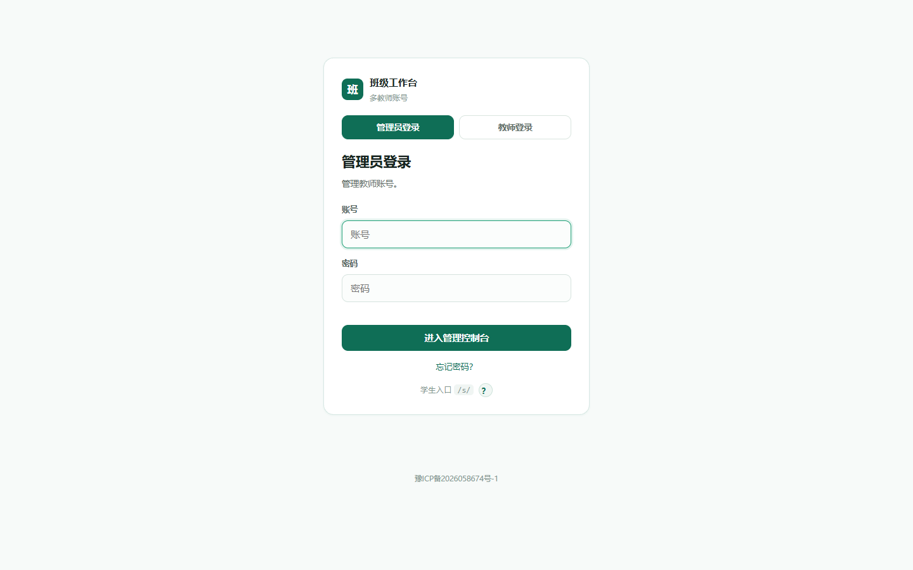

第一次打开会让你设置管理员账号与密保问题；之后用账号密码进入。
忘记密码可以点「忘记密码？」用密保自助重设。

### 2. 首页 `#home`

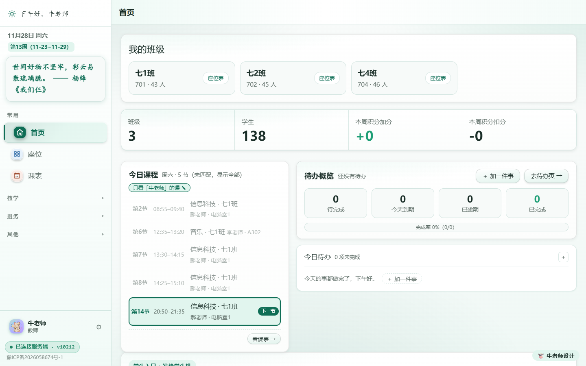

进门第一屏：我的班级、学生总数、本周德育加减分、今日课程、待办概览（含逾期提醒），
底部是学生入口地址（一键复制或打开学生端）。

### 3. 座位 `#seats`

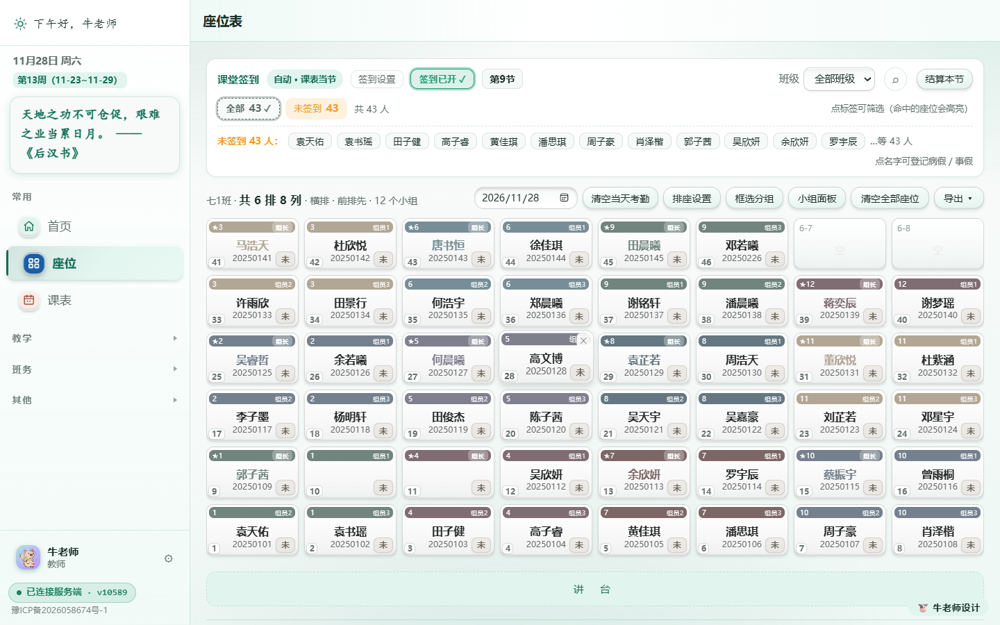

按教室座位排布，支持拖拽调位、框选分组。上课时「课堂签到」会实时把已签到的学生标绿，
顶部标签点一下就能筛出**未签到 / 迟到 / 病假 / 事假**的人。点击学生在面板里：

- 标**病假 / 事假**（再点一次取消）；
- **强制设置本节考勤**（任意状态，🔒 标记；强制后学生再签到也不会改写，直到解除）；
- 最后「结算本节」。

标题下会写明 **共 X 排 Y 列**。排座配置（行列数 / 蛇形或横竖排 / 起点 / 讲台方位）
自动同步到服务端，学生端座位表读的就是这一份，两端永远是同一张图。

### 4. 课表 `#timetable`

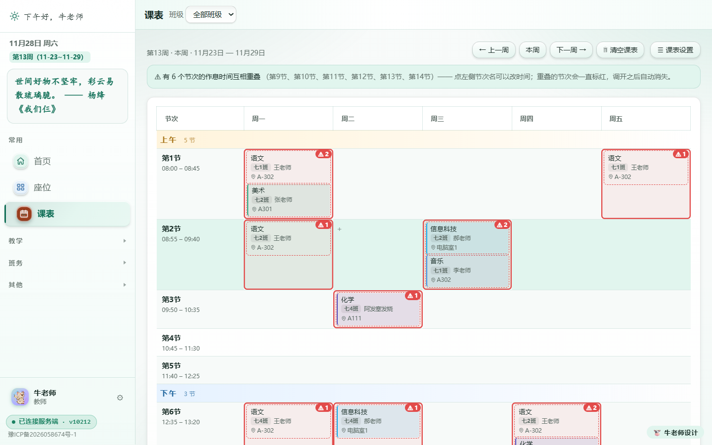

先设节次，再按天排课；切到单个班看本班课表，切到「全部班级」看全周。
同一时段给同一个老师排了两个班，格子会标红提示冲突。**星期栏吸顶常驻**：
上下滚动时星期标题固定在顶栏下方，桌面端与移动端都生效。

### 5. 大屏（课堂活动）`#guide`

选课程（文件夹名即课程名）→ 选学习单（三选一：设计器刚生成的页面 > 资料里「设为学习单」的网页 > 默认模板）→ 按班「下发」。学生端「今日」对应课程立刻出现「进学习单」入口；
下发时自动把本班学生数据（花名册）挂到学习单上，学生打开即带身份。课上在这里看提交与数据大屏。
**选课程即归属**：学生作品与提交数据会自动归档到「资料」里同名课程文件夹（新提交到达后增量归档）；
课程与文件的管理统一在「资料」页操作。「自定义学习单」设计区默认收起，点「＋ 新增自定义学习单」展开；
设计稿「💾 保存到资料」时弹窗选课程 / 子文件夹并支持重命名。

### 6. 资料 `#courseware`

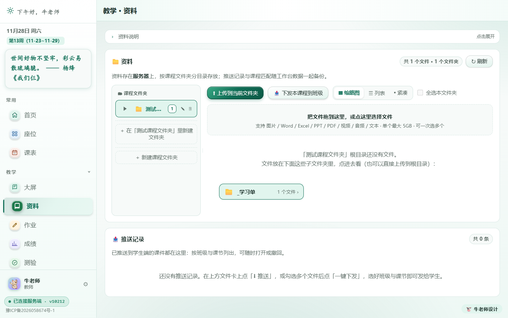

资料按「课程文件夹」归档在服务器上，资源管理器式界面：左侧树形目录（课程 → 子文件夹，
可拖动分隔条调宽），右侧列表给出**名称 / 类型 / 大小 / 修改时间**。
支持 Word / Excel / PPT / PDF / 视频 / 音频 / 图片，单个最大 300 MB，可批量上传；
勾选多个文件可批量删除 / 移动 / 一键下发；**活动归档**（学生作品）只读，不参与下发。
三种浏览视图（缩略图 / 列表 / 紧凑）记在本机。网页文件可「🗒 设为学习单」，下发时自动部署。

**类型识别与缩略图规则**：文件类型按**扩展名**判定——
`png/jpg/gif/webp/svg…` → 图片；`mp4/mov/mkv…` → 视频；`mp3/wav/flac…` → 音频；
`pdf` → PDF；`ppt/pptx/doc/docx/xls/xlsx/wps…` → 文档；`txt/md/csv/html/py/js…` → 文本；
认不出的扩展名 → 文件。缩略图视图（大卡片）里：图片 / 视频直接显示内容；
网页（.html）与 PDF 内嵌文件本体当封面；PPT / Word / Excel 由服务端
（`app/core/ooxml_preview.py`，纯 Python 解析 OOXML）渲染成页面当封面，
结果按「文件名+大小+修改时间」缓存，首次渲染后秒开；列表 / 紧凑视图仍用轻量图标。

### 7. 作业 `#homework`

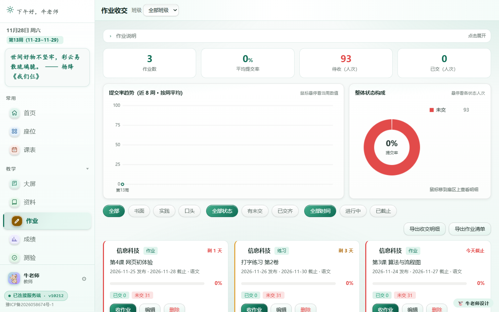

顶部是提交率趋势与状态构成，下方按作业列出每个人的状态，可批量催交、导出收交明细。

### 8. 成绩 `#scores`

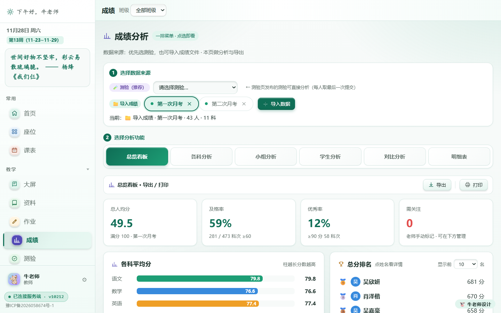

一场考试一张卡片：参考人数、平均分、最高 / 最低、及格率、优秀率、分数段分布；
「分析报告」支持多维筛选与班级 / 小组对比。

### 9. 打字 `#typing`

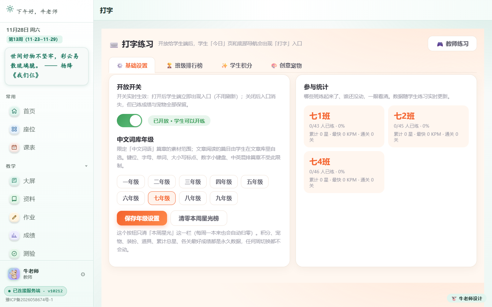

一键开放给学生，学生端立即出现「打字」入口；这里看各班参与率、最快速度与本周星光榜。

### 10. 网页 `#design`

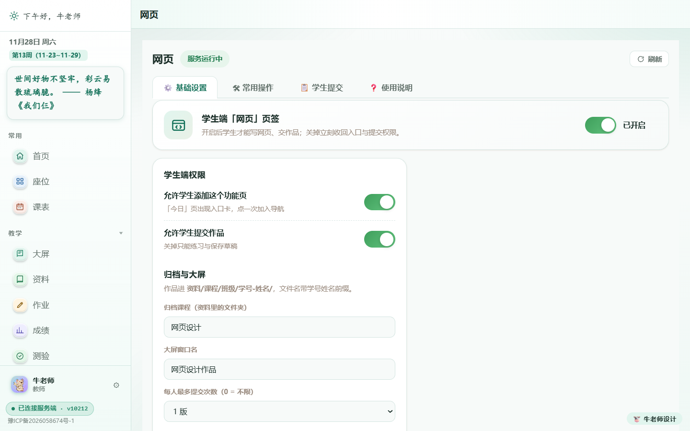

左侧写代码、右侧实时预览，学生点一次「提交作品」就自动截图、归档并进大屏。

- **一个代码区写完整个网页**（2.0.41）：HTML 页签里就是完整的网页文件（`<!DOCTYPE>` / `<html>` / `<head>` / `<style>` / `<body>`），样式直接写在 `<style>` 段，不再单开 CSS 窗口；预览与提交都用这同一份文档，交上去的文件老师双击就能打开。
- **入口自动出现**（2.0.41）：老师在教师端一开启，学生端左侧导航立刻多出「网页」，不需要学生先去「今日」页手动点「添加」；判据是 `enabled` 且 `allow_add`，SSE 的 `cfg` 事件即时生效，SSE 断开时每 10 秒轮询兜底。
- **图片素材**（2.0.41）：设计器「🖼 图片」抽屉，支持**网格 / 列表**两种视图；学生看到的是**老师下发到本班的图片**，教师练习时看到的是**课件库全部图片**；点缩略图按当前光标位置插入 `` 或 `background-image`，支持「＋ 从资料中添加文件」与逐张移除（只移出素材，不删原文件）。图片走 `/cw/<文件id>` 闸门，导出 PNG 时同源带会话内联，机房断网也能出图。
- **教师端网页预览**（2.0.41）：文件列表点学生交的 `.html` 直接**渲染并执行** HTML/CSS/JS（不再显示源码），支持上/下一个切换与关闭；加载超时、加载失败、资源缺失、脚本报错都有可读提示与「↻ 重新加载」。iframe 只放开脚本/表单/弹窗，**不给 `allow-same-origin`**，学生页面进不了教师端。
- **教师端一键启停**：开关一开，学生端「今日」页出现入口卡；全程在本页框架内打开，不跳新标签页。
- **两个权限分开管**：「允许添加」管入口是否出现，「允许提交」管能不能交作品；关掉提交后学生仍可练习、保存草稿。
- **教师自己也能练**：管理页点「✏ 进入网页练习」在同一个页框里切到设计器，进度（代码 + 显示方式 + 预览宽度）自动保存，下次进来接着写；写好了可「导出图片」当课件示例。
- **代码显示模式**：代码区可在「关键词高亮」与「普通文本」之间切换，标签 / 属性 / 选择器分色；切换即时生效、不丢光标，并随草稿保存。
- **左右分栏**：中间有可拖动的分隔条，实时调整代码区与预览区宽度（每侧最小 280px，拖到头会停住）；松手记住比例，刷新不丢，双击恢复各半，方向键可微调；窗口变大变小按同一比例伸缩，窄屏自动改成上下排列。
- **滚动同步**：滚代码或滚预览，另一边按可滚动范围的比例跟随，滚到顶 / 底严格对齐；用户滚动与程序赋值用「目标值标记 + 用户操作即清除」区分，不会来回拉扯。
- **归档与大屏**：作品按 `<课程>/<班级>/<学号-姓名>/<学号-姓名-原文件名>` 落进「资料」，与学习单归档共用同一套目录与命名规则；提交同时进「上课」页的实时窗口与作品墙，老师不用再搬运文件。
- **归档命名**（2.0.40 起统一）：文件名前缀 = 学生目录名（`学号-姓名`），已带前缀不重复加；重名时保留原名主体，按 `原名 (2).ext` 递增；同一份文件重复提交按大小识别，不重复落盘。网页作品与学习单上传完全一致。
- **知识库**：40+ 条 HTML/CSS 条目、4 个起步模板（默认模板为「示例内容」，姓名班级均为占位），可搜索、可一键插入代码；预览只运行 HTML/CSS，不执行 JavaScript。
- **草稿**：按学生存在服务端（`design.json`，随教师账号隔离），换台电脑登录能接着写；每 90 秒静默保存一次。

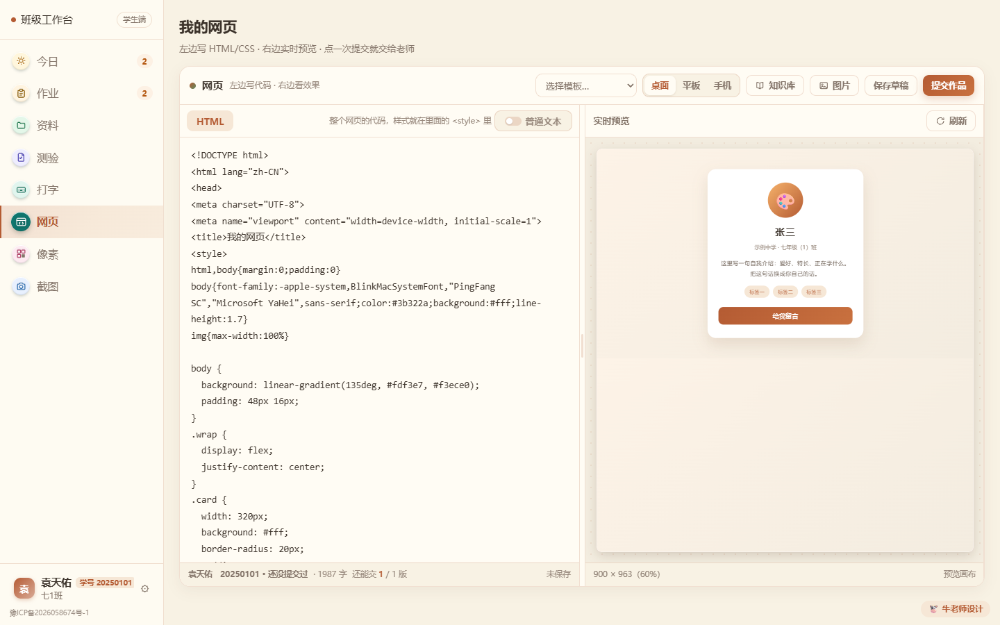

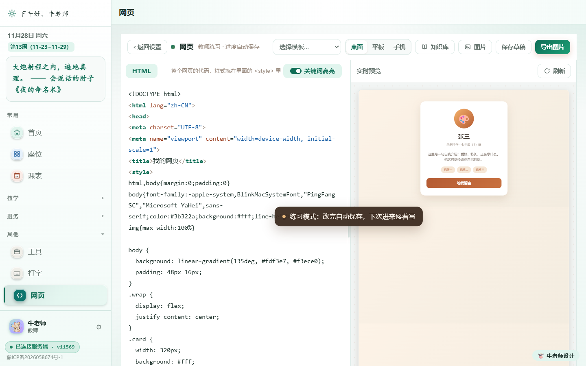

### 11. 像素 `#pixel`

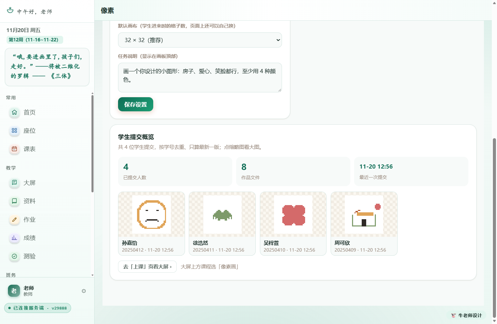

一格一格涂的像素画板：学生画完点一次「提交作品」，自动导出图片、存工程文件、归档并进大屏。

- **一键启停**：与「网页」同一套开关口径（`enabled` / `allow_add` / `allow_submit`）。老师一开，学生端「今日」页立刻出现入口卡、导航里多出「像素」页签；一关立刻收回入口与提交权限，**已画的草稿不丢**。
- **画布**：16 / 24 / 32 / 48 / 64 五档正方形，老师可设默认档位，学生页面上随时自己换；换尺寸时已画内容按左上角保留，超出部分裁掉（改大不丢）。
- **工具**：铅笔 / 橡皮 / 油漆桶 / 吸管，笔刷 1–3 格；支持左右镜像（画对称图形）、网格线开关、撤销重做（按「一笔」回退，最多 60 步）、右键当橡皮。
- **模板库**（8 个 16×16 小图）：爱心 / 笑脸 / 小房子 / 星星 / 小猫 / 苹果 / 小鱼 / 小树。两种用法 ——
  **照着画**只在工具面板里显示一张参考图、画布留空，学生自己一格一格描；**载入**直接把图案放到画布上（自动切到 16×16，可继续改，`Ctrl+Z` 能退回）。
  模板下标只用调色板前 16 个预设色，所以载入不会改动学生自己加的颜色。
- **调色板**：16 个预设暖色，最多 32 色；点色块选色，自己挑的颜色「＋ 加进调色板」，满了替换当前格。颜色随草稿一起存。
- **草稿**（`pixel.json`，随教师账号隔离）：改一笔就排队存（1.4 秒防抖），切页 / 关标签时用 `keepalive` 补一次，换台电脑登录同一个人能接着画。
- **提交**：导出 768px 见方的 PNG（最近邻放大，像素边缘不糊，白底）+ 一份工程文件（`.json`，含每格颜色，可再导入编辑），两个文件一起进活动库、自动归档到 `<课程>/<班级>/<学号-姓名>/`，同时进「大屏」页的实时窗口与作品墙。
- **教师端**：管理页直接出统计与作品缩略图墙（棋盘底 + 等比缩放，像素画不变形），点缩略图看大图、一键下载；「✏ 进入像素画练习」可在同一页框里自己试画，进度存自己名下，「导出图片」可当课件示例。

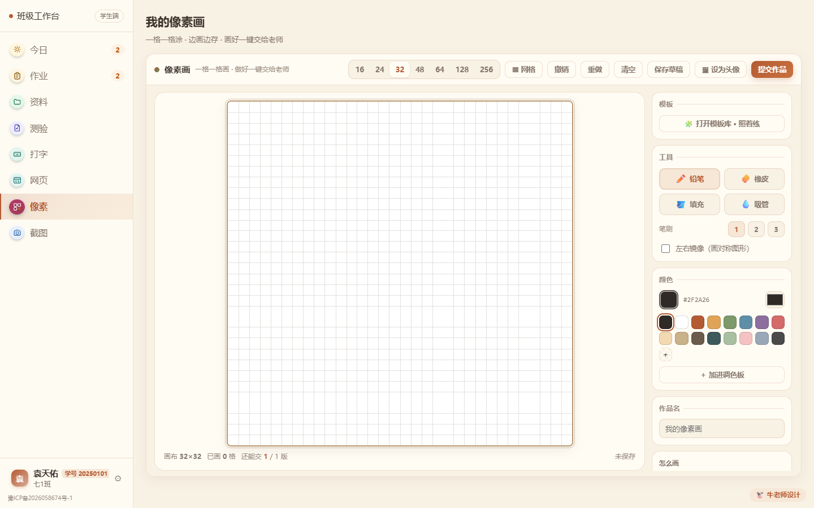

### 12. 班级 / 学生 / 待办 / 工具 / 设置

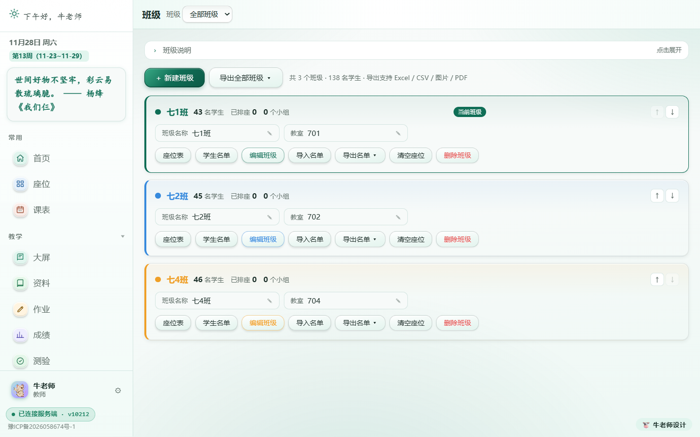

班级页五个页签管 **班级信息 / 进度 / 值日 / 分组 / 德育**；学生页管账号初始化、重置密码
（弹窗预填 6 位易读密码，默认勾「首次登录后要求学生自行修改」）、成长报告、通讯录导出；
待办分「今天 / 本周 / 全部」；工具含随机点名、计时器、番茄钟、自定义链接二维码；
设置里有主题字号、密保、模块开关、**软件更新**与**数据与备份**。

### 13. 学生端

学生打开 `/s/`：选班级 → 选学号 → 输密码。

| 今日 | 作业 | 科目 | 座位 |
|---|---|---|---|
| 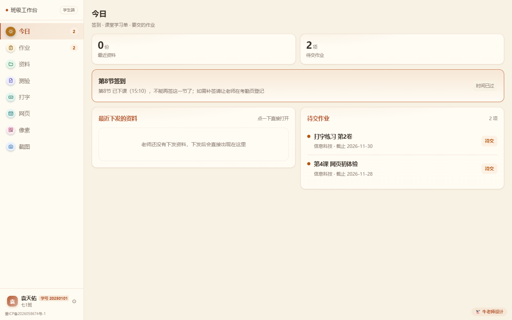 | 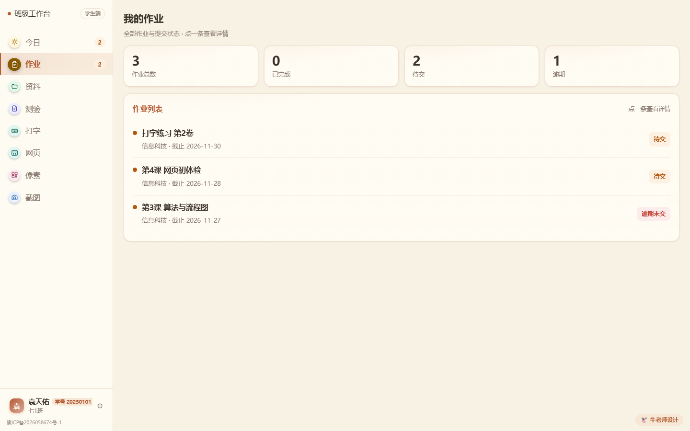 | 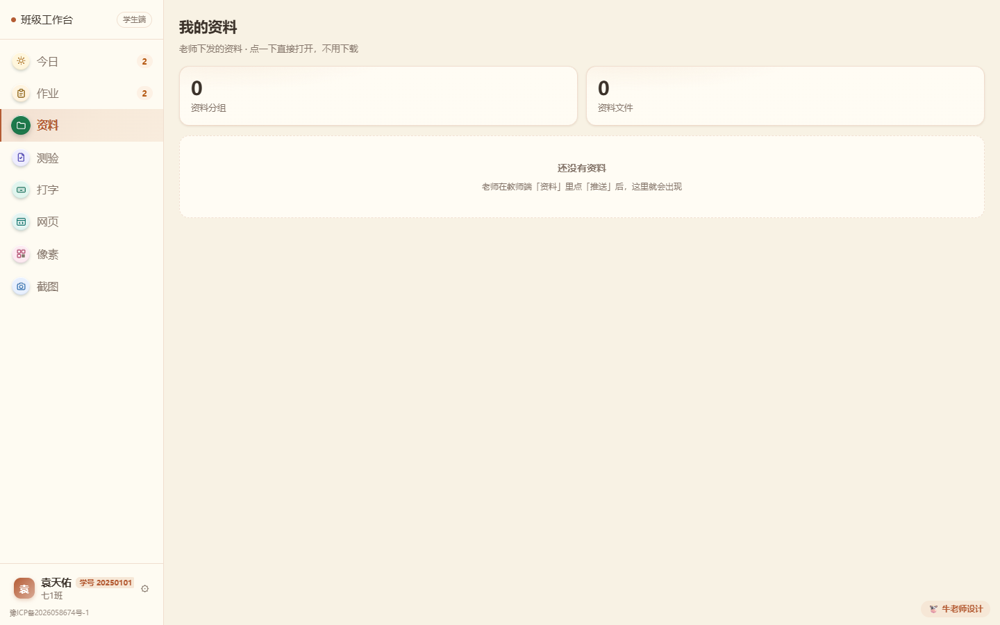 | 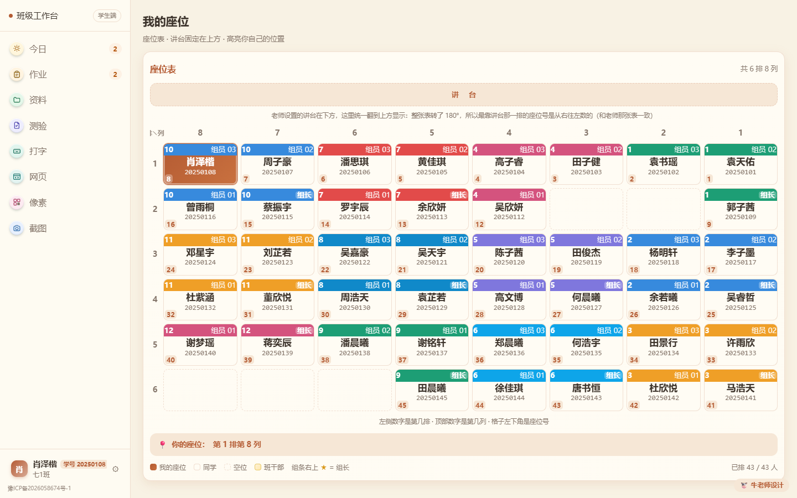 |
| 一键签到、今日课程与学习单入口、待交作业 | 全部作业与我的提交状态 | 老师推送的课程资源，点开在线预览 | 全教室座位表，自己那格高亮 |

> 学生端网页图标是橙底「学」字，与教师端绿色「牛师」图标区分。
> 想放到桌面：手机浏览器「添加到主屏幕」，或电脑右键 → 新建 → 快捷方式，填 `http://服务器IP:端口/s/`。

---

## 三、三端架构与运行形态

```
学生机 / 教师机浏览器 ──局域网 HTTP──▶ 统一入口（gateway nginx :8080）
                                        └── workbench 容器（:20020，容器网络内）
                                             ├── /teacher/   教师端
                                             ├── /s/         学生端（直连服务端）
                                             ├── /api/v2/*   同步 / 鉴权 / 业务
                                             └── /api/act/*  课堂活动
```

| 角色 | 职责 |
|---|---|
| **服务端（NAS Docker）** | 唯一主库（29 张表）+ 账号权威 + **唯一时间源** + 实时事件推送（SSE）+ 页面渲染。三个容器：`init`（初始化/迁移）→ `workbench`（主服务）→ `gateway`（统一入口） |
| **教师端** | 浏览器里的操作界面，不常驻任何进程。任何改动 → 服务端记变更（全局版本号 rev）→ 学生端 SSE 收到信号拉增量（浏览器端 `netsync.js` 每 1.5 秒兜底轮询） |
| **学生端** | 登录签到、打开学习单、作答提交、查看反馈。**直连服务端**，学生机可联网；所有静态资源本地化，零外链依赖 |

**关键口径：**

- **服务端时间是唯一时间源**：签到节次、考勤判定、缺勤扫描一律服务端计算（`/api/v2/student/now`、`/api/v2/teacher/now`），各端只做显示；
- **数据投影**：学生端只拿得到「本班 + 本人」的字段投影；手机号、家长信息、他人成绩在服务端就裁掉。关闭某模块时，学生端入口消失、接口直接 403；
- **容器内不按 IP 判身份**，按会话角色判定教师 / 学生；
- **服务端启动横幅会按网卡打印多条学生端地址**：一张网卡一条。物理网卡（如 `192.168.x.x`）是给学生用的；`172.x.x.x` 多为 Hyper-V / WSL / Docker 虚拟网卡，只有本机打得开，属正常现象。

---

## 四、部署

同一套程序、同一份数据格式，两种装法，随时可以互相搬家：

| | 方式一：直接运行 | 方式二：Docker（推荐） |
|---|---|---|
| 适合 | 教师机、笔记本、机房临时使用、无外网环境 | NAS、常开小主机、正式长期部署 |
| 前置 | Windows 10+ / macOS，**无需安装 Python**（包内已带运行时） | 装好 Docker 与 Compose |
| 启动 | 双击 `启动教师端` | `docker compose up -d --build` |
| 对外端口 | `20020` | `8080` 一个端口全包 |
| 开机自启 | 需自行加计划任务 | 随 Docker 自启 |

**共同部署前准备：** 学生设备与服务器同一局域网（机房关闭 AP 隔离）；服务器设固定 IP
或 DHCP 保留；预留 20 GB 以上磁盘；防火墙放行对外端口；服务器不休眠。
**整台机器出不去外网**（学校机房、内网服务器）时看「方式三」，那里有 Windows Server /
Ubuntu Server / 离线 Docker 的完整步骤。

### 方式一：直接运行（免安装）

1. 解压发行包到本地（路径尽量不含空格）；Windows 双击根目录 `启动工作台.bat`，
   macOS 双击 `启动工作台.command`，Linux 执行 `bash 启动工作台.sh`；
2. 浏览器打开 `http://127.0.0.1:20020/`；学生访问 `http://<这台电脑的局域网 IP>:20020/s/`。

**不需要安装 Python**：包内 `runtime/win-x64/python/` 已带 Python 3.13.7 运行时，
启动器会优先使用它。只有「克隆源码、不用发行包」这种方式，才需要本机装 Python 3.9+
并加入 PATH。

常用启动参数：`--port 20021`（换端口）、`--no-browser`、`--reset-password`（忘记教师密码）、`--no-dialog`。
首次运行 Windows 防火墙弹窗必须允许「专用网络」。

### 方式二：Docker

```bash
git clone https://gitee.com/shyxiaoniu/teacher-workbench.git
cd teacher-workbench
cp .env.example .env          # 正式使用至少改 WEB_PORT
docker compose up -d --build
```

`docker compose ps` 里 `workbench`、`gateway` 都是 `healthy` 即就绪（`init` 跑完即退，正常）。

`.env` 关键项：`WEB_PORT`（唯一对外端口）、`TZ=Asia/Shanghai`（不要动，考勤按本地日期归档）、
`WB_PUBLIC_URL`（前面再套反向代理时才填）、`WORKBENCH_VOLUME`（命名卷名，不要动）。

常用运维：

| 目的 | 命令 |
|---|---|
| 看状态 / 日志 | `docker compose ps` / `docker compose logs -f workbench` |
| 升级 | `docker compose up -d --build`（数据不丢） |
| 停止（保留数据） | `docker compose down`（**别加 `-v`**，会删数据卷） |
| 忘记教师密码 | `docker compose exec workbench python launch.py --reset-password` |

### 方式三：无外网服务器（Windows Server / Ubuntu Server）

机房和校园网里的服务器常常整台出不去外网 —— `pip` / `apt` / `docker pull` 全不可用。
这套程序**运行时零第三方依赖**（纯 Python 标准库），所以离线部署不需要装任何包，
唯一要做的是「把发行包送进去」：U 盘、内网共享、堡垒机上传、跳板机 `scp` 都行。
只需要那一个 `班级工作台<版本>-<yyMMdd>.zip`（约 17MB）。

#### Windows Server

1. 解压到 `D:\班级工作台`（路径别带空格）。包内自带
   `runtime\win-x64\python\python.exe`（Python 3.13.7 嵌入式），**不用装 Python**。
2. 双击 `启动工作台.bat`。首次启动会在 20020 起服务并打开浏览器，
   按提示设管理员账号（Server Core 没有桌面时手动打开 `http://127.0.0.1:20020/`）。
3. **放行防火墙** —— Server 默认全拦，这是最容易漏的一步。管理员 PowerShell：

```powershell
New-NetFirewallRule -DisplayName "班级工作台 20020" -Direction Inbound `
  -Protocol TCP -LocalPort 20020 -Action Allow -Profile Private,Domain
```

4. 学生访问 `http://<服务器内网 IP>:20020/s/`。

**开机自启**（用任务计划程序，别用「启动」文件夹）：

| 项 | 填什么 |
|---|---|
| 常规 | 选「不管用户是否登录都运行」，勾「使用最高权限运行」 |
| 触发器 | 启动时，延迟 30 秒 |
| 操作 | 程序 `D:\班级工作台\app\启动教师端.bat`，**起始于** `D:\班级工作台\app` |
| 设置 | 勾「失败后按 1 分钟间隔重启」，取消「运行超过…则停止任务」 |

> 「起始于」必须填 `app` 目录，否则相对路径找不到程序；选「只在用户登录时运行」的话，
> 服务器重启后没人登录，服务起不来。

#### Ubuntu Server

Ubuntu 20.04+ 自带 `python3`，标准库够用，**不需要 apt 装任何东西**。

1. 解压到 `/opt/workbench`：

```bash
sudo mkdir -p /opt/workbench
unzip -q 班级工作台2.0.46-261120.zip -d /tmp/wb
sudo cp -a /tmp/wb/班级工作台2.0.46-261120/. /opt/workbench/
# 连 unzip 都没有？用自带的 python3 解：
# python3 -c "import zipfile;zipfile.ZipFile('班级工作台2.0.46-261120.zip').extractall('/tmp/wb')"
```

2. 先前台试跑一次（Ctrl+C 停）：

```bash
cd /opt/workbench && bash 启动工作台.sh --no-browser --no-dialog
```

浏览器打开 `http://<服务器IP>:20020/` 设管理员账号；开了 ufw 的话放行
`sudo ufw allow 20020/tcp`。

3. 配成 systemd 服务（后台常驻 + 开机自启 + 崩了自动拉起）：

```bash
sudo useradd -r -s /usr/sbin/nologin workbench 2>/dev/null || true
sudo chown -R workbench:workbench /opt/workbench

sudo tee /etc/systemd/system/workbench.service >/dev/null <<'EOF'
[Unit]
Description=班级工作台 2.0
After=network-online.target
Wants=network-online.target

[Service]
Type=simple
User=workbench
WorkingDirectory=/opt/workbench/app
ExecStart=/usr/bin/python3 /opt/workbench/app/launch.py --no-browser --no-dialog
Restart=always
RestartSec=3
Environment=LANG=C.UTF-8
Environment=PYTHONIOENCODING=utf-8

[Install]
WantedBy=multi-user.target
EOF

sudo systemctl daemon-reload
sudo systemctl enable --now workbench
sudo systemctl status workbench --no-pager     # 看是否 active (running)
journalctl -u workbench -f                     # 跟着看日志
```

> `chown -R` 那行别漏 —— 服务账号写不了 `app/data` 会直接退出。
> `--no-dialog` 关掉图形化报错弹窗：服务器没桌面，弹窗会把进程卡住。
> 升级：把新包解压覆盖到 `/opt/workbench`（保留 `app/data`），
> `sudo systemctl restart workbench`。

#### 离线 Docker（服务器有 Docker，但拉不了镜像）

```bash
# ① 有网机器上构建并导出（含 gateway 用的 nginx）
docker compose build
docker save -o workbench-images.tar $(docker compose config --images)

# ② 拷进服务器
scp workbench-images.tar root@<server>:/root/

# ③ 服务器上导入（compose 文件与 .env 也一起拷过去）
docker load -i workbench-images.tar
docker compose up -d --no-build
```

> `docker compose config --images` 会把 `workbench`、`gateway` 用到的镜像都列出来，
> 一起 `save`；只导 workbench 会缺 nginx 网关。
> `.env` 里的 `IMAGE_TAG` 必须和导出的 tag 一致，否则 `up` 会去找一个不存在的镜像。

#### 怎么选

| 手上有 | 建议 |
|---|---|
| 一台 Windows 机器当服务器、老师熟悉 Windows | 方式一 + 任务计划程序 |
| 学校给的 Ubuntu 虚拟机 / 内网云主机 | 方式一 + systemd |
| 已经有 Docker、想要一键升级与迁移 | 离线 Docker |

> 三种方式装出来的数据格式完全一样，随时可以用
> 设置 → 数据与备份 → 一键导出 / 一键恢复 搬家，**不要手工拷数据库文件**。

---

## 五、第一次使用与课堂流程

**建班流程：** ①「班级」页建班级 → ②「学生」页导入名单（支持表格粘贴）→
③「课表」页设节次、按周排课 → ④「学生端控制台」设密码策略（统一初始密码 / 独立密码 /
首次登录必改 / 一键重置）→ ⑤「资料」页建课程文件夹、上传文件 → ⑥「大屏」页选课程下发。

**一堂课的典型用法：**

| 环节 | 老师做什么 | 学生做什么 |
|---|---|---|
| 课前 | 「大屏」选好课程与学习单，点「下发」 | —— |
| 上课 | 打开「座位」，投屏学生入口 | 打开 `/s/`，进入「今日」 |
| 签到 | 座位表实时看到谁已签到，可点标签筛人 | 点「一键签到」 |
| 课中 | 学生点开学习单作答，大屏实时看提交；资料可随时补发 | 在学习单里答题 / 传文件 |
| 课后 | 座位页「结算本节」；强制/请假登记收尾 | 在「科目」里回看资料 |

**考勤规则（服务端判定）：**

| 状态 | 判定 |
|---|---|
| 出勤（已签到） | 本节时间窗内登录（课表开始 5 分钟内） |
| 迟到 | 超过开始 5 分钟才登录 |
| 缺勤 | 开始 15 分钟仍未登录且未请假，自动记录；之后到堂登录改判「迟到」并留痕 |
| 病假 / 事假 | 教师手动登记，优先级最高，不被签到覆盖 |
| 🔒 强制 | 教师在座位面板「强制设置本节考勤」任意指定；**学生再签到也不改写**，直到教师解除 |

- 签到时间窗 = 上一节下课 +1 分钟 ~ 本节下课（当天第一节保留课前 15 分钟）；已下课不补签；
- 课间时段按「下一节有排课」归属，提前到机房不算迟到；
- 本班该节没排课不产生考勤（防假全勤）；课表 0 条时不拦；
- 未排课时段 / 作息表没填时间从宽处理。

---

## 六、课堂活动与学习单（闸门 + 票据机制）

一句话：**数据服务地址、任务号、学生身份，一个都不出现在学生页面上。**
教师端配一次，学生点开即用，答完自动进大屏。

### 数据落在哪

| 内容 | 位置 |
|---|---|
| 活动 / 提交 / 附件记录 | `<数据目录>/workbench.db`（act_task / act_submission / act_file 表，提交的 `sid/name/cls` 单独成列，按班统计直接查库） |
| 附件文件 | `<数据目录>/activity/<活动号>/<随机名>.<ext>`，对外 `/static/uploads/<活动号>/<文件>` |
| 附件上限 | 单文件 / 整份提交各 40MB；备份打包时 >10MB 或合计 >40MB 会跳过并点名，不静默丢 |

### 一次完整链路

```
① 教师端「大屏」：选课程 → 选学习单 → 按班下发
   （每班各推一份花名册 + 部署学习单页面 + 写 activity_pushes）
② 学生端「今日」：SSE 实时收到，对应课程行出现「进学习单」
③ 浏览器打开 /g/act/<push_id>   ← 同源闸门，带登录 Cookie
④ 服务端：验会话 → 验本班 & 已发放 → 验签到 → 签票
   302 到学习单页，票与身份拼在 URL 上（wbT/wbSid/wbName/wbCls/wbTask/wbBase）
⑤ 每次提交 → POST /api/v2/student/submit?t=<票>
⑥ 服务端：验票 → 用票里的身份覆盖页面填的学号（防冒名）→ 落库 → 大屏实时出现
```

- 票据只存内存（重启即失效，学生重开一次学习单即可），默认 12 小时有效；
- 学习单页面统一部署在 `/submit/custom.html?task=<任务号>`，页面存提交服务 `custom_templates`，改版随「下发」强制部署，该页 `Cache-Control: no-store`；
- 「下发」用的页面优先级：设计器刚生成 > 课程资料里被「设为学习单」的那份网页（自动识别，无需下拉）> 默认模板；
- 学生两个入口都通到这里：`/g/act/<发放id>`（今日·课堂活动）与 `/g/mat/<资料id>`（资料里点那份学习单）。资料入口在「该班已发放」时走完整闸门；已收回 / 从未发放时直通本节链路（带身份票、真提交按钮），不会再退回 `/cw` 原始网页（那会落进页面自带的「预览模式」兜底）；
- 签到闸门：今天一笔有效签到都没有（或缺勤）→ 学习单打不开，先回学生端签到；两个入口标准一致；
- 活动管理接口（教师端专用，走 `/api/v2/teacher/activity/*`）支持列表 / 导出 CSV·JSON / 删除 / 清空。

---

## 七、资料库（教师端「资料」页）

- **目录即数据**：文件按 `<课件根目录>/<课程文件夹>/<子文件夹>/<文件>` 存放，不维护索引；
  老师用资源管理器手动拷文件进去，刷新就能看到；拷走整个目录就是完整备份；
- 左侧树：课程文件夹（新建 / 重命名 / 删除）→ 课程内**子文件夹**（新建 / 点进 / 删除空文件夹），
  文件可在课程内「移入」子文件夹；分隔条可拖动调宽（双击复位，宽度记本机）；
- 上传：单文件最大 300MB，**流式直传**（浏览器 fetch body=File，服务端 256KB 分块落盘，
  前后端内存占用恒定，大文件不崩页）；同名自动加「（2）」；
- **设为学习单**：.html 文件可标记为本课程的学习单（存服务端配置，重启不丢；
  课程改名标记跟着走、文件删除自动失效）——「大屏」选这门课时自动预选；
- **下发**：勾选文件 → 选班级 → 学生端拿到**在线查看副本**（只读，动不了原文件）；
  推送记录可一键撤回；下发的学习单自动带上本班学生信息；
- 访问控制：只对教师账号开放管理；学生端只能看被下发的副本。

---

## 八、打字冒险岛

定位：信息科技机房课的打字训练系统，教师一键开关，学生端零安装。

- **六大篇章渐进主线**：键位熟悉 → 字母位置 → 英文单词 → 大小写标点 → 中文词语 → 课文句子（另有数字小键盘、中英混排篇章）；每章每卷 10 关，第 10 关 BOSS，卷号无限递增、难度按卷爬坡；
- **关卡内容随机化**：除「读文章」篇章按句序推进外，每个关卡在重玩 / 重置 / 刷新时都随机生成新内容（伪随机种子含每次进关的 nonce），防止背顺序；
- **反馈感**：逐字变色、实时速度 / 准确率、三星结算（通关 ≥90%；⭐⭐ 速度线；⭐⭐⭐ 速度线 ×1.3 且 ≥97%）、指法高亮随按键走（头顶 ⇧ 角标、错字红标、课文行永远显示原文）；
- **收集欲**：22 只原创宠物（SVG 零外部资源），BOSS 关打满星必掉宠物蛋（差一星 55% 概率、一关一颗、后来打满星可补掉），攒够 300 积分也能在牧场孵蛋卡直接换一颗（图鉴集齐后停售），装扮按累计星数解锁；
- **每周重置范围**：每周一只有「本周星光」归零（周榜专用）；**积分、宠物、装扮、牧场背景、出战特效、道具、累计总星、各关最好成绩、待孵宠物蛋全部永久保留**。教师端「清零本周星光榜」同样只动这一项。代码口径见 `app/core/typing_store.py` 的 `week_key()` 注释；
- **排行榜**：星光榜（本周）/ 总星榜 / 手速榜，只展示名字与成绩；教师端可重置周榜；
- **教师主权**：开关 + 年级词库限定中文素材范围；成绩由服务端按公式重算（不信任客户端）；
- **技术落点**：`app/typing/typing-data.js`、`levels.js`（引擎）、`student.html` / `teacher.html`（两端页面，iframe 内嵌）、`app/core/typing_store.py`（独立 JSON 存储）。
  未登录可打开但为演示模式（禁止提交）。

---

## 九、数据、备份与换机

### 数据存在哪

| 部署方式 | 位置 |
|---|---|
| Docker | 命名卷 `teacher-workbench-data`（`/app/data`：29 张表 `workbench.db`、课件库 `courseware/`、活动附件 `activity/`、打字 `typing.json`、每日快照）；`down` 不删，`down -v` 才删（**危险**） |
| 直接运行 | 项目 `app/data/` 目录 |

### 备份与恢复

**设置 → 数据与备份 → 一键导出全量备份**：设一个备份密码（≥6 位），得到 `.cwbackup`
加密文件，内含整库 29 张表 + 全部配置 + 教师 / 学生口令哈希（只存哈希）+ 打字成绩 +
学生作品附件（单个 ≤10MB、合计 ≤40MB，超出点名跳过）+ 浏览器界面设置。
课件大文件用旁边的 **导出资料包** 单独打包（保留课程子目录）。

**换机两步**：新环境装好并登录 → 一键恢复（选文件 + 同一密码）→ 有课件再导入资料包。

导入前置校验：空表 / 本机有数据而备份 0 行 → 拒绝；本机 ≥5 行且备份 <40% → 需二次确认（force）。
失败一定不改动任何数据。每天首次启动自动快照，保留 14 份。
**不要手工拷数据库文件迁移。** 导入只替换数据、不替换解锁密码。

---

## 十、版本、发行包与在线更新

> 逐个版本「改了什么」见 **[CHANGELOG.md](CHANGELOG.md)**；本节只讲当前的版本号规则、
> 发行包结构、离线安装、内网镜像与在线更新操作。

### 版本号维护

发版按顺序核对 5 处（缺一处就会出现「界面显示 2.0、镜像却是别的 tag」）：

| # | 文件 | 位置 |
|---|---|---|
| 1 | `app/server.py` | `VERSION = "2.0.41"` —— **唯一代码源** |
| 2 | `.env.example` | `IMAGE_TAG=2.0.41` |
| 3 | `docker-compose.yml` | `image: …:${IMAGE_TAG:-2.0.41}`（init 与 workbench **两处**） |
| 4 | `README.md` | 文首「当前版本」 |
| 5 | `version.json` | 随发版手工同步 |

不要跟着改的「版本」：`app/core/store.py` 的 `SCHEMA_VERSION`（表结构版本）、
`app/backup.js` 的 `VER`（备份格式版本）。

版本规则（2026-11-04 定版）：以 **2.0** 为基线，**每次改动更新都在后面追加序号**
（2.0.1 → 2.0.2 → 2.0.3 …），便于逐次追踪；主版本 / 次版本号只在数据表破坏性
变更或大改版时才动。`app/updater.py::vtuple` 按段比较数字，2.0.1 > 2.0 判定天然成立。

### 发行包（离线包，唯一产物）

打包前先在仓库根放好运行时（只需做一次，约 20 MB）：

```bash
# 下载官方嵌入式运行时，解压到 runtime/win-x64/python/
# https://www.python.org/ftp/python/3.13.7/python-3.13.7-embed-amd64.zip
```

然后执行打包：

打包脚本 `tools/make_release.py` 未随仓库分发（开发者自留）；版本取 `VERSION`、日期取当天，产物输出到 `dist/`。

命名 **`班级工作台<版本>-<yyMMdd>.zip`** —— 下载页与在线更新按这个格式取包，不要改名。
**只产出这一个离线包，不再产源码包**：包内 `runtime/win-x64/python/` 已带 Python 3.13.7，
用户解压后双击即用、无需安装任何环境依赖。脚本自动跳过运行期数据（`app/data/`、课件库、
附件、日志、`.git`、`__pycache__`），产物在 `dist/`。
**这个 zip 必须提交进仓库并推送**（在线更新与离线下载都从 `dist/<包名>.zip` 取），
不能当成普通构建产物忽略掉。包里：`启动工作台.bat` / `.command` + `app/` 全部程序 + `runtime/` 运行时 + docker 全套 +
`docs/shots/` 截图 + README + LICENSE。解压即用的空白工作台，不含任何真实数据。

> **下载优先走 Gitee「发行版」附件**（见文首下载区）：Gitee 对公开仓库 raw 文件
> 超过 10 MB 强制登录，匿名只能拿到 55 字节的提示文本；Releases 附件则匿名可下、
> 国内满速（实测 27 MB 约 14 秒）。仓库 `dist/` 里的 zip 仍需提交（在线更新的
> `version.json` 指向它、GitHub 镜像也靠它），但人工下载请用 Releases 直链。
> 新版本发布时两处都要更新：仓库 `dist/` 的 zip + Gitee Release 的附件。

### 服务器没有外网：离线安装（2.0.46 起）

服务端只要能打开教师端页面，就能更新 —— 缺的只是「把包送进去」的通道。

> ⚠️ **不要手动解压覆盖 `app/`**。手动覆盖会漏掉备份、回滚和版本校验；
> Windows 上正在运行的文件还经常被锁，覆盖到一半失败就再也起不来。

标准流程：

1. **在能上网的电脑**下载发行包 —— 仓库 `dist/` 里的
   `班级工作台<版本>-<yyMMdd>.zip`（Gitee / GitHub 都有），或用现成的下载链接。
2. 用 U 盘 / 内网共享 / 任何文件传输方式，把 zip 弄到**能打开教师端网页的那台电脑**上。
3. 教师端 → 系统设置 →「软件更新」→ 展开 **`▸ 离线安装（服务器连不上外网时用）`**
4. 选择 zip →「上传并安装」。上传过程有百分比进度（17MB 的包在内网通常几秒），
   传完服务端自动校验 → 解压 → 备份 → 换装。
5. 点「**立即重启服务**」，重启后版本号生效。全新版本装坏了，用同一张卡片上的「回滚」。

与在线更新的区别只有「包从哪来」：换装、备份、失败自动回滚、手动回滚，
全部走同一段代码（`app/updater.py::_install_zip`）。所以能做的事一样：

| 场景 | 支持 | 说明 |
|---|---|---|
| 新版覆盖旧版 | ✅ | 常规更新 |
| 同版本重装 | ✅ | 文件被误改/缺失时用来修复 |
| 降级到旧版 | ✅ | 上传旧版 zip 即可；装完记得核对版本号 |
| 装坏了回滚 | ✅ | 更新卡片上的「回滚到 v…」，只回滚代码，不动数据 |

**校验强度**：在线更新比对 `version.json` 的 sha256；离线包没有 manifest，
改用两道 —— zip 内部 **CRC32 逐文件校验**（能挡住 U 盘/网盘拷贝出的静默损坏）
+ 包内 `app/server.py` 的 **VERSION**，再过一次结构校验（必须能找到 `app/server.py`）。
读不到版本号、结构不对、CRC 对不上，一律拒装，当前代码一个文件都不动。

上限 800MB（正常发行包约 17MB）。上传的包落在 `<数据目录>/update/offline-upload.zip`，
下次上传直接覆盖，不累积。

> **Docker 部署**：离线安装换的是容器内 `/app/app/` 下的代码，数据卷 `/app/data` 不动，
> 所以当场能用。但**镜像 tag 没变** —— 下次 `docker compose up -d` 重建容器，
> 代码会退回镜像里的版本。要长期固定，改 `.env` 的 `IMAGE_TAG` 并重新
> `docker compose build && docker compose up -d`，别只靠离线安装。

### 内网镜像（一台机器做源，全内网共用）

内网里只要有一台机器能上外网（或能走代理），就可以把它做成**更新镜像**，
其余机器照常点「检查更新 / 下载并安装」，不用每次拷 U 盘。

镜像就是一个**静态文件目录**，相对结构必须和仓库一致：

```
mirror/                                  ← 任意 http 服务能访问到的目录
├── version.json                          ← 从仓库根目录同步
└── dist/
    └── 班级工作台2.0.46-261120.zip        ← version.json 里 zip 指向的那个包
```

> `version.json` 的 `zip` 是**相对路径**（`dist/xxx.zip`），程序会把它拼到
> **`version.json` 所在目录**后面。所以 version.json 在镜像根，包就必须在
> `镜像根/dist/` 下 —— 相对位置错了会报「安装包不在更新源上」。
> 不想保持这个结构，就把 `zip` 改成完整 URL。

**搭起来（三选一）**

A. 最省事，Python 一行命令（够临时用）

```bash
cd /path/to/mirror
python3 -m http.server 8090      # Windows 上把 python3 换成 python
# 内网机器访问 http://<镜像机IP>:8090/version.json 能看到 JSON 就成了
```

关掉终端就停，长期用建议挂成服务/计划任务。

B. nginx（要长期跑用这个）

```nginx
server {
    listen 8090;
    root /path/to/mirror;
    autoindex off;
    location / { try_files $uri =404; }
}
```

C. 群晖 / 威联通：Web Station 建个静态站点，根目录指到 `mirror/` 即可。

**同步内容**（在镜像机上定时跑，或手动更新时跑）

```bash
cd /path/to/mirror
curl -fL -o version.json \
  https://gitee.com/shyxiaoniu/teacher-workbench/raw/main/version.json
# 版本号从 version.json 读，包名按 班级工作台<版本>-<yyMMdd>.zip 拼
```

**客户端怎么指过去（二选一）**

| 方式 | 适合 | 做法 |
|---|---|---|
| 教师端「自定义源」 | 单台、临时 | 系统设置 → 软件更新 → 自动检查设置 → 自定义源填 `http://<镜像机IP>:8090/version.json` |
| 环境变量 `WB_UPDATE_URL` | 多台、长期、Docker | 启动前设 `WB_UPDATE_URL=http://<镜像机IP>:8090/version.json` |

两者都配时**环境变量优先**。填了自定义源就**只认它**，不会再自动回退到
Gitee / GitHub —— 这是故意的：老师指定了内网源，就不该偷偷从外网装另一份内容。

- 支持 `http://`（不强制 https），内网没有证书也能用。
- 包照旧做 sha256 与版本一致性校验，镜像里被塞了个错包会直接拒装。
- 镜像只解决「检查 + 下载」。**镜像机自己也上不了外网时，回到上面的离线安装。**

**排查三连**：镜像机上 `curl http://127.0.0.1:8090/version.json` →
要更新的那台机器 `curl http://<镜像机IP>:8090/version.json` → 再点「检查更新」。
第一步通第二步不通 = 防火墙/端口；两步都不通 = 服务没起或目录指错。


### 在线更新（教师端 设置 → 软件更新）

- 后台默认每 24 小时自动检查（1~720 小时可调），也可手动「检查更新」；
- 发现新版本 → 显示版本号 / 日期 / 更新说明 → 「下载并安装」→ 「立即重启服务」生效；
- **更新只替换程序文件，`app/data` 原地保留**；下载 / 校验失败什么都不改；
  换装失败自动回滚；也可手动「回滚到更新前」；
- 更新源：**固定** `https://gitee.com/shyxiaoniu/teacher-workbench/raw/main/version.json`
  （manifest 含版本 / 日期 / zip 文件名 / sha256 / notes）；设置页不再提供源地址入口，
  避免填错地址导致更新失败；启动发现新版本会在左下小窗与头像角标提醒；
- `version.json` 的 `zip` 写**相对仓库根的路径** `dist/<包名>.zip`（发行包实际在 `dist/`）。
  更新器兼容旧版只写纯文件名的 manifest（先试 `dist/`、再试仓库根）；全部 404 时明确提示
  「安装包与 manifest 不一致」而不是笼统的「检查更新源地址」；
- 发布一次更新的流程：改 `VERSION` → 运行打包脚本 `make_release.py`（未随仓库分发，
  自动同步 manifest，notes 手工编辑）→ `git add version.json` → 提交推送双远程；
- 机制细节：版本逐段数字比较（`app/updater.py::vtuple`）；sha256 校验；zip-slip 逐条路径校验；
  包内 `server.py` 的 VERSION 与 manifest 核对防装错包；换装前备份到
  `data/update/backup-v<旧版本>-<时间戳>/`；重启用 `os.execv` 原地换进程。

### 发版推送流程

```bash
# 1) 打包当前版本（脚本未随仓库分发）→ dist/班级工作台<版本>-<yyMMdd>.zip
# 2) 确认 version.json 的 version/date/zip/sha256 与新包一致
# 3) 提交（dist 下的 zip 必须一并提交，在线更新要下载它）
git add -A && git commit -m "release: 2.x"
git push github main && git push origin main
git ls-remote github refs/heads/main && git ls-remote origin refs/heads/main
# 两条哈希必须相同（Gitee / GitHub 双远程一致）
# 4) 用 python app/updater.py 自检或浏览器实测「检查更新」能拉到新包
```

---

## 十一、常见问题

**打不开页面**：`docker compose ps` 看是否 healthy；防火墙放行 `WEB_PORT`。

**学生连不上**：① 同一局域网；② 用 `http://服务器IP:端口/s/` 而不是 127.0.0.1；③ 关闭 Wi-Fi AP 隔离。

**启动日志为什么打印两条学生端地址**：服务端按网卡各打一条。`192.168.x.x` 这类是物理网卡
（学生用这条）；`172.16~31.x.x` 通常是 Hyper-V / WSL / Docker 的虚拟网卡，只有本机打得开，可忽略。

**忘记教师密码**：登录页「忘记密码」答密保；密保也忘了：`docker compose exec workbench python launch.py --reset-password`。

**学生忘了密码**：教师端「学生」页 → 重置密码（预填易读密码）。班级在**独立密码模式**时弹窗留空 = 清掉独立密码回落班级初始密码，该生可能登不进来，务必填新密码。

**首页学生入口地址不对**：入口地址按「老师当前打开工作台的地址」自动生成。用 127.0.0.1 打开会拿到本机地址，换局域网 IP 访问或设 `WB_PUBLIC_URL` 固定。

**课堂活动列表为空**：`docker compose logs -f workbench` 看报错；教师端大屏页右上角状态灯应显示活动服务就绪。

**时区不对 / 考勤日期错位**：确认 `.env` 的 `TZ=Asia/Shanghai` 未被覆盖，改完重启容器。

**上传大文件浏览器崩页**：2026-11-04 起已改为流式直传；若仍遇到，确认服务端与前端都是最新版本（旧版 base64 上传会内存耗尽）。

**升级到新版本**：Docker `git pull && docker compose up -d --build`；直接运行先备份再 `git pull`，或新目录跑起来一键恢复。

---

## 十二、许可与声明

本项目以 **MIT 许可证** 发布，全文见 [LICENSE](LICENSE)，Copyright (c) 2026 Shyxiaoniu。
任何人都可以免费使用、修改、再发布，唯一义务是**保留版权与许可声明**。
仓库中**不含任何真实班级、学生或成绩数据**，克隆下来是空白工作台。

### 第三方组件与许可声明

- Docker 基础镜像 `python:3.12-slim`（工作台主服务）与 `nginx:1.27-alpine`（统一入口网关）：
  基于 Debian，含 GPL/LGPL 组件（glibc、bash 等）。容器镜像属于「聚合」而非「衍生作品」，
  本项目源码的 MIT 许可不会传导到镜像内的 GPL 组件，反之亦然；仅在容器内使用、
  不与本项目源码混合分发。自行分发镜像时请遵守各基础镜像的许可
  （Debian 组件版权声明位于镜像内 `/usr/share/doc/*/copyright`）。
- 除上述内容外，`app/`、`docker/`、`docs/shots/` 与本文档均为本项目原创，MIT 许可。

### 你可以做什么 / 不可以做什么

可以：免费用于个人教学、学校内部部署、商业或非商业用途；修改源码、改界面、加功能；
复制、分发、放进自己的发行版。要求：**保留 LICENSE 与本文的许可声明**。

不可以：用「Shyxiaoniu」或「官方」名义为衍生版本背书；用于违法用途（包括未经授权收集、
买卖学生个人信息）。

### 免责声明

1. 本项目按「原样」提供，不提供任何明示或暗示的担保（适销性、特定用途适用性、不侵权）；
   数据丢失、判定错误、服务中断、设备损坏等由使用者自行承担。
2. 签到、考勤、成绩、德育等记录属于**日常教学记录，不构成法律意义上的证明**；
   涉及学生权益的重要结论，请以学校正式流程与纸质材料为准，并另行备份。
3. **请勿存储身份证号、家庭住址、健康状况等敏感个人信息**；姓名、学号等必要信息请在
   取得学校许可、并告知学生与家长的前提下使用。
4. 部署到公网或校园网前请自行加固（改默认口令、限访问范围、上 HTTPS、定期备份），
   未加固导致的风险由部署者承担。

---

<p align="center">班级工作台 2.0 · MIT License · Copyright (c) 2026 Shyxiaoniu</p>
