# 班级工作台 2.0

> 给班主任和任课老师用的一套**班级工作台**：教师端、学生端与表单服务共用一个网页入口，
> 数据全部存在自己的机器上，不依赖任何第三方云服务。

当前版本：**2.0**

> 想先看看长什么样？跳到 [二、界面一览](#二界面一览)，每个功能模块都配了截图。

```
http://<服务器局域网 IP>:8080/        ← Docker 部署的入口；直接运行时是 :20020
├── /teacher/   教师端  —— 老师用电脑打开
├── /s/         学生端  —— 学生用手机打开
└── /qf/        QuickForm —— 收集表、活动任务与数据分析
```

---

## 一、它能帮你做什么

### 教师端 `/teacher/`

| 分类 | 模块 | 主要用途 |
|---|---|---|
| 常用 | **首页** | 班级概览、今日课程、本周德育加减分、待办提醒、学生入口二维码 |
| 常用 | **座位** | 拖拽排座、框选分组、课堂签到实时显示、按状态筛人、结算本节考勤 |
| 常用 | **课表** | 节次设置、按周排课、课程库、排课冲突提醒 |
| 教学 | **上课** | 选一个 QuickForm 活动即完成发放，学生「今日」立刻可见；课上实时看提交与数据大屏 |
| 教学 | **课件** | 课件库上传归档、按课节下发给班级，学生在「课程」里在线预览 |
| 教学 | **作业** | 布置作业、收交状态与提交率趋势、批量催交 |
| 教学 | **成绩** | 考试管理、成绩录入（支持批量粘贴）、平均分 / 及格率 / 优秀率、分数段分布、分析报告与导出 |
| 教学 | **打字** | 打字练习开关、中文词库年级、班级参与统计与排行榜 |
| 班务 | **班级** | 班级信息 · 进度 · 值日 · 分组 · 德育 五个页签；导入名单、导出 Excel / CSV / 图片 / PDF |
| 班务 | **学生** | 学生与家长卡片、账号状态、批量管理与重置密码、成长报告、通讯录导出 |
| 其他 | **待办** | 分类待办、截止日、完成率、逾期提醒 |
| 其他 | **工具** | 随机点名、计时器、番茄工作法、自定义快捷链接与二维码 |
| 其他 | **设置** | 学期与周次、主题与字号、待办提醒、密保、模块开关、数据与备份 |

> 考勤已并入**座位**页（课上点座位就能标病假 / 事假并结算），
> 进度 / 值日 / 分组 / 德育已并入**班级**页，旧书签会自动跳到对应页面。

### 学生端 `/s/`

手机打开即用，不用装任何 App，底部四个页签（老师开放打字练习后会再多一个「打字」）：

- **今日**：一键签到 + 今日课程（每节课的课堂活动入口）+ 待交作业 + 值日；座位卡点一下直接进座位表
- **作业**：本班全部作业与我的提交状态（已提交 · 待批改 / 已批改 / 逾期）
- **课程**：老师推送的课程与资源文件，点开即可在线预览
- **座位**：整间教室的座位表，自己的位置高亮标出，讲台永远在上方（见下）

学生只会看到**本班、本人**的数据；手机号、家长信息、其他同学的成绩在服务端就被裁掉了。
座位表是唯一会下发「同班同学姓名」的接口，给姓名、学号、座位号、小组与班干部职务
（与教师端座位卡同一套信息），**不含电话、成绩、内部 id，也不带考勤状态**。

### QuickForm `/qf/`

内置的表单服务，负责活动任务、收集表与数据回收分析。工作台的「上课 / 数据大屏 / 学生作品」直接读它的数据。

QuickForm 是第三方开源项目（MIT 许可，© 2026 谢作如，<https://gitee.com/wstlab/quickform>），
本项目把它的**官方源码零改动**放在 `quickform/app/` 下单独跑一个容器，用法与许可详见
[第十节「版本与许可」](#十版本与许可) 与 [THIRD-PARTY-NOTICES.md](THIRD-PARTY-NOTICES.md)。

---

## 二、界面一览

下面每张图对应一个功能模块，可以直接看清「点进去是什么样」。
截图取自一套**演示数据**（3 个班 × 40 人，所有姓名、电话均为虚构），不代表任何真实班级。

### 1. 教师登录


第一次打开会让你设置管理员账号与密保问题；之后用账号密码进入。
忘记密码可以点「忘记密码？」用密保自助重设。

### 2. 首页 `#home`


进门第一屏：我的班级、学生总数、本周德育加减分、今日课程、待办概览（含逾期提醒），
右下角是发给学生的入口二维码与地址。

### 3. 座位 `#seats`


按教室座位排布，支持拖拽调位、框选分组。上课时「课堂签到」会实时把已签到的学生标绿，
顶部标签点一下就能筛出**未签到 / 迟到 / 病假 / 事假**的人，逐一点名字登记病假事假，最后「结算本节」。

标题下会写明 **共 X 排 Y 列**（如「七(1)班 · 共 6 排 8 列 · 蛇形 · 前排先 · 5 个小组」），
投屏时师生用同一个口径报位置。排座配置（行列数 / 蛇形或横竖排 / 起点 / 讲台方位）
会自动同步到服务端，学生端座位表读的就是这一份，两端永远是同一张图。

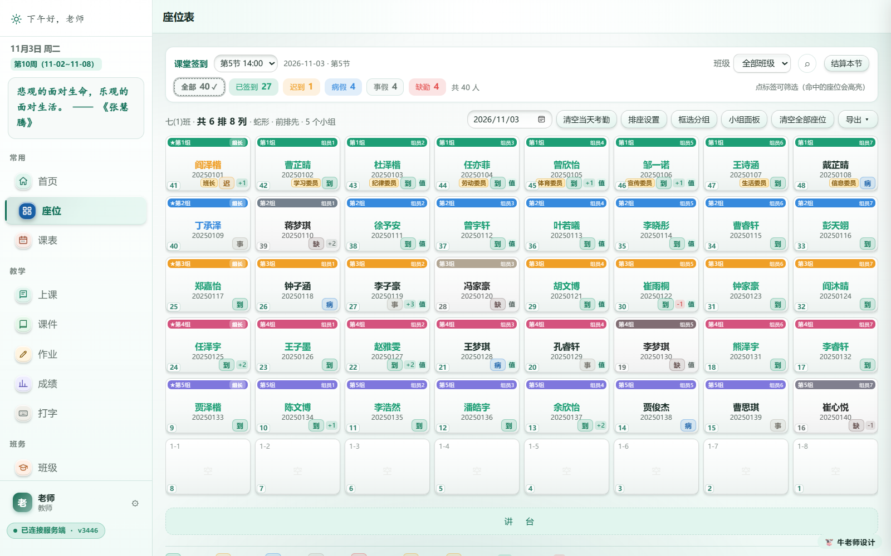

### 4. 课表 `#timetable`


先设节次，再按天排课；切到单个班看本班课表，切到「全部班级」看全周。
同一时段给同一个老师排了两个班，格子会标红提示冲突（图中周三第 3 节就是一例）。

### 5. 上课（课堂活动）`#guide`

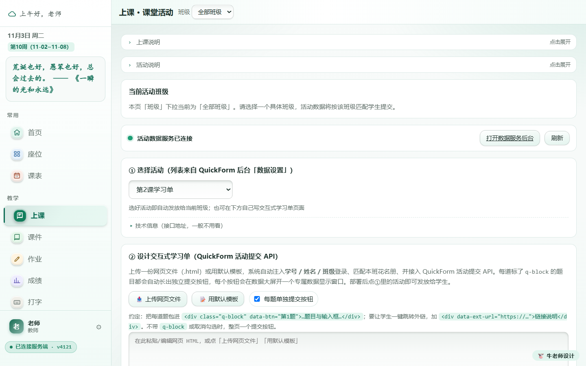

选一个 QuickForm 活动即完成发放，学生「今日」里对应的课立刻出现入口；
也可以在下方直接上传交互式学习单页面。课上在这里看数据大屏与学生作品。

### 6. 课件 `#courseware`


课件按「课节」归档在服务器上，支持 Word / Excel / PPT / PDF / 视频 / 音频 / 图片，
单个最大 300 MB，可批量上传；选中课节即可下发给班级，学生在「课程」里在线预览。

「浏览课件文件」提供**三种视图**，同一份文件列表，切换只看排版：

<table><tr>
<td width="50%">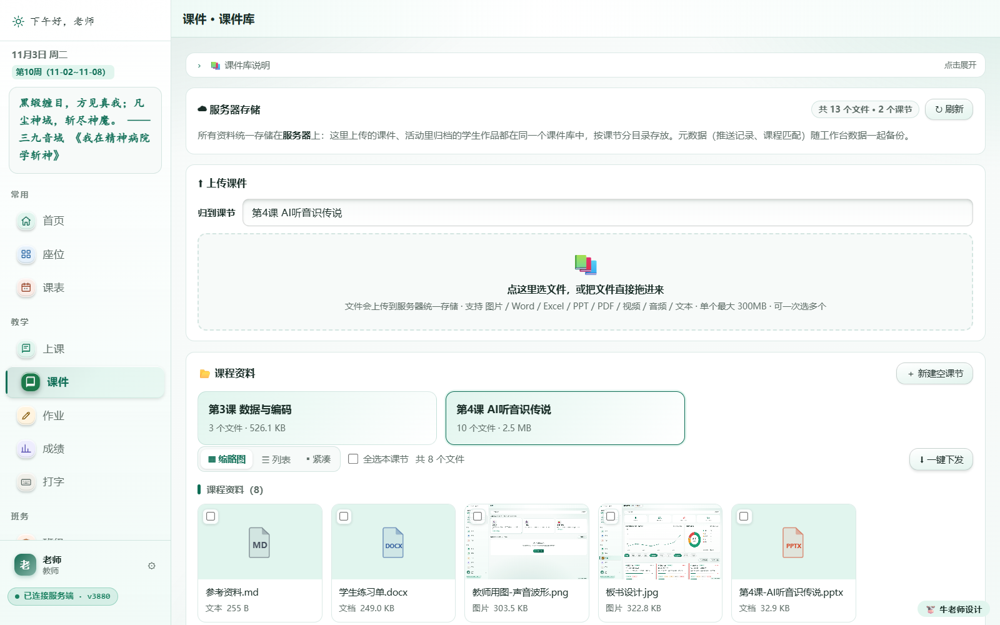<br>
<b>▦ 缩略图</b>：一张卡片一个文件，图片/视频直接看封面，找素材最快</td>
<td width="50%">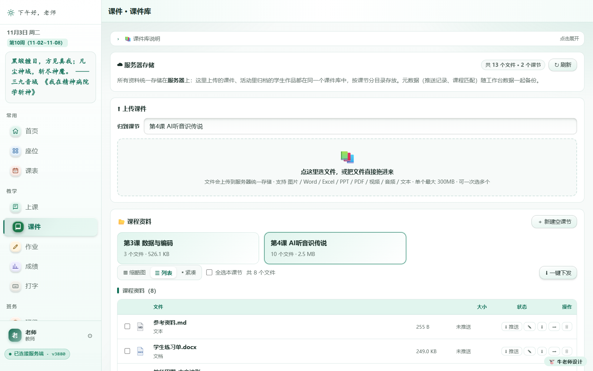<br>
<b>☰ 列表</b>：表头固定列，一眼核对<b>大小</b>与<b>推送状态</b>，适合逐条检查</td>
</tr></table>

还有 **▪ 紧凑**：双列小条目，一屏能扫几十个，课节里文件多时最省事。
视图选择记在本机，下次进来还是上次那个；换课节会自动清空已勾选，避免把别的课节的
文件误发出去。

配好视图后就是**批量下发**：勾选多个文件（支持 Shift 连选、全选本课节），点「一键下发」，
选一个或多个班级、填一个课节名，一次全发出去：

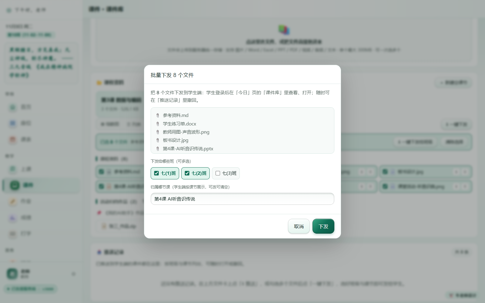

- 学生端「今日 · 课件库」立刻可见，课后也能在「课程」里回看；
- 已发过的组合会自动跳过，不会给学生端叠出重复卡片；
- 发错了在下方「推送记录」里一键撤回，文件本身仍留在课件库；
- **活动归档**（`_活动作品`，学生提交的作业作品）只读，不参与批量勾选——
  免得把某个学生的作品误发给别的班。

### 7. 作业 `#homework`


顶部是提交率趋势与状态构成（已交 / 迟交 / 订正 / 免交 / 未交），
下方按作业列出每个人的状态，可批量催交、导出收交明细。

### 8. 成绩 `#scores`


一场考试一张卡片，点开即看：参考人数、平均分、最高 / 最低、及格率、优秀率，
以及分数段分布；再往下的「分析报告」可做多维筛选与班级 / 小组对比。

### 9. 打字 `#typing`


一键开放给学生，学生端底部就会出现「打字」入口；这里同时能看到各班参与率、
最快速度与本周光星榜（图中演示实例尚未开放，所以显示 0/40）。

学生端的打字练习页有两处为「自己看着练」做的设计：

- **指法随按键走**：屏幕下方十根手指的图会跟着键盘实时亮起——当前该按哪根手指就抬起变色、
  外圈扩散一圈；敲下去的那一下再闪一次绿（敲错闪红），左右手区域同时点亮，
  学生不用低头数手指。按 Shift 组合键时，另一只手的 Shift 指会以虚线提示。
- **夜间模式**：顶栏右侧的 🌙 / ☀ 一键切换，偏好记在本机，学生端其它页面（今日、作业、
  课程、成绩、考勤）同步生效。夜间配色全部按 WCAG AA 校过对比度，
  深底浅字都过 4.5:1，晚自习或投影暗环境下不刺眼。

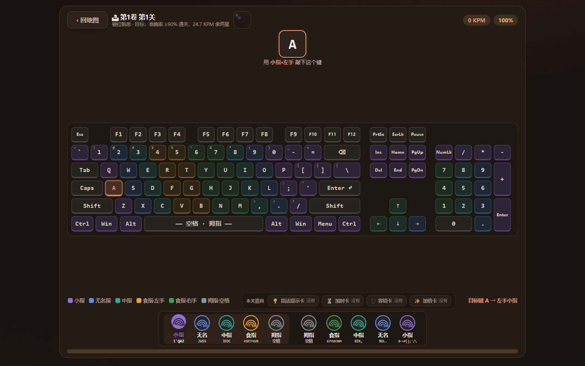

上图是夜间模式下的练习页：待打的是 `A`，左手小指抬起变色 + 外圈扩散，右下方「目标键 A → 左手小指」
同步提示；键盘上那颗键也在呼吸闪烁。

### 10. 班级 `#classes`


一个班一张卡：改班名教室、看人数与分组、导入名单、导出名单（Excel / CSV / 图片 / PDF）。
上方五个页签分别管 **班级信息 / 进度 / 值日 / 分组 / 德育**。

### 11. 学生 `#students`

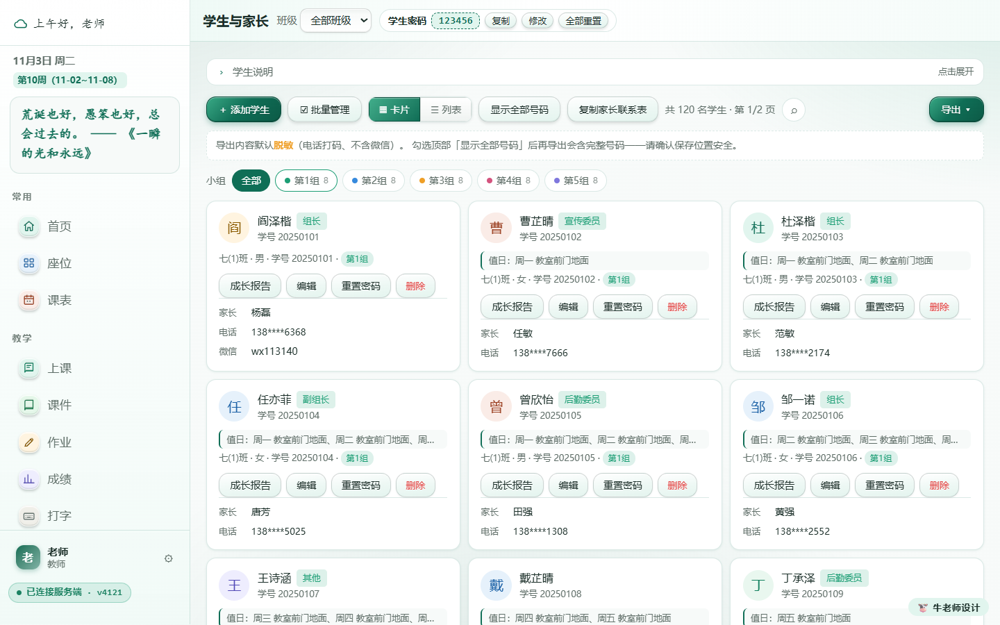

学生卡片带家长联系方式（默认脱敏显示，勾选后才显示完整号码）。
这里负责账号初始化、重置密码、查看成长报告、导出通讯录。

**单个学生忘了密码怎么办**：在卡片或列表行上点「重置密码」，当场给它设一个新密码
（弹窗里预填一个 6 位易读密码，如 `wbxdrhmc`，可改），顺手读给学生就行。
默认勾着「首次登录后要求学生自行修改」，学生用新密码进来会先被要求改掉。

> 留空则等同于「清掉独立密码，回落到班级初始密码」。
> ⚠️ 如果班级处在**独立密码模式**，留空会让这名学生登不进来——这种班级请务必填一个新密码。

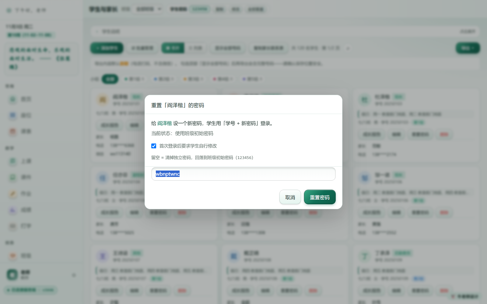

### 12. 待办 `#todos`

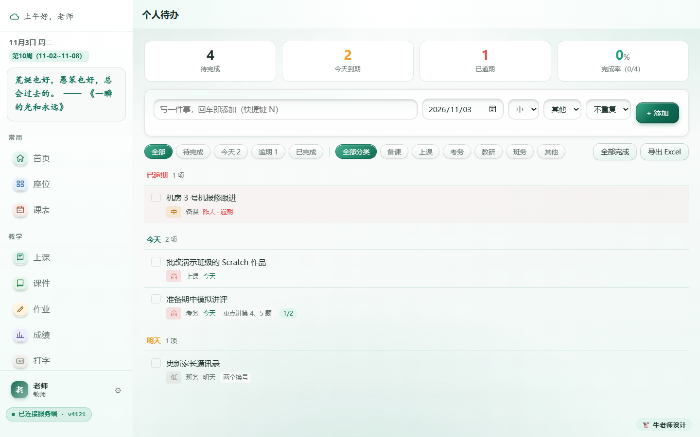

分「今天 / 本周 / 全部」，标截止日、优先级与关联班级，逾期自动标红。

### 13. 工具 `#tools`

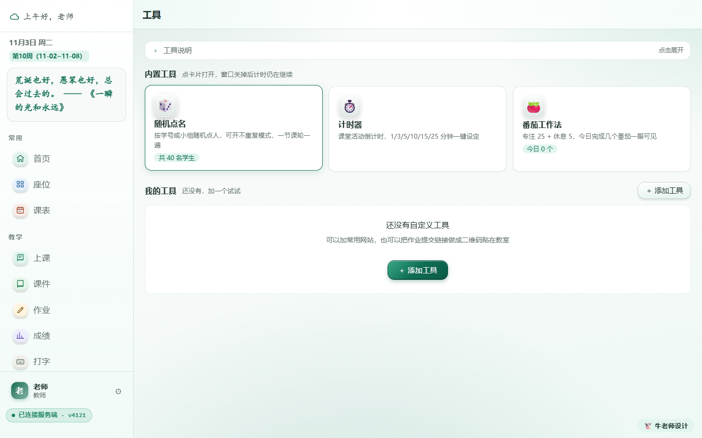

随机点名、计时器、番茄工作法，都可以在课堂上一键打开；
还可以把常用网站或作业提交链接做成自定义工具（自动生成二维码贴在教室）。

### 14. 设置 `#settings`

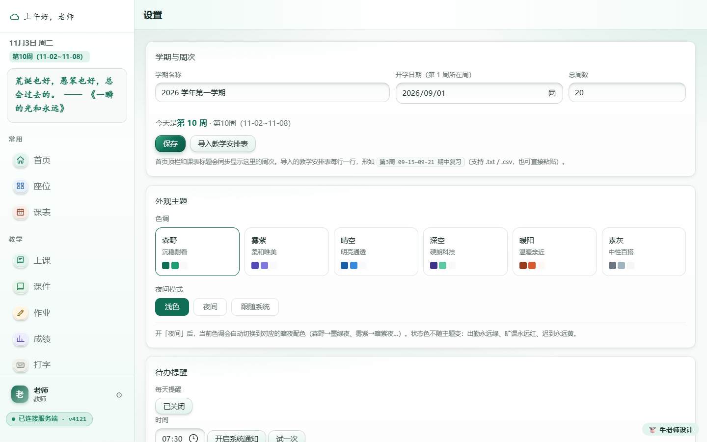

学期与周次、主题配色与夜间模式、待办提醒、密保、模块开关，
以及最重要的 **数据与备份**（一键导出 / 一键恢复）。

### 15. 学生端

学生打开 `/s/`，选班级、选自己的学号、输密码就能进；手机上是底部四个页签：

| 今日 | 作业 | 课程 | 座位 |
|---|---|---|---|
|  |  |  |  |
| 一键签到、今日课程与课堂活动入口、待交作业 | 全部作业与我的提交状态 | 老师推送的课程资源，点开在线预览 | 全教室座位表，自己那格橙色高亮 |

**座位表怎么「看懂」**（`docs/shots/student/s07-座位表.png`）：

- 讲台**永远画在最上方**。老师那边把讲台设在下方（`讲台方位 = 下`）时，
  学生端会把整张表上下翻转，让最靠近讲台的那一排落在最上面；
  排号仍按老师那张表数（老师说「你坐第 3 排」，学生端也显示第 3 排）。
- 表头写 **共 X 排 Y 列**，和教师端同一口径；网格**左侧标排号、顶部标列号**，
  「第几排第几列」一眼可查。
- 每个座位格与教师端座位卡同一套信息：顶部**组色小组条**（组名 + 组长★/组员号，
  格子窄时缩成★/编号）、**姓名**、**学号**（等宽小字）、左下角**座位号**、
  右下角**金色班干部职务牌**；考勤状态学生端一律不显示。
- 自己的座位用品牌色实心 + 白色内描边 + 呼吸光晕，姓名与其它格同字号；
  底部再写一行「你的座位：第 X 排第 Y 列」，图例说明橙块 = 我的座位。
- 夜间模式下自动换成深底方案，姓名、讲台条、图例都按 WCAG AA 校过对比度。

在**电脑浏览器**里打开同一个地址，会自动换成宽屏布局——左侧栏导航、统计卡横排、课程三列网格：

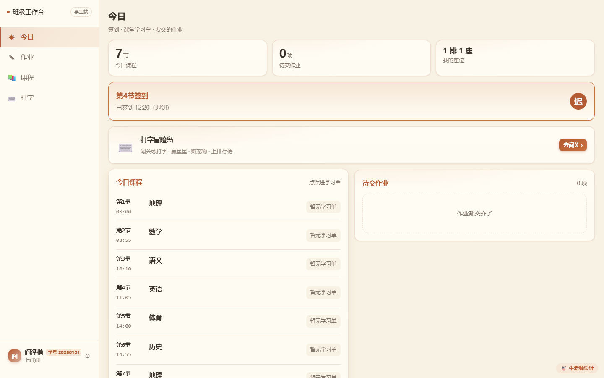

登录页长这样（`20-login-student.png`）：

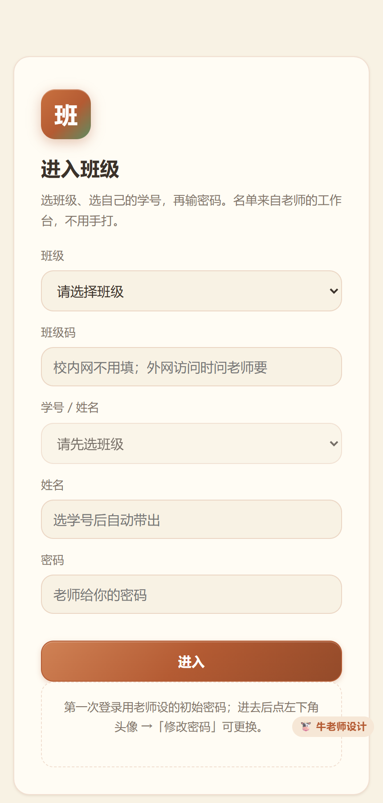

> 学生端的网页图标是橙底「学」字，和教师端的绿色图标区分开。
> 想放到桌面：在手机浏览器里「添加到主屏幕」，或在电脑上右键 → 新建 → 快捷方式，
> 填 `http://服务器IP:端口/s/` 即可；图标不理想时，可在快捷方式属性里手动指向
> `app\student\favicon.ico`。

学生端两套完整截图——**手机版 18 张**（登录 / 今日 / 作业 / 课程 / 座位表 / 个人信息 / 成绩 / 考勤 / 夜间 / 打字六图）
与 **PC 宽屏版 10 张**（1440×900，含宽屏布局对照表），连同每页的操作流程与状态说明，
见 **[docs/学生端界面一览.md](docs/学生端界面一览.md)**。

### 16. QuickForm 入口

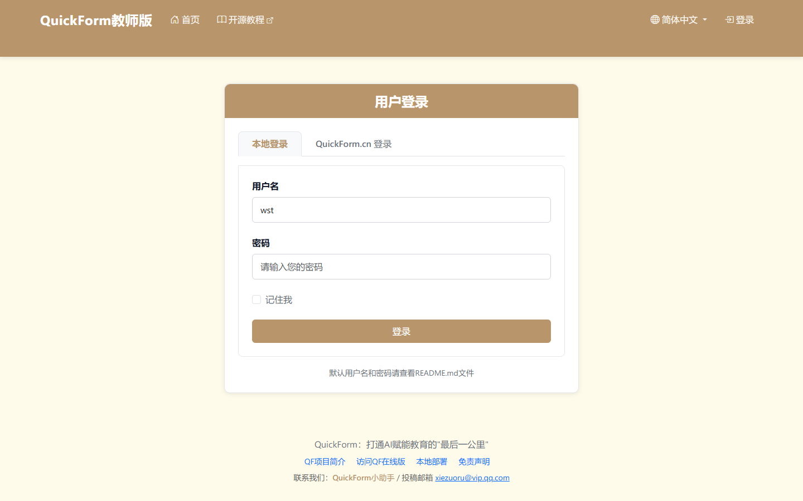

表单服务自带的后台（默认账号 `wst / quickform`，首次登录后请立刻改密码）。
工作台的活动任务、收集表与数据大屏都来自这里。

启动、复用与排障的完整方案见 **[docs/QuickForm服务一键启动与稳定运行方案.md](docs/QuickForm服务一键启动与稳定运行方案.md)**。

---

## 三、两种部署方式

同一套程序、同一份数据格式，两种装法，随时可以互相搬家：

| | 方式一：直接运行 | 方式二：Docker |
|---|---|---|
| 适合 | 教师机、笔记本、机房临时使用、无外网环境 | NAS、常开小主机、正式长期部署 |
| 前置 | Windows 10+ / macOS，Python 3.9+（或带运行时的离线包） | 装好 Docker 与 Compose |
| 启动 | 双击 `启动教师端` | `docker compose up -d` |
| 对外端口 | `20020`（QuickForm 走 `5055`） | `8080` 一个端口全包 |
| 需要外网 | 不需要 | 只在首次构建时需要 |
| 开机自启 | 需自行加计划任务 | 随 Docker 自启 |

> 已经在方式一里有数据、想换成方式二？在旧环境「一键导出」，在新环境「一键恢复」即可，见第八章。

**两种方式共同的部署前准备：**

| 项 | 要求 |
|---|---|
| 网络 | 学生设备与服务器必须在**同一个局域网 / 同一个 Wi-Fi**；机房请关闭路由器的 AP 隔离 |
| 地址 | 给服务器设固定 IP，或在路由器做 DHCP 保留，否则学生链接会变 |
| 磁盘 | 建议预留 20 GB 以上（课件、学生作品附件都存在本机） |
| 常开 | 关机或休眠 = 全班掉线 |
| 防火墙 | 放行上面那一个对外端口即可 |

---

## 四、方式一：直接运行（Windows / macOS，可完全离线）

在自己的电脑上直接开，不装 Docker，也不需要外网。

**前置**：Python 3.9 或更高。Windows 安装时务必勾选 **Add Python to PATH**。
如果拿到的是带运行时的离线包（`runtime/` 已内置 Python），则无需另外安装。

**启动：**

1. 把项目解压 / 克隆到本地目录（路径尽量不含空格与特殊符号）。
2. Windows 双击 `app\启动教师端.bat`；macOS 双击 `app/启动教师端.command`。
3. 脚本会自动做三件事：启动工作台（默认 `http://127.0.0.1:20020/`）、
   尝试拉起 QuickForm（`127.0.0.1:5055`）、打开浏览器。
4. 学生用手机访问 `http://<这台电脑的局域网 IP>:20020/s/`。

**常用启动参数**（追加在启动脚本后面，例如 `启动教师端.bat --port 20021`）：

| 参数 | 作用 |
|---|---|
| `--port 20020` | 指定工作台端口，被占用时换一个 |
| `--bind 0.0.0.0` | 监听地址，默认就是全部网卡（学生才连得上） |
| `--no-browser` | 启动后不自动打开浏览器 |
| `--reset-password` | 忘记教师密码时重置 |
| `--quickform background` | QuickForm 后台常驻（默认，关掉启动窗口也不停） |
| `--quickform foreground` | QuickForm 前台启动，日志直接打在窗口里，关窗即停 |
| `--quickform off` | 本次不启动 QuickForm |
| `--qf-port 5055` | 指定 QuickForm 端口（被占用会自动顺延） |
| `--qf-status` | 只看状态：进程 / 端口 / HTTP / 代理四条线 |
| `--qf-stop` / `--qf-restart` | 停止 / 重启后台常驻的 QuickForm |

不想记参数，也可以用 `app\` 下的三个快捷入口：
`启动教师端-QuickForm后台.bat`、`启动教师端-QuickForm前台.bat`、`QuickForm服务状态.bat`。

**注意：**

- 首次启动若 QuickForm 起不来（缺 Flask 等依赖），启动器会把缺哪个模块、装哪条命令
  直接打出来；这只影响 `/qf/` 与「活动」模块，考勤、导学单、作业、成绩等主功能照常可用。
  完整的环境检查、配置项、启动步骤与异常处理见
  [docs/QuickForm服务一键启动与稳定运行方案.md](docs/QuickForm服务一键启动与稳定运行方案.md)。
- 电脑休眠、锁屏断网都会让学生掉线，长期使用建议走方式二。
- 首次运行时 Windows 防火墙会弹窗询问，必须允许「专用网络」。

---

## 五、方式二：Docker 一键启动

### 1. 前置条件

| 项 | 要求 |
|---|---|
| Docker | NAS 用「容器 / Docker」套件；Windows / macOS 装 Docker Desktop；Linux 装 docker + compose 插件 |
| Compose | 支持 `docker compose`（v2 命令形式） |
| 网络 | 首次构建需要联网拉基础镜像与依赖，构建完成后可完全离线运行 |
| 端口 | 只需放行一个对外端口（默认 `8080`） |

### 2. 一键启动

```bash
git clone https://gitee.com/shyxiaoniu/teacher-workbench.git
cd teacher-workbench
cp .env.example .env          # 改下面「必改」的两项
docker compose up -d --build
```

等 10~30 秒，执行 `docker compose ps`，`workbench`、`quickform`、`gateway`
三个都是 `healthy` 就绪（`init` 是初始化容器，跑完即退出，属正常）。
浏览器打开 `http://<服务器IP>:8080/` 即可。

> **完全离线部署**：在有外网的机器上执行 `docker compose build`，
> 再用 `docker save` 导出镜像、拷到目标机 `docker load`，之后 `docker compose up -d` 不再联网。

### 3. 必要参数配置（`.env`）

不建 `.env` 也能启动（全部取默认值），但正式使用**至少改前两项**：

| 变量 | 默认值 | 是否必改 | 说明 |
|---|---|---|---|
| `QF_SECRET_KEY` | `please-change-me-to-a-random-string` | **必改** | QuickForm 会话密钥，不改则重启后要重新登录。用 `openssl rand -hex 24` 生成 |
| `WEB_PORT` | `8080` | 按需 | 唯一对外端口，被占用时改这里；二维码与学生链接会自动跟随 |
| `WB_INTERNAL_SECRET` | `wb-internal-change-me` | **建议改** | 工作台跨容器调用 QuickForm 的内部密钥，两个服务必须是同一个值。缺少或两端不一致时，「数据大屏」的清空 / 删除提交会返回 403 |
| `QF_ADMIN_USER` / `QF_ADMIN_PASSWORD` | `wst` / `quickform` | 按需 | QuickForm 首次启动创建的账号，库里已有账号时不会覆盖 |
| `TZ` | `Asia/Shanghai` | 不要动 | 考勤与每日快照按本地日期归档 |
| `WB_PUBLIC_URL` | 空 | 一般留空 | 只有前面再套域名 / 反向代理时才填完整地址 |
| `WORKBENCH_DEBUG_PORT` | `20020` | 一般留空 | 仅服务器本机的排障通道，不对外 |
| `WORKBENCH_VOLUME` / `QUICKFORM_VOLUME` | 见默认 | 不要动 | 命名卷名；改名等于换一个空卷，旧数据仍在原卷里 |

改完执行 `docker compose up -d` 生效。

### 4. 常用运维命令

| 目的 | 命令 |
|---|---|
| 看状态 / 看日志 | `docker compose ps` / `docker compose logs -f workbench` |
| 重启全部服务 | `docker compose restart` |
| 升级到新版本 | `docker compose up -d --build` |
| 停止（保留数据） | `docker compose down` |
| 忘记教师密码 | `docker compose exec workbench python launch.py --reset-password` |

> `docker compose down -v` 会连数据卷一起删除，**除非确定要清空，否则别加 `-v`**。

### 5. 首次设置

| 要做的事 | 怎么做 |
|---|---|
| 设教师账号和密码 | 打开 `http://<服务器IP>:8080/teacher/`，按提示创建，**同时设置密保问题**（忘记密码时靠它自助找回） |
| 改 QuickForm 密码 | 打开 `http://<服务器IP>:8080/qf/`，用默认账号 `wst / quickform` 登录后立刻修改 |

到这里系统就能用了，接下来把班级建起来。

---

## 六、第一次使用：把班级建起来

1. **建班级** —— 教师端「班级」页新建，填班级名、教室。
2. **导学生名单** —— 「学生」页可逐条添加，也可批量导入（支持从表格粘贴姓名与学号）。
3. **排课表** —— 「课表」页先设节次，再按周排课；排好的课会出现在首页「今日课程」。
4. **设学生登录方式** —— 「学生端控制台」里设置初始密码策略：
   - 全班统一初始密码（默认 `123456`）
   - 每人独立密码
   - 首次登录必须改密码（推荐）
   - 一键重置全班密码
5. **发导学单** —— 「导学单」页选班级、日期、节次，添加条目后发放，学生手机端「今日」立刻可见。

学生第一次登录：选班级 → 选学号（姓名自动带出）→ 输密码。

---

## 七、一堂课的典型用法

| 环节 | 老师做什么 | 学生做什么 |
|---|---|---|
| 课前 | 在「导学单」里放好本课资料、活动与测验，点「发放」 | —— |
| 上课 | 打开「座位表」，投影二维码或用 `/s/` 地址让学生进入 | 手机打开 `/s/`，进入「今日」 |
| 签到 | 座位表上实时看到谁已签到，点统计标签可筛选出未签到的人 | 点「一键签到」 |
| 课中 | 在「活动」里布置任务、看数据大屏；课件直接下发 | 在导学单里看资料、提交活动、作答测验 |
| 课后 | 「考勤」页结算本节，未签到自动转旷课；作业与成绩照常记录 | 在「我的」里看进度与评价 |

**考勤规则**（可在实践中按需调整）：登录即签到；上课后 5 分钟内签到算出勤，超过算迟到；
超过 15 分钟未签到且老师未标请假，自动记为缺勤。老师标记的**病假 / 事假优先**，学生端不开放请假入口，
统一由老师在座位表或考勤页登记。

---

## 八、数据、备份与换机

### 数据存在哪

| 部署方式 | 位置 |
|---|---|
| Docker | 两个命名卷：`teacher-workbench-data`（班级、学生、成绩、考勤、德育、导学单、课件、附件、每日快照）、`teacher-workbench-quickform-data`（QuickForm 库与提交附件）；`docker compose down` 不会删，`down -v` 才会删（**危险，别用**） |
| 直接运行 | 项目里的 `app/data` 目录（`workbench.db`、`typing.json`、`submissions/`、课件库、每日快照） |

### 备份：点一次就够

**教师端 ⚙ 系统设置 → 数据与备份 → 一键导出全量备份**

点一下、设一个备份密码（至少 6 位），即可得到一个 `.cwbackup` 加密文件，里面包含：

- 服务端整库（29 张表）+ 全部配置
- 教师账号、学生登录密码（只存哈希，不存明文）
- 打字练习成绩、金币与装扮
- 学生作品附件（单个 ≤ 10 MB、合计 ≤ 40 MB，超出部分导出时会点名提示）
- 浏览器里的界面设置与待办

课件库里的大文件（PDF / 视频 / 课件）体积大，用旁边的 **导出课程资料包** 单独打包。

### 换机：两步搬完

1. 新环境装好（方式一或方式二都行）并登录教师端
2. 系统设置 → 数据与备份 → **一键恢复** → 选文件、输入同一个备份密码

服务端数据与本机设置一起还原，刷新即用——不用重新建班，不用重发学生密码。
若还有课件文件，再点一次 **导入课程资料包**。

### 出错时会发生什么

备份与恢复都做了前置校验，**失败一定不改动任何数据**，并且会明确提示原因：

| 情况 | 提示与处理 |
|---|---|
| 文件不完整 / 被改过 | 校验和不通过，直接中止，本机数据不动 |
| 备份密码输错 | 提示「密码不对，或备份文件已损坏」 |
| 备份来自更新版本 | 提示先升级本机再导入 |
| 备份数据量明显少于本机 | 先拦下来并说明差多少；确认要覆盖才继续 |
| 服务端没启动 / 登录失效 | 提示具体原因，可以直接重试 |
| 本机已还原、服务端失败 | 明确告知「本机已还原、服务端未改动」，便于重试 |

> 系统每天首次启动会自动快照一份数据库，保留 14 份，误操作时可以先找回。
> **不要**手工拷贝数据库文件做迁移，用上面的一键导出 / 一键恢复最稳。

---

## 九、常见问题

**打不开页面**
先 `docker compose ps` 看是否 `healthy`；再确认服务器防火墙放行了 `WEB_PORT`（Windows 为「Windows Defender 防火墙 → 入站规则」）。

**学生手机连不上**
① 手机与服务器必须在同一局域网；② 用 `http://服务器IP:端口/s/` 而不是 `127.0.0.1`（Docker 默认 `8080`，直接运行是 `20020`）；③ 检查 Wi-Fi 是否开了 AP 隔离。

**学生端提示「从外网访问需要班级码」**
从公网 IP 拉班级名单需要班级码（名单含真实姓名学号，不能对全网开放）。校内同一 Wi-Fi 不用填；需要外网访问时，把教师端的「班级码」告诉学生填入即可。

**忘记教师密码**
登录页点「忘记密码」，回答密保问题即可自助改密。密保也忘了，在服务器上重置：

```bash
# Docker 部署
docker compose exec workbench python launch.py --reset-password

# 直接运行（Windows）
app\runtime\win-x64\python\python.exe app\launch.py --reset-password
```

**学生忘了自己的密码，进不来**
教师端「学生」页找到这名学生，点卡片或列表行上的**重置密码** → 弹窗里已经预填了一个
6 位易读密码（如 `wbxdrhmc`，可改）→ 点「重置密码」，把新密码读给学生即可。
默认勾着「首次登录后要求学生自行修改」，学生进来会先被要求改掉。

> 弹窗里如果把密码留空，等于「清掉独立密码、回落到班级初始密码」。
> 班级处在**独立密码模式**时别留空——那样这名学生会一直登不进来。

**直接运行时报「python 不是内部或外部命令」**
说明没装 Python 或没加进 PATH。重装时勾选 **Add Python to PATH**，或改用带 `runtime/` 的离线包。

**双击启动脚本后窗口一闪就没了**
多半是端口被占用或依赖缺失。用命令行运行 `app\launch.py` 能看到具体报错；端口冲突时加 `--port 20021` 换一个。

**改了端口，二维码还是旧地址**
二维码与学生入口按「老师当前打开的地址」自动生成，改端口后重启服务即可；若仍不对，多半是用 `127.0.0.1:端口` 打开的——换成服务器局域网 IP 访问，或（Docker）设置 `WB_PUBLIC_URL`。

**QuickForm 页面打不开**
它只是配套服务，不影响考勤 / 导学单 / 成绩等主功能。

```bash
# Docker
docker compose ps
docker compose logs -f quickform
```

直接运行时看启动窗口里的 `[3/5] QuickForm` 那一行；缺失 Flask 等依赖会导致它起不来，
按提示安装依赖，或改用 Docker 部署。

**时区不对 / 考勤日期错位**
Docker 部署确认 `.env` 里 `TZ=Asia/Shanghai` 没有被覆盖，改完重启容器；直接运行则跟随系统时区。

**想升级到新版本**
```bash
# Docker（自己构建）
git pull && docker compose up -d --build
```
端口、数据卷、环境变量全部沿用，数据不会丢。直接运行的方式：备份后在旧目录 `git pull`，
或新目录跑起来用「一键恢复」把数据搬过去。

---

## 十、版本与许可

- **当前发行版本：2.0**
- 版本号更新位置见 [docs/版本号维护说明.md](docs/版本号维护说明.md)
- 本项目以 **MIT 许可证** 发布，全文见 [LICENSE](LICENSE)，Copyright (c) 2026 Shyxiaoniu

任何人都可以免费使用、修改、再发布本项目，唯一义务是保留版权与许可声明。
仓库中**不含任何真实班级、学生或成绩数据**，克隆下来是一个空工作台，首次访问会让你设置自己的账号密码。

### 许可范围（重要：两套 MIT，两个版权人）

本仓库里**不是所有代码都属于本项目**，按目录划分：

| 目录 | 归属 | 许可证 | 版权人 |
|---|---|---|---|
| `app/`、`docker/`、`tools/`、`docs/`、根目录各文档 | 本项目原创 | MIT | Copyright (c) 2026 Shyxiaoniu |
| `quickform/app/` | **QuickForm 教师版 2.5 官方源码，零改动** | MIT | **Copyright (c) 2026 xiezuoru（版权所有 (c) 2026 谢作如）** |
| `quickform/` 下除 `app/` 之外（`serve.py` / `init_admin.py` / `Dockerfile` / `docker-entrypoint.sh`） | 本项目原创的适配层 | MIT | Copyright (c) 2026 Shyxiaoniu |

**QuickForm** 是温州科技高级中学 AI 科创中心联合温州大学开发的智能表单管理服务，
上游仓库 <https://gitee.com/wstlab/quickform>，以 MIT 许可证开源。
本项目把它整体放进 `quickform/app/` 作为 `/qf/` 独立容器运行，**没有改动其源码**，
其许可全文与版权声明随源码保留在 [quickform/app/LICENSE](quickform/app/LICENSE)。
MIT 的义务只有一条：再分发时保留版权声明与许可全文——所以**转发本项目或发行包时，
请不要删掉 `quickform/app/LICENSE`**。

QuickForm 前端还带了一批第三方库（Bootstrap 5.1.3 / Bootstrap Icons 1.10.5 均 MIT、
highlight.js 11.7.0 为 **BSD-3-Clause**、marked 15.0.12 MIT、qrcodejs MIT），
完整清单、版本、位置与 Python 依赖许可见 **[THIRD-PARTY-NOTICES.md](THIRD-PARTY-NOTICES.md)**。

### 你可以做什么

- 免费用于个人教学、学校内部部署、商业或非商业用途；
- 修改源码、改界面、加功能，改成自己学校的样子；
- 复制、分发、放进自己的发行版，甚至收费分发；
- 唯一要求：**保留 `LICENSE`、`quickform/app/LICENSE` 与 `THIRD-PARTY-NOTICES.md`**，不要把别人的版权声明删掉或改成自己的。

### 你不可以做什么（限制）

- **不得用原作者名义背书**：不能用「Shyxiaoniu」「谢作如」或「QuickForm 官方」的名义推广你的衍生版本，
  也不能暗示本项目获得了 QuickForm 上游的官方认证；
- **不得去掉 QuickForm 页面里的免责声明与来源链接**（页脚的「免责声明」「访问 QF 在线版」「联系我们」）；
- **不得违反 BSD-3-Clause 的禁止背书条款**：使用 highlight.js 时不得以其贡献者名义为衍生产品背书；
- **不得把本项目用于违法用途**，包括但不限于未经授权收集、买卖学生个人信息；
- 本项目**不含任何真实数据**。若你在自己的部署里录入学生信息，那是你的数据处理行为，
  **相关合规责任（告知、同意、最小必要、安全保管）由部署者承担**，与代码作者无关。

### 免责声明

1. 本项目按**「原样」**提供，**不提供任何明示或暗示的担保**（包括适销性、特定用途适用性、不侵权）。
   使用过程中出现的数据丢失、判定错误、服务中断、设备损坏等，由使用者自行承担。
2. 签到、考勤、成绩、德育等记录属于**日常教学记录，不构成法律意义上的证明**。
   涉及学生权益的重要结论，请以学校正式流程与纸质材料为准，并另行备份。
3. **请勿存储身份证号、家庭住址、健康状况等敏感个人信息**；姓名、学号等必要信息请在取得学校许可、
   并告知学生与家长的前提下使用。QuickForm 侧的官方提醒保持原样未改动，详见其
   [免责声明](https://my.feishu.cn/docx/KYlJdyq3wojmwox8KJTcnKORnob)。
4. 部署到公网或校园网前请自行加固（改默认口令、换 `QF_SECRET_KEY`、限访问范围、上 HTTPS、定期备份），
   **未加固导致的风险由部署者承担**。
5. 本项目与 QuickForm 上游作者**无隶属或背书关系**。


---

## 十一、发行包（离线分发）

给同事、给机房、给自己留底，用发行包最省事：解压、双击、就能用，不用装 git、不用联网。

### 命名规则

```
班级工作台<主版本.次版本>-<yyMMdd>.zip
例：班级工作台2.0-261103.zip   ← 版本 2.0，打包日期 2026-11-03
```

版本号取自 `app/server.py` 的 `VERSION`，日期取打包当天的年月日（`yyMMdd`）。
改版本时只需改 `VERSION` 一处（详见 [docs/版本号维护说明.md](docs/版本号维护说明.md)）。

### 构建方式

发行包**不手工打包**，由仓库里的脚本生成，避免把真实数据带出去：

```bash
python tools/make_release.py                 # 版本取 VERSION，日期取当天
python tools/make_release.py --date 261103    # 指定日期（yyMMdd）
python tools/make_release.py --out D:\dist    # 指定输出目录（默认 dist/）
```

脚本会自动跳过：运行期数据（`app/data/`、`submission-system/data/`、QuickForm 库与上传附件）、
课件库（`app/courseware/`）、数据库与日志、`.git`、`_analysis/`、`__pycache__`。
产物落在 `dist/` 下（该目录已被 `.gitignore` 忽略，不会误提交）。

### 包里有什么

| 路径 | 内容 |
|---|---|
| `启动工作台.bat` / `.command` | 双击启动（Windows / macOS），参数原样传给 `app/launch.py` |
| `发行说明.md` | 版本、日期、启动方式、数据位置、重新构建方法 |
| `app/` | 主程序：服务端、教师端页面、学生端（含网页图标）、打字练习、提交系统、图标 |
| `quickform/` | 表单服务 QuickForm（`app/` 为官方源码，零改动，自带 `LICENSE`） |
| `docker/` + `Dockerfile` + `docker-compose.yml` + `.env.example` | 容器化部署所需全部文件 |
| `docs/` | 9 份使用与设计文档 + `docs/shots/` 下的功能截图（教师端 / 学生端手机版 / 学生端 PC 版 / QuickForm），README 离线也能正常显示 |
| `README.md` / `LICENSE` | 使用说明与本项目的 MIT 许可证 |
| `THIRD-PARTY-NOTICES.md` | 第三方组件清单（QuickForm 的 MIT 与版权、前端库版本、依赖许可） |
| `quickform/app/LICENSE` | **QuickForm 上游 MIT 全文**，Copyright (c) 2026 xiezuoru，再分发时不可删除 |

**不含**：任何真实班级 / 学生 / 家长 / 成绩数据、数据库文件、日志、上传附件、课件库、`.git`。
解压出来是一套空白工作台，首次打开会让你设置自己的账号密码。

当前这一版（`2.0` / `261103`）：201 个文件，解压后约 18.1 MB，压缩包约 14.5 MB
（含 63 张功能截图：教师端 25、学生端手机版 18、学生端 PC 版 10、QuickForm 10）。
解压后直接启动做过冒烟校验：首页、教师登录、学生端、`/favicon.ico`、`/s/favicon.ico`、
`/s/manifest.webmanifest` 均正常返回。

> 想要「内置 Python 运行时、连 Python 都不用装」的版本，在联网机器上先跑
> `quickform/app/scripts/_build_win_runtime.sh` 生成 `runtime/`，再把整个目录打包即可。

---

## 十二、参考文档

| 文档 | 内容 |
|---|---|
| [app/使用说明.md](app/使用说明.md) | 各页面细节、考勤标签含义、备份与迁移的完整说明 |
| [docs/课堂系统工作流程-v2-学生机可联网-2026-11-01.md](docs/课堂系统工作流程-v2-学生机可联网-2026-11-01.md) | 考勤、导学单、提交统计三大环节的处理流程 |
| [docs/使用场景与三端架构-2026-11-01.md](docs/使用场景与三端架构-2026-11-01.md) | 教师端、学生端、服务端的协作方式 |
| [docs/导学单数据流设计.md](docs/导学单数据流设计.md) | 导学单从创建到学生端展示的数据流转 |
| [THIRD-PARTY-NOTICES.md](THIRD-PARTY-NOTICES.md) | 第三方组件清单：QuickForm 的 MIT 与版权、前端库版本、Python 依赖许可、免责声明 |

---

<p align="center">班级工作台 2.0 · MIT License · Copyright (c) 2026 Shyxiaoniu</p>
<p align="center">内含 QuickForm 教师版（MIT License · Copyright (c) 2026 谢作如），见 <code>quickform/app/LICENSE</code></p>
