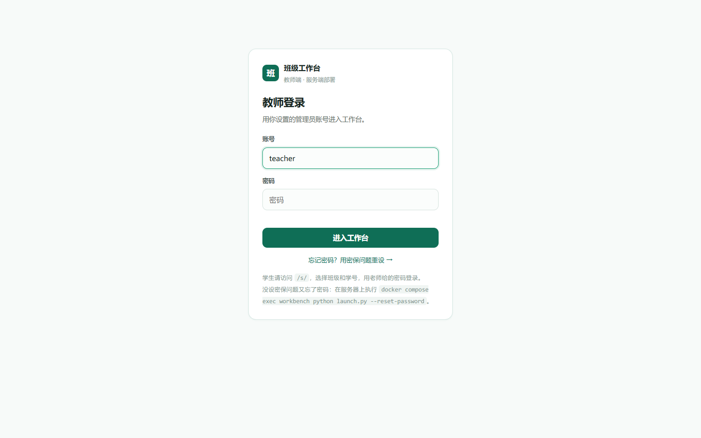
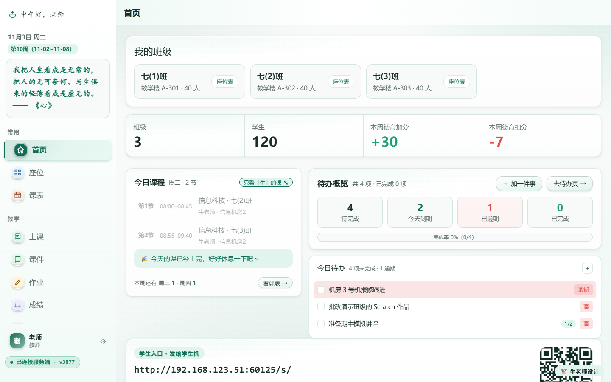
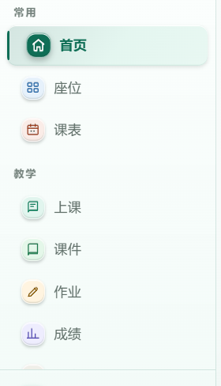
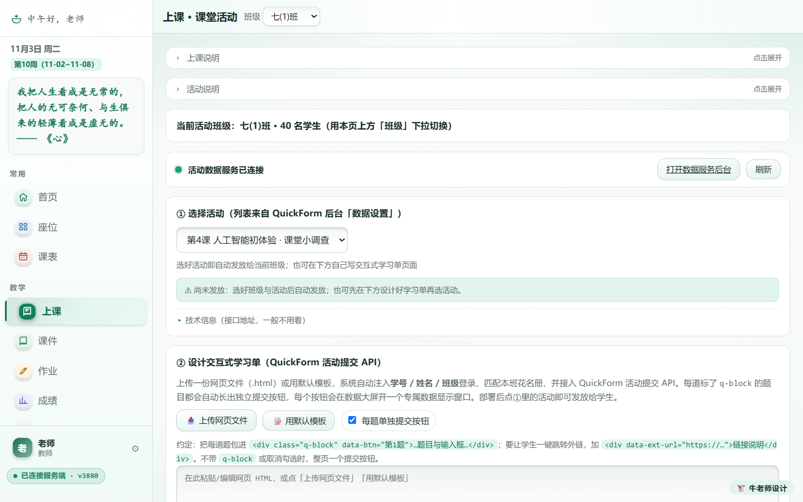
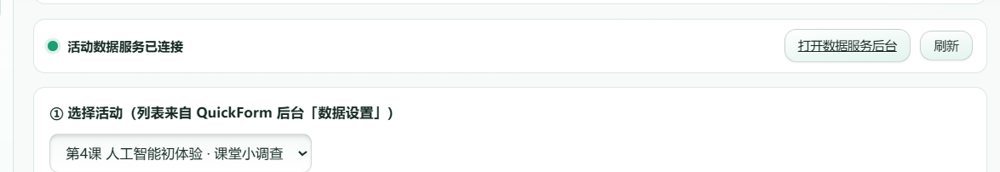
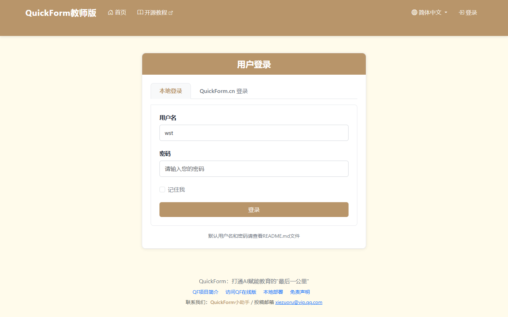
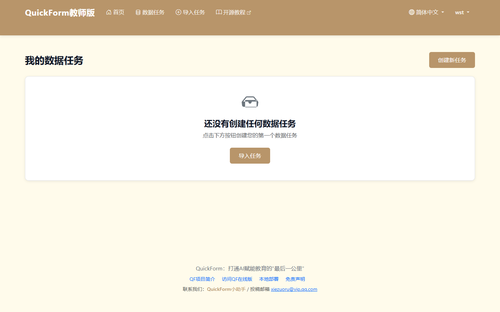
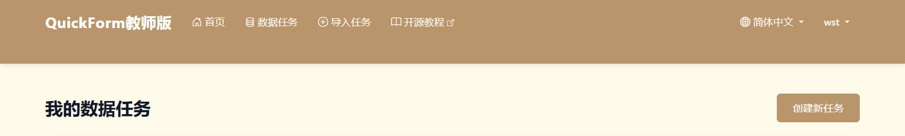
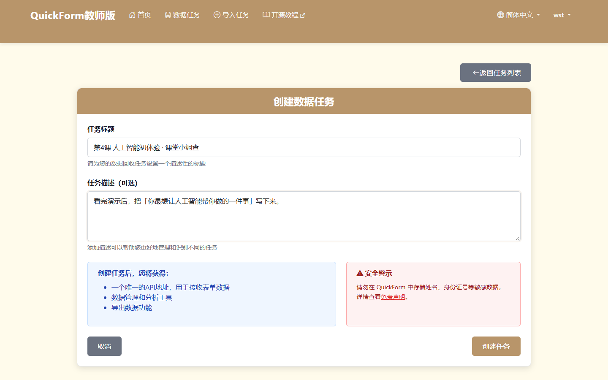
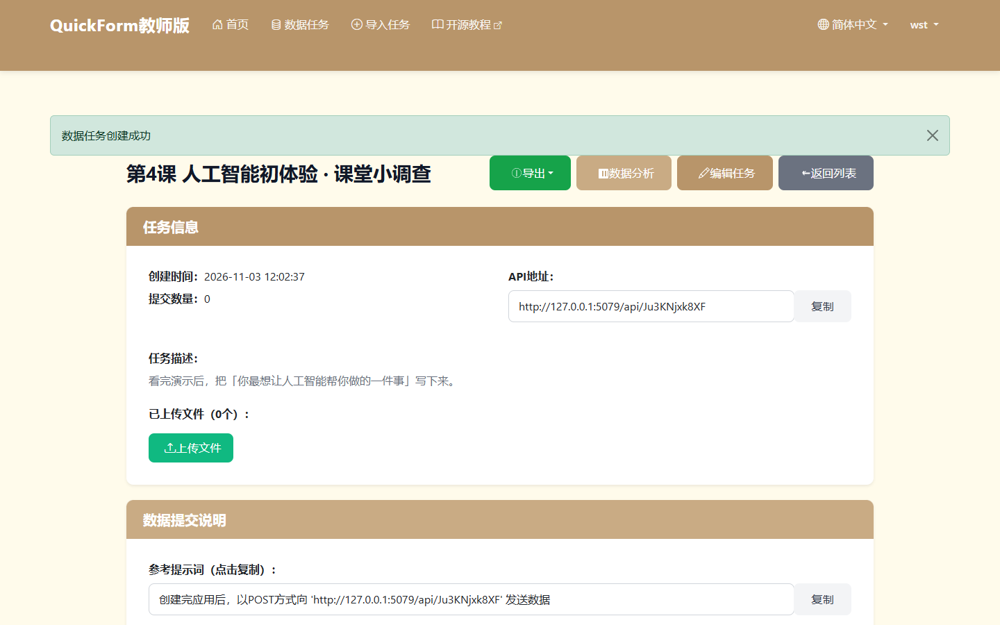

# QuickForm 服务一键启动与稳定运行方案

> 适用版本：班级工作台 2.0（桌面一键启动形态 / 非 Docker）
> 覆盖范围：教师机双击启动 → QuickForm 本地服务（默认 `127.0.0.1:5055`）的**拉起、复用、检查、停止**
> 对应代码：`app/launch.py`（启动器）、`app/core/qfctl.py`（服务生命周期）、`app/*.bat`（快捷入口）

---

## 〇、本文的截图标注约定

全文步骤统一编号为 **S1～S12**（路径 A）与 **S1′/S5′**（路径 B，仅两处差异）。每个步骤的「截图」栏固定给出四项，缺一即为标注不完整：

| 标注项 | 说明 |
|---|---|
| **截图编号 · 文件名** | 例如「截图 04 · `q03-上课-课堂活动.png`」，编号与第八节清单、与下文内嵌图片一一对应 |
| **菜单路径** | 从登录后首页出发的点击路径，精确到「哪个分组、第几项」 |
| **应见按钮 / 控件** | 该步骤必须出现、且老师要点到的按钮或输入框 |
| **关键字段 + 预期状态** | 字段名、应有取值、以及"什么样才算过" |

**两类步骤的区分**：S1～S3、S5 是**终端输出**（黑底命令窗口，只有文字滚动，没有按钮与菜单），因此不配界面截图，改为「可复制的输出原文 + 字段核对表」，便于排错时直接对照；**S4 起进入浏览器界面，全部使用 PC 端 1440×900 实拍截图**，每个步骤一张，必要时再补一张局部定位图（文件名带 `a` 后缀）指认按钮位置。

> 局部定位图是从整屏图上裁下来的原图局部，未做任何重绘或拼接，见 `q02a` / `q03a` / `q05a`。

---

## 一、方案要达到的效果

| 目标 | 落地方式 | 怎么确认 |
|---|---|---|
| 一键启动，不用记命令 | 双击 `启动教师端.bat`，默认把 QuickForm 一起拉起来 | 启动后横幅里出现 `QuickForm http://127.0.0.1:20020/qf/` |
| 后台 / 前台可自选 | `--quickform background` / `foreground`，或两个专用 bat | 状态块「启动方式」一行显示实际模式 |
| 重复触发不自伤 | 先探活再决定：已在跑就**只提示、不再起第二个进程** | 出现「服务已在运行 —— 直接复用，不再启动第二个实例」 |
| 老师能立刻找到入口 | 状态块直接打印工作台入口地址，并自动打开浏览器 | 浏览器落地页为 `/teacher/`，左侧「教学 → 上课」可见 |
| 出问题知道怎么办 | 检查项逐条给结论，失败给命令级处置建议 | `[1/6]`～`[6/6]` 六步每步都有 ✓ / ✗ 与原因 |

### 四条判定线（缺一不可）

「启动成功」不是看窗口有没有报错，而是四层同时成立：

| # | 判定层 | 判定方法 | 通过标准 |
|---|---|---|---|
| ① | 进程 | 读 `data/quickform.runtime.json` 里的 PID，用 `OpenProcess` + `GetExitCodeProcess` 判断是否 `STILL_ACTIVE` | PID 存活，且不是系统复用的号 |
| ② | 端口 | `connect_ex` 探测 `127.0.0.1:5055` | 能建立 TCP 连接 |
| ③ | HTTP | `GET /login`，读前 4KB 判断响应体是否含 `QuickForm` / `登录` | 状态码 2xx/3xx 且内容对得上 |
| ④ | 链路 | 经工作台反代 `GET /qf/login`（教师端「上课」页走的就是这条） | 状态码 2xx/3xx |

只做 ①② 会出现「进程在、端口开、页面 500」的假阳性，所以 ③④ 必须一起看。`--qf-status` 会把四条线逐条打印。

> 第 ③④ 条的**人工验收**落在界面上：截图 06（直连 `/login`）与截图 04/05（经 `/qf/` 反代后「上课」页的活动下拉）。这两张图能正常出现，就等价于 ③④ 通过。

---

## 二、启动前的环境与依赖检查

> 这一步在启动器里是 `[1/6] QuickForm 启动前检查`，也可以单独用 `--qf-status` 复核。
> **本阶段全部在终端完成，不涉及界面点击**，因此无界面截图；判断依据见下表的「启动器里的呈现」一列。

| 检查项 | 判断标准 | 启动器里的呈现 | 未通过时怎么处置 | 验证方式 |
|---|---|---|---|---|
| Python 版本 | ≥ 3.7 | `班级工作台 2.0 · 启动器` 能打印出来即通过 | 安装 python.org 官方包，勾选 Add to PATH | 命令行 `python -V` |
| 工作台文件完整 | `server.py` / `index.html` / `student/index.html` / `core/store.py` / `submission-system/server.py` 都在 | 缺文件会直接 `✗ 部署包不完整` 并列出缺失项 | 整个文件夹一起拷贝，不要只拷单个文件 | 看启动器是否停在 `[1/6]` 之前 |
| 数据目录可写 | 能在 `data/` 下创建并删除 `.write_probe` | 失败会 `✗ 数据目录不可写` | 把整个文件夹放到「文档 / 桌面 / D 盘」 | 手动在 `data/` 新建一个 txt 试试 |
| QuickForm 源码 | 存在 `quickform/app/app.py`（或 `serve.py`） | `源码目录  …\quickform\app  ✓` | 解压官方源码到 `quickform/app/`；或改用外部服务 `WB_QUICKFORM_URL` | 目录里能否看到 `app.py`、`templates/`、`static/` |
| 启动入口 | 优先 `serve.py`（含 `/qf` 前缀适配），否则 `app.py` | `启动入口  app.py  ✓` | 源码不完整就重新解压 | 同上 |
| Python 依赖 | `flask / flask_sqlalchemy / flask_login / flask_bcrypt / flask_babel / sqlalchemy / werkzeug` 全部可 import | `依赖  Flask 全家桶齐全  ✓`；缺了会列出模块名 | 按提示执行 `"<解释器>" -m pip install -r quickform/app/requirements.txt`，或改用随包运行时 | 重启一次启动器看 `依赖` 一行是否变 ✓ |
| 端口可用 | 首选 5055：先 `connect`（有人在听就跳过），再 `bind`（不加 `SO_REUSEADDR`） | `端口  5055 空闲  ✓` / `5055 上已有实例在跑（PID …）→ 将直接复用` / `被占用（PID …），将接管或自动顺延` | 关掉占用程序，或用 `--qf-port 5060` 指定 | `netstat -ano | findstr :5055` |
| 数据库文件 | `quickform/app/data/quickform.db` 可读写（首次启动会自动建） | 启动日志里出现 `Running on http://127.0.0.1:5055` | 文件被占用时关掉另一个 QF 进程；损坏则改名备份后重启 | 启动后 `--qf-status` 的 ③ 是否为 200 |

### 依赖缺失时的真实表现（务必按提示装，不要盲猜）

```
[1/6] QuickForm 启动前检查
  源码目录  E:\...\quickform\app  ✓
  启动入口  app.py  ✓
  解释器    D:\...\python.exe
  依赖      缺少 flask、flask_sqlalchemy、flask_login、flask_bcrypt、flask_babel、sqlalchemy、werkzeug  ✗
            处置："D:\...\python.exe" -m pip install -r "E:\...\quickform\app\requirements.txt"
```

> 提示：`python.org` 装的系统 Python 默认**没有** Flask；随包运行时（项目根 `runtime/win-x64/python/`）已内置。启动器挑解释器的顺序是
> `WB_QF_PYTHON` → `runtime/win-x64/python/python.exe` → `runtime/python/python.exe` → `quickform/runtime/...` → `.venv` → 当前解释器，取第一个存在的。

---

## 三、配置项

### 3.1 配置文件（推荐老师改这里）

`data/config.json`：

```json
{
  "port": 20020,
  "quickform": {
    "mode": "background",
    "port": 5055,
    "secret": ""
  }
}
```

| 键 | 默认 | 作用 | 可选值 / 说明 |
|---|---|---|---|
| `quickform.mode` | `background` | 启动方式 | `background` 后台常驻（关掉启动窗口也不停）；`foreground` 前台（日志就在窗口里，关窗即停）；`off` 不启动 |
| `quickform.port` | `5055` | QuickForm 监听端口 | 5055 被别的程序占用时，启动器会顺延到 5056…5064，并在状态块里说明实际端口 |
| `quickform.secret` | 空 | Flask 会话密钥 | 留空则用 `SECRET_KEY` 环境变量或内置值；固定下来可以避免重启后登录态失效 |

> 改完不需要重启工作台，下次启动生效。工作台侧访问地址始终走同源 `/qf/`，**换端口不用改前端**。

### 3.2 环境变量（高级 / 排障用）

| 变量 | 作用 |
|---|---|
| `WB_QUICKFORM_URL` | 指向**外部** QuickForm（如 NAS 上的容器）。设置后启动器不再拉起本地进程，只做探活 |
| `WB_QF_PYTHON` | 指定跑 QuickForm 的解释器（多套 Python 并存时用） |
| `WB_QF_APP_DIR` | 指定 QuickForm 源码目录（换源码、跑多份实例时用） |
| `QUICKFORM_PORT` | QuickForm 自身读取的端口；启动器会自动注入，一般不用手写 |

### 3.3 命令行

| 命令 | 用途 |
|---|---|
| `python launch.py` | 默认：后台启动 QuickForm |
| `python launch.py --quickform background` | 显式后台常驻 |
| `python launch.py --quickform foreground` | 前台启动（日志打进当前窗口） |
| `python launch.py --quickform off` | 只要工作台，不起 QuickForm |
| `python launch.py --qf-port 5060` | 指定 QuickForm 端口 |
| `python launch.py --qf-status` | **只看状态**，不启动任何服务 |
| `python launch.py --qf-stop` | 停止后台常驻实例 |
| `python launch.py --qf-restart` | 先停再起（僵死时用） |

### 3.4 快捷入口（给不记命令的老师）

| 文件（`app/` 目录下） | 等价命令 | 说明 |
|---|---|---|
| `启动教师端.bat` | `launch.py` | 日常用这个，后台模式 |
| `启动教师端-QuickForm后台.bat` | `launch.py --quickform background` | 明确走后台 |
| `启动教师端-QuickForm前台.bat` | `launch.py --quickform foreground` | 需要看 QF 日志时用 |
| `QuickForm服务状态.bat` | `launch.py --qf-status` | 双击即可看四条判定线，看完 `pause` 停住 |

---

## 四、启动步骤（后台 / 前台两条路径）

### 路径 A｜后台启动（默认，推荐日常使用）

**S1 · 双击启动入口**

| 项 | 内容 |
|---|---|
| 操作 | 打开 `app/` 目录，双击 `启动教师端.bat`（或 `启动教师端-QuickForm后台.bat`） |
| 判断标准 | 弹出黑底命令窗口，首屏三行是 `班级工作台 2.0 · 启动器` / `目录：…` / 分隔线 |
| 验证方式 | 窗口不闪退（闪退 = Python 没装好或被杀软拦截，见第六节末行） |
| 截图 | **无界面截图**——本步是文件资源管理器里双击，进入的窗口只有滚动文字，没有按钮与菜单。窗口内容见 S2～S5 的输出原文 |

**S2 · 读 `[1/6] QuickForm 启动前检查`**

| 项 | 内容 |
|---|---|
| 操作 | 看窗口里 `源码目录 / 启动入口 / 解释器 / 依赖 / 端口` 五行 |
| 判断标准 | 源码、入口、依赖三行末尾是 `✓`；端口行为「空闲」或「已有实例在跑 / 被占用（将接管或顺延）」 |
| 验证方式 | 若依赖行是 `✗`，按它给出的 `pip install -r` 命令装完再双击一次 |
| 截图 | **无界面截图**（终端输出）。核对字段：`源码目录` 指向 `…\quickform\app`、`启动入口` 为 `app.py`、`依赖` 为「Flask 全家桶齐全 ✓」 |

**S3 · 读 `[2/6] 检查端口 20020`**

| 项 | 内容 |
|---|---|
| 操作 | 看是否打印 `端口可用  ✓` |
| 判断标准 | 出现 `端口可用  ✓`；若显示 `端口上已有本工作台在运行 → 直接复用`，说明上次实例没关，本次**不会**起第二个（直接跳到第五节） |
| 验证方式 | 浏览器访问 `http://127.0.0.1:20020/api/v2/ping`，返回 JSON 且 `service` 为 `workbench` |
| 截图 | **无界面截图**（终端输出）。这是接口地址，不是日常操作路径，故不给界面图 |

**S4 · 读 `[3/6] 启动工作台服务` → 浏览器出现登录页**

| 项 | 内容 |
|---|---|
| 操作 | 等窗口打印 `服务已就绪  ✓`，并进入 `[4/6]` |
| 判断标准 | 该行出现；任务管理器里有一个 `python.exe` 监听 20020 |
| 验证方式 | 浏览器能打开教师端登录页（即下面的截图 01） |
| 截图 | **截图 01 · `q01-教师端登录.png`**（步骤 S4）<br>· 菜单路径：无（启动器自动打开的落地页）<br>· 应见按钮：「进入工作台」绿色主按钮；「忘记密码？用密保问题重设 →」文字链接<br>· 关键字段：`账号`（预填 `teacher`）、`密码`（空）<br>· 预期状态：页面标题区为「班级工作台 / 教师端 · 服务端部署」，卡片标题「教师登录」，无任何红色报错 |



**S5 · 读 `[4/6] QuickForm 服务`（后台模式的核心一步）**

| 项 | 内容 |
|---|---|
| 操作 | 等 `进程已就绪  PID xxxxx  端口 5055`，随后出现状态块 `QuickForm 服务已启动` |
| 判断标准 | `状态  ● 运行中（进程 + HTTP 双重校验通过）`、`健康检查  HTTP 200 /login · xx ms`、`代理链路  /qf/login → HTTP 200  ✓`、`启动方式  后台常驻（关掉启动窗口也不停）` |
| 验证方式 | 再跑一次 `QuickForm服务状态.bat`（或 `--qf-status`），四条线仍全绿、PID 不变 |
| 截图 | **无界面截图**（终端状态块）。核对字段见第五节示例原文；其中 `代理链路 /qf/login → HTTP 200 ✓` 是进入界面验收的通行证 |

**S6 · 读 `[5/6] 读取配置` + `[6/6] 打开浏览器` → 落地工作台首页**

| 项 | 内容 |
|---|---|
| 操作 | 浏览器自动打开 `http://127.0.0.1:20020/teacher/`，用账号密码登录 |
| 判断标准 | 横幅里出现四行地址（教师端 / 学生端 / 学生端控制台 / QuickForm），QuickForm 一行后缀为「（同一入口）」 |
| 验证方式 | 横幅末尾提示「QuickForm 为后台常驻，关窗不影响；停止用 launch.py --qf-stop」——出现这行说明后台模式生效 |
| 截图 | **截图 02 · `q02-工作台首页.png`**（步骤 S6）<br>· 菜单路径：登录后默认落地页 `/teacher/`（左侧导航第 1 组「常用」→ 第 1 项「首页」高亮）<br>· 应见按钮：左侧导航各分组项；右上角无全局搜索（已移除）；底部「学生入口 · 发给学生机」地址与二维码<br>· 关键字段：`我的班级` 卡片（七(1)班 / 七(2)班 / 七(3)班 各 40 人）、`班级 3 / 学生 120` 统计条、左上问候语与日期「11月3日 周二」、左下 `已连接服务端 · v3877`<br>· 预期状态：页面完整渲染、无「加载中」骨架、左下角版本号与状态点为绿色 |



**S7 · 认准左侧导航路径（教学 → 上课）**

| 项 | 内容 |
|---|---|
| 操作 | 在左侧栏找到第 2 个分组标题「教学」，它下面第 1 项就是「上课」 |
| 判断标准 | 分组顺序固定为：**常用**（首页 / 座位 / 课表）→ **教学**（上课 / 课件 / 作业 / 成绩 / 打字）→ **班务**（班级 / 学生）→ **其他**（待办 / 工具） |
| 验证方式 | 鼠标悬停「上课」，图标块有高亮反馈；点击后地址栏变为 `…/teacher/#guide` |
| 截图 | **截图 03 · `q02a-导航路径.png`**（步骤 S7，局部定位图）<br>· 菜单路径：左侧栏 →「教学」分组 →「上课」<br>· 应见按钮：左侧栏可点的菜单项 `首页`（当前高亮）、`座位`、`课表`、`上课`、`课件`、`作业`、`成绩`；分组标题 `常用` / `教学` 不可点<br>· 关键字段：分组内顺序 `首页 · 座位 · 课表` 与 `上课 · 课件 · 作业 · 成绩`<br>· 预期状态：当前页「首页」呈深绿底 + 左侧竖条；「上课」为未选中态，可直接点 |



**S8 · 在「上课」页确认 QuickForm 真的可用（最关键的人工验收）**

| 项 | 内容 |
|---|---|
| 操作 | ① 点「上课」；② 顶部右侧「班级」下拉选 `七(1)班`；③ 看「活动数据服务」状态行；④ 点「选择活动」下拉 |
| 判断标准 | 绿色圆点 + `活动数据服务已连接`；`当前活动班级：七(1)班 · 40 名学生`；活动下拉能列出 QuickForm 后台的活动名 |
| 验证方式 | 下拉里能看到活动 = ③ HTTP 与 ④ 代理链路都通，且 QF 数据库读得到内容；此时可把活动名与后台截图 09 的标题对上 |
| 截图 | **截图 04 · `q03-上课-课堂活动.png`**（步骤 S8，整屏）；控件细节另见下方的 **截图 05**<br>· 菜单路径：左侧栏 → 教学 → 上课（地址栏 `…/teacher/#guide`）<br>· 应见按钮：「班级 ▼」下拉、`打开数据服务后台`、`刷新`、`选择活动 ▼`、下方 `上传网页文件` / `用默认模板` / `每题单独提交按钮`<br>· 关键字段：`当前活动班级：七(1)班 · 40 名学生`、`● 活动数据服务已连接`、`① 选择活动（列表来自 QuickForm 后台「数据设置」）`、`② 设计交互式学习单（QuickForm 活动提交 API）`<br>· 预期状态：状态行是**绿点**（灰点 = 未连接，见第六节）；下拉**非空**；若出现黄条 `△ 尚未发放：选好班级与活动后自动发放`，说明还没选班级或活动，选完即消失 |



**截图 05 · `q03a-上课页关键控件.png`**（步骤 S8，局部放大：用于指认按钮位置）

- 菜单路径：左侧栏 → 教学 → 上课 → 页面中部「活动数据服务」与「① 选择活动」两行
- 应见按钮：右上 `打开数据服务后台`（灰底胶囊按钮）、其右侧 `刷新`；下方 `选择活动 ▼` 下拉（当前选中 `第4课 人工智能初体验 · 课堂小调查`）
- 关键字段：绿点 + `活动数据服务已连接`、`① 选择活动（列表来自 QuickForm 后台「数据设置」）`
- 预期状态：绿点在文字左侧、颜色饱和；下拉框有值且右侧带 ▾ 箭头；`打开数据服务后台` 悬停有底色反馈（点它进入 S9）



**S9 · 打开 QuickForm 后台登录页**

| 项 | 内容 |
|---|---|
| 操作 | 在「上课」页点右侧按钮 **`打开数据服务后台`**；或地址栏直接输 `http://127.0.0.1:20020/qf/` |
| 判断标准 | 跳出 QuickForm 的「用户登录」卡片，页签停在「本地登录」 |
| 验证方式 | 能出现这张卡片 = ④ 代理链路通（若走到这里报 502/连接被拒，说明 QF 进程挂了，回 S5 看状态块） |
| 截图 | **截图 06 · `q04-QuickForm登录.png`**（步骤 S9）<br>· 菜单路径：上课页 → 右上「打开数据服务后台」（等价于顶部导航「首页」以外的直达入口）<br>· 应见按钮：`本地登录` / `QuickForm.cn 登录` 两个页签、`登录` 棕色按钮、`记住我` 勾选框<br>· 关键字段：`用户名`（预填 `wst`）、`密码`（占位「请输入您的密码」）、右上 `简体中文 ▼` / `登录`<br>· 预期状态：地址栏是 `/qf/login`（同源反代），不是 `:5055`；页面无 500 报错 |



**S10 · 进入后台「我的数据任务」**

| 项 | 内容 |
|---|---|
| 操作 | 输密码 → 点「登录」；也可点顶部导航 **`数据任务`** 回到列表 |
| 判断标准 | 顶部导航出现 `首页 / 数据任务 / 导入任务 / 开源教程`，右上角变成用户名 `wst ▼`；主体标题为「我的数据任务」 |
| 验证方式 | 首次登录一般是空状态（「还没有创建任何数据任务」）；已建过活动则列出任务卡片 |
| 截图 | **截图 07 · `q05-QuickForm后台.png`**（步骤 S10，整屏）；导航细节另见下方的 **截图 08**<br>· 菜单路径：顶部导航 →「数据任务」（登录后默认落到这里）<br>· 应见按钮：右上 `创建新任务` 主按钮；空状态里的 `导入任务` 按钮；右上 `简体中文 ▼`、`wst ▼`（下拉含「设置 / 退出登录」）<br>· 关键字段：品牌名 `QuickForm教师版`、页面标题 `我的数据任务`、空状态文案 `还没有创建任何数据任务`<br>· 预期状态：**已登录**（右上显示用户名而非「登录」）；列表为空属正常首次状态，不代表故障 |



**截图 08 · `q05a-后台导航.png`**（步骤 S10，局部：看清导航与「创建新任务」位置）

- 菜单路径：页面最顶部棕色导航条，从左到右第 2 项即 `数据任务`
- 应见按钮：`首页`、`数据任务`、`导入任务`、`开源教程`（带外链图标）；右端 `简体中文 ▼`、`wst ▼`；主体右上棕色 `创建新任务`
- 关键字段：品牌 `QuickForm教师版`、右侧用户名 `wst`（= 已登录）、页面标题 `我的数据任务`
- 预期状态：导航项为浅色可点文字，无「登录」字样；`创建新任务` 为填充棕色按钮（点它进入 S11）



**S11 · 新建一个活动（任务）**

| 项 | 内容 |
|---|---|
| 操作 | 在「我的数据任务」页点右上 **`创建新任务`** |
| 判断标准 | 进入「创建数据任务」表单，右上角是 `←返回任务列表` |
| 验证方式 | 填完点 `创建任务` 能跳转、不报错 |
| 截图 | **截图 09 · `q06-QuickForm新建活动.png`**（步骤 S11）<br>· 菜单路径：数据任务页 → 右上「创建新任务」<br>· 应见按钮：左下 `取消`、右下棕色 `创建任务`、右上 `←返回任务列表`<br>· 关键字段：`任务标题`（示例 `第4课 人工智能初体验 · 课堂小调查`）、`任务描述（可选）`（示例「看完演示后，把「你最想让人工智能帮你做的一件事」写下来。」）；右侧两个提示框：「创建任务后，您将获得（唯一 API 地址 / 数据分析 / 导出）」与「⚠ 安全警示（请勿存姓名、身份证号等敏感数据）」<br>· 预期状态：标题与描述均已填写；`创建任务` 可点（标题为空时会拦） |



**S12 · 确认活动已生成，并抄下 API 地址**

| 项 | 内容 |
|---|---|
| 操作 | 点 `创建任务` 后，看页面顶部的绿色提示条与「任务信息」区块 |
| 判断标准 | 顶部出现 `数据任务创建成功`；任务名与刚才填的标题一致；`API地址` 可复制 |
| 验证方式 | 回到 S8 的「上课」页点 `刷新`，`选择活动` 下拉里应能选到刚建的这个活动 |
| 截图 | **截图 10 · `q07-QuickForm活动已创建.png`**（步骤 S12）<br>· 菜单路径：创建页 →「创建任务」→ 自动跳任务详情<br>· 应见按钮：`导出 ▾`、`数据分析`、`编辑任务`、`返回列表`、`上传文件`、API 右侧 `复制`<br>· 关键字段：绿色横幅 `数据任务创建成功`、`创建时间`、`提交数量 0`、`API地址 http://…/api/…`、`任务描述`、`已上传文件（0个）`<br>· 预期状态：`提交数量` 为 0（还没有学生提交）；API 地址里的主机端口应与你实际部署一致（测试实例为 `127.0.0.1:5079`，正式环境走同一入口 `/qf/api/…`） |



> **S4～S12 截图总览**：编号 01→10 恰好是老师从"系统刚起来"到"活动能用"的完整视觉轨迹，任意一张打不开都指向特定的故障点（见第六节矩阵）。

---

### 路径 B｜前台启动（需要盯着 QF 日志时）

与路径 A 只有两处终端差异，**S6 之后的界面与截图完全一致**，直接沿用截图 02～10。

**S1′ · 双击 `启动教师端-QuickForm前台.bat`**

| 项 | 内容 |
|---|---|
| 操作 | 双击 `app/启动教师端-QuickForm前台.bat` |
| 判断标准 | 窗口先打印「前台模式：QuickForm 的日志会直接显示在本窗口，关闭窗口即同时停止工作台与 QuickForm。」 |
| 验证方式 | `[4/6]` 之后，QF 的启动日志（`* Serving Flask app 'app'`、`* Running on http://127.0.0.1:5055`）直接混在启动器输出里，而不是写进日志文件 |
| 截图 | **无界面截图**（终端输出，与 S1 同属启动动作）；界面部分从 S6 起与路径 A 相同 |

**S5′ · 读 `[4/6]` 的差异**

| 项 | 内容 |
|---|---|
| 操作 | 看状态块的「启动方式」一行 |
| 判断标准 | `启动方式  前台（随启动窗口，关窗即停）`，且状态块后多一行「前台模式：本窗口会持续显示 QuickForm 日志，关窗即停。」 |
| 验证方式 | 关掉窗口后 `--qf-status` 应显示「未运行」；`data/quickform.runtime.json` 会被清理 |
| 截图 | **无界面截图**（终端输出）。界面验收同样走 S6～S12 |

> 两种模式共用同一套检查、同一份状态文件、同一条 `/qf` 代理链路，**唯一区别是进程归属**：后台用 `DETACHED_PROCESS` 脱离控制台，前台继承控制台。

---

## 五、服务已在运行时再次触发（重点场景）

**触发方式**：老师忘了已经开过，又双击了一次 `启动教师端.bat`；或开机自启已经拉起过一次。

**预期行为**：不启动第二个 QuickForm，不起第二个工作台，直接打印状态与入口。

### 5.1 终端部分（原样输出）

```
[1/6] QuickForm 启动前检查
  源码目录  E:\Documents\班级工作台2.0\quickform\app  ✓
  启动入口  app.py  ✓
  解释器    E:\wb-qf-runtime\Scripts\python.exe
  依赖      Flask 全家桶齐全  ✓
  端口      5055 上已有实例在跑（PID 45216）→ 将直接复用
[2/6] 检查端口 20020
  端口上已有本工作台在运行 → 直接复用（不会起第二个实例）

  教师端：http://127.0.0.1:20020/teacher/
[3/6] 工作台服务：已在运行，跳过启动
[4/6] QuickForm 服务

  ==========================================================
  QuickForm 服务已在运行 —— 直接复用，不再启动第二个实例
  ==========================================================
  状态        ● 运行中（进程 + HTTP 双重校验通过）
  进程        PID 45216
  端口        5055（127.0.0.1） · 在监听
  启动于      2026-11-03 09:12:33（已运行 2 小时 15 分）
  启动方式    外部实例（不是本启动器拉起的，已接管）
  健康检查    HTTP 200 /login · 307 ms
  代理链路    /qf/login → HTTP 200  ✓
  服务地址    http://127.0.0.1:5055/login
  统一入口    http://127.0.0.1:20020/qf/
  工作台入口  http://127.0.0.1:20020/teacher/#guide（上课 · 课堂活动）
  日志        外部实例，日志在其自身窗口 / 容器里
  ----------------------------------------------------------
  下一步：浏览器打开上面的「工作台入口」→ 上课 → 课堂活动，
          活动列表能列出来，即说明 QuickForm 与 /qf 代理链路都正常。
  重启 / 停止：launch.py --qf-restart  |  launch.py --qf-stop
```

**终端字段核对表**（本步为纯文本输出，无按钮可点）：

| 判断标准 | 验证方式 |
|---|---|
| 出现标题行 `QuickForm 服务已在运行 —— 直接复用，不再启动第二个实例` | 肉眼确认；或 `--qf-status` 连续两次输出的 PID 相同 |
| 状态块含 端口 / PID / 启动时间 / 已运行时长 / 健康检查 / 代理链路 / 服务地址 / 统一入口 / 工作台入口 | 逐行核对，工作台入口地址与当前实际端口一致 |
| 启动方式区分来源：`后台常驻` / `前台` / `外部实例（不是本启动器拉起的，已接管）` | 三种来源都不影响复用，只影响「能不能用 `--qf-stop` 停」 |
| 不产生第二个 `python.exe` | 任务管理器「详细信息」里 `python.exe` 数量不变；或 `netstat -ano \| findstr :5055` 仍只有一个 PID |

### 5.2 界面部分（老师接下来要看的三张图）

状态块最后一行的「工作台入口」就是要交给老师点的地址，点开后依次看到：

| 顺序 | 操作 | 截图 | 应展示内容（菜单路径 / 按钮 / 关键字段 / 预期状态） |
|---|---|---|---|
| 1 | 打开状态块给的「工作台入口」`/teacher/` | **截图 01** · `q01-教师端登录.png` | 若此前已登录过会直接进首页；未登录则先见此登录页（账号预填 `teacher`，按钮「进入工作台」） |
| 2 | 登录后停在首页，确认左侧导航完好 | **截图 02** · `q02-工作台首页.png`<br>（路径见 **截图 03** · `q02a-导航路径.png`） | 菜单路径：左侧「教学」分组 → 「上课」；关键字段：`已连接服务端 · v3877` 为绿点、版本号与当前服务一致 |
| 3 | 点「上课」，确认活动下拉仍能列出活动 | **截图 04** · `q03-上课-课堂活动.png`<br>（按钮细节见 **截图 05** · `q03a-上课页关键控件.png`） | 菜单路径：教学 → 上课；关键字段：`● 活动数据服务已连接`、`当前活动班级：七(1)班 · 40 名学生`、下拉选中 `第4课 人工智能初体验 · 课堂小调查`；预期状态：与上次一致，**PID 未变、页面未重启** |

> 复用场景下**不需要**再走 S9～S12 的 QuickForm 后台步骤——除非要在后台新增活动。若新增了活动，回到截图 04 的页面点「刷新」即可看到。

**状态块的三种来源判定**：

| 启动方式一行 | 含义 | 停止方式 |
|---|---|---|
| 后台常驻（关掉启动窗口也不停） | 本启动器用 `DETACHED_PROCESS` 起的 | `launch.py --qf-stop` |
| 前台（随启动窗口，关窗即停） | 跟着某个启动器窗口活着 | 关那个窗口 |
| 外部实例（不是本启动器拉起的，已接管） | 计划任务、Docker、或上一版启动器留下的 | 用它自己的方式停（计划任务 / `docker compose stop quickform`） |

---

## 六、异常处理矩阵

| 症状（窗口或页面看到的） | 根因 | 处置 | 处置后的验证 |
|---|---|---|---|
| `✗ 部署包不完整，缺少：…` | 只拷了部分文件 | 整个文件夹一起拷 | 重新启动，能过 `[1/6]` |
| `✗ 数据目录不可写` | 放在 Program Files / 只读盘 | 挪到桌面、文档或 D 盘 | `data/` 下能手动新建文件 |
| `依赖 缺少 flask…  ✗` | 系统 Python 没装 Flask | 按提示 `pip install -r requirements.txt`，或改用随包运行时 | `--qf-status` 能连上，或启动时 `依赖 … ✓` |
| `✗ 启动失败：Python 依赖不完整…` | 同上（启动阶段才发现） | 同上 | 同上 |
| `✗ 端口 5055-5064 都被占用` | 端口段被别的软件占满 | `--qf-port 5070` 换一段，或关掉占用程序 | 状态块里端口变为新值 |
| `✗ 启动失败：进程启动后立即退出（代码 1）` | 数据库被占用 / 依赖版本冲突 / 源码损坏 | 看提示里的日志尾部；`quickform/app/data/quickform.db` 改名备份后重启（会新建空库） | 日志出现 `Running on http://127.0.0.1:5055` |
| `✗ 等了 40 秒仍未通过健康检查` | 端口被别的程序「假绑定」（Windows `SO_REUSEADDR`）、建库过慢、磁盘卡顿 | 换端口重试；确认没有第二个 QF 在抢同一端口 | `--qf-status` ③ 变 200 |
| `▲ 进程还在（PID …），但 HTTP 探活不通 —— 属于僵死状态` | 进程卡死 / 半启动 | `launch.py --qf-restart` | 新 PID，四条线全绿 |
| `▲ 异常：进程不在/无响应（状态文件是旧的）` | 上次被强杀，状态文件没清 | 直接再启动一次（会自动接管/覆盖状态） | 状态变 `● 运行中` |
| 「上课」页状态行是**灰点**「未连接到活动数据服务」 | QF 没起、端口不对、`WB_QUICKFORM_URL` 指错 | 先 `--qf-status` 看 ③④；再看 `data/config.json` 的 `quickform.port` | 「上课」页变为绿点（截图 05） |
| 页面能连 QF 但「选择活动」是空的 | QF 后台还没有活动 | 到 `/qf/` 后台「创建新任务」（截图 09） | 回到「上课」页点「刷新」，下拉出现活动名（截图 05） |
| `/qf/` 打开是 502 / 连接被拒 | 代理在、后端进程没了 | 回 S5 看状态块；`--qf-restart` | 截图 06 的登录卡片能打开 |
| 双击 bat 窗口一闪就没了 | Python 不在 PATH / 被杀软拦 | 命令行里 `cd app` 后跑 `python launch.py` 看报错 | 窗口能停住并显示 `[1/6]` |

**退出码约定**（`--qf-status`，便于脚本/计划任务判断）：

| 退出码 | 含义 |
|---|---|
| `0` | 运行且四条线通过 |
| `1` | 未运行 |
| `2` | 状态文件残留 / 进程僵死，需要 `--qf-restart` |

---

## 七、启动后的稳定性验收清单

按顺序做一遍，全过即可认为「已稳定启动」。凡是浏览器操作，都标了对应截图。

| # | 验收项 | 命令 / 操作 | 通过标准 | 参考截图 |
|---|---|---|---|---|
| 1 | 进程唯一 | `netstat -ano \| findstr :5055` | 只有一行 `LISTENING`，PID 与状态块一致 | —（终端） |
| 2 | 进程存活 | `--qf-status` | `● 运行中`，`进程 PID …` 不显示「已退出」 | —（终端） |
| 3 | HTTP 正常 | 浏览器开 `http://127.0.0.1:5055/login` | 出现 QuickForm 登录页 | 截图 06（同一页面，直连端口） |
| 4 | 代理链路 | 浏览器开 `http://127.0.0.1:20020/qf/` | 同样出现 QuickForm 登录页 | 截图 06 |
| 5 | 业务贯通 | 「上课」页看活动下拉（教学 → 上课） | 能列出 QuickForm 后台的活动 | 截图 04 / 05 |
| 6 | 重复触发安全 | 再双击一次启动 bat | 出现「服务已在运行」，PID 不变 | 第五节 5.2 |
| 7 | 后台抗关窗 | 关掉启动器窗口（后台模式） | `--qf-status` 仍 `● 运行中` | —（终端） |
| 8 | 可停止 | `launch.py --qf-stop` | 输出 `已停止 PID …`，状态变「未运行」 | —（终端） |
| 9 | 可恢复 | 再双击启动 bat | 新 PID，四条线全绿，活动列表仍能列出 | 截图 01 → 04 |

> 第 7 条是后台/前台的关键差异：**后台模式关窗不停服务**，前台模式关窗即停。两种模式都在文档里给出了对应的提示语，避免老师误判。

---

## 八、截图清单（PC 端，1440×900）

全部位于 `docs/shots/quickform/`，按老师在界面上的行进顺序编号；带 `a` 的是同一步骤的局部定位图。

| 编号 | 文件 | 对应步骤 | 界面 / 菜单路径 | 应展示的按钮与关键字段 |
|---|---|---|---|---|
| 截图 01 | `q01-教师端登录.png` | S4 / 5.2-1 | 启动后落地页 `/teacher/` | 「进入工作台」按钮；账号（预填 `teacher`）、密码；「忘记密码？用密保问题重设 →」 |
| 截图 02 | `q02-工作台首页.png` | S6 / 5.2-2 | 登录后首页 `/teacher/` | 左侧四组导航；`我的班级` 三张卡片；`班级 3 / 学生 120`；左下 `已连接服务端 · v3877`；底部学生入口与二维码 |
| 截图 03 | `q02a-导航路径.png` | S7 / 5.2-2 | 局部：左侧栏 | `常用`（首页·座位·课表）→ `教学`（上课·课件·作业·成绩）；「首页」为选中态 |
| 截图 04 | `q03-上课-课堂活动.png` | S8 / 5.2-3 | 左侧栏 → 教学 → 上课 | `班级 ▼`、`打开数据服务后台`、`刷新`、`选择活动 ▼`；`当前活动班级：七(1)班 · 40 名学生`；`● 活动数据服务已连接` |
| 截图 05 | `q03a-上课页关键控件.png` | S8 | 局部：服务状态行 + 选择活动 | 绿点 `活动数据服务已连接`、`打开数据服务后台`、`刷新`、下拉选中 `第4课 人工智能初体验 · 课堂小调查` |
| 截图 06 | `q04-QuickForm登录.png` | S9 | `/qf/login`（同源反代） | `本地登录` / `QuickForm.cn 登录` 页签；用户名（预填 `wst`）、密码；`登录` 按钮、`记住我` |
| 截图 07 | `q05-QuickForm后台.png` | S10 | 顶部导航 → 数据任务 | 右上 `创建新任务`；空状态 `还没有创建任何数据任务` + `导入任务`；右上 `简体中文 ▼`、`wst ▼` |
| 截图 08 | `q05a-后台导航.png` | S10 | 局部：顶部导航 | `首页 / 数据任务 / 导入任务 / 开源教程`；`我的数据任务` 标题；`创建新任务` 按钮 |
| 截图 09 | `q06-QuickForm新建活动.png` | S11 | 数据任务 → 创建新任务 | `任务标题`、`任务描述（可选）`、`取消`、`创建任务`、`←返回任务列表`；右侧「您将获得」与「⚠ 安全警示」两个提示框 |
| 截图 10 | `q07-QuickForm活动已创建.png` | S12 | 创建后自动跳任务详情 | 绿色横幅 `数据任务创建成功`；`提交数量 0`；`API地址` + `复制`；`导出 ▾ / 数据分析 / 编辑任务 / 返回列表` |

> 全部为 PC 端界面（1440×900）实拍；S1～S3、S5、S5′ 属终端输出，不在此表内，以可复制的原文呈现，便于排障时逐字比对。截图 03、05、08 为整屏图的原始局部裁剪，未重绘。

---

## 九、快速参考

```bat
:: 日常（后台）
启动教师端.bat

:: 需要看 QF 日志
启动教师端-QuickForm前台.bat

:: 只看状态（四条判定线）
QuickForm服务状态.bat

:: 僵死 / 换端口
python launch.py --qf-restart
python launch.py --qf-port 5070
```

---

## 十、附：与 Docker 部署的关系

Docker / NAS 部署下 QuickForm 是独立容器（`teacher-workbench-quickform`），由 `docker-compose.yml` 的 `depends_on` + `healthcheck` 管理，**不走本方案的本机进程管理**。此时：

- 工作台容器设置 `WB_QUICKFORM_URL=http://quickform:5055`，启动器的 `[1/6]` 会走「外部服务」分支，只探活不拉起；
- 状态换成 `docker compose ps`（两个服务 `healthy`）+ `docker compose logs -f quickform`；
- 停止/重启用 `docker compose restart quickform`。

本方案的四条判定线在容器场景同样适用，只是「进程」一层由 Docker 的健康检查代劳。界面部分（截图 01～10）在容器部署下完全一致，只是把 `127.0.0.1:20020` 换成 `http://<NAS>:8080`。

---

## 十一、附：许可提醒（转发/二次分发时看）

`quickform/app/` 里的代码是 **QuickForm 教师版官方源码，零改动**，以 **MIT 许可证**开源，
版权人为 **Copyright (c) 2026 xiezuoru（版权所有 (c) 2026 谢作如）**，
上游仓库 <https://gitee.com/wstlab/quickform>，许可全文见 [`quickform/app/LICENSE`](../quickform/app/LICENSE)。

MIT 的实质义务只有一条：**再分发时保留版权声明与许可全文**。所以：

- 把 `quickform/` 目录打包发给别人、或覆盖升级后重新分发时，**不要删掉 `app/LICENSE`**；
- 不要删改 QuickForm 页面页脚的「免责声明 / 访问 QF 在线版 / 联系我们」；
- 升级 `app/` 时先看一眼新版 `LICENSE`（万一上游换了许可类型，分发策略要复核）。

工作台自身（`app/`、`docker/`、`tools/`、`docs/`）是本项目原创，同样 MIT，
版权人 Copyright (c) 2026 Shyxiaoniu。完整的第三方清单（含 Bootstrap、highlight.js 等前端库
与 Python 依赖许可）见根目录 [THIRD-PARTY-NOTICES.md](../THIRD-PARTY-NOTICES.md)。
