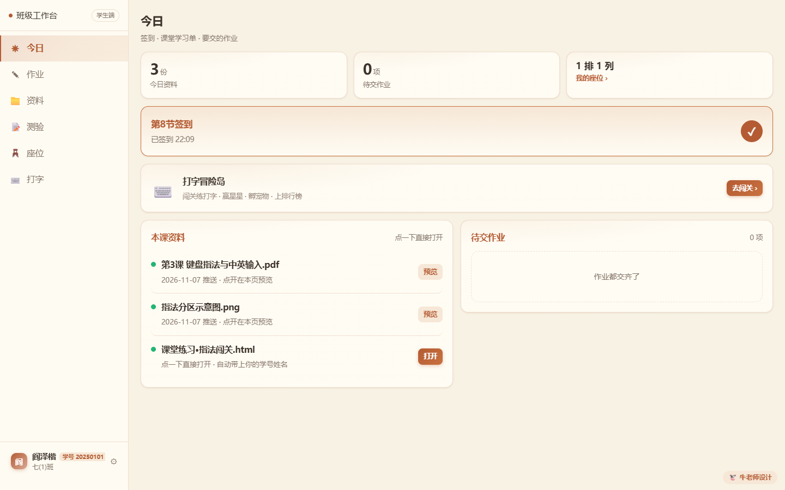
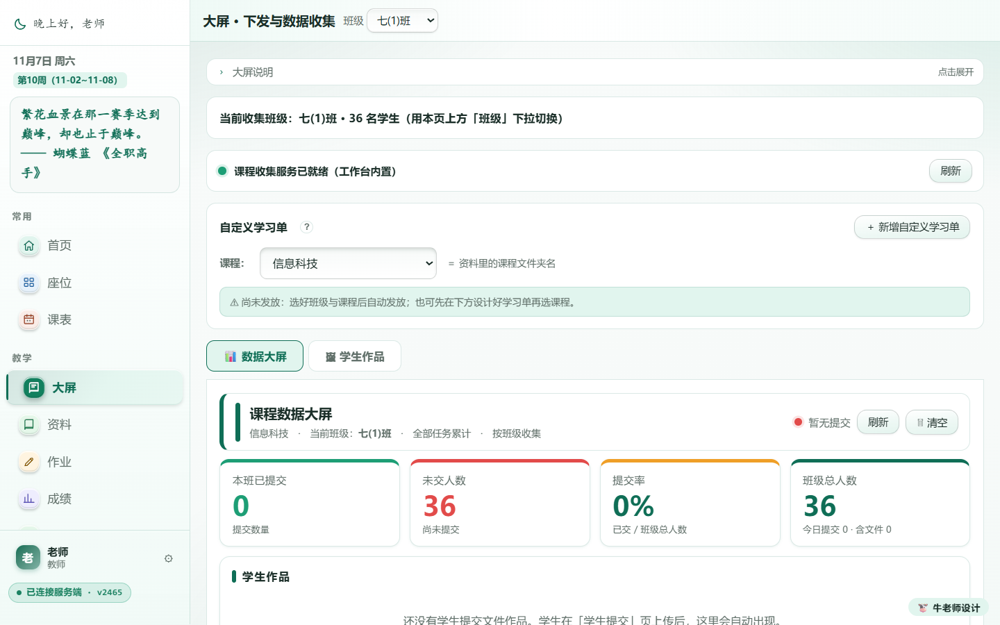
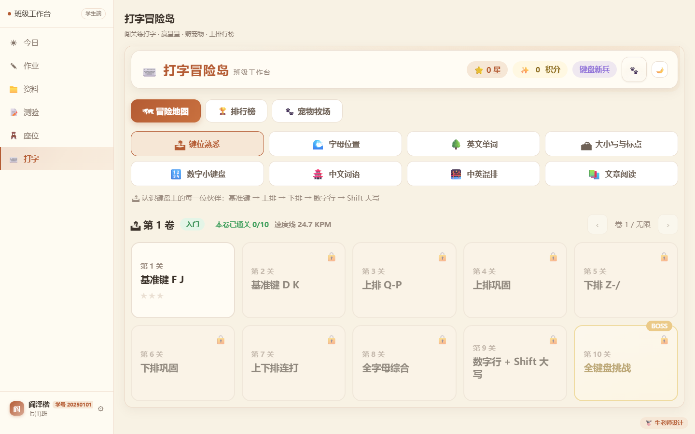
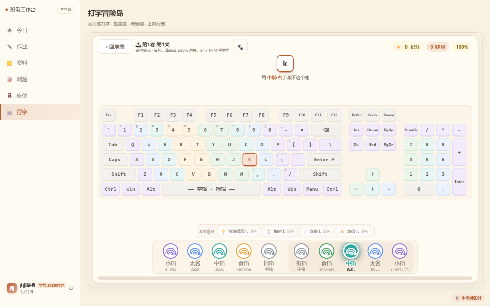
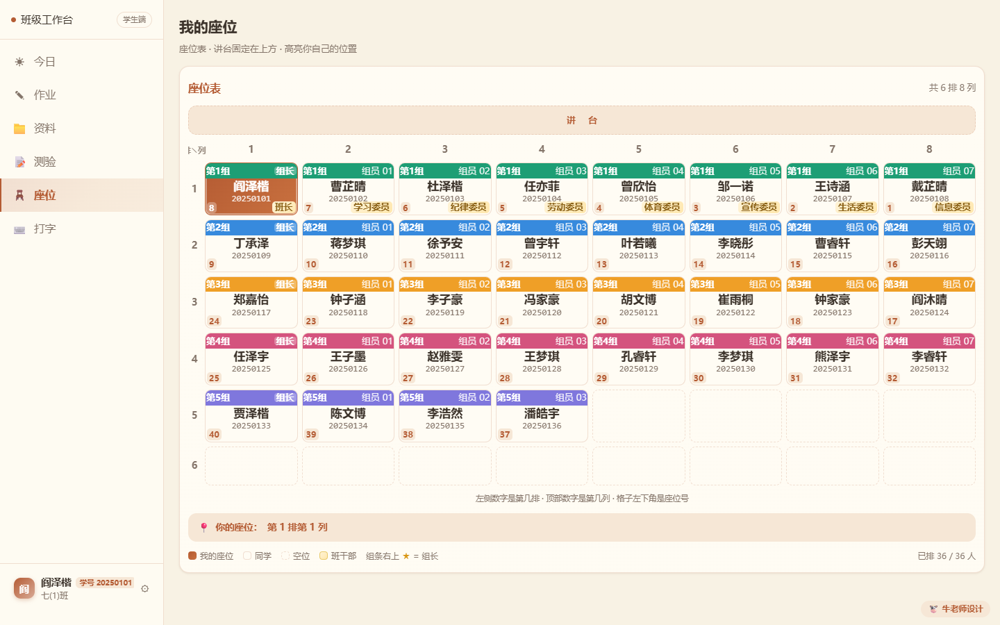
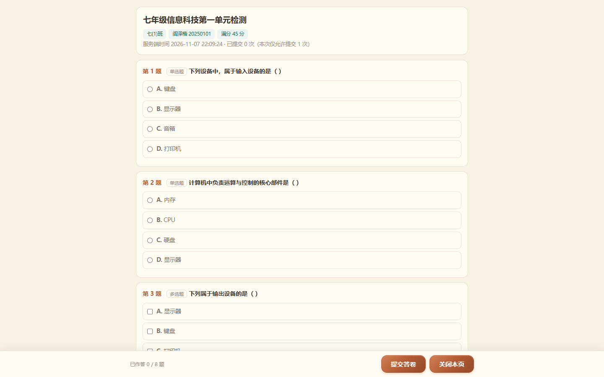

# 班级工作台 2.0 功能介绍（学生端 PC 版）

## 一、为什么还要自己做一套

机房第一节课，最常见的画面是这样的：

打了上课铃，三十几台电脑陆续亮起来。我说"先签到"，然后开始等——有人找不到网址，有人输错学号，有人举手问"老师密码是什么"。等所有人都进来，七八分钟过去了。

接着发任务："打开我发在群里的那个文件，第三个。"于是第二轮："老师我没看到""老师是这个吗""老师我打不开"。

一节课四十分钟，前十分钟都在解决"怎么开始"。

这不是学校没平台。恰恰相反，ITtools、LearnSite 这些信息科技教学平台我都用过，而且都是好东西——尤其对我们这一科，比自己攒表格强太多。问题不在功能，在定位：**它们是"上好一节课"的平台，我要的是"管好一个班"的工具。**

**ITtools** 是一套信息科技教学辅助平台，主打"备—教—学—评"一体化：20 多个教学模块按课搭积木，图文页面、课堂测验、作品互评、学生网盘、指法练习都有，最实在的是操作题自动批阅——Word、PS、Python，还有计算思维那类文本通用操作题，交上来就能判。一节操作课上完，学生当堂就知道错在哪。我卡在哪：它是为"这一节课"设计的，可我课后要算的那几笔账——按节次的考勤、按班的成绩、按课程归档的资料——还得回 Excel 里手工再算一遍。

**LearnSite** 是一款专为中小学信息技术课堂做的开源教学辅助平台，最早由温州周老师开发，现在由上海倪老师和各地一线老师一起维护：学案配递进式活动，作品提交、作品互评、作品档案、课堂测验、打字练习、资源下载都在里面，一节课能闭环。我卡在哪：主要是 .NET + SQL Server 的部署，得常年开着一台 Windows 服务器，我校没有这样的机器，也没人长期维护数据库。它的学生端面向机房电脑，这一点跟我的场景倒是一致的。

**飞象老师** 课堂互动做得好，抢答、随机点名都顺手。但数据在平台那一侧，讲完一节课，痕迹也就散了，回头想按班看趋势，得另外再整理一遍。

把它们的边界摊开看，是这样一张表：

| 平台 | 定位 | 它擅长的（教学场景） | 我卡在哪 |
|---|---|---|---|
| ITtools | 信息科技教学辅助平台 | 20+ 教学模块按课搭建，操作题自动批阅当堂反馈 | 围绕"一节课的活动"组织，跨课时的班级账要另算 |
| LearnSite | 信息技术课堂开源教学平台 | 学案+递进式活动、作品提交互评、作品档案、打字练习 | .NET + SQL Server 部署，长期维护顶不住 |
| 飞象老师 | 课堂互动平台 | 抢答、随机点名顺手 | 数据留在平台上，按班复盘要重做 |

问题就在这儿：**我的需求不是"一个功能"，而是"一个班的日常"**。

一节课四十分钟，机房 36 台电脑。学生坐下要签到，讲台大屏要把任务放出去，学生做完了要能当场看见，交上来的文件要能按班按人归好，作业和成绩要能落回同一个班里，下次上课还得能翻出上次的记录。这些事，在我这里分散在班级群、Excel、表单和课堂平台之间，一节课就要切几次窗口，还得手工把数据搬来搬去——搬的过程中一定会漏，漏了就没人补。

所以我做了班级工作台 2.0。它没有追求功能多，只追求一件事：**一节课从头到尾，不用离开这个页面**。

具体一点说，它把四件事绑在了一起：

- 班级和学生是同一份名单，座位、考勤、作业、成绩都引用它，不各存一套；
- 学生有账号，登录即签到，谁在线我一眼能看到；
- 讲台和学生桌面看的是同一份数据，我下发什么，学生那头立刻出现；
- 交上来的文件按"课程 / 班级 / 学号-姓名"自动归位，不用我事后整理。

下面统一用学生端 PC 端的界面来讲——机房上课，学生面对的就是这台电脑上的这个页面。

---

## 二、学生端：一台电脑上的一个页面

**用途**

这是学生登录后的第一屏。今天要签的到、这节课要用的资料、还没交的作业、自己的座位，都在这一页。学生不用记网址、不用加群、不用装任何软件，浏览器打开就行。

它替代的是原来那一串口头指令："先签到""打开第三个文件""作业交到群里""你坐第三排第二个"。这些话以后不用说了，页面上写着。

**界面布局**

- 左侧是常驻导航：今日、作业、资料、测验、座位、打字。打字这一项由老师开关控制，没开就不出现。
- 顶部三个数字卡：今日资料几份、待交作业几项、我的座位在第几排第几列。
- 中间是签到卡。图上显示"第 8 节签到 · 已签到 20:24"，右边的绿色对勾表示这一节已经记上了。
- 再往下是"打字冒险岛"入口卡，点"去闯关"直接站内切过去。
- 底部左侧是"本课资料"，按老师下发的顺序排列，每条后面有"预览"或"打开"；右侧是"待交作业"。
- 左下角固定显示本人身份：姓名、学号、班级。学生一眼能确认"这是我的账号"。

六个页签各管一件事，学生只要记住这一张表：

| 页签 | 一句话说明 |
|---|---|
| 今日 | 签到 · 课堂学习单 · 要交的作业 |
| 作业 | 全部作业与提交状态，点一条看详情 |
| 资料 | 老师下发的资料，点一下直接打开，不用下载 |
| 测验 | 老师发给本班的检测，点开作答，按设置显示答案与分数 |
| 座位 | 座位表，讲台固定在上方，高亮自己的位置 |
| 打字 | 闯关练打字、赢星星、孵宠物、上排行榜 |

**主要操作方式**

1. 打开 `http://老师的IP:8080/s/`，选班级、选学号、输密码进入。学生不用注册，账号就是名单里那个学号。
2. 密码由老师统一设，可以在学生端控制台设成"统一初始密码 / 独立密码 / 首次登录必改"三选一。忘了密码不用找学生，老师在后台一键重置。
3. 进页面即自动签到，不用点。如果网络抖动没签上，签到卡上会有"一键签到"按钮兜底。
4. 要资料就点"预览"或"打开"，文件在新标签页打开，不下载到本地，也不占学生电脑的磁盘。
5. 要交作业就点右下角的"待交作业"，进去提交，交完状态立刻变。

第一屏的信息密度是刻意控制过的：**能一屏看完，就不用翻页**。所以概览、成绩、考勤、德育这些"关于我"的内容没有单独占页签，全部收进了左下角账号卡弹出的个人信息面板里——学生偶尔要看，但不是每节课都看的东西，不值得占一个位置。

---

## 三、大屏展示：让讲台和课桌看到同一件事

> 这一节的主界面在教师端——大屏本来就是给讲台那块屏用的。学生那一侧看到的是"今日"页里的资料卡，下面一并说明。

**用途**

上课最常做的动作是"把任务发下去"。以前是：把文件传到群共享，再口头说"打开第三个文件"。总有几个人找不到，也总有人打开的是上一节课的。

大屏页把这件事变成了一个动作：**选班级、选课程，任务就发出去了**。学生在自己电脑的"今日"页里直接看到，点一下就能做。学生提交之后，谁交了、谁没交、交了几份，回到这块屏上实时刷新。

它同时解决两个方向的焦虑：学生不用问"是这个吗"，我不用问"你交了没"。

**界面布局**

- 右上角是班级下拉，当前是"七(1)班"。下面紧跟着一条提示："当前收集班级：七(1)班 · 36 名学生"——数据是按这个班收集的，选错班就收集错。
- 中间"自定义学习单"卡片里是课程下拉。这一项对应的是资料库里的课程文件夹名，图上选的是"信息科技"。选好班级和课程，系统会自动把学习单发到这个班。
- 再往下是两个页签："数据大屏"和"学生作品"。上课看前者，收作品看后者。
- 数据大屏区顶部是四个统计卡：**本班已提交、未交人数、提交率、班级总人数**。图上这一节还没人交，所以是 0 / 36 / 0% / 36。
- 下面按任务分块。图上这一节还没有人提交，所以任务窗口区是空的。
- 一旦有提交，每个提交按钮、每次测验都会各自占一个窗口。窗口里是这个任务的已提交数、未交人数、提交率和提交名单，同一个学生只算最后一次提交，不会因为反复提交刷上去。
- 最下面是"学生作品"区，学生提交的文件按班级汇总在这里，点开就能看。

**一节课是怎么走完的**

| 阶段 | 我做什么 | 学生看到什么 |
|---|---|---|
| 课前 2 分钟 | 班级下拉选到本节课的班，课程下拉选到对应文件夹，学习单自动下发 | "今日"页的"本课资料"里多出一条，带"打开" |
| 上课开始 | 投屏切到大屏页 | 打开后自动带上他的学号和姓名，不用重填 |
| 课中 | 看四个统计卡和任务窗口，谁交了谁没交一目了然 | 提交后状态立刻变成"已提交" |
| 讲解环节 | 点某个窗口的"设为大屏"，那份作品放大到讲台屏 | 抬头能看到自己的作品被投上去 |
| 下课 | 点"清空"，本节数据归档，下一节重新开始 | 页面回到干净状态，历史记录不丢 |

**数据是怎么算的**

这块我改过几版，现在定死的是这几条：

- **提交率按"本班应交人数"算**，不是按年级或全校。36 人的班交了 9 份，就是 25%，不会因为别的班交得多而虚高。
- **同一个学生只算最后一次提交**。学生反复改、反复交，不会把提交数刷到 40 去。
- **按班隔离**。七(1)班的大屏只收七(1)班的提交，同名同姓跨班也不会串——判定先看班级，再看学号或姓名。
- **只统计"提交"这件事，不算正确率**。这一条是刻意的，下面单独说。
- **清空是按"课程 + 活动"清的**，只清这一节，不动别的课，也不动归档目录里的文件。

**这块以前不是大屏，是 QuickForm**

QuickForm 是我用得最久的一个工具：收表单、做问卷、导出结果，体验很顺，1.0 的时候我干脆把它接进了自己的工作台，学习单就用它收。但它只知道"有人交了一份表"——不知道这个班 36 个人里谁没交，不知道交上来那份对的是哪台机器前的哪个人，更不知道谁这节课压根没签到。每收回一批，我还得拿名单一条条对：谁没交、谁交了两遍、哪个文件名对不上人。

上面那几条统计口径，就是那会儿一次次对出来的。所以 2.0 干脆把收件长进了大屏：提交一落库就带着票里的学号和班级，同一个学生只留最后一次，提交率按本班应交人数算。收完就能讲，不用再对一遍名单。

**主要操作方式**

1. 上课前：班级下拉选到本节课的班，课程下拉选到对应的课程文件夹，学习单自动发放。
2. 学生打开自己电脑上的"今日"页，在"本课资料"里点"打开"，页面会自动带上他的学号和姓名，不用再填一遍。
3. 学生做完提交，大屏上的统计卡和窗口实时变化，不用手动刷新。
4. 想重点讲某一份作品，点窗口右上角的"设为大屏"，那一份就单独放大到讲台屏上。
5. 下课点"清空"，这一节的数据归档，下一节重新开始。

**为什么大屏不算正确率**

这里有一个刻意的设计：**大屏只回答"谁交了"，不回答"谁对谁错"**。

刚做出来的时候我也想把正确率塞进来，试过之后放弃了。原因很实际：上课的时候我要的是"还有 4 个人没交，我可以再等两分钟"，不是"这道题全班的正确率是 62%"。后者是把课上成教研，前者才是上课。

对错和分数在测验页和成绩页看，混在一起反而两边都看不清。所以现在这三处入口分工是定死的：

| 入口 | 干什么 | 不干什么 |
|---|---|---|
| 大屏 | 实时收件看板：谁交了、交到哪个窗口 | 不显示答案分数，不算正确率 |
| 测验页 | 唯一的逐题正确率、按班成绩分析 | 不另存一份提交、不另算一套分 |
| 成绩页 | 选测验 + 班级 → 换算百分制 → 写成一场考试 | 不绕过统计口径直接读原始答卷 |

三处读的是同一份提交，不是三套数据。

---

## 四、打字输入：把指法练成肌肉记忆

**用途**

信息科技课有一个绕不开的起点：**很多七年级学生不会用键盘**。两只食指戳，眼睛在键盘和屏幕之间来回找，打一行字要用一分钟。这个基础不打掉，后面讲文字处理、讲编程，全都在给他们补打字。

可打字这件事，讲是讲不会的。我说一百遍"手指放在 F 和 J 上"，不如让他自己敲二十分钟。问题是怎么让他愿意敲二十分钟。

打字冒险岛是这么来的：它把"练指法"拆成了能一关一关过的小目标，每一关都很短，每一关都有反馈，每一关都有一个明确的东西在等他。

对老师来说，它只是一个开关：开了，学生端出现"打字"这一项；关了，入口消失，接口直接拒绝。

**界面布局**

- 顶部一条状态栏：星数、积分、当前称号（图上是"键盘新兵"），右边是设置和明暗主题切换。
- 三个页签：**冒险地图、排行榜、宠物牧场**。地图是练的地方，排行榜看班级里谁快，牧场是攒下来的宠物。
- 地图区第一排是八个篇章按钮：键位熟悉、字母位置、英文单词、大小写与标点、数字小键盘、中文词语、中英混排、文章阅读。点哪个练哪个。
- 篇章下面是卷号条："第 1 卷 入门 · 本卷已通关 0/10 · 速度线 24.7 KPM"，右侧可以往后翻卷，卷号没有上限。
- 再往下是 10 个关卡卡片。第 1 关"基准键 F J"已解锁，2 到 9 关锁着，第 10 关是 BOSS"全键盘挑战"。卡片上有三星位，通关拿星。

**八个篇章为什么是这个顺序**

这个顺序不是随手排的，是按"手上的动作"一步步加难度：

| 篇章 | 练什么 | 为什么放在这个位置 |
|---|---|---|
| 键位熟悉 | 基准键 F、J 和周围几个键 | 先把手放对地方，不求快 |
| 字母位置 | 26 个字母的实际位置 | 手位固定之后再扩到全键盘 |
| 英文单词 | 成词输入 | 从"按键"过渡到"打词" |
| 大小写与标点 | Shift、逗号句号引号 | 加了新手指，速度会掉，得单独练 |
| 数字小键盘 | 右侧数字区 | 换一只手，独立成章 |
| 中文词语 | 拼音输入 | 换输入法，等于从头再练一次 |
| 中英混排 | 中英切换 | 真实文档的样子 |
| 文章阅读 | 整段连续输入 | 到这一步才谈速度和耐力 |

七年级一个学期能走完前四章就不错了。后面几章是给学得快的学生留的，也是给下一学年留的。

**主要操作方式**

1. 老师先在教师端点开打字开关，选好适用的年级（一到九年级，只影响"中文词语"这一章的词库范围）。
2. 学生进"打字"页，选篇章、选关卡。锁着的关卡要先过前一关。
3. 进关后，屏幕正中出现一个待敲的字符（图上是大字 a），下面一行小字提示用哪根手指："用小指-左手 敲下这个键"。
4. 下方是全键盘图示，**该按的键会高亮**（图上 A 键是橙色框），学生不用低头找。
5. 照着一路敲下去。敲对了，字按顺序变色，速度和准确率在右上角实时走；敲错了，错的字标红，但**课文那一行永远显示原文**，不会因为打错就把原文改掉——改掉的话，学生就不知道自己在打什么了。
6. 一关结束按准确率和速度给星。图上这一关的目标写得很直白："准确率 ≥90% 通关，24.7 KPM 拿两星"。
7. 成绩不由浏览器说了算——提交后服务端按同一套公式重算一遍，改前端数字没用。

**星星、道具和宠物**

关卡内容每局随机生成，防的是"背顺序"：背下第 3 关那串字母，换一局就没用了，只能老老实实看屏幕打。

星星有两个用处。一是换道具：底部有一条"本关道具"——指法提示卡、加时卡、容错卡、加倍卡，默认都没有，靠攒星星换。二是解锁装扮和宠物：牧场里有 12 只原创宠物，BOSS 首次通关掉蛋，装扮按累计星数一只只解锁。

这套东西看着像游戏，其实解决的是一个很朴素的问题：**打字练习本身没有成就感**。多打一百个字不会让任何人兴奋，但多一颗星会。

**防作弊这件事**

打字是有成绩的，有成绩就有人想改。所以这一块从设计上就不信任客户端：

- 速度和准确率由服务端按同一套公式重算，前端报上来的数字只作参考；
- 排行榜按班级口径，学生只看得到本班；
- 老师关掉开关后，接口直接拒绝，不是把按钮藏起来而已。

---

## 五、其余几页，同一套布局

学生端的其余页签都是同一个骨架：左边导航、右边内容、顶部一句话说明。学生学会一页，其余几页不用再教。

**座位**：讲台固定在上方，自己的座位橙色高亮，底部直接写"你的座位：第 1 排第 1 列"。每格显示姓名、学号、所在小组和班干部职务，组长右上角有星标。学生最常问的"我坐哪儿"，这一页就答完了。

有个细节值得说：老师端可以把讲台设在上方或下方，学生端统一翻到上方显示，座位号仍然和老师那张表一致——不然学生在屏幕上看到的位置，和他在教室里抬头看到的是反的。

**测验**：老师下发的卷子按班级自动匹配，学生只看到发给本班的那几份。点进去是逐题作答，顶部标明班级、姓名、学号、满分和"本次仅允许提交 1 次"，底部是答题进度和"提交答卷"。

什么时候能看答案、能不能看分数，由老师在发布时单独设，且是在服务端出网前就裁掉的——学生拿到的页面里根本没有答案字段，连线题只给打乱后的右项。也就是说，就算学生打开开发者工具翻请求，也翻不出答案。

简答和图片上传这两类要人工批阅，没批就是"待批阅"，不冒充 0 分。

---

## 六、几句实话

前面讲的都是它能干什么，这一节讲讲它不能干什么。这些是我自己用下来最清楚的部分，写在前面比藏起来有用。

**它需要一台常开的机器。** NAS、小主机、机房那台不关的电脑，都行。但它不是云服务，你关机，学生就进不来。

**它只在局域网里。** 不出公网，不需要域名和备案，代价是学生必须连同一个 Wi-Fi。机房如果开了 AP 隔离，设备之间互相不通，得找网管关掉。

**它不替你做判断。** 谁能请假、谁该扣分、哪份作业算迟交，规则写死在代码里，但边界情况还得人来定。工具只保证"改了就记上"，不保证"改得对"。

**它是按机房电脑设计的。** 学生端面向 1366×768 以上的机房屏幕，一节课 40 分钟，学生在同一台机器上签到、看资料、交文件。手机能打开，但排版会挤——我的课都在机房上，就没往这上面花时间。

**一个班用很顺，一所学校用要慎重。** 我没有做过几十个班、几千人的压力测试，也不知道并发高了会怎样。它的定位就是"一个老师带着几个班"，别拿它当校级平台。

知道这些，再决定要不要装，比看完功能介绍就动手更靠谱。

---

## 七、最后

这套东西没有多聪明，它只是把一节课里那些重复的、容易漏的动作，固定成了几个按钮：签到不用点、资料不用传、作业不用催、座位不用问。

以前一节课开头要花十分钟解决"怎么开始"，现在学生坐下、打开页面、点一下，就开始了。省下来的十分钟，是能用来讲课的十分钟。

工具是为课堂服务的，不是反过来。如果一个平台需要我先改变上课方式才能用，那它再好也不适合我。
