# 学生端界面一览

> 适用版本：班级工作台 2.0
> 访问地址：`http://<教师机 IP>:20020/s/`（局域网），或教师端首页的「学生入口」卡片
> 截图口径：**手机端** 430×900 @2x（移动 UA）+ **PC 端** 1440×900（桌面 UA，见第十二节）；打字练习为 1440×900；全部为真实运行截图

学生端只有**三个页签**（今日 / 作业 / 课程）+ 一个**个人信息面板**，再加上可选的「打字冒险岛」。
成绩、考勤、德育、学习报告都收在个人信息面板里，不再单独占页签——这是 2.0 相对 1.x 最大的结构变化。

---

## 一、页面地图

| 区域 | 入口 | 截图 | 主要用途 |
|---|---|---|---|
| 登录 | `/s/` | s01、s02 | 选班级 → 选学号 → 输密码（首次登录强制改密） |
| 今日 | 底部页签「今日」 | s03 | 签到状态、今日课表、待交作业、值日 |
| 作业 | 底部页签「作业」 | s04、s05 | 本班全部作业与我的提交状态，点开看详情 |
| 课程 | 底部页签「课程」 | s06 | 老师下发的课程与资源，点资源可在线预览 |
| 座位 | 底部页签「座位」/ 今日页座位卡 | s07、s07b | 全教室座位表，自己那格高亮，讲台固定在上方 |
| 个人信息 | 左下角头像 / 悬浮按钮 | s08 | 学习摘要、分组、成绩、考勤、头像、报告、改密、退出 |
| 我的成绩 | 个人信息 →「我的成绩」 | s09 | 历次考试分数、班均、百分制换算 |
| 考勤记录 | 个人信息 →「考勤记录」 | s10 | 每次课的出勤 / 迟到 / 请假 / 缺勤 |
| 夜间模式 | 个人信息 →「夜间」 | s11 | 护眼暗色主题（整站跟随） |
| 打字冒险岛 | 「今日」页打字卡片 / 页签「打字」 | t01–t06 | 关卡地图、练习、结算、排行榜、宠物牧场 |

> 上表截图均为**手机端**。同样的页面在电脑浏览器里是另一套布局（左侧栏 + 三列网格），
> 单独拍了一套 10 张，见 **[十三、PC 端（宽屏）界面一览](#十三pc-端宽屏界面一览1440900)**。

---

## 二、登录

### 2.1 登录页

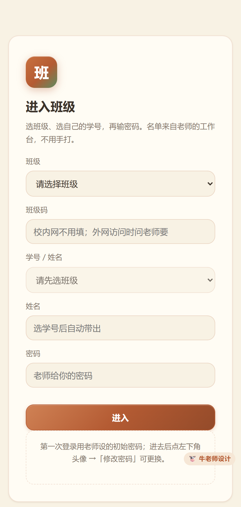

- **关键字段**：班级下拉（如「七(1)班」）、学号/姓名下拉、密码输入框、登录按钮。
- **判断标准**：班级下拉能列出本机全部班级；选中班级后学号下拉自动刷新为该班名单。
- **状态**：名单为空时下拉只有占位项，说明教师端还没建班或没导入学生。

### 2.2 选好班级与学号

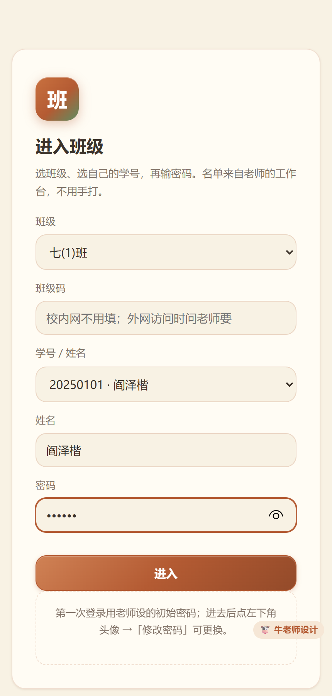

- **操作流程**：先选班级 → 再选学号（顺序不能反）→ 输密码 → 点登录。
- **判断标准**：班级与学号都显示具体值，密码框有掩码。
- **首次登录**：若该生是初始密码，登录后会强制弹出「修改密码」页，改完才进「今日」。

---

## 三、今日

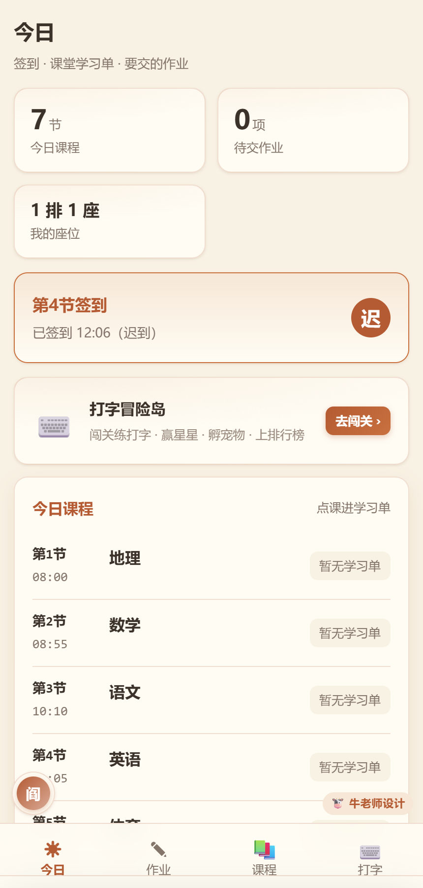

- **顶部三张卡**：今日课程节数、待交作业数、我的座位（如「1 排 1 座」）。
- **签到卡**：显示第几节签到、签到时间与判定结果。示例为「第4节签到 · 已签到 11:49（迟到）」——绿色/橙色角标由服务端判定，学生不能自己改。
- **今日课程**：按节次列出科目与时间，当前节次高亮；右侧是学习单入口（有活动时显示「进入课堂活动」，无活动显示「暂无学习单」）。
- **底部导航**：今日 / 作业 / 课程三个页签，打字功能开启时多一个「打字」。
- **状态覆盖**：
  - 已签到 / 迟到 / 请假 / 缺勤（角标不同）
  - 有学习单 / 暂无学习单
  - 有值日任务时，页面底部会多出值日卡

---

## 四、作业

### 4.1 作业列表（含四种提交状态）

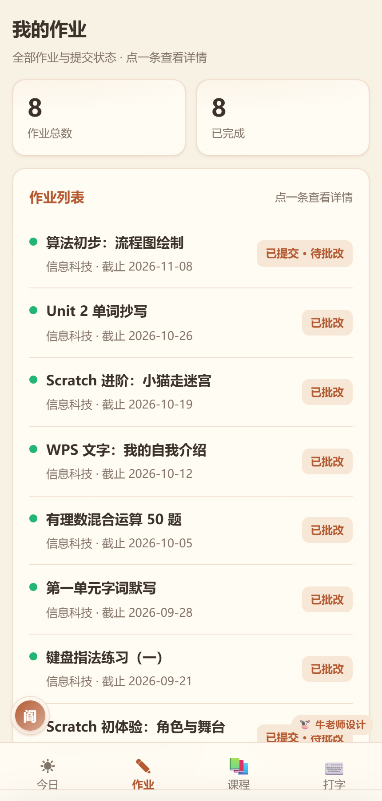

- **顶部统计**：作业总数 / 已完成数。
- **列表项**：作业标题、科目、截止日期、右侧状态标签。
- **四种状态**（同一屏里就能看全）：
  | 标签 | 含义 | 颜色 |
  |---|---|---|
  | 待交 | 还没提交，未到截止 | 中性 |
  | 已提交 · 待批改 | 已交，老师还没批 | 琥珀 |
  | 已批改 | 老师已批，可看结果 | 绿 |
  | 逾期 | 过了截止还没交 | 红 |
- **操作流程**：点任意一行 → 底部弹出详情。

### 4.2 作业详情（已提交状态）

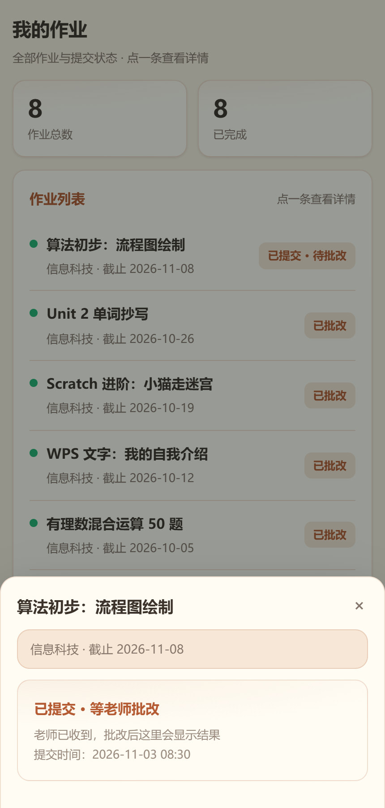

- **弹层内容**：作业标题、科目与截止时间、状态区（「已提交 · 等老师批改」+ 提交时间）、附件/作答区、关闭按钮。
- **判断标准**：底层列表被压暗且不可点击，弹层从底部推入。
- **状态差异**：
  - 待交 → 显示输入区与「提交」按钮
  - 已提交 → 显示回执「老师已收到，批改后这里会显示结果」与提交时间
  - 已批改 → 显示得分 / 评语
  - 逾期 → 顶部红色提示，提交入口置灰

---

## 五、课程

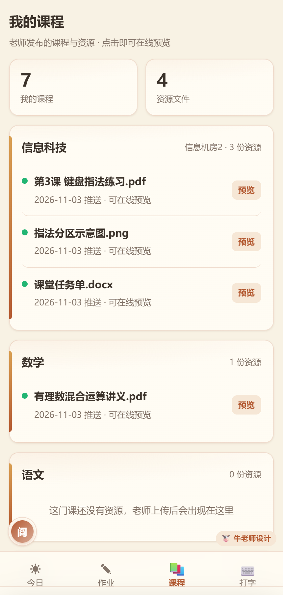

- **顶部统计**：「我的课程」门数、「资源文件」份数。
- **课程卡片**：课程名（如「信息科技」）、上课地点与资源份数（如「信息机房2 · 3 份资源」）、资源条目列表。
- **资源条目**：文件名（PDF / PNG / DOCX / 音频 / 视频）、推送日期、「可在线预览」提示、右侧「预览」标签。
- **操作流程**：点任一资源 → 底部弹出预览层，PDF/图片/视频/文本在浏览器内联打开，不下载、不跳出。
- **状态差异**：
  - 有资源 → 绿色圆点 + 「预览」标签
  - 无资源 → 卡片内显示「这门课还没有资源，老师上传后会出现在这里」
  - 未下发的资源 → 列表里根本不出现（服务端裁剪，不是前端隐藏）

---

## 六、座位表

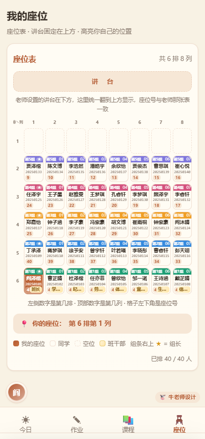

- **入口**：底部页签「座位」；也可从「今日」页的座位卡直接点进来。
- **讲台永远在上方**：老师把讲台设在下方时，整张表会上下翻转，
  最靠近讲台的那一排落到最上面；排号仍按老师那张表数，师生报位置不打架。
- **共 X 排 Y 列**：表头右上角写明，和教师端同一口径；
  网格**左侧标排号（1…R）、顶部标列号（1…C）**，「第几排第几列」一眼可查。
- **座位格与教师端同一套信息**：顶部组色**小组条**（组名 + 组长★/组员编号，
  格子窄时右侧缩成★/两位编号）、**姓名**、**学号**（等宽小字）、
  左下角**座位号**角签、右下角**金色班干部职务牌**；
  考勤状态学生端一律不显示。
- **我的座位**：品牌色实心 + 白色内描边 + 呼吸光晕，姓名与其它格同字号；
  底部再写一行「你的座位：第 X 排第 Y 列」，图例里橙色小块 = 我的座位。
- **数据来源**：`GET /api/v2/student/seatmap`，返回姓名 / 学号 / 座位号 / 小组 /
  班干部职务与行列坐标，**不含电话、成绩、内部 id，也不带考勤**；
  只有本班已登录学生能读，带 `class_id` 也读不到别的班。
- **空位与未排座**：没人的格子画虚线空位；老师还没排到你时，
  底部提示「老师还没有把你排到座位上」，表格照常显示。
- **列多时**：字号随列数自动降档（5 列 13px → 9 列以上 9px），
  姓名最多两行、绝不截成「张…」，实在放不下才允许横向滑动。

夜间模式：

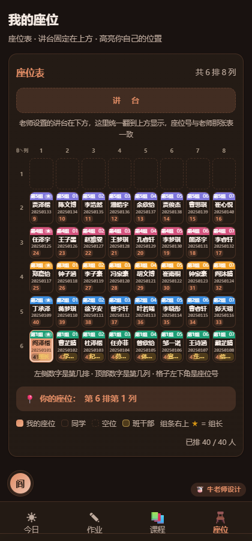

---

## 七、个人信息面板

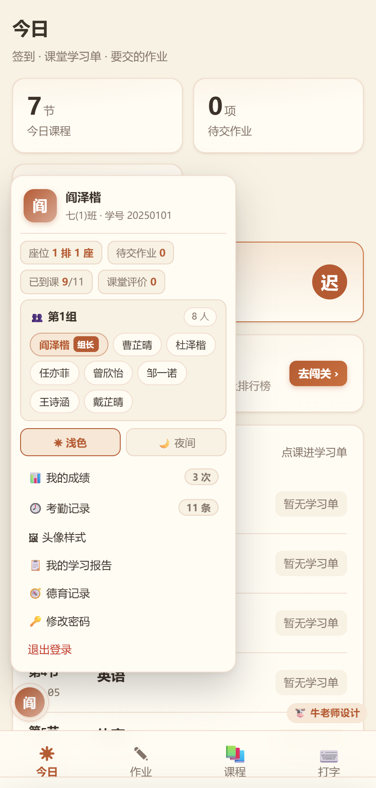

- **入口**：左下角头像卡（桌面宽屏）或左下角悬浮按钮（窄屏）。
- **头部**：头像、姓名、班级与学号。
- **学习摘要四宫格**：座位、待交作业、已到课（如 9/11）、课堂评价。
- **分组卡**：本组组名、人数、成员 chips，组长有「组长」标记。
- **主题切换**：浅色 / 夜间。
- **功能入口**：我的成绩、考勤记录、头像样式、我的学习报告、德育记录、修改密码、退出登录。
- **判断标准**：点面板以外区域自动收起；各入口后面的数字（3 次 / 11 条）是真实条数。

---

## 八、成绩

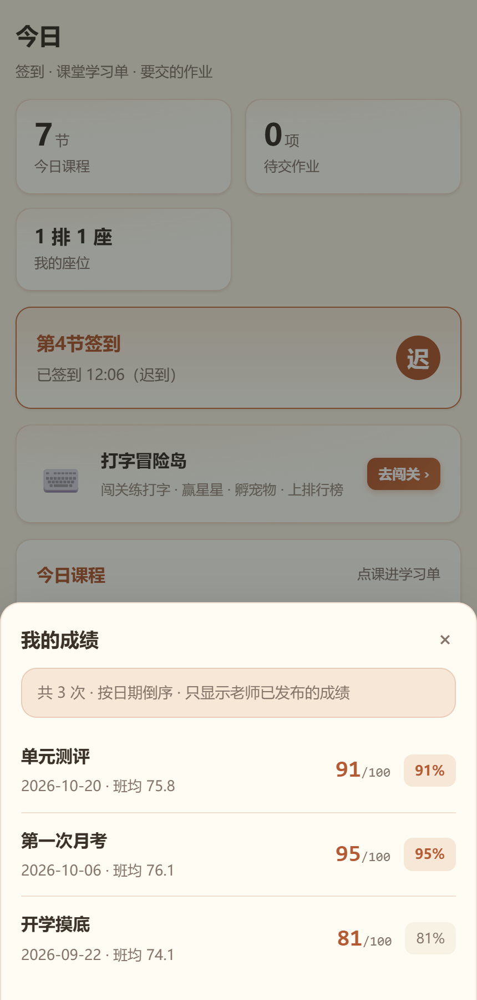

- **入口**：个人信息 →「我的成绩」。
- **内容**：共 N 次、按日期倒序、只显示老师已发布的成绩；每条含考试名、日期、班均、得分与百分制换算。
- **判断标准**：只能看到自己的分数；未发布的考试不出现。
- **状态**：一条都没有时显示「还没有发布的成绩」。

---

## 九、考勤

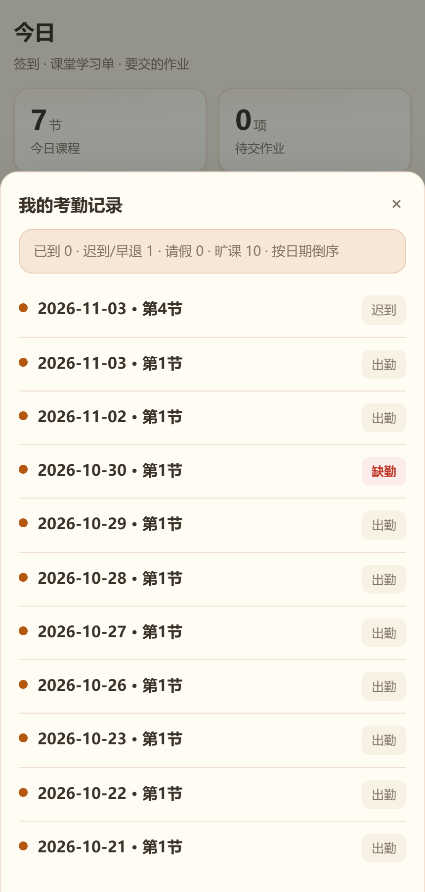

- **入口**：个人信息 →「考勤记录」。
- **内容**：每次课的时间、科目、状态（出勤 / 迟到 / 病假 / 事假 / 缺勤）。
- **判断标准**：状态由教师端判定并同步，学生端只读；请假记录会标出来源（教师标记）。

---

## 十、夜间模式

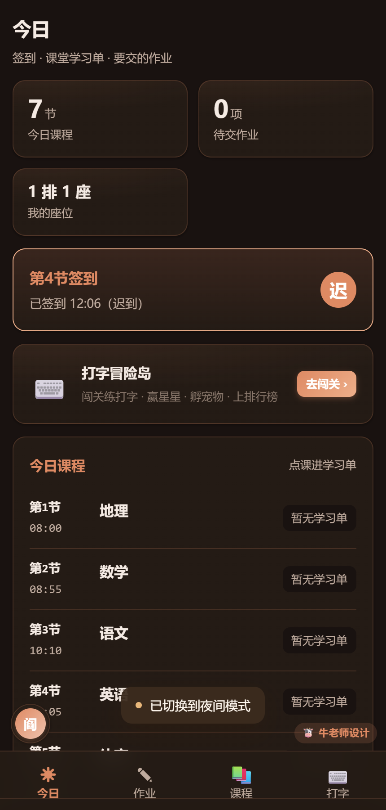

- **入口**：个人信息 →「🌙 夜间」。
- **效果**：整站配色切换（背景、卡片、文字、状态标签），刷新后仍保持。
- **判断标准**：文字对比度足够、状态标签仍能区分；切回「☀ 浅色」立即恢复。

---

## 十一、打字冒险岛（重点）

> 需要在教师端「打字」页打开开关（`打字冒险岛` 开启 + 选择年级词库）。关闭状态下学生端只显示「老师还没开放打字练习」。

### 11.1 冒险地图

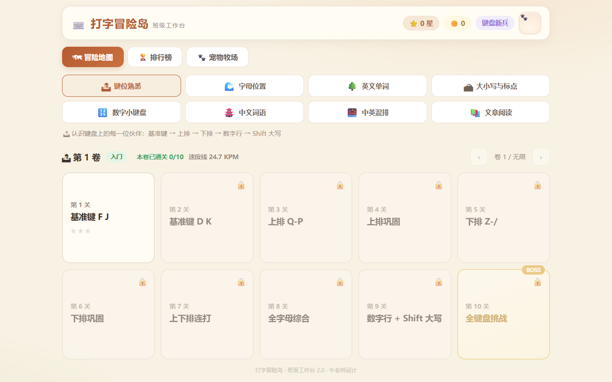

- **顶部**：星星数、金币数、当前称号（如「键盘新兵」）、宠物。
- **阶段条**：键位熟悉 / 字母位置 / 英文单词 / 大小写与标点 / 数字小键盘 / 中文词语 / 中英混排 / 文章阅读。
- **章节**：`第 1 卷`，显示「本卷已通关 0/10」与目标速度（如 24.7 KPM）。
- **关卡网格**：10 关两行铺满；未解锁的关卡右上角带锁；第 10 关为 BOSS（金色边框）。
- **判断标准**：只有第 1 关可点，其余带锁——这是新学生的正常状态；通关后下一关自动解锁。
- **操作流程**：点已解锁关卡 → 进入练习。

### 11.2 关卡开始

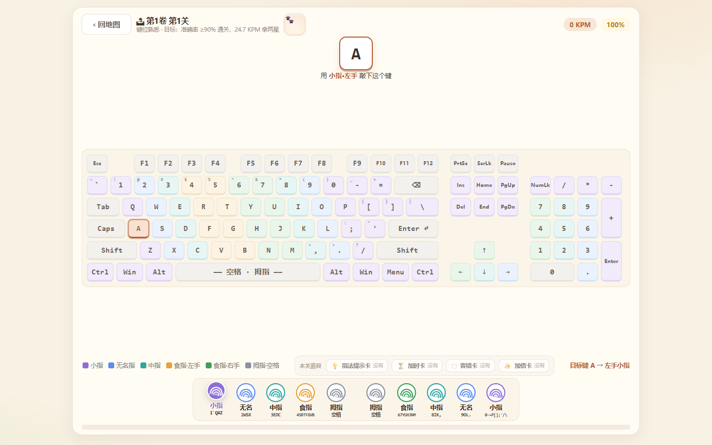

- **顶部**：`‹ 回地图`、关卡名（第 1 卷第 1 关）、通关条件（准确率 ≥90%、24.7 KPM 拿三星）、实时速度与正确率。
- **中央**：当前目标键大字提示 + 指法提示（「用小指·左手 敲下这个键」）。
- **虚拟键盘**：全尺寸键盘，目标键高亮，其余按键按手指分区着色。
- **底部**：图例、道具条（提示卡 / 加时卡 / 容错卡 / 加倍卡）、手指图（标注每个手指负责的键）。
- **判断标准**：键盘高亮键与大字母提示一致；指法图对应手指高亮。

### 11.3 练习中

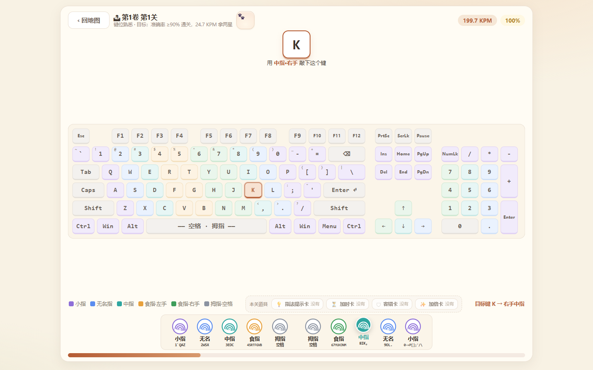

- **实时反馈**：右上角速度（KPM）与正确率随敲击刷新；底部进度条随正确字符推进。
- **目标键切换**：敲对一个键，中央大字与键盘高亮立即切到下一个键。
- **判断标准**：速度不为 0、进度条有推进、正确率保持 100%（示例为 199.7 KPM / 100%）。
- **异常状态**：打错时正确率下降、目标键不变；连续错误会触发提示卡提示。

### 11.4 结算

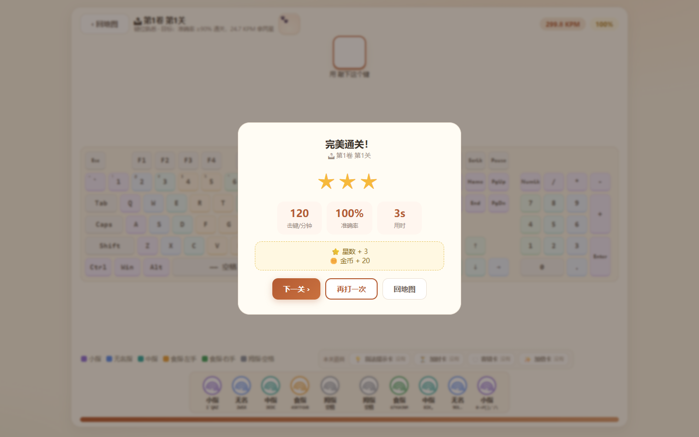

- **结算卡**：通关结论（完美通关 / 通关）、星级（1–3 星）、三项指标（击键/分钟、准确率、用时）、奖励（星星 +3、金币 +20）。
- **按钮**：下一关、再打一次、回地图。
- **判断标准**：三项指标与练习过程一致；奖励入账后顶部星星/金币数增加。
- **未达标**：星级减少或无星，仍可「再打一次」。

### 11.5 排行榜

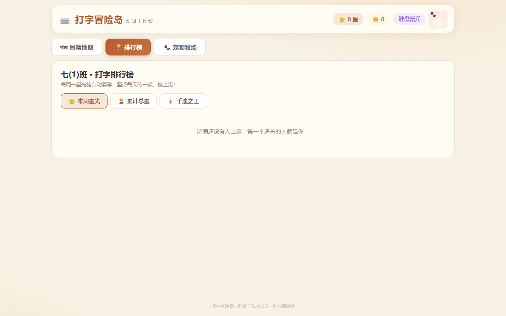

- **内容**：本班排行榜（班级名 + 打字排行榜），按成绩排序，显示名次、姓名、速度、正确率。
- **判断标准**：只显示本班同学，不跨班；自己所在行高亮。
- **状态**：无人上榜时显示空状态提示。

### 11.6 宠物牧场

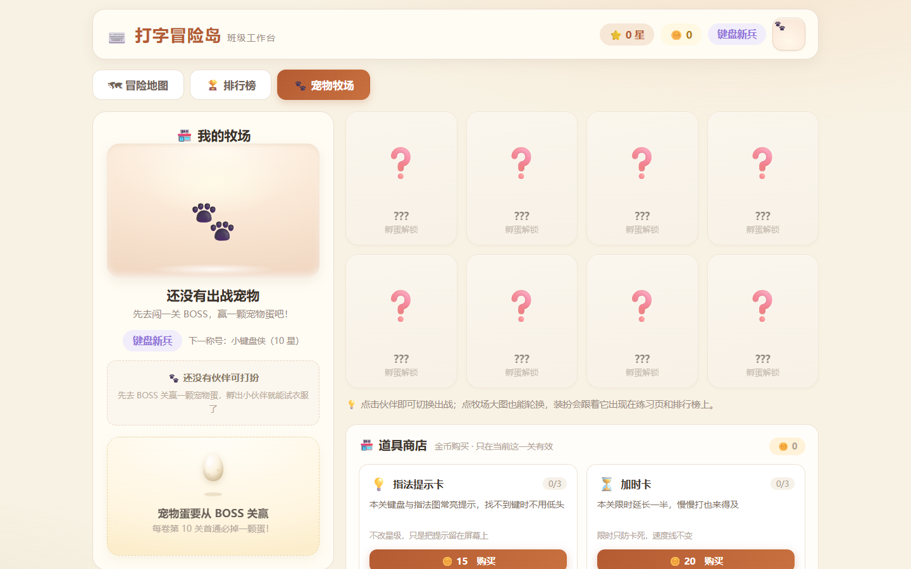

- **内容**：宠物展示区、孵化/出战入口、衣柜与道具商店、金币余额。
- **判断标准**：金币与星星和地图页一致；没有宠物时显示孵化引导。
- **玩法闭环**：打字赚星星/金币 → 孵宠物 → 买装扮 → 出战加成。

---

## 十二、状态覆盖一览

| 状态类型 | 出现位置 | 截图 |
|---|---|---|
| 未登录 / 已选班级学号 | 登录页 | s01、s02 |
| 已签到（迟到） | 今日 · 签到卡 | s03 |
| 待交 / 已提交·待批改 / 已批改 / 逾期 | 作业列表 | s04 |
| 已提交回执 | 作业详情 | s05 |
| 有资源 / 无资源 | 课程 | s06 |
| 面板展开 | 个人信息 | s08 |
| 有成绩 / 无成绩 | 我的成绩 | s09 |
| 有考勤 / 无考勤 | 考勤记录 | s10 |
| 夜间主题 | 整站 | s11 |
| 关卡未解锁 / 已解锁 / BOSS | 打字地图 | t01 |
| 关卡开始（0 进度） | 打字练习 | t04 |
| 练习中（有进度） | 打字练习 | t05 |
| 通关结算（三星） | 打字练习 | t06 |
| 排行榜有数据 / 空 | 打字排行榜 | t02 |
| 有宠物 / 无宠物 | 宠物牧场 | t03 |
| 宽屏布局（左栏 + 三列网格） | PC 端各页 | pc01–pc10 |

---

## 十三、PC 端（宽屏）界面一览（1440×900）

### 13.1 为什么单独拍一套

学生端是响应式页面：**窗口一变宽，底部三个页签就换成左侧 236px 侧边栏，内容区也从单列堆叠展开为多列网格**。
老师在办公室电脑上打开学生端、家长在笔记本上查看、机房用大屏演示，看到的都是这一套；它和手机版不是同一个形态，所以单独成册。

| 对比项 | 手机端（430×900） | PC 端（1440×900） |
|---|---|---|
| 主导航 | 底部三个页签「今日 / 作业 / 课程」 | **左侧栏**「今日 / 作业 / 课程 / 打字」，当前项高亮 |
| 个人信息入口 | 悬浮头像按钮（圆钮） | **左下角账号卡**（头像 + 姓名 + 学号 + 班级） |
| 今日页 | 单列向下堆叠 | 顶部三张统计卡**横排**，下方「今日课程 / 待交作业」**左右双栏** |
| 课程页 | 单列卡片 | **三列网格**，有资源与无资源的卡片并排可比 |
| 作业列表 | 单列窄行 | 单列宽行，右侧状态标签（已批改 / 已提交·待批改） |
| 弹层（成绩、考勤、作业详情） | 近全屏 | **居中浮层**，背景压暗、可点空白关闭 |
| 页脚 | 无 | 右下角「牛老师设计」水印 |

> 图注里的「应见」都是判断标准：这些元素出现了，说明该页在宽屏下渲染正常。

### 13.2 登录


- **应见**：居中登录卡（约 400px 宽），字段自上而下为 班级 / 班级码 / 学号·姓名 / 姓名 / 密码，底部橙色「进入」按钮。
- **与手机版差异**：卡片居中、四周留白多；手机版是贴边铺满。
- **判断标准**：班级下拉可展开并列出全部班级；「班级码」提示为「校内网不用填；外网访问时问老师要」。

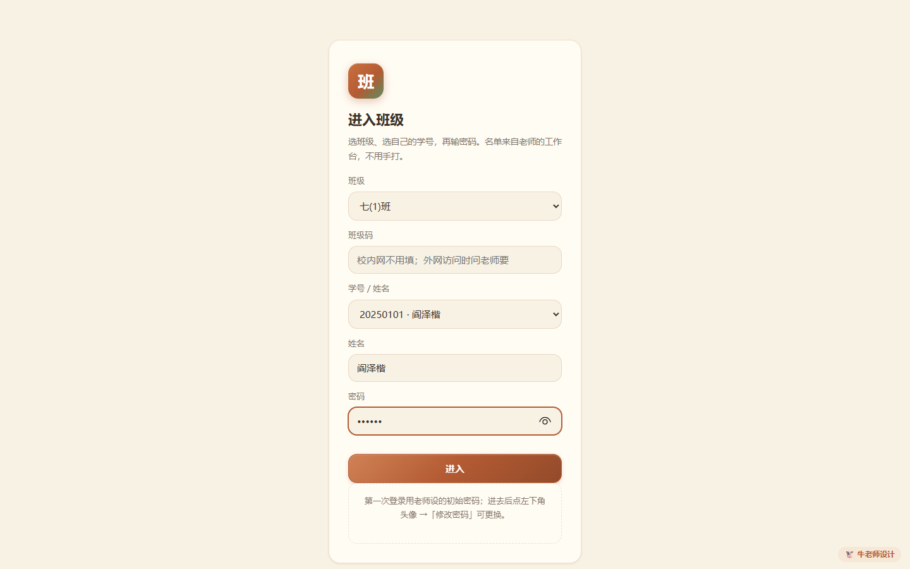

- **应见**：班级已选中、学号自动带出姓名、密码框显示掩码。
- **判断标准**：选完班级后「学号 / 姓名」下拉与「姓名」只读框同步刷新；「进入」按钮可点。

### 13.3 今日

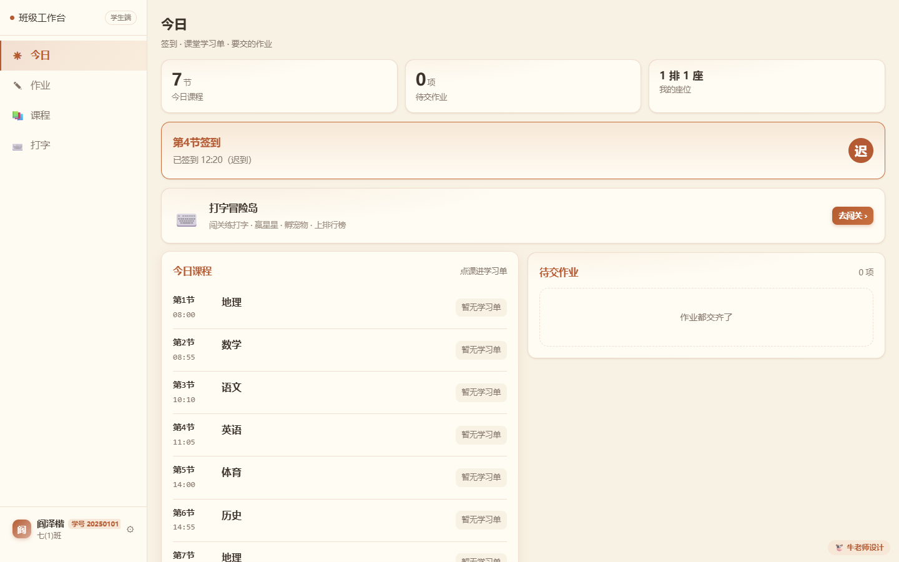

- **应见**：左侧栏「今日」高亮；顶部三张统计卡（`7 节` 今日课程 / `0 项` 待交作业 / `1 排 1 座` 我的座位）；「第4节签到」橙卡带 `已签到 12:20（迟到）`；「打字冒险岛」入口卡；下方左「今日课程」时间表、右「待交作业」。
- **与手机版差异**：统计卡从竖排变横排；课表与待交作业从上下堆叠变左右双栏；课表较长时**页面整体滚动**（首屏只到第 6～7 节）。
- **判断标准**：签到卡出现绿色对勾；「待交作业」为空时显示「作业都交齐了」；左下账号卡显示真实姓名与学号。

### 13.4 作业

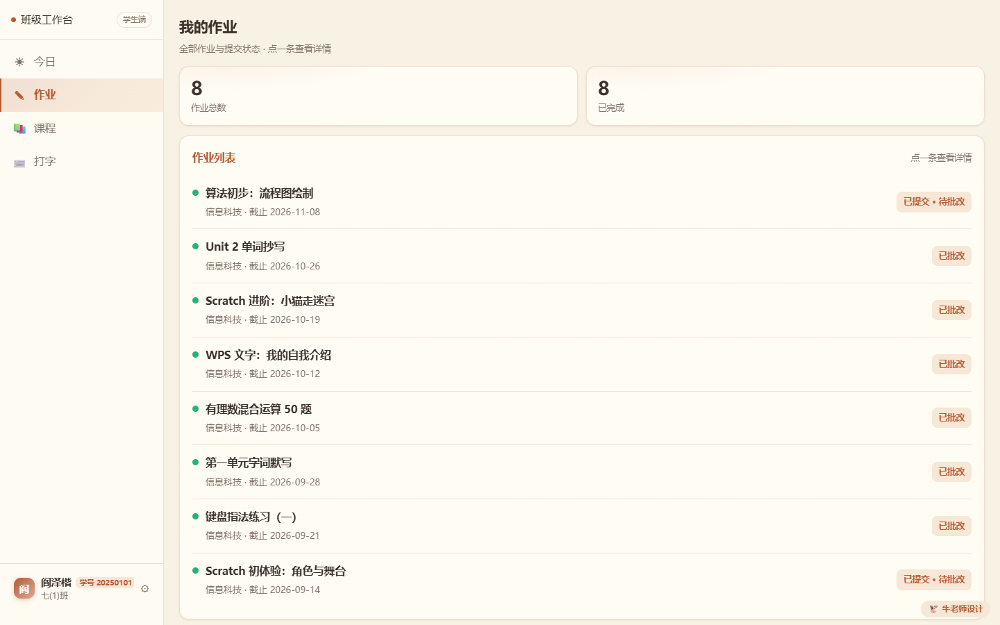

- **应见**：顶部两张统计卡（`8` 作业总数 / `8` 已完成）；「作业列表」逐条列出作业名、科目、截止日期；右侧状态标签。
- **与手机版差异**：行更宽、留白更大，状态标签固定在右端对齐。
- **判断标准**：四种状态标签都能出现——`已批改`、`已提交·待批改`，以及待交 / 逾期；列表右上角提示「点一条查看详情」。

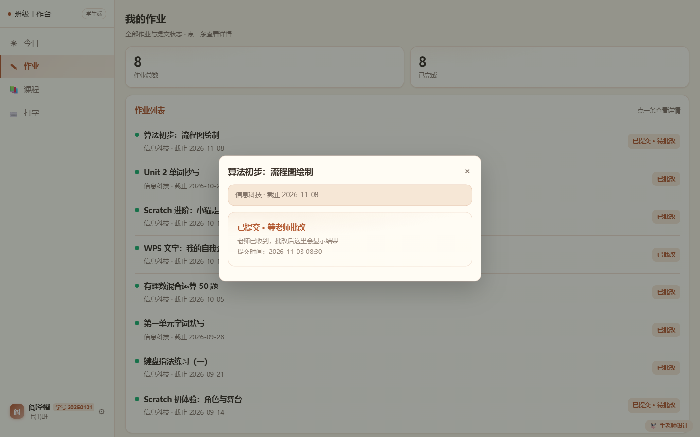

- **应见**：居中浮层，标题为作业名，副行「信息科技 · 截止 2026-11-08」，正文状态块 `已提交 · 等老师批改` 与提交时间。
- **判断标准**：浮层出现时底层页面被压暗；右上角 `×` 或 Esc 可关闭；未提交的作业在此处显示提交输入区而不是回执。

### 13.5 课程

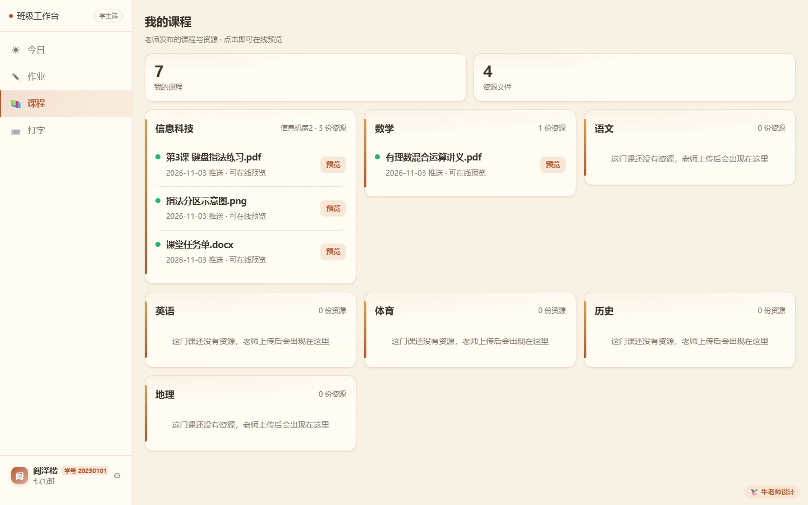

- **应见**：顶部统计 `7 我的课程` / `4 资源文件`；下方**三列网格**课程卡，每卡右上角显示「N 份资源」。
- **与手机版差异**：单列 → 三列；一屏内可同时看到「有资源」与「无资源」两种卡片。
- **判断标准**：有资源的卡片列出条目（标题 + 日期 + 「预览」按钮）；无资源的卡片显示「这门课还没有资源，老师上传后会出现在这里」。

### 13.6 个人信息面板

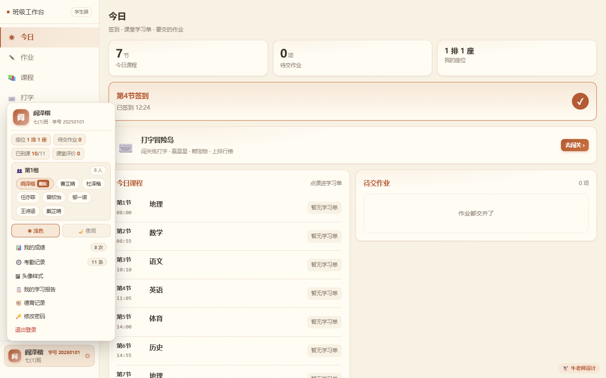

- **应见**：从左下角账号卡**向上弹出**的面板，含头像 + 姓名 + 班级学号；四格摘要（座位 / 待交作业 / 已到课 / 课堂评价）；「第1组」组员；浅色 / 夜间切换；功能列表：我的成绩、考勤记录、头像样式、我的学习报告、德育记录、修改密码、退出登录。
- **与手机版差异**：手机版从屏幕底部整屏弹出；PC 版锚在左下角、窄卡片。
- **判断标准**：点面板外区域可关闭；「我的成绩」右侧显示条数（如 `3 次`）、「考勤记录」显示 `11 条`。

### 13.7 我的成绩

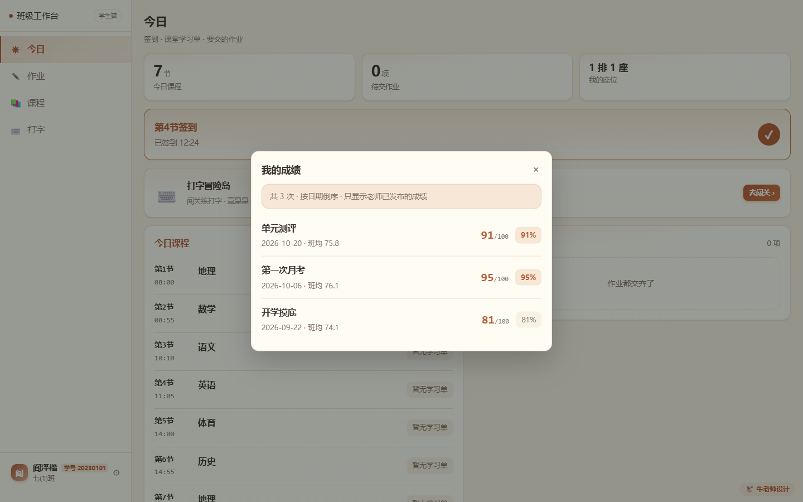

- **应见**：居中浮层「我的成绩」，说明行「共 3 次 · 按日期倒序 · 只显示老师已发布的成绩」；每条含考试名、日期、`班均 xx.x`、右侧分数与百分制。
- **判断标准**：有成绩时列出条目；老师未发布时为空状态。同一考试多科目时按科目分行。

### 13.8 考勤记录

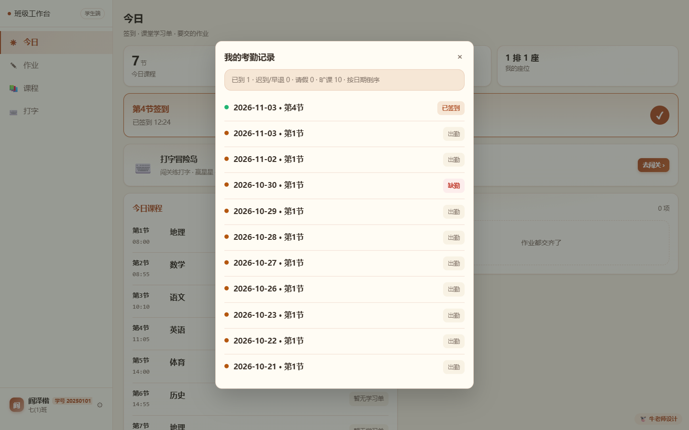

- **应见**：居中浮层「我的考勤记录」，顶部小结「已到 1 · 迟到 0 · 请假 0 · 旷课 0 · 按日期倒序」，下方逐条日期 + 课节 + 状态标签。
- **判断标准**：状态标签四色可辨——`已签到`（绿）、`出勤`、`迟到`、`缺勤`（红）；点击背景可关闭。

### 13.9 夜间模式

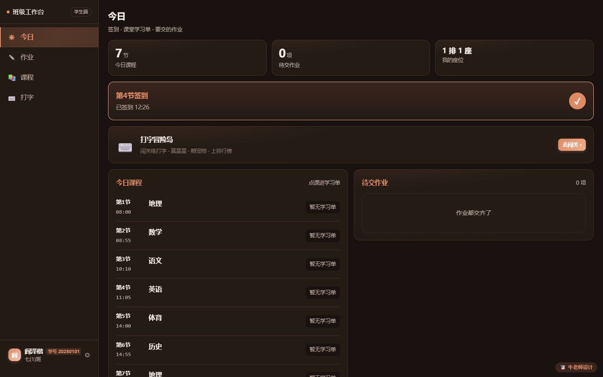

- **应见**：整站深色——左侧栏、统计卡、签到卡、课表、待交作业卡全部转深底浅字。
- **判断标准**：没有任何残留的浅色大块；文字对比度足够，橙色强调色仍可辨。
- **注意**：打字冒险岛是独立主题页，切夜间后它仍是自己的浅色卡片风，属预期，不是样式没生效。

### 13.10 打字练习（本身就是 PC 尺寸）

打字页是独立页面（`/ty/`），设计上就是桌面形态（1440×900），没有手机版对应物，直接沿用第六节的截图：


| 冒险地图 | 关卡开始 | 练习中 | 结算 |
|---|---|---|---|
| `student/t01` | `student/t04` | `student/t05` | `student/t06` |
| 排行榜 `t02` · 宠物牧场 `t03` | | | |

### 13.11 复现方式

```bash
# 隔离实例 + 演示数据 + 逐页截图（真实 data/ 不动）
python E:\wb-shots\run_pc.py
```

- 视口 `1440×900`、`deviceScaleFactor=1`、桌面 UA（Edge 131）、`isMobile=false`
- 输出目录 `docs/shots/student-pc/`，命名 `pc01-页面名.png`
- 脚本 `E:\wb-shots\shots_pc.js`；页签入口在宽屏下变成侧栏项，脚本按**可见性**择一（`#suBtn` 侧栏账号卡 / `#suFab` 悬浮钮），避免点到隐藏元素
- 夜间模式用「切换后刷新页面」的方式收尾，防止点击空白时误点到「打字冒险岛」卡片

---

## 十四、截图规范（便于后续补拍）

| 项 | 口径 |
|---|---|
| 学生端手机版视口 | 430×900，`deviceScaleFactor=2`，移动 UA，`isMobile=true` |
| 学生端 PC 版视口 | 1440×900，`deviceScaleFactor=1`，桌面 UA，`isMobile=false` |
| 打字 / 教师端视口 | 1440×900，`deviceScaleFactor=1` |
| 命名 | `s01-页面名.png`（手机版）、`pc01-页面名.png`（PC 版）、`t01-打字-页面名.png`（打字）、`q01-…`（教师端/QuickForm） |
| 存放 | `docs/shots/student/`、`docs/shots/student-pc/`、`docs/shots/quickform/` |
| 数据 | 演示数据（3 个班 × 40 人 × 10 天），不含真实学生信息 |
| 稳定性 | 截图前 `animations: disabled`，避免动效残影 |

> 复现方式：用隔离数据目录起一个工作台实例 + 灌演示数据，再用 Playwright 驱动 Edge 逐页截图；真实 `data/` 全程不动。
> 手机版走 `python E:\wb-shots\run_shots2.py`，PC 版走 `python E:\wb-shots\run_pc.py`（同一套演示数据，只是视口不同）。
