# 我用 WorkBuddy 花费近万积分耗时近一个月，重置了班级工作台 2.0


> 上一篇写的是"一个文件，双击就能用"。
> 这一篇写的是"一个班，连上同一个地址就能用"。

一个班五十来人，一节课点一遍考勤，点到第三节就烦了。

这是我上一次做班级工作台的起点。

10 月 26 日，我发了那篇《我不会写代码，但让 AI 给我写了 2.4 万行，做了个班级工作台自己用》。后台的消息大概分三类。

一类问：文件在哪下？
一类问：能不能几个老师一起用？
还有一类问：学生能不能也登进来？

前两个我能答。第三个答不了。

因为那个东西是一个 HTML 文件。数据存在浏览器里，一台电脑一个人用，学生进不来。

所以我把它拆了，重写了一遍。

这是 2.0。

---

## 一、先说清楚：这不是升级，是换了个东西

1.0 的定位，是"给老师一个人用的记事本"。

打开就能记，关掉浏览器就结束，数据在 localStorage 里，AES-256 加密，密码不存明文。这些我当时很得意，现在依然觉得是对的——对"一个人用"这个场景，它是最优解。

但它有三个天花板，撞上去才知道疼。

**第一，换台电脑就断了。** 导出备份、拷 U 盘、再导入，能用，但麻烦。机房上课想换一台机器，得先折腾五分钟。

**第二，只有我一个人看得到。** 学生不知道自己交没交、第几节签到、座位在哪。信息到我这里就断了。

**第三，所有"发放"都得靠嘴。** 发一份学习单，得挨个说"打开这个网址"；发一份资料，得在群里刷屏；催作业，得拿着名单一个个 @。

所以 2.0 换了一副骨架：

| | 1.0 | 2.0 |
|---|---|---|
| 形态 | 一个 HTML 文件 | 服务端 + 教师端 + 学生端 |
| 数据 | 浏览器 localStorage | 服务器 SQLite，29 张表 |
| 谁能用 | 一台电脑、一个人 | 局域网内教师电脑 + 机房的学生电脑 |
| 实时 | 无 | SSE 推送，改完学生端就变 |
| 断网 | 能用 | 能用（局域网，不需要外网） |
| 装法 | 双击 | 双击，或 Docker 一条命令 |

一句话：**1.0 是记事本，2.0 是一套小系统。但它没有变成那种要培训一下午的系统**——教师端还是一条左侧导航，打开就能干活。

### 顺便回答一个问题：为什么不直接用现成的

这一年我被问得最多的一句是：ITtools、LearnSite 这些信息科技教学平台不都能用吗，为什么还要自己写一个？

能用，我都试过，而且都是好东西——尤其对我们信息科技这一科，它们比自己攒表格强太多。问题不在功能，在定位：**它们是"上好一节课"的平台，我要的是"管好一个班"的工具。**

**ITtools** 是一套信息科技教学辅助平台，主打"备—教—学—评"一体化：20 多个教学模块可以按课搭积木，图文页面、课堂测验、作品互评、学生网盘、指法练习都有，最实在的是操作题自动批阅——Word、PS、Python，还有计算思维那类文本通用操作题，交上来就能判。一节操作课上完，学生当堂就知道错在哪，这在以前得我一台一台机子去看。

我卡在哪：它天生是为"这一节课"设计的，模块都是课堂活动的积木。可我课后要算的那几笔账——这个班按节次的考勤、这次考试按班的成绩、这门课的资料按班归档——还得回到 Excel 里手工再算一遍。它不吃我这套"一个班一条线"的数据。

**LearnSite** 是一款专为中小学信息技术课堂做的开源教学辅助平台，最早是温州周老师一个人写起来的，现在由上海倪老师和各地一线老师一起维护。它比我想要的还完整：学案配递进式活动，作品提交、作品互评、学生作品档案、课堂测验、打字练习、资源下载都在里面，一节课从"发任务"到"收作品"能闭环，2026 年的版本还加了网页课件活动和物联网、AI 体验。

我卡在哪：主要是部署。它是 .NET + SQL Server 那一套，得装在常年开着的 Windows 服务器上，我校没有这样一台机器，也没有人能长期维护数据库。至于学生端面向机房电脑这件事，跟我的场景倒是完全一致——我的课都在机房上，学生也是坐在同一台机器前操作。


**飞象老师** 课堂互动做得好，抢答、随机点名都顺手。但数据在平台那一侧，讲完一节课，痕迹也就散了，回头想按班看趋势，得另外再整理一遍。

| 平台 | 定位 | 它擅长的（教学场景） | 我卡在哪 |
|---|---|---|---|
| ITtools | 信息科技教学辅助平台 | 20+ 教学模块按课搭建，操作题自动批阅当堂反馈 | 围绕"一节课的活动"组织，跨课时的班级账要另算 |
| LearnSite | 信息技术课堂开源教学平台 | 学案+递进式活动、作品提交互评、作品档案、打字练习 | .NET + SQL Server 部署，长期维护顶不住 |
| 飞象老师 | 课堂互动平台 | 抢答、随机点名顺手 | 数据留在平台上，按班复盘要重做 |

所以我不是要再做一个课堂平台——上面那两个，在"上好一节课"这件事上都做得比我好。我要的是把"一个班的日常"串起来：学生坐下要签到，讲台要把任务放出去，做完了要能当场看见，交上来的文件要能按班按人归好，作业和成绩要能落回同一个班里，下次上课还得翻得出上次的记录。

这些事，在我这里分散在班级群、Excel、表单和课堂平台之间，一节课就要切几次窗口，还得手工把数据搬来搬去——搬的过程中一定会漏，漏了就没人补。

所以 2.0 不是"再多一个工具"，是把这几件事绑到一份数据上：班级和学生共用一个名单，座位、考勤、作业、成绩都引用它；讲台和学生桌面看的是同一份数据；交上来的文件按"课程 / 班级 / 学号-姓名"自动归位。

---

## 二、一页一页看

这一节的图全部来自一套演示数据——姓名、电话、成绩都是编的。

图的顺序，就是你打开工作台之后的顺序。每张图下面，就是这一页在干什么。

学生端一共六个页签，先给一张总表，后面逐页说：

| 页签 | 一句话说明 |
|---|---|
| 今日 | 签到 · 课堂学习单 · 要交的作业 |
| 作业 | 全部作业与提交状态，点一条看详情 |
| 资料 | 老师下发的资料，点一下直接打开，不用下载 |
| 测验 | 老师发给本班的检测，点开作答，按设置显示答案与分数 |
| 座位 | 座位表，讲台固定在上方，高亮自己的位置 |
| 打字 | 闯关练打字、赢星星、孵宠物、上排行榜 |

教师端拍了 8 页（登录、首页、座位、课表、作业、成绩、班级、打字配置），学生端拍了 4 页——今日、作业、资料、座位。测验和打字在第四节单独讲。

### ① 登录

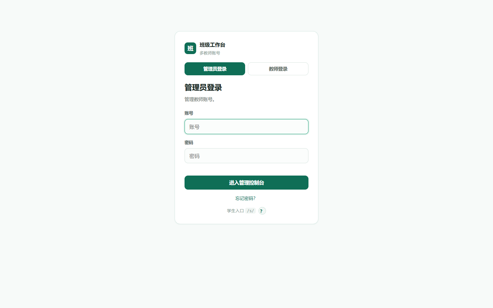

一个地址，两个身份：老师走 `/teacher/`，学生走 `/s/`。

教师登录要账号密码（**账号不是自己注册的，得由管理员在 `/admin` 里建**），忘了可以走密保重设，或者在服务器上跑一条命令重置。底下那行小字是给学生的提示——他们不用注册，用老师发的密码就能进。

### ② 首页

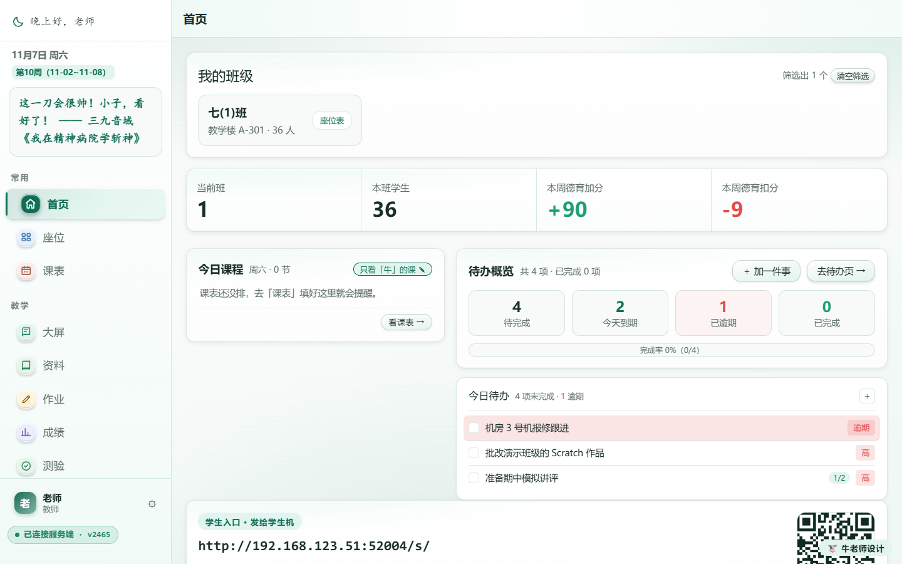

进门第一屏。

最上面是"我的班级"：每个班一张卡，点"座位表"直接跳过去。

中间四个数：当前班、本班学生 36、本周德育加分 +90、扣分 −9。

往下左边是今日课程（图里是周六没排课，提示"课表还没排，去「课表」填好这里就会提醒"），右边是待办概览：4 项、今日到期 2、已逾期 1，逾期那条"机房 3 号机报修跟进"直接标红。

最底下是学生入口：一条网址加一个二维码，直接投屏出去，学生在机房那台机器上照着输就能进。

### ③ 座位

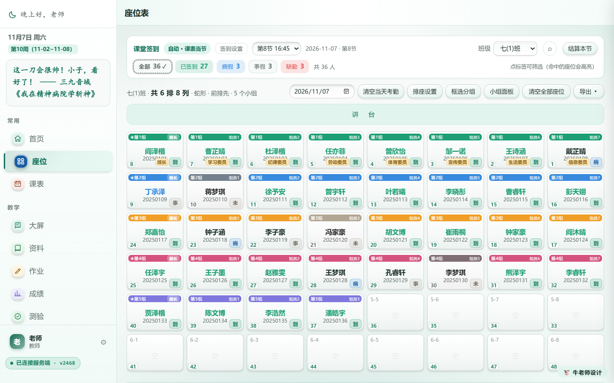

每天打开最多的就是这一页。

顶部是"课堂签到"卡：自动对齐课表当节（图里第 8 节 16:45），右边可以切班级、点"结算本节"。

再下面一排标签：全部 36、已签到 27、未到 3、事假 3、病假 3。点一下只剩那一类人，未到的名字直接列出来。

座位区是 6 排 8 列、弧形、前排先，分 5 个小组；讲台固定在上方。每个座位格上是姓名、学号、小组徽标，有的还挂着班干部职务牌和德育分，右上角是本节考勤状态（到 / 未 / 病 / 事）。

工具条：清空当天考勤、排座设置、框选分组、小组面板、清空全部座位、导出。

**框选分组**是我最得意的功能，完整保留了：按住鼠标拖一个框，12 个座位一起选中，起个组名，第 7 组当场生成，座位上的组徽标跟着换色。从框选到分组完成，十秒。

**考勤也不用点。** 1.0 里谁迟到、谁请假、谁没来，我一个个点；五十来人一节课点一遍，点到第三节就烦了——开头那句话就是从这来的。

2.0 把判定搬到了服务端，规则写死：

| 状态 | 判定 |
|---|---|
| 出勤 | 本节时间窗内登录（开始 5 分钟内） |
| 迟到 | 超过开始 5 分钟才登录 |
| 缺勤 | 开始 15 分钟仍未登录且未请假，自动记录 |
| 病假 / 事假 | 教师手动登记，优先级最高，不被签到覆盖 |
| 🔒 强制 | 教师任意指定，学生再签到也不改写 |

还有几个当时没想到、后来必须补的细节：

- 签到窗是"上一节下课 +1 分钟 ~ 本节下课"，当天第一节留课前 15 分钟；已经下课了不能补签；
- 课间十分钟按"下一节有排课"归属，学生提前到机房不算迟到；
- 本班这一节没排课，不产生考勤——防止"假全勤"；
- 缺勤之后又到堂签到，自动改判迟到，留痕。

图里那排标签（已签到 27 / 未到 3 / 病假 3 / 事假 3）就是这些规则跑出来的结果。点一个学生，面板里可以直接标病假、事假，或者强制设定本节（🔒 标记，学生再签到也不改写，直到你解除）。下课点"结算本节"，这一节就落库。

这些东西写进代码，比写在班规里管用。

### ④ 课表

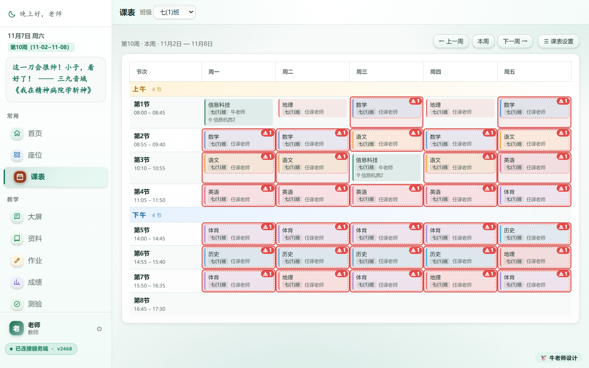

顶上班级下拉选到哪个班，就排哪个班的课。第 10 周、11 月 2 日到 11 月 8 日，上面可以翻周。

上午 4 节、下午 4 节，节次一行一行排，周一到周五横着铺，每格是科目、班级、老师和地点。

哪个格子跟哪个格子撞了（同一个时段给同一位老师排了两个班），它自己会算出来——红框描边，右上角一个"▲1"。演示数据里撞得多，真用的时候一眼就能看到该挪哪格。

### ⑤ 作业


四张统计卡：8 份作业、平均提交率 31%、待收 18 人次、已交 87 人次。

左边是提交率趋势（近 8 周、按周平均），右边是整体状态构成的环图：已交 78、迟交 5、订正 4、免交 3、未交 18，总提交率 83%。

再往下可以按类型筛（书面 / 实践 / 口头）、按状态筛（有未交 / 已交齐）、按时间筛（进行中 / 已截止）。

每份作业一张卡：科目和类型标签、标题、发布与截止时间、提交进度条，下面一行小数是已交 / 迟交 / 订正 / 免交 / 未交各多少人。右上角是"剩 6 天"或者"已截止"，底部按钮收作业、编辑、删除，右上角还能导出收交明细和作业清单。

### ⑥ 成绩

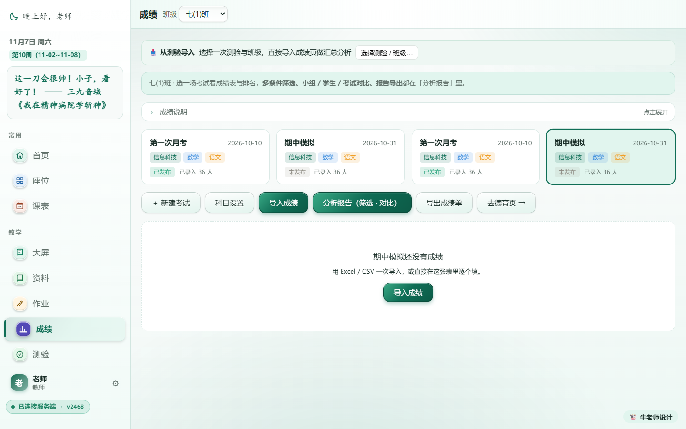

最上面一条"从测验导入"：选一次测验和班级，直接导入成绩页做汇总分析——测验和成绩是通的。

往下是考试卡片，一场考试一张：科目标签、发布状态、已录入人数。

按钮一排：新建考试、科目设置、导入成绩、分析报告（筛选 · 对比）、导出成绩单、去德育页。

选中一场考试，下面就是分数段分布、平均分、及格率优秀率这些（图里选中的"期中模拟"还没录成绩，所以主区是导入提示——录完就是柱状图和分析）。

### ⑦ 班级

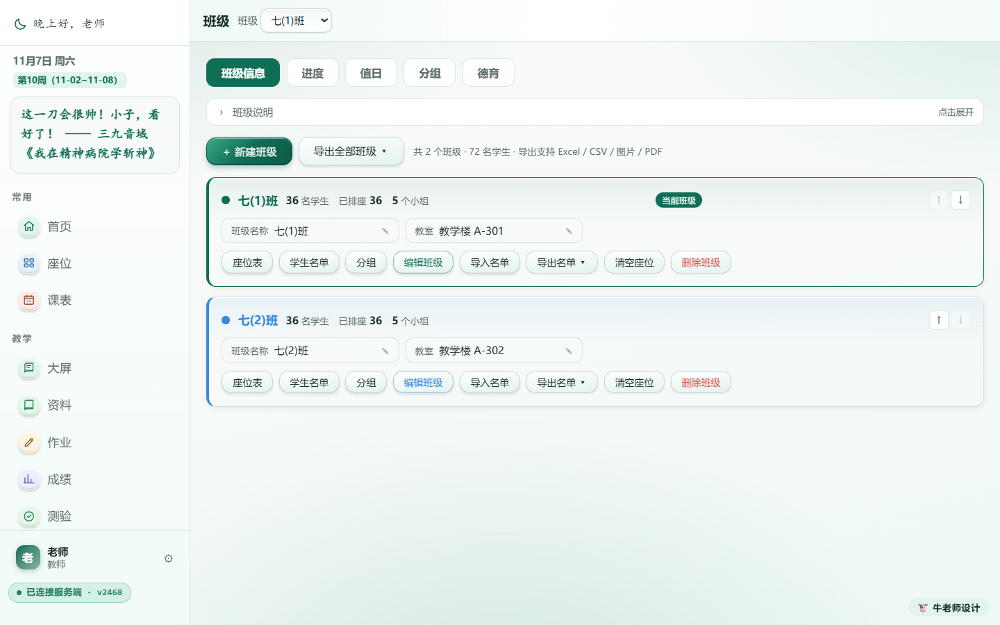

班级页是五个页签：班级信息 / 进度 / 值日 / 分组 / 德育。

1.0 里这是四个独立模块，现在收进一个页面——它们都是"看一眼就走"的东西，不值得各占一个导航项。

每个班一张卡：班名、学生数、已排座人数、小组数，班级名称和教室直接在卡上改。按钮是座位表、学生名单、分组、编辑班级、导入名单、导出名单、清空座位、删除班级。

### ⑧ 打字

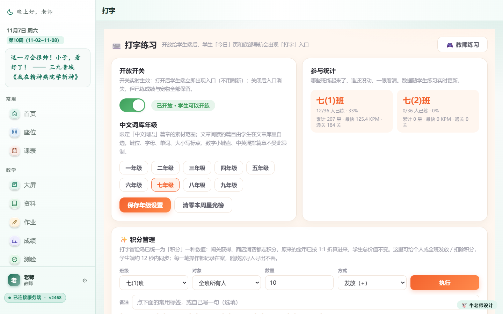

这是教师端的配置页，不是学生玩的界面。

一个开放开关：开了，学生端"今日"页和底部导航立刻出现"打字"入口；关了，入口消失，但成绩和宠物都留着。

下面选中文词库的年级（一到九年级），只影响"中文词语"那一章的素材范围。

右边是参与统计：每个班多少人练过、累计多少星、最快多少 KPM、通关多少关，学生一练数据就动。再往下是积分管理，可以按班或按人发放、扣除积分——打字攒的积分和老师发的积分是同一套。

### ⑨ 学生端 · 今日

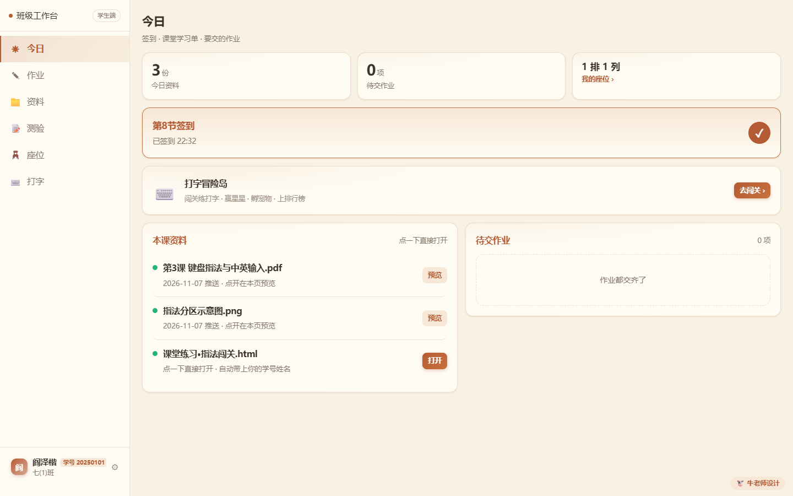

学生在机房电脑上打开 `/s/` 就是这一页，不装 App，不用注册，输一次网址就进去了。下面四张学生端截图都是机房 PC 界面。

左侧是页签：今日、作业、资料、测验、座位、打字。

顶上三张卡：今天 3 份资料、0 项待交作业、我的座位在 1 排 1 列。

往下是签到卡："第 3 节签到，已签到"。迟到与否是服务端按课表时间算的，不是学生自己选的。

再往下是打字冒险岛的入口；最底下左右两块，左边是本课资料——老师当节下发的文件直接列在这，右边是待交作业。

### ⑩ 学生端 · 作业

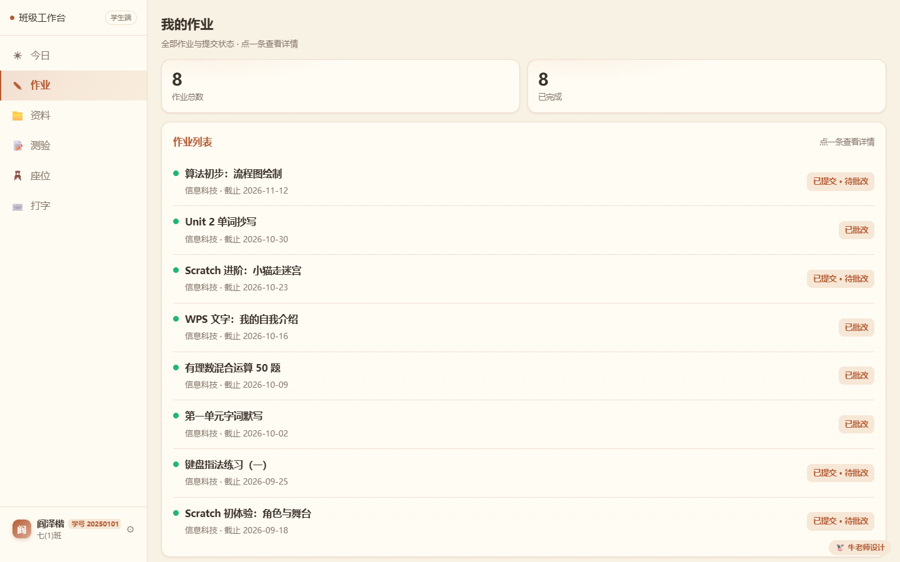

顶上两笔数：8 份作业、已完成 8 份。

列表一条一份：科目和标题、截止日期，右边是状态——已提交 · 待批改、已批改。

学生不用再问"我交了没"。

### ⑪ 学生端 · 资料

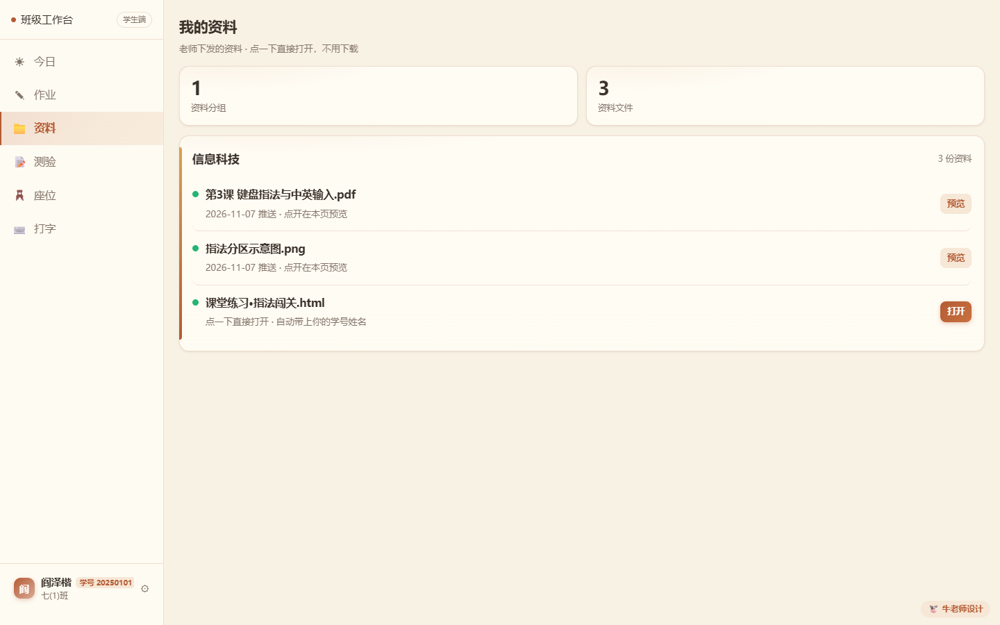

老师下发的资料，按课程分组，顶上两笔数：1 个分组、3 份文件。

这一页早一版叫"课程"，2.0.38 改成了"资料"——只列老师下发的，不再显示课表里的科目。课表（第几节上什么）那是给老师排课用的，学生知道下一节上机房就够了。

每个文件右边一个"预览"，点开在线看，不用下载，也不占学生电脑的磁盘；网页类的直接"打开"，还会自动带上学生的学号姓名。

### ⑫ 学生端 · 座位

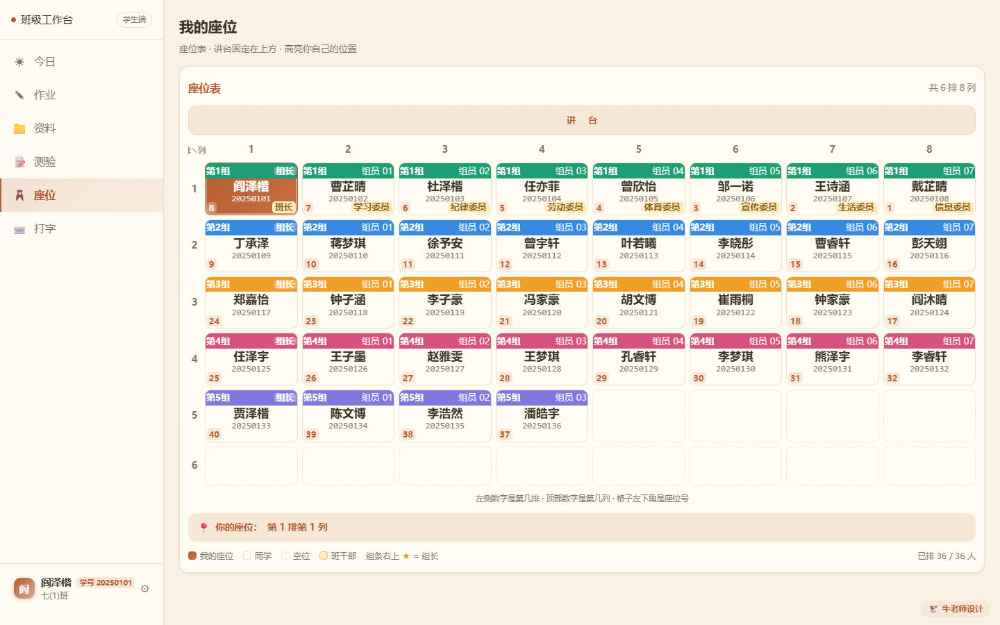

整间教室的座位表，讲台固定在上方，自己那格高亮（图里是第 1 排第 1 列）。

有个细节值得说：老师端可以把讲台设在上方或下方，学生端统一翻到上方显示，座位号仍然和老师那张表一致。

左侧数字是第几排，顶部数字是第几列，格子左下角是座位号。图例里标了班干部和组长，右下角还能看到全班 36 人都在自己的位置上。

四页看下来，学生端只有一个原则：只给本班、本人。

座位表是唯一会下发同班同学姓名的接口——只给姓名、学号、座位号、小组、班干部职务，**不含电话、成绩、内部 id，也不带考勤状态**。

手机号、家长信息、别人的成绩，在服务端就被裁掉了。

---

## 三、15 个模块，一个一个对

这是这篇文章最实在的部分。上一篇里我列了 15 个模块，这次挨个说它们去哪了、变成了什么。

| 1.0 模块 | 2.0 在哪 | 具体变化 |
|---|---|---|
| 座位表 | 常用 · 座位 | 拖拽排座、框选分组全保留；新增实时签到、按状态筛人、强制考勤、结算本节 |
| 考勤 | 并进「座位」 | 不再手点状态，服务端按课表判定：5 分钟内出勤、超 5 分钟迟到、15 分钟没到缺勤，请假优先 |
| 课表 | 常用 · 课表 | 新增节次时间重叠校验、同老师撞课标红、星期栏吸顶常驻 |
| 作业 | 教学 · 作业 | 新增提交率趋势、状态构成环图、导出收交明细；学生端能自己看交没交 |
| 成绩 | 教学 · 成绩 | 新增批量粘贴录入、及格率 / 优秀率、分数段分布、分析报告、从测验一键导入 |
| 德育 | 班务 · 班级（德育页签） | 记分逻辑没变，数据从本机搬到服务端 |
| 分组 | 班务 · 班级（分组页签） | 框选分组保留，组徽标、组内角色、成员管理都在 |
| 值日 | 班务 · 班级（值日页签） | 分区、岗位、轮换保留 |
| 学习进度 | 班务 · 班级（进度页签） | 保留 |
| 学生档案 | 班务 · 学生 | 新增账号状态、批量重置密码、成长报告、通讯录导出 |
| 班级管理 | 班务 · 班级 | 变成五个页签的统一入口 |
| 待办 | 其他 · 待办 | 新增今天 / 本周 / 全部、截止日、逾期提醒 |
| 工具箱 | 其他 · 工具 | 点名、计时器、番茄钟、自定义链接二维码；**截图工具删了**（下面说为什么） |
| 系统设置 | 顶栏 · 设置 | 新增模块开关、密保、数据备份、在线更新 |
| （首页 / 总览） | 常用 · 首页 | 1.0 没有独立首页；2.0 新增：班级概览、今日课程、本周德育、待办、学生入口二维码 |

上面这张表是总览，功能细节在上一节的图里都对着说过了。表里还有三页没单独给图，补在这里——

**学生档案**（班务 · 学生）：账号状态、批量重置密码、成长报告、通讯录导出都在这一页。

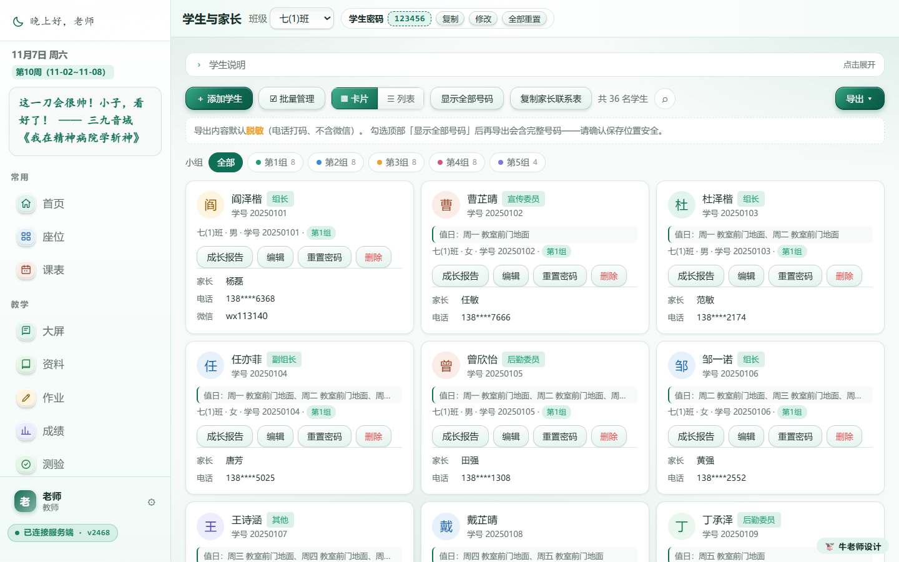

**待办**（其他 · 待办）：今天 / 本周 / 全部、截止日、逾期提醒，首页那个"待办概览"就是它的摘要。

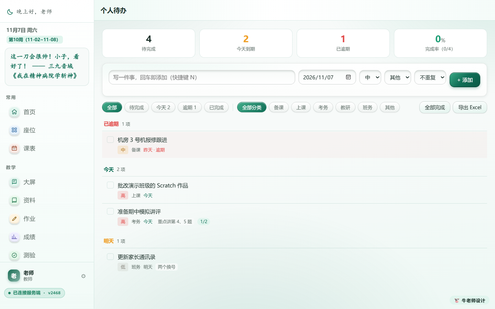

这里只补一件表里写不下的事——我删了一个功能。

### 工具箱：我删了一个功能

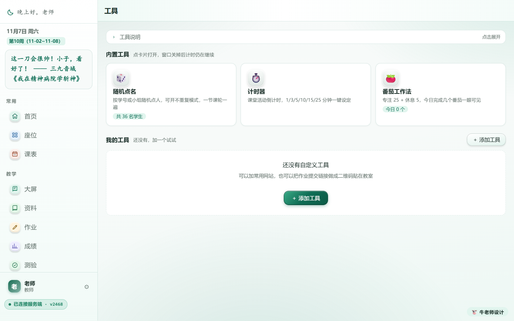

现在的工具页就三样内置：随机点名（按学号或小组机抽人，可开不重复模式）、计时器（1/3/5/10/15/25 分钟一键定）、番茄工作法（专注 25 + 休息 5）。下面留了"我的工具"，可以加常用网址，也可以把作业提交链接做成二维码贴在教室。

截图工具，2.0.32 删的。

原因很实在：局域网 `http://192.168.x.x` 下，浏览器根本不给屏幕捕获权限，只有 `127.0.0.1` 或 `https` 能用。老师在机房用 IP 打开，点截图就是"不支持"。

一个大部分时候用不了的功能，不如没有。

后来还删掉一个："学习单整页 HTML 存档"。以前学生一提交，系统会把整页 DOM 克隆一份存成 html。后来发现：真正有用的是学生交的那个文件，页面快照除了占空间没别的用。

**功能不是越多越好。删掉用不上的，剩下的才转得动。**

---

## 四、2.0 新长出来的五件事

前面那些图里没出现的，就是这一节要讲的。这一节的功能后台逻辑多，上一版只有文字，这次全部补了真机截图。

### 1. 大屏和学习单：一节课跑通了

这是 2.0 最费劲的一块，也是最值的一块。

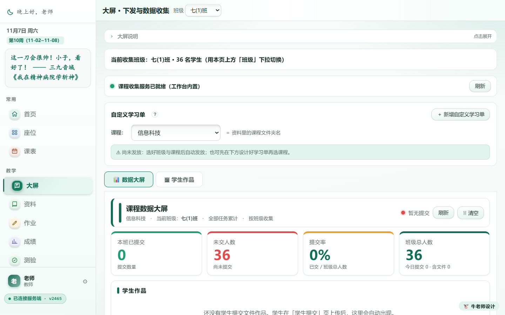

这就是大屏页：右上角选班级、选课程，中间是四个统计卡（本班已提交 / 未交人数 / 提交率 / 班级总人数），下面按任务分块，每个任务一个窗口。

流程是这样的：

1. 教师在"大屏"页选课程 → 选学习单 → 按班下发；
2. 学生端"今日"对应的课立刻出现"进学习单"；
3. 学生点开，服务端验身份、验班级、验签到，签一张票，302 到学习单页；
4. 学生作答 / 传文件，提交；
5. 大屏实时出现：谁交了、交到哪个窗口。

换成上课的视角，是这样三段：

| 阶段 | 我做什么 | 学生看到什么 |
|---|---|---|
| 课前 2 分钟 | 班级下拉选到本节课的班，课程下拉选到对应文件夹，学习单自动下发 | "今日"页的"本课资料"里多出一条，带"打开" |
| 课中 | 投屏停在大屏页，看四个统计卡（本班已提交 / 未交人数 / 提交率 / 班级总人数）和任务窗口 | 点"打开"就进作答页，学号姓名已经带好，不用重填 |
| 讲解 | 点某个窗口的"设为大屏"，那一份放大到讲台屏 | 抬头能看到自己的作品被投上去 |
| 下课 | 点"清空"，本节归档，下一节重新开始 | 页面回到干净状态，历史记录不丢 |

统计口径也定死了几条，每一条都是踩过坑之后加的：

- **提交率按"本班应交人数"算**，不是按年级或全校。36 人的班交了 9 份就是 25%，不会因为别的班交得多而虚高；
- **同一个学生只算最后一次提交**。学生反复改、反复交，不会把提交数刷到 40 去；
- **按班隔离**。七(1)班的大屏只收七(1)班的提交，同名同姓跨班也不会串——判定先看班级，再看学号或姓名；
- **只统计"提交"，不算正确率**；
- **清空按"课程 + 活动"清**，只清这一节，不动别的课，也不动已经归档的文件。

这块以前不是大屏，是 QuickForm。

QuickForm 是我用得最久的一个工具：收表单、做问卷、导出结果，体验很顺，1.0 的时候我干脆把它接进了自己的工作台，学习单就用它收。但它只知道"有人交了一份表"——不知道这个班 36 个人里谁没交，不知道交上来那份对的是哪台机器前的哪个人，更不知道谁这节课压根没签到。每收回一批，我还得拿名单一条条对：谁没交、谁交了两遍、哪个文件名对不上人。

上面那几条统计口径，就是那会儿一次次对出来的。所以 2.0 干脆把收件长进了大屏：提交一落库就带着票里的学号和班级，同一个学生只留最后一次，提交率按本班应交人数算。收完就能讲，不用再对一遍名单。

这里有个设计我当时纠结了很久：**数据服务地址、任务号、学生身份，一个都不出现在学生页面上。**

学生看到的链接是 `/g/act/一串id`，不是数据库地址，也不是自己的学号。票只存在内存里，12 小时有效，重启就失效。提交时服务端用票里的身份覆盖页面填的学号——防冒名。

签到闸门也在这一层：今天一笔有效签到都没有，学习单打不开，先回去签到。

### 2. 资料库：文件终于有地方放了

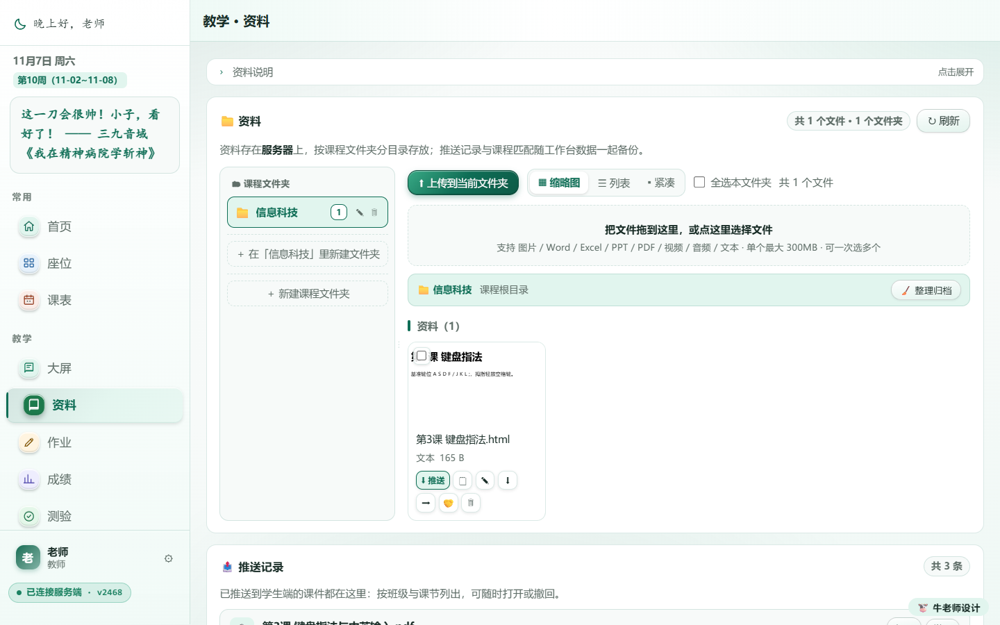

资料存在服务器上，按课程文件夹分目录存放：左边是课程树，右边是文件列表，可以缩略图、列表两种视图看，网页文件可以"设为学习单"。推送记录按班级与课节列在下面，可随时打开或撤回。

1.0 没有文件管理。课件在电脑文件夹里，学生在群里传，收上来的作业在下载文件夹堆着。

2.0 的资料库是"目录即数据"：

```
课件根 / 课程 / 子文件夹 / 文件
```

老师用资源管理器直接拷文件进去，刷新就能看到；拷走整个目录就是完整备份。左边树、右边列表，三种视图，网页文件可以"设为学习单"。

更关键的是**自动归档**。学生交了文件，服务端立刻复制一份到：

```
<课程>/<班级>/<学号-姓名>/<原文件名>
例：信息科技/七1班/20250108-张三/作业.docx
```

不用老师打开大屏，不用手动点归档。同名不同内容存成 `作业 (2).docx`，永不覆盖；纯数据提交不建文件夹。

2.0 早期不是这么做的：归档靠前端在大屏刷新时顺带跑，老师关掉页面就永远不归档——"学生说交了、资料里没有"就是这么来的。现在改成提交时服务端做，才算真修掉。

### 3. 测验：七种题型，答案不下发

2.0.38 刚加的。

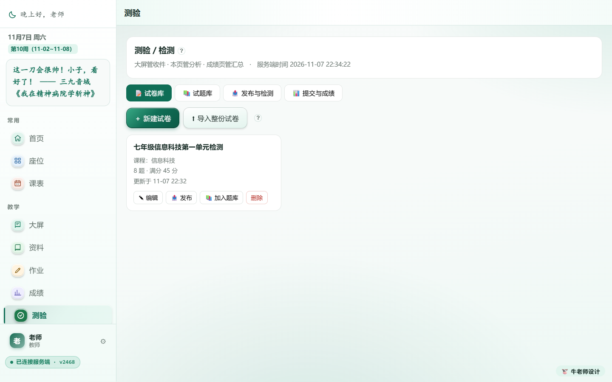

测验页四个页签：试卷库、试题库、发布与检测、提交与成绩。新建试卷或导入一份文本试卷都行——图里这份"七年级信息科技第一单元检测"就是从文本解析进来的，8 题、满分 45 分，点"发布"选班级就下发。

单选、多选、填空、判断、连线、简答、图片上传，七种题型。逐题设分值和答案，可以设开放与截止时间、提交次数上限。

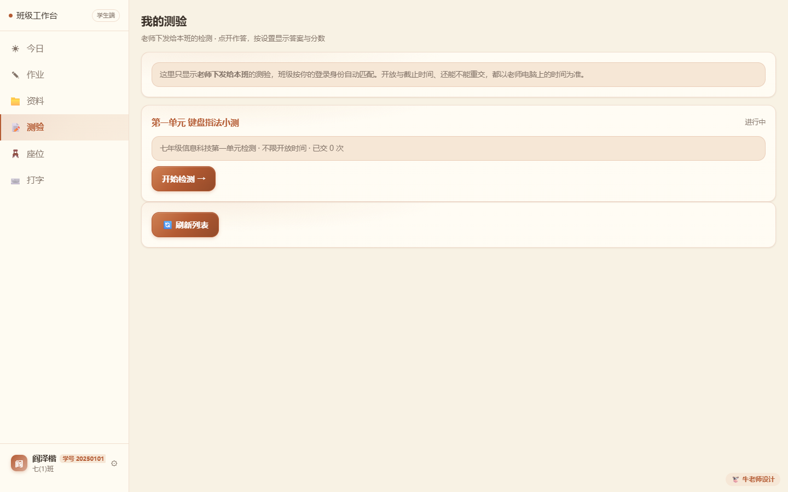

学生端"测验"页签里就是老师发给本班的检测，一场一行，状态一目了然。

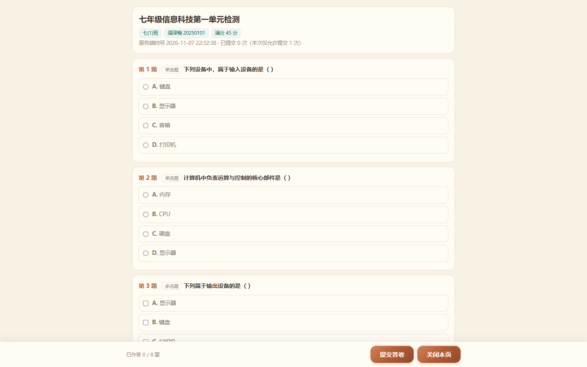

点开作答是独立的一页：题目、选项、作答区，交卷后按老师设的开关决定显示答案还是分数。

两个开关是分开的：**提交后是否立即显示答案**、**是否立即显示分数**。都在服务端出网前裁剪——学生拿到的试卷里，正确答案、分值、配对关系这些字段根本不存在，连线题只给打乱后的右项。

判分在服务端。客观题自动判，简答和图片上传要人工批阅，没批就是"待批阅"，不冒充 0 分。

三处入口分工也定死了：

| 入口 | 干什么 | 不干什么 |
|---|---|---|
| 大屏 | 实时收件看板：谁交了、交到哪个窗口 | 不显示答案分数，不算正确率 |
| 测验页 | 唯一的逐题正确率、按班成绩分析 | 不另存一份提交、不另算一套分 |
| 成绩页 | 选测验 + 班级 → 换算百分制 → 写成一场考试 | 不绕过统计口径直接读原始答卷 |

三处读同一份提交，同一次发布同一个学生只算最后一次。

**为什么大屏不算正确率**

刚做出来的时候我也想把正确率塞进大屏，试过之后放弃了。

上课的时候我要的是"还有 4 个人没交，我可以再等两分钟"，不是"这道题全班正确率 62%"。后者是把课上成教研，前者才是上课。

对错和分数留给测验页和成绩页。三处看同一份提交，但各回答各的问题。

### 4. 打字冒险岛

上一节第 ⑧ 张图是教师端的开关，学生端玩的是另一套东西。

信息科技课有个绕不开的起点：**很多七年级学生不会用键盘**，两只食指戳，眼睛在键盘和屏幕之间来回找。这个基础不打掉，后面讲文字处理、讲编程，全都在补打字。

可打字讲是讲不会的。我说一百遍"手指放在 F 和 J 上"，不如让他自己敲二十分钟。问题是怎么让他愿意敲。

打字冒险岛把"练指法"拆成能一关一关过的小目标，八个篇章：

| 篇章 | 练什么 | 为什么排在这个位置 |
|---|---|---|
| 键位熟悉 | 基准键 F、J 和周围几个键 | 先把手放对地方，不求快 |
| 字母位置 | 26 个字母的实际位置 | 手位固定之后再扩到全键盘 |
| 英文单词 | 成词输入 | 从"按键"过渡到"打词" |
| 大小写与标点 | Shift、逗号句号引号 | 加了新手指，速度会掉，得单独练 |
| 数字小键盘 | 右侧数字区 | 换一只手，独立成章 |
| 中文词语 | 拼音输入 | 换输入法，等于从头再练一次 |
| 中英混排 | 中英切换 | 真实文档的样子 |
| 文章阅读 | 整段连续输入 | 到这一步才谈速度和耐力 |

七年级一个学期能走完前四章就不错了，后面几章是给学得快的学生留的。

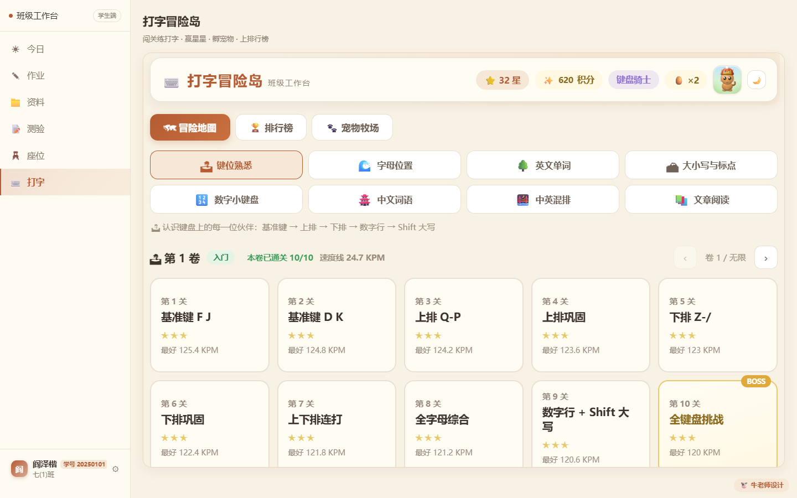

学生端进去就是这张冒险地图：顶上八个篇章随便切，每卷 10 关，每张关卡卡上是这一关练什么、拿了几颗星、最好成绩多少。

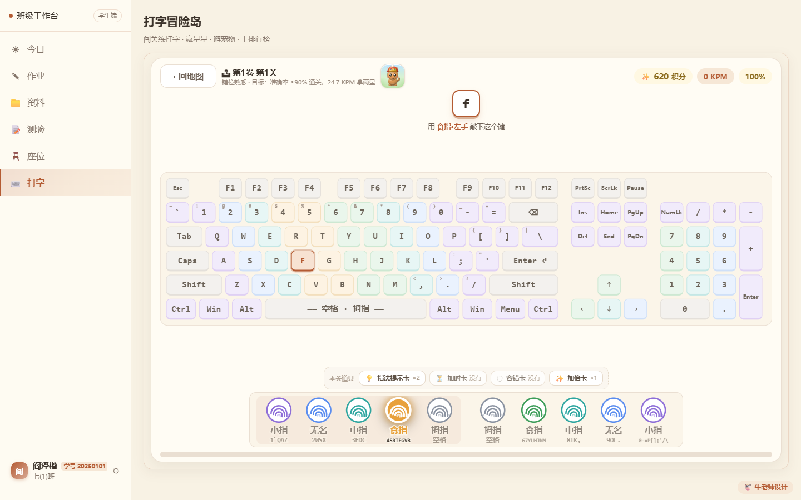

进一关长这样：中间是课文行，下面是整块键盘图和左右手指法分区，按到哪个键、该用哪根手指，高亮直接标出来。

每章每卷 10 关，第 10 关 BOSS，卷号无限递增。每关内容随机生成，防止背顺序——背下第 3 关那串字母，换一局就没用了。

逐字变色、实时速度和准确率、三星结算；指法高亮跟着按键走，大写头顶有 ⇧ 角标，错字红标但课文行永远显示原文（改掉的话，学生就不知道自己在打什么了）。

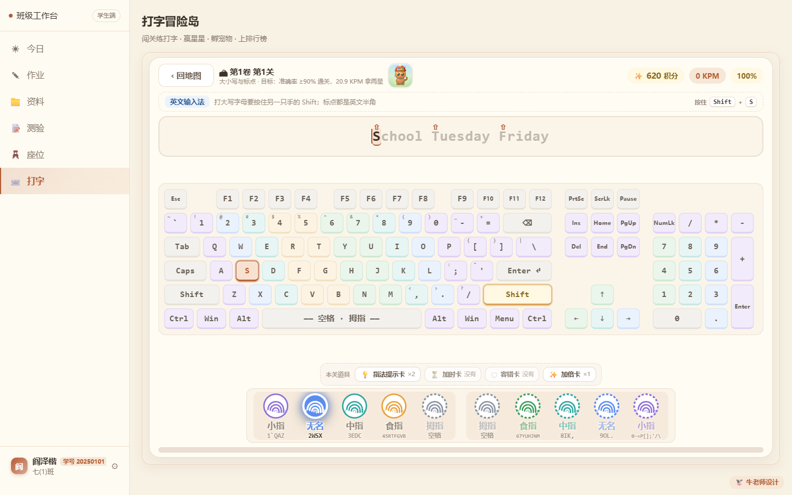

"大小写与标点"篇章专门练 Shift：要打大写字母的那个键，头顶会浮一个 ⇧ 角标，Shift 键同时点亮，按错了角标不会消失。

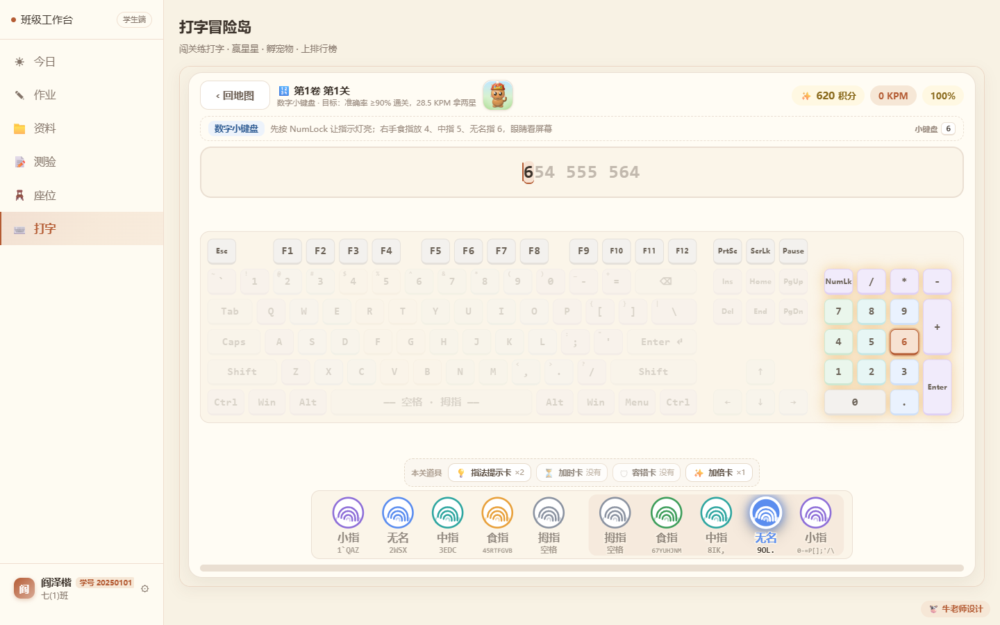

"数字小键盘"是独立的一章：主键盘区压暗，只亮右边的小键盘，提示条告诉你先按 NumLock、右手 4-5-6 定位。

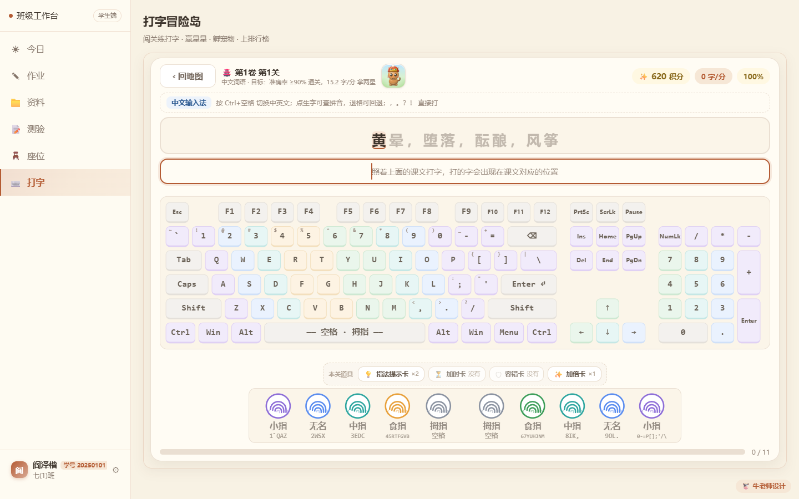

"中文词语"切换到中文输入法打拼音，输入法提示条会告诉学生"按 Ctrl+空格 切换到中文"，打出的字会出现在课文中对应的位置。

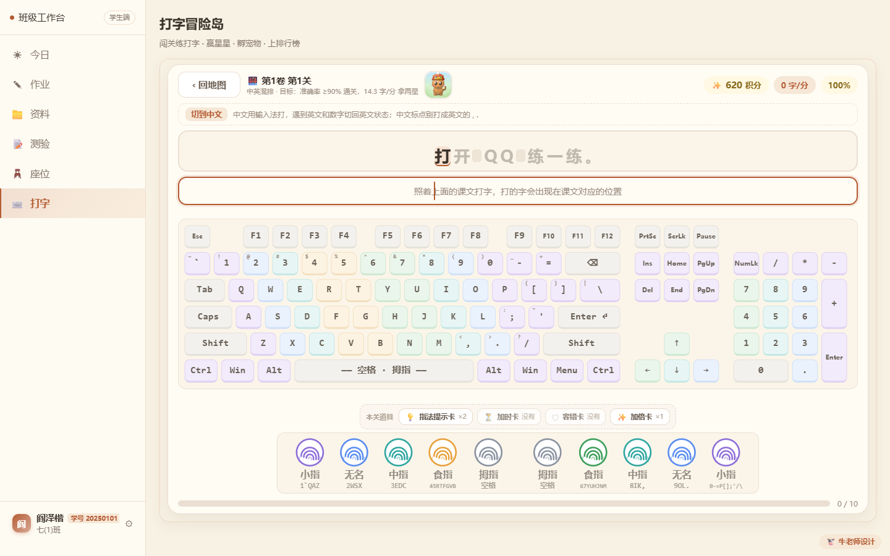

"中英混排"是真实文档的样子：中文、英文、数字、标点混在一句里，输入法徽标跟着当前字符自动变。

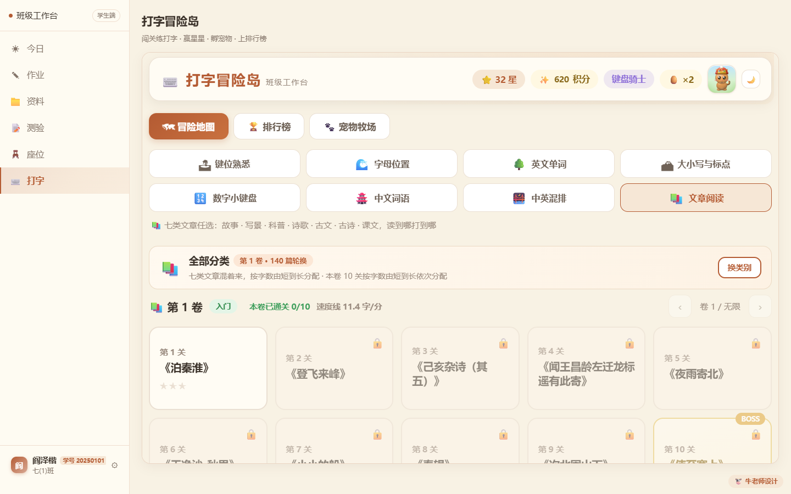

最后的"文章阅读"是长文练习：七类文章任选（故事 · 写景 · 科普 · 诗歌 · 古文 · 古诗 · 课文），每卷 10 关按字数由短到长分配，图里第 1 关就是《泊秦淮》。

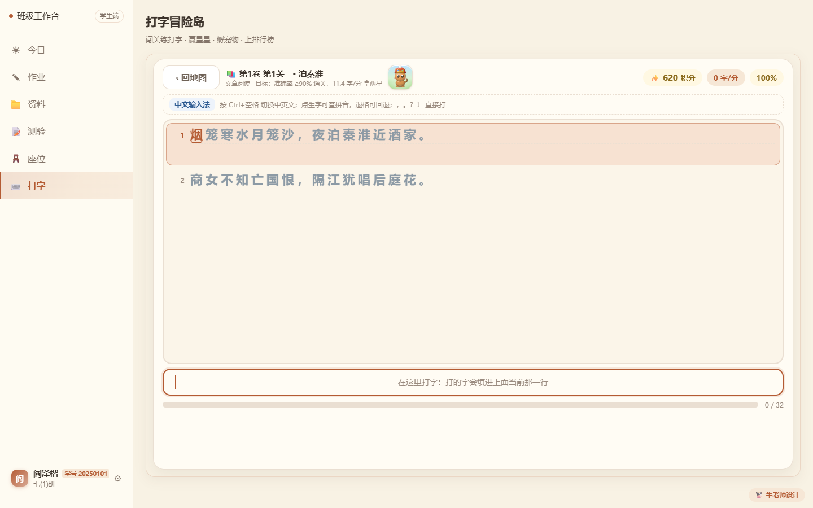

长文关不显示键盘和指法图——屏幕全留给课文，读到哪打到哪，打完一行自动接下一行。

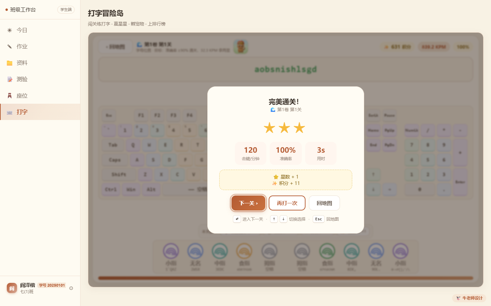

打完一关当场结算：几颗星、击键每分钟、准确率、用时，星数和积分涨了多少直接写在奖励栏里。

星星有两个用处：换道具（指法提示卡、加时卡、容错卡、加倍卡，默认都没有），和攒着解锁装扮、孵宠物。

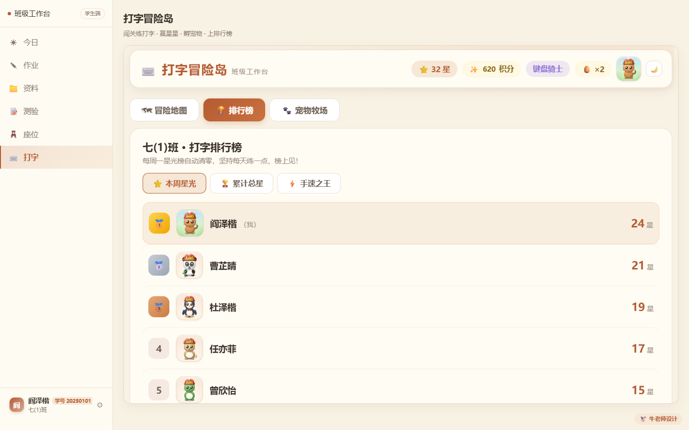

班级排行榜按本周星光 / 累计总星 / 手速之王三个榜切换，每周一自动清零重算，每个学生头顶跟着自己的出战宠物。

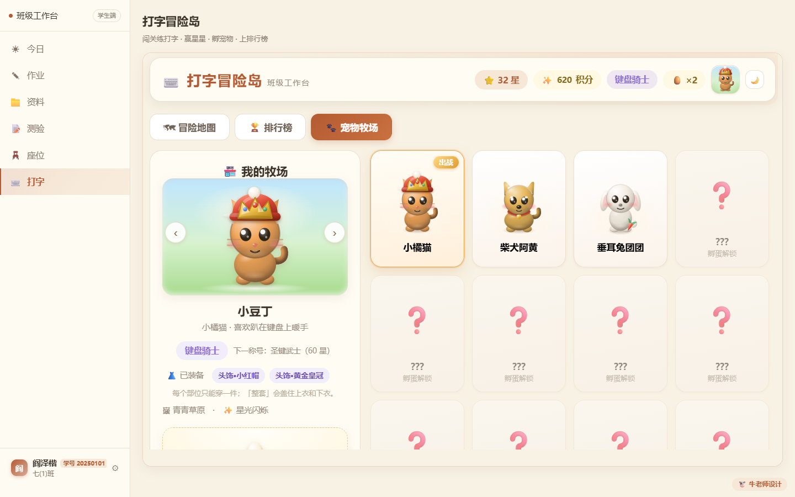

牧场里有 12 只原创宠物，BOSS 首通掉蛋，孵出来就能出战、穿装扮——图里这只小橘猫戴了小红帽和黄金皇冠，站在青青草原上，出战还挂着星光特效。图鉴没孵出来的，就还是问号。

这套东西看着像游戏，其实解决一个很朴素的问题：**打字练习本身没有成就感**。多打一百个字不会让任何人兴奋，但多一颗星会。

成绩由服务端按公式重算，不信任客户端；老师关掉开关后接口直接拒绝，不是把按钮藏起来而已。

### 5. 多老师、备份、在线更新

这三件不是课堂功能，但没有它们，这东西只能自己玩。

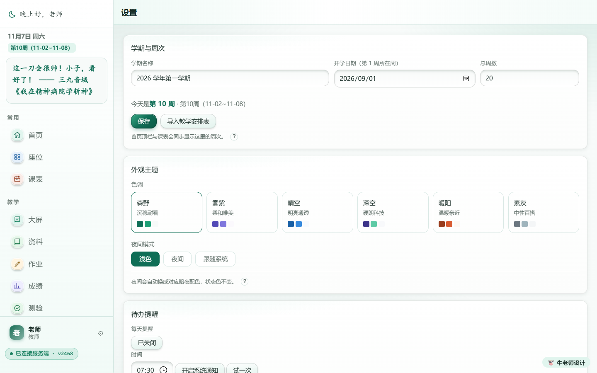

设置页里能看到的：学期与周次（首页和课表的周次都从这算）、六套外观主题、待办提醒；往下翻是多教师账号、备份恢复、在线更新。

**多教师账号隔离**：管理员控制台管账号，每个教师一个工作区（`accounts/<id>/`），数据互不可见。资料可以共享——勾选目标教师，服务端复制一份过去，不动源文件。老单账号数据升级时映射成 `default`，零迁移。

**加密备份**：设置里一键导出 `.cwbackup`，设一个 ≥6 位的备份密码，内含 29 张表 + 配置 + 口令哈希 + 打字成绩 + 学生作品附件。备份文件本身是密文，换电脑导入要输同一个密码。

导入有两道拦截：空表、或本机有数据而备份 0 行 → 拒绝；本机 ≥5 行而备份 <40% → 二次确认。失败不改动任何数据。

**在线更新**：每 24 小时查一次版本，发现新版提示，下载 → 校验 sha256 → 换装 → 重启。失败自动回滚，也能手动回滚。更新只替换程序文件，数据原地保留。

---

## 五、数据还在你自己的机器上

上一篇我专门写了一节"数据不出我的电脑"。2.0 这句话要改一下：

**数据不出你自己的机器。**

只不过这台机器从"你的电脑"变成了"你的 NAS / 你的小主机 / 机房里那台常开的电脑"。

- 业务数据在一个 SQLite 文件里，29 张表；课件、学生附件、试卷文件在旁边的目录；
- 学生端只拿得到"本班 + 本人"的字段投影，手机号、家长信息、他人成绩在服务端就裁掉；
- 试卷和答案不进同步快照，否则等于把答案发给学生；
- 备份文件是 AES 密文，密码不存明文；
- 不需要任何第三方云服务，不联网也能跑。

代价是：你得有一台常开的机器，得自己做备份，得自己放行防火墙端口。

这就是"数据自主"的真实价格。我觉得值，但你得知道。

### 还有几句实话，一起说完

讲"它能干什么"很容易，讲"它不能干什么"才见真心。所以补在这里：

**它需要一台常开的机器。** NAS、小主机、机房那台不关的电脑都行。但它不是云服务，你关机，学生就进不来。

**它只在局域网里。** 不出公网，不需要域名和备案，代价是学生必须连同一个 Wi-Fi。机房如果开了 AP 隔离，设备之间互相不通，得找网管关掉。

**它不替你做判断。** 谁能请假、谁该扣分、哪份作业算迟交，规则写死在代码里，但边界情况还得人来定。工具只保证"改了就记上"，不保证"改得对"。

**它是按机房电脑设计的。** 学生端面向 1366×768 以上的机房屏幕，一节课 40 分钟，学生在同一台机器上签到、看资料、交文件。手机能打开，但排版会挤——我的课都在机房上，就没往这上面花时间。

**一个班用很顺，一所学校用要慎重。** 我没做过几十个班、几千人的压力测试，也不知道并发高了会怎样。它的定位就是"一个老师带着几个班"，别拿它当校级平台。

知道这些再决定要不要装，比看完功能就动手更靠谱。

---

## 六、这一个月，我主要在修什么

上一篇说"AI 写了 2 万多行"。这次重写完，`app/` 下是 **46 个源码文件、6.7 万行**。

版本号已经走到 **2.0.38**，中间三十多个小版本，几乎每次都是"改一处、验一处"。

听起来很顺，实际上大部分时间在修那种"看起来不是 bug 的 bug"。挑四个讲。

**① 弹窗突然变成空白**

管理员控制台点"重置密码"，弹窗只剩一个壳，正文全空。

查了半天，代码没问题。真正的原因是：弹窗类名用了 `ad-*`（`.ad-ov` / `.ad-body` / `.ad-btn`），uBlock、AdBlock 这类插件会把 `[class^="ad-"]` 当成广告块 `display:none`。

卡片和按钮还在，中间的正文和输入框被隐藏了。

改名的改法很土：全部换成 `wbd-*`。但从那以后我知道，**前端类名也要避开广告拦截器的黑名单**。

**② macOS 更新完，双击没反应**

Windows 上打包，macOS 上解压，`.command` 文件的权限从 755 变成 644，双击就是"没有权限打开"。

根因在 zip：`ZipInfo` 默认 `create_system = 0`（FAT/MS-DOS），解压器看到"DOS 文件系统"就忽略 Unix 权限位。

修法是写 `create_system = 3` + `external_attr = mode << 16`，构建完再自检一遍，权限不对直接让构建失败，不产出坏包。

**③ Windows 上重启服务，服务全没了**

自动更新完点"重启"，结果两个进程都没了。

因为 Windows 的 `os.execv` 不是 Unix 的"原地换映像"，而是"先起新进程、再退旧进程"。新进程启动时探测端口，旧进程还在监听 → 判定"已有一个实例在运行" → 新进程直接退出；旧进程随后也退。

修法：重启前先 `server_close()` 释放监听，给新进程带 `WB_RESTARTING=1` 标记，端口被占也只等它释放（最多 8 秒），不当成重复启动。

**④ 导入 8MB 备份，页面卡死 15 秒**

局域网 `http://` 下 `crypto.subtle` 不可用，AES 解密只能用纯 JS 实现，速度 0.54 MB/s。8MB 要 14.9 秒，全程同步占用主线程，页面定格。

改成按 64KB 分片解密，每片让出主线程（约 120ms），带进度条。总耗时只多 5%，但界面全程能点。

顺带确认了一件事：**服务端从来不是瓶颈**（导入 1000 行 0.13 秒）。以后再遇到"导入慢"，先测前端解密，别去改数据库。

还有一堆小的：学生上传的文件名变成 `作业.txt`（编码三重转错，单独写了个 `fix_filename()`）；归档路径多拼了一层 `activity/activity/`；学习单身份在页面上显示两遍；资料里删个文件就被弹回课程根目录……

这些东西不会出现在功能列表里，但它们决定了一个东西"能不能每天用"。

---

## 七、三条经验，比上次更贵

上一篇我给了三条：要求写到细节、规矩提前立死、一次只做一个模块。

这次重写，三条都还在，但要各加一句。

**① 先定数据模型，再谈界面**

1.0 是"页面驱动"：想到一个模块，画一个页面，数据塞进 localStorage。

2.0 不行。29 张表、三个端、实时同步，字段一改，三处全崩。

所以这次我学乖了：先把"班级 / 学生 / 座位 / 考勤 / 作业 / 成绩"这些实体的关系画清楚，谁是主键、谁引用谁、删除时谁跟着删，定完了再让 AI 写界面。

界面可以改，数据模型改一次要脱一层皮。

**② 边界比功能重要**

"学生能看到什么"这个问题，比"再加一个功能"重要十倍。

2.0 里每一处学生接口都要过一遍投影：这个字段该不该给他？给了会不会顺带泄露别人？关掉模块后接口是不是真的 403？

试卷不进同步、座位表不带电话、提交用票里的身份覆盖页面填的学号——这些都是边界，不是功能。

功能漏了能补，边界漏了是事故。

**③ 验收必须真机，不能只看代码**

AI 说"已修复"的时候，通常是真的改了代码，但不等于真的好了。

这次每个版本我都跑一遍真机验收：登录走真实表单、hash 路由加 `?v=N` 防缓存、截图存证。53 张截图一轮，登录页 401 是已知噪音。

听起来很笨，但它拦住过"接口返回 200 但页面没变"、"改了样式但被缓存"、"本地好使部署后 404"。

**AI 写得快，验收得慢。慢的那一步不能省。**

---

## 八、开源了，直接拿

项目用 MIT 许可证开源，仓库里没有任何真实班级、学生、成绩数据，克隆下来是一套空白工作台。

**仓库地址：**

- Gitee（国内快）：`https://gitee.com/shyxiaoniu/teacher-workbench`
- GitHub（镜像）：`https://github.com/Shyxiaoniu/teacher-workbench`

**发行包直链（点开就下，不用装 Git）：**

```
https://gitee.com/shyxiaoniu/teacher-workbench/raw/main/dist/班级工作台2.0.38-261106.zip
```

也可以进仓库，点 `dist` 目录自己找最新那个 zip。约 5MB。

---

### 装法一：直接运行（Windows / macOS，最简单）

适合：自己的办公电脑、笔记本、机房临时用、没有 Docker 的环境。

**前置条件：** Windows 10 以上或 macOS，Python 3.9 以上。

Windows 装 Python 时**务必勾选 "Add Python to PATH"**，否则双击启动脚本会提示找不到 Python。
如果你拿到的是带 `runtime/` 目录的完整离线包，则不用装 Python，解压即用。

1. 下载 `班级工作台2.0.38-261106.zip`，解压到一个**路径不含空格**的目录；
2. Windows 双击 `app\启动教师端.bat`；macOS 双击 `app/启动教师端.command`；
   （第一次运行 Windows 会弹防火墙，必须勾选"专用网络"并允许）
3. 浏览器打开 `http://127.0.0.1:20020/`；
4. 首次启动时，**终端窗口会打印管理员账号和初始密码**：
   ```
   [workbench] 管理员账号 teacher ／ 初始密码 t12345678
               只在首次启动打印这一次，登录后请尽快改掉。
   ```
   **注意：这是"管理员"账号，不是上课用的教师账号。**它只能进 `http://127.0.0.1:20020/admin`，进去只做一件事——建教师账号。拿它去登教师端，会被弹回登录页。
5. 学生连同一个 Wi-Fi，浏览器打开 `http://<这台电脑的局域网IP>:20020/s/`。

> 忘了教师密码：`python launch.py --reset-password`。
> 换端口：启动时加 `--port 20021`。

---

### 装法二：Docker（NAS / 常开小主机，推荐长期用）

适合：群晖、威联通、Unraid、软路由、迷你主机。装好 Docker 和 Compose 就行。

```bash
git clone https://gitee.com/shyxiaoniu/teacher-workbench.git
cd teacher-workbench
cp .env.example .env
docker compose up -d --build
```

等 `docker compose ps` 里 `workbench` 和 `gateway` 都变成 `healthy`（`init` 跑完就退出，是正常的）。

浏览器打开 `http://<NAS的局域网IP>:8080/`，教师端是 `/teacher/`，学生端是 `/s/`。

`.env` 里只需要改一个地方：`WEB_PORT`（对外端口）。`TZ=Asia/Shanghai` 不要动，考勤按本地日期归档。首次部署建议把 `WB_ADMIN_PASSWORD` 改掉。

常用运维：

| 目的 | 命令 |
|---|---|
| 看状态 | `docker compose ps` |
| 看日志 | `docker compose logs -f workbench` |
| 升级 | `docker compose up -d --build`（数据不丢） |
| 停止 | `docker compose down`（**别加 `-v`**，会删数据卷） |
| 忘记密码 | `docker compose exec workbench python launch.py --reset-password` |

---

### 装完先做这七步

1. **管理员页**：浏览器打开 `/admin`，用终端打印的管理员账号登录，**先建一个教师账号**（填登录账号、姓名、初始密码，密码至少 8 位）——这一步不做，教师端进不去；
2. **班级**页：新建班级；
3. **学生**页：导入名单（支持从 Excel 直接粘贴）；
4. **课表**页：设节次时间，按周排课；
5. **学生端控制台**：设密码策略（统一初始密码 / 独立密码 / 首次登录必改 / 一键重置）；
6. **资料**页：建课程文件夹，上传课件；
7. **大屏**页：选课程 → 选学习单 → 按班下发。

之后老师用自己的教师账号登 `/teacher/`，学生打开 `/s/`，选班级、选学号、输密码，就能签到和进学习单了。

要几个老师一起用，就在管理员页多建几个教师账号。管理员只管账号，班级、学生、资料这些仍在教师端各自配置；**每个教师的数据和文件是分开的**，互不干扰，也不会互相看到对方的班。

---

### 四个最容易踩的坑

**用终端打印的账号登教师端，进不去。** 那个是管理员账号，只能进 `/admin`。教师端只认教师账号，得先在管理员页建一个，再拿它登 `/teacher/`。这是我被问得最多的一个问题，所以放在第一个说。

**学生连不上。** 先确认在同一个局域网，再用 `http://服务器IP:端口/s/`（不是 `127.0.0.1`）。机房如果开了 AP 隔离，设备之间互相不通，找网管关掉。

**启动日志打印了两条学生端地址。** 正常。`192.168.x.x` 是物理网卡，给学生用；`172.16~31.x.x` 通常是 Hyper-V / WSL / Docker 的虚拟网卡，只有本机打得开。

**改了端口，二维码还是旧地址。** 二维码按老师当前打开的地址生成。用 `127.0.0.1` 打开就会拿到本机地址，换局域网 IP 访问，或设 `WB_PUBLIC_URL`。

---

## 九、把话说清楚：MIT 开源，但它到底能干什么

装之前，先看清边界。这一节不讲功能亮点，只讲"它是什么、不是什么"。

### 一句话定位

**它是一套免费开源的、跑在你自己局域网里的班级日常工具。** 代码在 MIT 许可证下公开，谁都能下载、使用、修改、再分发；但它不是一个云服务，也不是一个学校级平台——**没有服务器在替你跑，没有客服在替你修**，机器是你自己的，数据也是你自己的。

### 它具体能做什么

| 能做 | 说明 |
|---|---|
| 管一个班的日常 | 班级、学生名单、座位、考勤、作业、成绩、德育分、分组值日，共用一份名单，不各存一套 |
| 课堂发放与收件 | 大屏选课程 → 按班下发学习单 → 学生点开作答/传文件 → 大屏实时看谁交了；全班只算最后一次提交 |
| 资料与文件归档 | 课程文件夹当资料库，课件按课程管；交上来的文件自动按「课程 / 班级 / 学号-姓名」落盘 |
| 课堂检测 | 七种题型，按班发布，学生作答后教师端看逐题正确率与按班成绩；答案不下发给学生 |
| 打字练习 | 八个篇章、无限关卡、宠物与排行榜，教师端一个开关决定是否开放 |
| 局域网内自托管 | 一台常开电脑/NAS 就能跑，Windows 双击即用或 Docker 一条命令；数据落本机 SQLite，不出门 |
| 多老师共用一套 | 管理员建多个教师账号，各自的班级、学生、文件互相隔离 |

### 它明确不能做什么

| 不能做 | 原因 / 边界 |
|---|---|
| 当云服务用 | 没有公网托管、没有域名备案。**机器一关，学生就进不来**；跨校、居家访问都不在范围内 |
| 当校级平台用 | 定位是"一个老师带几个班"，没做过几十个班、几千人并发的压力测试，也没有学校级的权限体系与教务对接 |
| 替你做判断 | 谁能请假、谁该扣分、哪份作业算迟交，规则写死在代码里，边界情况仍要人来定。工具只保证"改了就记上"，不保证"改得对" |
| 自动批主观题 | 客观题能判对错，编程题、操作题、作文这类**不判分**，只收件、只统计交没交 |
| 手机上舒服地用 | 界面按机房电脑（1366×768 以上）设计，手机能打开但排版会挤，没有 App、没有小程序 |
| 家长端 / 家校沟通 | 没有家长账号、没有短信、没有微信推送。家长信息只是名单里的字段，不对外发送 |
| 帮你保数据 | 备份要你自己点、自己存。它不会自动传到网盘，硬盘坏了也不会自己恢复 |

### 什么场景适合装

- **一个信息科技（或任何学科）老师，带 3—8 个班**，有固定的机房或教室电脑；
- 上课流程相对固定：**签到 → 发任务 → 学生做 → 当堂看提交 → 下课归档**；
- 机器就在教室里或办公室，**学生和老师在同一局域网**；
- 你愿意自己维护一台机器，也愿意自己保管备份。

### 什么场景不适合

- 需要**校外访问**、家长手机上看成绩 → 这套不解决；
- 学校已经有教务系统，要求**数据对接、统一身份认证** → 这套没有接口，也不打算做；
- 想找"开箱即用的商业服务"，出了问题有人 7×24 上门 → 这是开源项目，问题走 issue，作者不承诺响应时间；
- 指望它**替代教学判断**（自动评优、自动排名、自动给建议）→ 它只摆事实，不下结论。

### 许可证与支持，说白一点

MIT 是很宽松的许可证：**你可以免费用在课堂上，可以改成自己要的样子，也可以打包给同事、给别的学校，甚至商用**；唯一要求是保留版权声明和许可证文本。

与之对应的是**没有任何担保**：代码按"现状"提供，出了数据问题、教学事故，作者不承担责任；也没有服务等级承诺（SLA）、没有售后电话。仓库里能提 issue，我看到会回，但那是"有空就回"，不是工单。

一句话收尾：**它是一个老师自己做的工具，好用、免费、可改，但它只对你那台机器和那几个班负责。**

---

## 最后

1.0 做出来的时候，我觉得最得意的是"一个文件，双击就能用"。

2.0 做出来之后，最得意的东西变了：**学生在下面点一下签到，我投屏上那个格子就绿了。**

那一瞬间，工具才真的变成课堂的一部分。

这一个月，近万积分，三十多个版本，6.7 万行代码。我不是程序员，全程没写一行代码。我只是把"我想要什么"讲清楚，然后一遍一遍地验收。

东西开源了，MIT，随便用、随便改。唯一的请求是：**别把学生真实信息传到公网。**

如果你也在做类似的东西，或者装的过程中卡住了，评论区说一声。

---

*项目：班级工作台 2.0 · MIT License · Copyright (c) 2026 Shyxiaoniu*

---

## 附：配图清单（发布前对照，发布时删除本节）

正文共 33 张图，全部是 2.0.38 真机截图（1440×900 桌面比例），按下面的序号顺序上传即可，图与小节一一对应。

封面单独一张：`cover/cover-1080x460.png`（1080×460，公众号头条封面标准尺寸；另备 2 倍图 `cover/cover-2160x920.png`），上传时在"封面"位置选它，不占正文图序。

| 序 | 文件 | 对应小节 | 画面内容 |
|---|---|---|---|
| 1 | `shots/s38/t38-01-教师端-登录.png` | ① 登录 | 教师登录卡 |
| 2 | `shots/s38/t38-02-教师端-首页.png` | ② 首页 | 我的班级、四统计数、今日课程、待办概览、学生入口二维码 |
| 3 | `shots/s38/t38-03-教师端-座位.png` | ③ 座位 | 课堂签到第 8 节、状态标签 27/3/3/3、6 排 8 列弧形座位 |
| 4 | `shots/s38/t38-04-教师端-课表.png` | ④ 课表 | 第 10 周、上午 4 节下午 4 节、撞课红框 ▲1 |
| 5 | `shots/s38/t38-05-教师端-作业.png` | ⑤ 作业 | 8 份 / 31% / 18 待收 / 87 已交、趋势线、状态环图、作业卡 |
| 6 | `shots/s38/t38-06-教师端-成绩.png` | ⑥ 成绩 | 从测验导入、考试卡、按钮行、未录成绩空态 |
| 7 | `shots/s38/t38-07-教师端-班级.png` | ⑦ 班级 | 五页签、两个班卡片、行内编辑与按钮组 |
| 8 | `shots/s38/t38-11-教师端-打字配置.png` | ⑧ 打字 | 开放开关、词库年级、参与统计、积分管理 |
| 9 | `shots/s38/s38-02-学生端-今日.png` | ⑨ 学生端 · 今日 | 三张卡、已签到、打字入口、本课资料 + 待交作业 |
| 10 | `shots/s38/s38-03-学生端-作业.png` | ⑩ 学生端 · 作业 | 8 份作业、已完成 8、状态标签 |
| 11 | `shots/s38/s38-05-学生端-资料.png` | ⑪ 学生端 · 资料 | 1 个分组 3 份文件、预览 / 打开按钮 |
| 12 | `shots/s38/s38-04-学生端-座位表.png` | ⑫ 学生端 · 座位 | 6 排 8 列、讲台在上、第 1 排第 1 列高亮 |
| 13 | `shots/s38/t38-08-教师端-学生.png` | 三 · 学生档案 | 名单、账号状态、操作按钮 |
| 14 | `shots/s38/t38-13-教师端-待办.png` | 三 · 待办 | 今天 / 本周 / 全部、逾期标红 |
| 15 | `shots/s38/t38-12-教师端-工具.png` | 三 · 工具箱 | 随机点名、计时器、番茄工作法、自定义工具位 |
| 16 | `shots/s38/s38-11-教师端-大屏.png` | 四.1 大屏 | 选班选课、四统计卡、任务窗口区 |
| 17 | `shots/s38/t38-09-教师端-资料.png` | 四.2 资料库 | 课程树、缩略图/列表、上传、推送记录 |
| 18 | `shots/s38/t38-10-教师端-测验.png` | 四.3 测验 | 四页签、试卷卡、新建/导入/发布 |
| 19 | `shots/s38/s38-06-学生端-测验列表.png` | 四.3 测验 | 本班检测列表 |
| 20 | `shots/s38/s38-07-学生端-测验作答.png` | 四.3 测验 | 作答页题目与选项 |
| 21 | `shots/s38/s38-08-学生端-打字闯关.png` | 四.4 打字 | 冒险地图：八篇章、每卷 10 关、星级与最好成绩 |
| 22 | `shots/s38/s38-09-学生端-打字关卡.png` | 四.4 打字 | 键位关：课文行 + 键盘图 + 指法分区 |
| 23 | `shots/s38/s38-22-打字-关卡-大小写.png` | 四.4 打字 | 大小写关：⇧ 角标 + Shift 高亮 |
| 24 | `shots/s38/s38-23-打字-关卡-数字小键盘.png` | 四.4 打字 | 小键盘关：主键盘压暗、小键盘高亮 |
| 25 | `shots/s38/s38-24-打字-关卡-中文词语.png` | 四.4 打字 | 中文词语：拼音输入 + 输入法提示条 |
| 26 | `shots/s38/s38-25-打字-关卡-中英混排.png` | 四.4 打字 | 中英混排：输入法徽标随字符变 |
| 27 | `shots/s38/s38-21-打字-篇章-文章阅读地图.png` | 四.4 打字 | 文章阅读：七类文章任选、关卡卡带篇名 |
| 28 | `shots/s38/s38-29-打字-关卡-文章阅读.png` | 四.4 打字 | 长文关：《泊秦淮》整篇、无键盘图 |
| 29 | `shots/s38/s38-26-打字-结算.png` | 四.4 打字 | 三星结算：速度 / 准确率 / 用时 / 奖励 |
| 30 | `shots/s38/s38-27-打字-排行榜.png` | 四.4 打字 | 本周星光榜：12 人上榜、出战宠物头像 |
| 31 | `shots/s38/s38-28-打字-宠物牧场.png` | 四.4 打字 | 牧场：出战小橘猫戴装扮、图鉴解锁状态 |
| 32 | `shots/s38/t38-14-教师端-设置.png` | 四.5 设置 | 学期周次、外观主题、待办提醒 |
| 33 | （第九节为纯文字表格，无图） | — | — |

说明：

- 33 张图全部是 2.0.38 真机截图，教师端 / 学生端风格统一，公众号里建议单张成段、宽度铺满，不要并排。
- 旧目录 `shots/app/` 里的图是旧版界面，**已全部从正文撤下，不要上传**。

补图时只补到对应小节标题下面、说明文字上面，不要打乱 ①—⑫ 的顺序。
